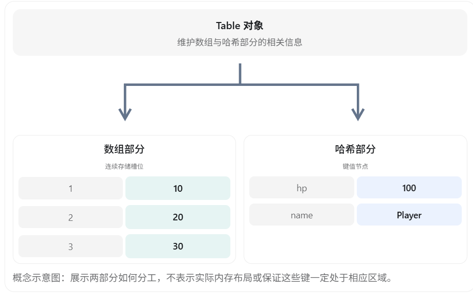
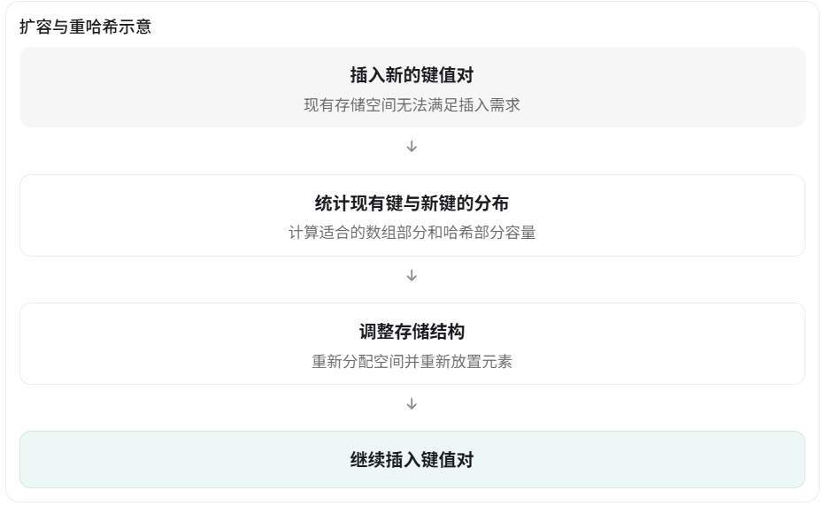

# 模块二：Lua Table 底层实现（游戏客户端面试）

Table 是 Lua 最重要的数据结构之一，也是游戏客户端开发面试的高频考点。

对于 UE5 / UnLua 开发岗位，面试官除了考察 Table 的基本使用，还可能进一步追问：

- Table 底层为什么同时使用数组和哈希表？
- Table 发生哈希冲突时怎么解决？
- Table 扩容时发生了什么？
- 为什么 Lua 不需要 class 关键字也能实现面向对象？
- `__index`、`__newindex` 如何实现继承和属性访问？
- 为什么频繁创建 Table 可能造成游戏卡顿？

下面以 Lua 5.4 标准实现为主要参考，结合 C++ 和游戏客户端开发讲解。

## 一、Table 是什么？

面试重要程度：★★★★★

### 1. 面试口头回答

Lua 的 Table 是一种通用的关联数组，可以使用不同类型的值作为键，也能存储不同类型的数据。

在标准 Lua 的底层实现中，Table 主要由两部分组成：

1. **数组部分（Array Part）**：适合存储较密集的正整数键。
2. **哈希部分（Hash Part）**：用于存储字符串键、其他类型的键，以及不适合放入数组部分的整数键。

通过这种设计，Lua 使用一种数据结构，就能实现数组、字典、集合，以及面向对象编程中的对象。

### 2. 为什么说 Table 是通用数据结构？

例如，C++ 通常使用不同的 STL 容器实现不同需求：

```c++
vector<int> arr;
unordered_map<string, int> dict;
unordered_set<int> s;
```

而 Lua 可以全部使用 Table：

```lua
-- 数组
local arr = {10, 20, 30}

-- 字典
local dict = {
    hp = 100,
    mp = 50
}

-- 集合
local set = {
    [1001] = true,
    [1002] = true
}

-- 对象
local player = {
    name = "Warrior",
    hp = 100
}
```

注意，**这些 Table 在语言层面都是同一种数据类型**，并不是 Lua 根据写法创建了四种不同的容器。

## 二、Table 的底层数据结构

面试重要程度：★★★★★

### 1. 数组部分 + 哈希部分

假设定义了下面的 Table：

```lua
local t = {
    [1] = 10,
    [2] = 20,
    [3] = 30,
    ["hp"] = 100,
    ["name"] = "Player"
}
```

可以通过下面的示意图理解它的底层结构：



Lua 官方源码 `ltable.c` 明确采用数组部分和哈希部分的混合结构。

### 2. 数组部分有什么特点？

数组部分可以理解为 C++ 中的连续存储数组。

```lua
local t = {10, 20, 30, 40}
```

当正整数键分布比较密集时，Lua 倾向于使用数组部分来存储它们。

其优点包括：

- 不需要为每一个数组下标计算哈希值。
- 通过下标可以直接定位对应槽位。
- 连续存储有利于缓存局部性。
- 对于密集整数键，通常比全部使用哈希节点更加节省空间。

需要注意，Lua 虽然通常从 1 开始使用数组，但 `t[0]`、`t[-1]` 也都是合法的 Table 键，只是它们不会被放进数组部分。

### 3. 哈希部分有什么特点？

哈希部分适合存储以下键：

```lua
local t = {}

t["name"] = "Warrior"
t["hp"] = 100
t[10000] = "Special"
t[true] = "Enabled"
```

对于某些整数键，比如 `10000`，**如果它和其他整数键的分布非常稀疏，Lua 通常会把它存储在哈希部分。**

> [!NOTE]
>
> 也就是说如果整数键和其他整数键分布的不稀疏的话，就会被分在数组部分

哈希部分主要通过计算键的哈希值找到对应位置，正常情况下查找、插入和删除具有接近 O(1) 的平均时间复杂度。

但这不代表任意一次操作都严格是 O(1)，因为还可能涉及冲突处理和扩容。

### 4. 面试追问：为什么不用一个哈希表来存储所有数据？

如果 Table 全部使用哈希表，那么：

```lua
local arr = {10, 20, 30, 40, 50}
```

即使只是存储一组连续的整数键，也需要维护哈希节点和进行哈希定位。

数组部分能够让这些操作更加直接。

反过来，如果全部使用普通数组：

```lua
local t = {}

t[1] = 10
t[1000000] = 20
```

就可能为了两个元素分配大量空槽位。

所以 Lua 采用混合结构，兼顾密集整数键的访问效率和稀疏键的存储效率。

**面试总结：数组部分优化密集整数键，哈希部分解决通用键和稀疏键的问题。**

## 三、Table 如何决定元素放在数组还是哈希部分？

面试重要程度：★★★★☆

这是非常有价值的深入追问。

### 1. 不是所有整数键都会进入数组部分

例如：

```lua
local t = {}

t[1] = 10
t[2] = 20
t[1000000] = 30
```

不能简单理解为 Lua 会分配一个长度为 1000000 的数组。

它会根据整数键的分布以及实际存储情况，决定数组部分的规模。

### 2. 数组部分容量如何决定？

Lua 5.4 的数组部分大小通常选择为 2 的幂，并依据正整数键的密度进行计算。

可以将核心规则概括为：

选择满足从 1 到 n 的区间中，超过一半位置被使用的最大合适容量 n。

例如有以下整数键：

```
1、2、3、4、5、6
```

容量为 8 时，前 8 个位置中有 6 个有效值，密度为 75%，比较适合使用数组部分。

但如果整数键是：

```
1、100、10000
```

它们之间非常稀疏，Lua 没必要为最大键分配同样大小的连续数组。

实际源码还需要考虑整数键分布、容量限制以及重哈希时机。

### 3. 一个容易误解的地方

数组部分与哈希部分并不是在每次赋值时都立即进行一次全局最优重新规划。

例如：

```lua
local t = {}

t[100] = 1
t[1] = 2
t[2] = 3
```

这些键具体存放在哪一部分，可能受到插入顺序、历史容量和重哈希时机的影响。

因此，源码层面的存储位置不应该成为 Lua 业务逻辑正确性的前提。

## 四、Table 如何解决哈希冲突？

面试重要程度：★★★★☆

### 1. 什么是哈希冲突？

哈希表需要通过哈希函数，将一个键映射到对应的存储位置。

假设哈希表有 8 个槽位，简化后的哈希函数是：

```c++
int Hash(int key) {
    return key % 8;
}
```

那么：

```
Hash(1)  = 1
Hash(9)  = 1
Hash(17) = 1
```

三个不同的键被映射到了相同位置，这就产生了哈希冲突。

### 2. 常见的解决方法

在 C++ 数据结构面试中，通常会提到两种解决方法：

- 链地址法：发生冲突时，将多个节点组织到同一个桶对应的链中。
- 开放寻址法：发生冲突时，尝试寻找其他空闲槽位。

Lua 标准实现采用的并不是简单的传统链表，也不是单纯的线性探测。

### 3. Lua 如何解决冲突？

Lua 5.4 的哈希部分使用一种结合了链式结构与 Brent 变体优化的方式。

它的核心思路是：

1. 对键计算哈希值，找到主位置。
2. 如果主位置存在冲突，就检查已有节点是否在自己的主位置。
3. 如果已有节点并不在自己的主位置，可以将它移动到其他空闲位置，让新节点占据主位置。
4. 如果已有节点就在自己的主位置，则让新节点使用其他空闲位置，并建立链接关系。

其目的之一是让每个键的主位置尽可能保持合理的查找结构，从而降低冲突对访问性能的影响。

Lua 的链接信息存储在哈希节点结构中，不需要为每个冲突额外创建一个普通链表节点。

### 4. 面试口头回答

> Lua 的 Table 在哈希部分使用了带有 Brent 变体优化的链式散列结构。发生哈希冲突时，会检查已有节点是否位于自己的主位置，并根据情况移动节点或使用空闲节点建立链接。这样可以尽可能提高主位置访问效率，减少冲突带来的额外查找开销。

面试建议： 普通 UE5 客户端岗位掌握这一层即可。除非面试官明确要求分析 Lua 源码，否则不需要背诵哈希节点的完整插入代码。

## 五、Table 的扩容机制

面试重要程度：★★★★★

### 1. 面试口头回答

Lua Table 的扩容并不只是简单地将数组容量翻倍。

由于 Table 分为数组和哈希两个部分，所以在需要重哈希时，Lua 会重新统计整数键和其他键的分布，计算数组部分与哈希部分所需的容量，然后重新组织元素。

扩容和重哈希的过程可能涉及内存分配、元素重新放置等操作，开销较高。

### 2. 举例理解

假设最开始创建了一个空 Table：

```lua
local t = {}
```

然后不断插入整数键：

```lua
for i = 1, 100 do
    t[i] = i
end
```

开始时数组部分的容量可能较小。

随着插入不断进行，Lua 可能需要调整容量，重新分配空间，并且将原来处于哈希部分的部分整数键迁移到数组部分。



这张图描述的是需要重哈希的情形，并不代表每次插入新键都会触发整个流程。

### 3. 面试追问：Table 扩容和 C++ vector 扩容有什么区别？

| 对比     | Lua Table                        | C++ vector                 |
| -------- | -------------------------------- | -------------------------- |
| 结构     | 数组 + 哈希部分                  | 连续数组                   |
| 扩容考虑 | 键分布与存储容量                 | 主要考虑元素数量与容量     |
| 元素处理 | 可能需要重新分配和重新组织键值对 | 可能需要移动或复制现有元素 |
| 容量增长 | 由内部重哈希策略决定             | 实现相关，常见为按比例增长 |
| 访问方式 | 整数下标、通用键                 | 整数下标                   |

这里有一个特别需要注意的点：

**Lua Table 的数组部分和哈希部分，并不保证每次扩容都会同时翻倍。**

## 六、Table 的键有哪些限制？

### 1. 哪些类型可以作为键？

Lua Table 的键可以是大多数 Lua 值。

```lua
local t = {}

t[1] = "number"
t["name"] = "string"
t[true] = "boolean"

local key = {}
t[key] = "table"

print(t[key])  -- table
```

但是有两个重要限制：

- `nil` 不能作为 Table 的键。
- `NaN` 不能作为 Table 的键。

此外，赋值为 nil 表示移除对应键：

```lua
local t = {
    hp = 100
}

t.hp = nil

print(t.hp)  -- nil
```

### 2. 面试追问：为什么两个内容一样的 Table 不能互相作为相同的键？

```lua
local a = {id = 1001}
local b = {id = 1001}

local t = {}

t[a] = "Player"

print(t[a])  -- Player
print(t[b])  -- nil
```

因为 `a` 和 `b` 是两个不同的 Table 对象。

Table 作为键时，使用对象身份进行区分，而不是逐字段比较。

即使内部内容完全一样，也不会被认为是同一个键。

> [!NOTE]
>
> 两个内容完全一致的table对象不会被视为是相等的，无论是作为key还是作为值，因为他们是**两个对象**
>
> ```lua
> local a = {
>     name = "a"
> }
> 
> local b = {
>     name = "a"
> }
> 
> local c = {
>     a,
>     b
> }
> 
> print(a == b)
> 
> print(c[1] == c[2])
> ```

### 3. 面试追问：1 和 1.0 是不同的键吗？

Lua 5.3/5.4 中：

```
local t = {}

t[1] = "Integer"
t[1.0] = "Float"

print(t[1])  -- Float
```

因为整数值 `1` 与浮点数 `1.0` 数值相等，作为键时会对应同一个位置。对于具有整数值的浮点键，Lua 会进行相应的规范化处理。

## 七、Table 的遍历与长度

面试重要程度：★★★★★

### 1. pairs 和 ipairs 的区别

```lua
local t = {
    [1] = 10,
    [2] = 20,
    [4] = 40,
    name = "Player"
}
```

使用 `ipairs`：

```lua
for k, v in ipairs(t) do
    print(k, v)
end
```

输出：

```
1  10
2  20
```

遇到索引 3 对应的 **nil**，就会停止。

> [!NOTE]
>
> ipairs会严格从1开始，沿着1，2，3一个个找，只要有一个是nil，就会停止，不会跳着找
>
> 所以对于下面这种没有1的情况，就会在开头就停止
>
> ```lua
> local a = {
>     [2] = 2,
>     [3] = 3
> }
> 
> for i, v in ipairs(a) do
>     print(i, v)
> end
> ```

而使用 `pairs`：

```lua
for k, v in pairs(t) do
    print(k, v)
end
```

会遍历所有存在的键值对，包括字符串键和索引 4。

但是**遍历顺序没有保证**。

| 比较     | pairs              | ipairs                |
| -------- | ------------------ | --------------------- |
| 遍历范围 | Table 的所有键值对 | 从 1 开始的连续整数键 |
| 顺序     | 不保证             | 按索引递增            |
| 遇到 nil | 不返回不存在的键   | 停止遍历              |
| 常见用途 | 字典、映射         | 连续数组              |

### 2. 为什么 #t 不一定是元素数量？

```lua
local t = {10, 20, nil, 40}
```

对于这个 Table：

```lua
print(#t)
```

**不能保证得到一个固定的元素数量。**

Lua 5.4 中，长度运算符对普通 Table 返回一个满足边界条件的整数，而不是简单地统计非 nil 元素的数量。对于具有空洞的 Table，可能存在多个合法边界。

如果要统计所有有效键值对，可以这样写：

```lua
local count = 0

for k, v in pairs(t) do
    count = count + 1
end

print(count)  -- 3
```

**面试常见误区：把 `#t` 直接理解为 C++ 容器中的 `size()`。**

两者并不总是等价。

## 八、Table 如何实现面向对象？

面试重要程度：★★★★★

这一部分会与模块三的元表知识产生联系，也是理解 UnLua 类绑定机制的重要基础。

Lua 本身不需要使用传统的 `class` 关键字，就能利用 Table、函数和元表来模拟面向对象。

### 1. 第一步：通过 Table 存储数据和函数

```lua
local Player = {
    hp = 100
}

function Player:Attack()
    print("Player Attack")
end

Player:Attack()
```

但是这样还不够。

假如希望创建多个独立的玩家对象，每个对象有自己的血量，应该怎么办？

### 2. 第二步：使用元表

```lua
local Player = {}

Player.__index = Player

function Player.new(name, hp)
    local self = {}

    setmetatable(self, Player)

    self.name = name
    self.hp = hp

    return self
end

function Player:Attack()
    print(self.name .. " Attack")
end

local p1 = Player.new("Warrior", 100)
local p2 = Player.new("Mage", 50)

p1:Attack()
p2:Attack()
```

输出：

```
Warrior Attack
Mage Attack
```

这里的关键是：

```lua
Player.__index = Player

setmetatable(self, Player)
```

### 3. 为什么访问 p1:Attack() 能找到函数？

因为 `p1` 自己并没有保存 `Attack` 函数。

调用：

```
p1:Attack()
```

本质上需要查找：

```
p1.Attack
```

查找过程如下：

p1.Attack

p1 中不存在 Attack

获取 p1 的元表 Player

查找元表的 __index

Player.__index = Player

继续访问 Player.Attack

找到 Attack 函数并调用

### 4. __index 和 __newindex 的区别

这两个元方法是非常高频的追问。

`__index`：读取不存在的键时触发。

```
local t = {}

setmetatable(t, {
    __index = function(table, key)
        print("找不到字段：" .. key)
        return 100
    end
})

print(t.hp)
```

输出：

```
找不到字段：hp
100
```

`__newindex`：向不存在的键赋值时触发。

```
local t = {}

setmetatable(t, {
    __newindex = function(table, key, value)
        print("添加字段：" .. key)
        rawset(table, key, value)
    end
})

t.hp = 100
t.hp = 50
```

输出：

```
添加字段：hp
```

为什么第二次没有触发？

因为第一次通过 `rawset` 已经把 `hp` 存储在 `t` 中。

第二次赋值时，原有字段存在，直接修改即可，不会再调用 `__newindex`。

`rawget` 和 `rawset` 可以跳过相应的元方法。


Lua


### 5. 面试追问：Lua 如何实现继承？

可以让一个子类 Table 通过元表查找父类 Table 中的方法。

```
local Character = {}

function Character:Move()
    print("Character Move")
end

local Warrior = {}

Warrior.__index = Warrior

setmetatable(Warrior, {
    __index = Character
})

function Warrior.new()
    local self = {}
    setmetatable(self, Warrior)
    return self
end

function Warrior:Attack()
    print("Warrior Attack")
end

local w = Warrior.new()

w:Move()
w:Attack()
```

执行 `w:Move()` 时的查找顺序：

```
w
 ↓ 没有 Move
Warrior
 ↓ 没有 Move
Character
 ↓ 找到 Move
```

这就实现了方法层面的继承。

不过，这只是 Lua 模拟面向对象的一种方式，并不等同于 C++ 中的真实类继承体系。

## 九、Table 在游戏客户端中的性能优化

面试重要程度：★★★★★

这是面试官从 Lua 基础延伸到实际游戏项目时，很可能考察的内容。

### 1. 减少频繁创建临时 Table

假设一个 UI 每帧都会更新：

```
function UpdateUI()
    local data = {
        hp = 100,
        mp = 50,
        level = 10
    }

    RefreshUI(data)
end
```

这里每调用一次 `UpdateUI()`，都会创建一个新的 Table。

如果每帧调用一次，在 60 FPS 的情况下，每秒就会创建约 60 个 Table。

如果还有大量角色、技能和 UI 同时执行类似逻辑，就会产生更多临时对象，增加垃圾回收压力。

可以考虑复用 Table：

```
local data = {
    hp = 0,
    mp = 0,
    level = 0
}

function UpdateUI(hp, mp, level)
    data.hp = hp
    data.mp = mp
    data.level = level

    RefreshUI(data)
end
```

这样可以减少不必要的 Table 分配。

注意：复用 Table 时必须确认调用方不会长期持有它，或者不会依赖它保持历史快照，否则后续修改可能引起逻辑错误。

### 2. 尽量使用密集的整数索引

对于数组型数据：

```
local t = {10, 20, 30, 40}
```

通常比使用大量稀疏整数键更容易利用 Lua 的数组部分。

但这并不意味着应该把所有字典改造成数组。具体选择仍应由业务模型、可读性和实际性能测试决定。

### 3. 减少不必要的动态扩容

如果知道需要创建很多元素，应该考虑是否存在预分配手段。

但要注意：

标准 Lua 5.4 并没有像 C++ `vector::reserve()` 那样面向普通 Lua 代码的通用 Table 预留容量接口。

部分 Lua 实现或宿主框架可能提供扩展 API；如果使用 C API，也可以通过 `lua_createtable` 提供数组与哈希部分的初始容量提示。

### 4. 避免在高频 Tick 中进行不必要的遍历

例如：

```
function Update()
    for k, v in pairs(AllPlayers) do
        -- 每帧遍历所有玩家
    end
end
```

如果只有少数玩家的数据发生变化，那么完全遍历所有玩家可能并不划算。

对于事件驱动型 UI，可以尽量改为：

数据发生变化 → 发送事件/通知 → 更新对应 UI

这与 UE5 中使用数据变化通知、Signal 或 ViewModel 驱动 UI 的思路是一致的。

## 十、Table 与 C++ 容器的对比

| 特性               | Lua Table             | std::vector   | std::unordered_map |
| ------------------ | --------------------- | ------------- | ------------------ |
| 存储结构           | 数组 + 哈希           | 连续数组      | 哈希表             |
| 整数下标访问       | 通常 O(1)             | O(1)          | 平均 O(1)          |
| 通用键查找         | 平均 O(1)             | 不支持        | 平均 O(1)          |
| 插入新键           | 平均 O(1)，可能重哈希 | 尾部均摊 O(1) | 平均 O(1)          |
| 是否允许不同值类型 | 允许                  | 通常不允许    | 通常不允许         |
| 是否自动管理内存   | GC                    | RAII          | RAII               |

这里的 O(1) 是常见实现下的平均或均摊复杂度，不代表每一次操作都严格是常数时间。

另外，C++ 容器也可以通过 `variant`、多态等方式存储不同形式的数据，只是需要更明确的类型设计。

## 十一、Lua Table 高频面试模拟

这 5 道题适合检查自己是不是真的理解了 Table，而不只是记住了「数组 + 哈希」这句话。

1. 为什么 Lua Table 要同时设计数组部分和哈希部分？

答案

2. Table 的哈希部分如何处理哈希冲突？

答案

3. Table 删除一个元素之后，会立刻缩容吗？

答案

4. 为什么 __newindex 不能保证监听到一个字段的所有修改？

答案

5. 为什么 Lua 中创建大量临时 Table 可能造成卡顿？

答案

## 十二、完整面试口头回答（约 1 分钟）

如果面试官直接问：

“讲一下 Lua Table 的底层实现。”

可以这样回答：

> Lua 的 Table 是一个通用的关联数组，底层采用数组部分和哈希部分结合的方式实现。
>
> 数组部分主要用于存储密集的正整数键，具有较好的连续访问性能；哈希部分则负责存储字符串键、其他类型的键和比较稀疏的整数键。
>
> 对于哈希冲突，Lua 使用带有 Brent 变体优化的链式散列方式，尽量减少冲突对查找性能的影响。
>
> 当 Table 需要扩容和重哈希时，会重新统计键的分布，调整数组和哈希部分的容量，并重新组织元素。
>
> 此外，Lua 的 Table 还能配合元表和 `__index` 实现面向对象中的方法查找与继承。
>
> 在实际游戏客户端开发中，需要特别注意避免在每帧更新逻辑中频繁创建临时 Table，否则可能增加 GC 压力，影响帧率稳定性。

这段回答覆盖了 底层结构、哈希冲突、扩容、面向对象和游戏性能优化，适合作为面试时的主线。

如果面试官继续深入，再分别展开即可。

下一模块是 模块三：Lua 元表与元方法，会进一步解释 `__index`、`__newindex`、`__call`、`__eq`、运算符重载，以及它们如何与 UnLua 的对象绑定和方法调用联系起来。