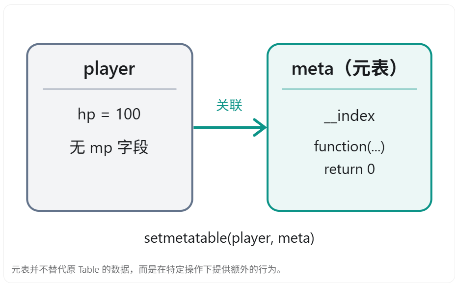
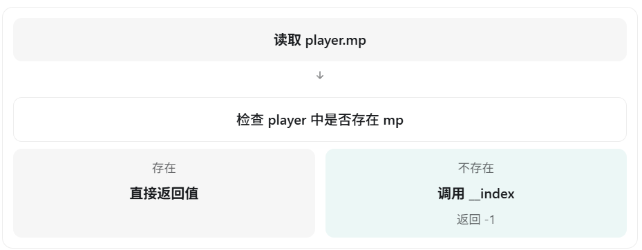

# 模块三：Lua 元表与元方法（游戏客户端面试）

核心高频模块

元表（Metatable）是 Lua 实现面向对象、运算符重载以及自定义对象行为的重要机制。

对于 UE5 游戏客户端开发岗位，面试官尤其喜欢围绕 `__index` 和 `__newindex` 追问，因为它们与 Lua 的类、继承、属性访问，以及 Lua 与 C++ 的绑定机制密切相关。

本模块重点讲解：

1. 什么是元表？什么是元方法？
2. `__index` 的执行机制。
3. `__newindex` 的执行机制。
4. `rawget`、`rawset` 有什么作用？
5. Lua 如何利用元表实现类、对象和继承？
6. `__call` 如何让 Table 像函数一样调用？
7. Lua 如何实现运算符重载？
8. `__gc`、`__mode` 与垃圾回收有什么关系？
9. 元表与 C++ 虚函数、UE5 反射、UnLua 有什么关系？
10. 游戏客户端面试中的常见陷阱。

以下主要基于 Lua 5.4 说明，对于 Lua 5.1 / LuaJIT 存在的差异会单独指出。

## 一、什么是元表？什么是元方法？

面试重要程度：★★★★★

### 1. 面试口头回答

Lua 中的元表本质上也是一个普通的 Table，只不过我们可以通过 `setmetatable`，将它关联到另一个 Table 上，用来改变这个 Table 在特定操作下的默认行为。

元表中具有特殊名称的字段，例如 `__index`、`__newindex`、`__add`、`__call`，可以定义对应的行为，它们被称为元方法。

利用元表，可以实现属性访问控制、运算符重载、面向对象和继承等功能。

**元表本质上是一套通过特定操作触发的行为扩展机制。**

### 2. 为什么需要元表？

首先看一个普通 Table：

```lua
local player = {
    hp = 100
}

print(player.hp)     -- 100
print(player.mp)     -- nil
```

访问不存在的 `mp` 字段时，Lua 默认返回 nil。

但如果希望访问不存在的字段时自动返回一个默认值呢？

就可以使用元表：

```lua
local player = {
    hp = 100
}

local meta = {}

meta.__index = function(t, key)   --t是player，key是mp
    print("访问不存在的字段：" .. key)
    print(t.hp)     
    return 0
end

setmetatable(player, meta)

print(player.hp)  -- 100
print(player.mp)  -- 0
```

输出：

```
100
访问不存在的字段：mp
100
0
```

这里发生了什么？

- `player.hp`：字段存在，直接返回 100。
- `player.mp`：字段不存在，触发元表中的 `__index`。
- `__index` 返回 0，最终访问结果就是 0。

### 3. 元表与普通 Table 的关系



可以把元表理解为 **Table 的行为规则表。**

### 4. setmetatable 和 getmetatable

Lua 提供两个常用函数：

```lua
setmetatable(table, meta)
getmetatable(table)
```

前者设置元表，后者获取元表。

例如：

```lua
local t = {}
local meta = {}

setmetatable(t, meta)

print(getmetatable(t) == meta)  -- true
```

需要注意：

- 一个 Table 在同一时刻只能直接关联一个元表。
- 多个 Table 可以共享同一个元表。
- 元表本身仍然是普通 Table，也可以有自己的元表。
- 对 Table 之外的值，不能直接使用普通 `setmetatable` 来修改元表。

这些规则来自 Lua 官方手册的元表定义。

## 二、`__index` 的执行机制

面试重要程度：★★★★★

这是整个模块最重要的知识点。

### 1. 面试口头回答

==`__index` 用于控制 Table 的读取行为。==

当访问 Table 中不存在的键时，Lua 会检查它的元表是否定义了 `__index`。

如果 `__index` 是函数，就会调用该函数，并将原 Table 和访问的键作为参数传入。

如果 `__index` 是 Table，则会继续从这个 Table 中查找对应的键。

这也是 Lua 能够实现默认属性、方法共享以及面向对象继承的重要原因。

### 2. 情况一：`__index` 是函数

> [!NOTE]
>
> 也可以先把函数构造好，然后在setmetatable里面隐式构造一个表
>
> ```lua
> local a = {
>     hp = 100
> }
> 
> function show(t, k)
>     print(t, k)
> end
> 
> setmetatable(a, {
>     __index = show
> })
> 
> print(a.mp)
> ```

```lua
local player = {
    hp = 100
}

local meta = {
    __index = function(t, key)
        print("查找字段：" .. key)
        return -1
    end
}

setmetatable(player, meta)

print(player.hp)
print(player.mp)
```

输出：

```
100
查找字段：mp
-1
```

> [!NOTE]
>
> 为啥会输出-1？
>
> ​	因为player.mp调用元表中的元方法，而元方法返回了-1，就相当于player.mp就是-1

执行过程：



这里有一个关键细节：

**即便定义了 `__index`，它也不会拦截普通 Table 中已经存在的非 nil 字段。**

例如：

```lua
print(player.hp)
```

由于 `hp` 已经存在，Lua 就直接返回它的值，不需要调用 `__index`。

### 3. 情况二：`__index` 是 Table

> [!NOTE]
>
> 其实应该是下面这个样子，c是a的元表，但是c的__index是一个表
>
> ```lua
> local a = {
>  hp = 100
> }
> 
> local c = {
>  __index = {
>      mp = 200
>  }
> }
> 
> setmetatable(a, c)
> 
> print(a.mp)
> ```
>

这里相当于先把index要等于的表写好了，然后直接搞一个隐式的表{index = default}


```lua
local defaults = {
    hp = 100,
    mp = 50
}

local player = {
    name = "Warrior"
}

setmetatable(player, {
    __index = defaults
})

print(player.name)  -- Warrior
print(player.hp)    -- 100
print(player.mp)    -- 50
```

这里的 `__index` 不是函数，而是另一个 Table。

当 Lua 访问 `player.hp` 时：

1. 先检查 `player` 自己有没有 `hp`。
2. 发现没有。
3. 检查元表的 `__index`，发现是 `defaults`。
4. 继续访问 `defaults.hp`。
5. 返回 100。

如果 `defaults` 自己也有元表，还可能继续查找。

这就是 Lua 实现原型式方法查找的重要基础。

### 4. 面试追问：`__index` 能不能形成多级查找？

可以。

```lua
local A = {
    a = 10
}

local B = {
    b = 20
}

local C = {
    c = 30
}

setmetatable(B, {
    __index = A
})

setmetatable(C, {
    __index = B
})

print(C.a)  -- 10
print(C.b)  -- 20
print(C.c)  -- 30
```

访问 `C.a` 时，查找路径是：

```
C → B → A
```

这意味着即使 Lua 没有 C++ 那样的原生类继承语法，也能通过元表构建类似的继承查找关系。

注意：如果元表之间形成不合理的循环查找关系，也可能出现递归错误。

## 三、`__newindex` 的执行机制

面试重要程度：★★★★★

### 1. 面试口头回答

==`__newindex` 用于控制 Table 的赋值行为。==

当我们给 Table 中一个不存在的键赋值时，Lua 会检查元表中的 `__newindex`。

如果它是函数，就会调用这个函数，并传入 Table、键和值。

如果它是另一个 Table，就会尝试把赋值操作转发给那个 Table。

需要注意的是，**触发 `__newindex` 后，Lua 不会自动将值写入原 Table，必须由元方法决定如何处理。**

### 2. 示例：拦截属性赋值

```lua
local player = {}

local meta = {}

meta.__newindex = function(t, key, value)
    print("赋值操作：", key, value)
end

setmetatable(player, meta)

player.hp = 100

print(player.hp)  -- nil
```

输出：

```
赋值操作： hp 100
nil
```

为什么还是 nil？

因为元方法只是打印了信息，并没有真正把 `hp` 写入 `player`。

正确的写法：

```lua
local player = {}

local meta = {}

meta.__newindex = function(t, key, value)
    print("赋值操作：", key, value)
    rawset(t, key, value)
end

setmetatable(player, meta)

player.hp = 100

print(player.hp)  -- 100
```

这里 `rawset` 的作用是绕过 `__newindex`，直接向 Table 写入字段。

### 3. 面试高频陷阱：为什么第二次赋值不触发？

```lua
local player = {}

setmetatable(player, {
    __newindex = function(t, key, value)
        print("修改：", key, value)
        rawset(t, key, value)
    end
})

player.hp = 100
player.hp = 50
```

只输出：

```
修改： hp 100
```

原因是：

第一次赋值时，`hp` 不存在，因此触发 `__newindex`。

第二次赋值时，`hp` 已经存在，Lua 直接修改它的值，不再触发 `__newindex`。

所以你不能简单地认为：

> 只要给 Table 设置了 `__newindex`，就能监听所有属性修改。

这是错误的。

### 4. `__newindex` 是 Table 的情况

```lua
local data = {}
local proxy = {}

setmetatable(proxy, {
    __newindex = data
})

proxy.hp = 100

print(proxy.hp)  -- nil
print(data.hp)   -- 100
```

因为赋值被转发给了 `data`，原始的 `proxy` 并没有保存 `hp`。

## 四、rawget 和 rawset 的作用

面试重要程度：★★★★☆

### 1. 面试口头回答

`rawget` 和 `rawset` 是 Lua 提供的原始访问函数，能够绕过 `__index` 和 `__newindex` 这两个元方法。

其中：

- `rawget(t, key)`：不经过 `__index`，直接读取 Table 自己的字段。
- `rawset(t, key, value)`：不经过 `__newindex`，直接修改 Table 自己的字段。

它们常用于实现自定义属性访问、代理对象，以及避免元方法递归调用。

### 2. rawget 示例

```lua
local t = {}

setmetatable(t, {
    __index = function()
        return 100
    end
})

print(t.hp)             -- 100
print(rawget(t, "hp"))  -- nil
```

`t.hp` 会触发元方法。

`rawget(t, "hp")` 则只检查 `t` 自己，返回 nil。

### 3. 为什么 __newindex 内部经常用 rawset？

错误写法：

```lua
local t = {}

setmetatable(t, {
    __newindex = function(obj, key, value)
        obj[key] = value
    end
})

t.hp = 100
```

当执行 `t.hp = 100`：

1. 发现 `hp` 不存在。
2. 进入 `__newindex`。
3. 执行 `obj[key] = value`。
4. 发现 `hp` 仍然不存在。
5. 再次进入 `__newindex`。

形成递归，最终报错。

> [!NOTE]
>
> 这里会形成递归是因为obj[key] = value就是t.hp = 100，相当于在t并没有hp的时候再次给hp赋值

正确写法：

```lua
__newindex = function(obj, key, value)
    rawset(obj, key, value)
end
```

同样地，在 `__index` 中错误地使用 `return t[key]`，也可能因为反复访问不存在的键而递归。

**记忆方式：`__index` 处理读，`__newindex` 处理写，rawget/rawset 绕过这两个钩子。** 

## 五、Lua 如何利用元表实现面向对象？

面试重要程度：★★★★★

这部分是 `__index` 最重要的实际应用之一。

### 1. Lua 为什么没有 class 也能创建对象？

在 C++ 中，我们可以定义类：

```lua
class Player {
public:
    int HP;

    void Attack() {
        // 攻击逻辑
    }
};
```

类描述了对象的成员变量和成员函数。

而 Lua 中的函数本身就可以存储在 Table 中，所以我们可以利用 Table 来模拟类。

```lua
local Player = {}

function Player:Attack()
    print("Attack")
end
```

但我们希望不同的玩家对象拥有独立的 HP，同时共享同一份 `Attack` 函数，而不是每个对象都创建一个新函数。

这时就需要 `__index`。

### 2. 使用元表实现类和对象

==这个例子非常典型==

```lua
local Player = {}

Player.__index = Player  --这句代码不能直接在Player声明的时候写在表里面

function Player.new(name, hp)    --这句也不能，我感觉应该是因为他们用到了Player本身，如果写在声明的表里面，此时Player还未真正存在
    
    --新建一个表，初始化一下属性
    local newplayer = {
        name = name,
        hp = hp
    }

    --把这个新表和Player绑起来，这样他就可以访问Player里面的公用属性（这里Player的公用属性只有Attack函数）
    setmetatable(newplayer, Player)

    return newplayer
end

function Player:Attack()
    print(self.name .. " Attack")
end

--p1和p2都包含name和hp两个key，但是不包含Attack函数
local p1 = Player.new("Warrior", 100)
local p2 = Player.new("Mage", 50)

--由于p1和p2并不包含Attack函数，所以他们会用__index找到Player，试图取读Player里面的Attack函数
p1:Attack()
p2:Attack()
```

输出：

```
Warrior Attack
Mage Attack
```

需要理解三个关键点：

**第一：`Player` 相当于类的描述。**

```lua
local Player = {}
```

其中保存公共的方法。

**第二：每个实例是独立的 Table。**

```lua
local self = {
    name = name,
    hp = hp
}
```

因此 `p1.hp` 和 `p2.hp` 可以拥有不同的值。

**第三：通过元表共享方法。**

```lua
Player.__index = Player
setmetatable(self, Player)
```

当执行 `p1:Attack()` 时，先找 `p1.Attack`。如果不存在，就通过元表的 `__index` 找到 `Player.Attack`。

这样两个玩家实例可以共享同一份函数实现。

> [!NOTE]
>
> 这里的操作其实是类似于封装
>
> p1和p2是Player类的两个实例，他们独立拥有自己的成员变量，由类保管仅一份的成员函数（C++里也是这样，每个对象拥有自己的成员变量，然后共用一份成员函数）

### 3. 为什么一定要写 Player.__index = Player？

因为：

```lua
setmetatable(self, Player)
```

只是设置元表，并不意味着访问不存在的字段时，会自动从 `Player` 中查找。

只有设置：

```lua
Player.__index = Player
```

才能让 Lua 在查找缺失字段时，继续查找 `Player`。

这是面试中很容易被追问的地方。

### 4. Lua 如何实现继承？

```lua
local Character = {}
Character.__index = Character

function Character:Move()
    print(self.name .. " Move")
end

-- 子类
local Warrior = {}
Warrior.__index = Warrior

-- 子类查找不到时，继续查父类
setmetatable(Warrior, {
    __index = Character
})

function Warrior.new(name)
    local self = {
        name = name
    }

    setmetatable(self, Warrior)

    return self
end

function Warrior:Attack()
    print(self.name .. " Attack")
end

local w = Warrior.new("Arthur")

w:Move()
w:Attack()
```

输出：

```
Arthur Move
Arthur Attack
```

方法查找路径如下：

w:Move()

在实例 w 中查找 Move

Warrior

w 的元表，Warrior.__index = Warrior

Character

找到 Move 函数，调用时 self 仍然是 w

这里要特别理解：

```
setmetatable(w, Warrior)
```

和：

```
setmetatable(Warrior, {
    __index = Character
})
```

这两次 `setmetatable` 的作用完全不同。

第一次让实例能够查找 `Warrior` 的方法。

第二次让 `Warrior` 能够继续查找 `Character` 的方法。

### 5. 面试追问：如何实现方法重写？

只需要在子类 Table 中定义同名方法：

```
function Character:Attack()
    print("Character Attack")
end

function Warrior:Attack()
    print("Warrior Attack")
end
```

当调用：

```
w:Attack()
```

会优先找到 `Warrior.Attack`，因此执行子类实现。

这可以模拟 C++ 中的方法重写行为，但它并不是 C++ 虚函数表机制。

Lua 是通过 Table 的动态字段查找实现的，C++ 则通常利用虚函数表进行虚调用。

## 六、`__call`：让 Table 像函数一样调用

面试重要程度：★★★★☆

### 1. 面试口头回答

正常情况下，Lua 的 Table 不能直接像函数一样调用。

但是如果为 Table 的元表定义 `__call` 元方法，那么当我们尝试调用这个 Table 时，Lua 就会执行对应的元方法。

它经常用于实现类似构造函数的调用形式，或者创建可调用对象。

### 2. 基础代码

```
local t = {}

setmetatable(t, {
    __call = function(self, a, b)
        return a + b
    end
})

print(t(10, 20))  -- 30
```

这里：

```
t(10, 20)
```

实际上触发了 `t` 的 `__call` 元方法。

`__call` 的第一个参数是被调用的对象本身，后续参数是原调用传入的参数。

### 3. 利用 __call 模拟构造函数

正常创建 Lua 对象可能需要：

```
local p = Player.new("Warrior", 100)
```

我们可以通过 `__call` 将其改造成：

```
local p = Player("Warrior", 100)
```

完整示例：

```
local Player = {}
Player.__index = Player

function Player.new(name, hp)
    local self = {
        name = name,
        hp = hp
    }

    return setmetatable(self, Player)
end

setmetatable(Player, {
    __call = function(cls, name, hp)
        return cls.new(name, hp)
    end
})

local p = Player("Warrior", 100)

print(p.name)  -- Warrior
print(p.hp)    -- 100
```

通过 `__call`，可以让 Lua 类的创建形式更加接近 C++ 的构造函数调用。

## 七、Lua 如何实现运算符重载？

面试重要程度：★★★★☆

Lua 与 C++ 一样，都可以自定义某些运算符的行为。

但是 C++ 通常通过 `operator+` 这样的函数进行运算符重载，而 Lua 通过元方法实现。

### 1. 常见运算符元方法

| 元方法       | 对应操作     | 作用             |
| ------------ | ------------ | ---------------- |
| `__add`      | `+`          | 加法             |
| `__sub`      | `-`          | 减法             |
| `__mul`      | `*`          | 乘法             |
| `__div`      | `/`          | 除法             |
| `__mod`      | `%`          | 取模             |
| `__unm`      | 一元 `-`     | 取负             |
| `__eq`       | `==`         | 相等比较         |
| `__lt`       | `<`          | 小于比较         |
| `__le`       | `<=`         | 小于等于比较     |
| `__concat`   | `..`         | 拼接             |
| `__len`      | `#`          | 长度操作         |
| `__tostring` | `tostring()` | 自定义字符串表示 |

Lua 5.3/5.4 还支持针对按位操作、整除等运算符的元方法。

### 2. 游戏场景：实现二维向量加法

在 UE5 中，你应该比较熟悉 `FVector` 的加法运算。

例如：

```
FVector A(1, 2, 3);
FVector B(4, 5, 6);

FVector C = A + B;
```

我们也可以使用 Lua 元表模拟类似行为：

```
local Vector2 = {}
Vector2.__index = Vector2

function Vector2.new(x, y)
    return setmetatable({
        x = x,
        y = y
    }, Vector2)
end

function Vector2.__add(a, b)
    return Vector2.new(
        a.x + b.x,
        a.y + b.y
    )
end

local a = Vector2.new(1, 2)
local b = Vector2.new(3, 4)

local c = a + b

print(c.x, c.y)  -- 4 6
```

这里执行：

```
local c = a + b
```

Lua 发现两个操作数不能使用普通数字加法，于是查找对应的 `__add` 元方法。

最终执行：

```
Vector2.__add(a, b)
```

这种方式可用于实现向量、矩阵、颜色等自定义数据类型。

注意，在 UnLua 中使用 `UE.FVector` 时，实际运算符支持取决于 UnLua 的类型导出与绑定实现，并不意味着 Lua 会自动继承 C++ 中所有的 `operator` 重载。

### 3. 面试陷阱：__eq 能否改变 Table 的相等判断？

默认情况下：

```
local a = {x = 1}
local b = {x = 1}

print(a == b)  -- false
```

因为它们是两个不同的 Table。

我们可以通过 `__eq` 自定义比较规则：

```
local meta = {}

meta.__eq = function(a, b)
    return a.x == b.x
end

local a = setmetatable({x = 1}, meta)
local b = setmetatable({x = 1}, meta)

print(a == b)  -- true
```

但是这里存在一个重要区别：

`__eq` 改变的是 `==` 运算符的比较行为，并不会改变 Table 作为哈希键时使用的原始相等规则。

例如：

```
local t = {}
t[a] = "data"

print(t[b])  -- nil
```

即使 `a == b` 返回 true，它们作为 Table 键时仍然是两个不同对象。

这是因为 Lua 的 Table 查找使用原始相等关系，而不是 `__eq`。


Lua


## 八、其他常用元方法

### 1. __tostring：自定义对象的打印信息

```
local Player = {}
Player.__index = Player

Player.__tostring = function(self)
    return "Player: " .. self.name
end

local p = setmetatable({
    name = "Warrior"
}, Player)

print(p)
```

输出：

```
Player: Warrior
```

它适合用于调试日志，让打印出来的对象信息更加直观。

### 2. __len：自定义长度运算

在 Lua 5.4 中：

```
local t = {10, 20, 30}

setmetatable(t, {
    __len = function(self)
        return 100
    end
})

print(#t)      -- 100
print(rawlen(t)) -- 3
```

这里 `#t` 会调用元方法，而 `rawlen` 获取原始长度。

注意：Lua 5.1 不支持用 `__len` 覆盖普通 Table 的长度行为，这是不同版本的重要差异。

### 3. __metatable：保护元表

```
local t = {}

local meta = {
    __metatable = "Protected"
}

setmetatable(t, meta)

print(getmetatable(t))  -- Protected
```

如果继续执行：

```
setmetatable(t, {})
```

会抛出错误。

这是因为原元表中的 `__metatable` 字段限制了普通 `getmetatable` 和 `setmetatable` 对元表的访问。

但是，这不应该被理解成绝对的安全边界，拥有完整 debug 库权限的代码仍可能绕过这种保护。

### 4. __pairs：自定义遍历

在 Lua 5.4 中，`pairs()` 可以通过 `__pairs` 元方法自定义遍历行为。

这在代理 Table 中比较有用，因为代理自身可能没有真实数据。

需要注意 Lua 5.1 的标准 `pairs` 不支持 `__pairs`，不要假设这个特性在所有 Lua 版本中都存在。

## 九、`__gc` 与 `__mode`：元表和垃圾回收

面试重要程度：★★★★☆

这两个元方法在 Lua 内存管理中比较重要，尤其容易与 C++ 对象生命周期结合考察。

### 1. `__gc`：对象回收时的清理逻辑

在 Lua 5.4 中，可以为 Table 设置 `__gc`：

```
local meta = {}

meta.__gc = function(obj)
    print("对象正在被回收")
end

local t = setmetatable({}, meta)

t = nil

collectgarbage("collect")
```

在这个示例中，如果对象已经不可达，完整 GC 可以执行其终结方法。

不过需要注意：

- `t = nil` 不代表对象立即被销毁。
- `__gc` 的执行时机由垃圾回收机制决定。
- 不能把 `__gc` 当成与 C++ 析构函数完全等价的机制。
- Lua 5.1 中，标准 `__gc` 主要用于 full userdata，而不是普通 Table。

### 2. `__mode`：实现弱引用 Table

Lua 默认会把 Table 中对可回收对象的引用视为强引用。

假设：

```
local cache = {}

local player = {
    name = "Warrior"
}

cache[1] = player

player = nil
```

虽然 `player` 被赋值为 nil，但 `cache[1]` 仍然引用该对象，所以这个 Table 对象不会仅仅因为 `player = nil` 就被回收。

可以使用弱引用 Table：

```
local cache = setmetatable({}, {
    __mode = "v"
})
```

其中：

| __mode | 含义             |
| ------ | ---------------- |
| `"k"`  | 键为弱引用       |
| `"v"`  | 值为弱引用       |
| `"kv"` | 键和值都是弱引用 |

弱引用不会单独阻止对应的可回收对象被 GC 回收。对象被回收后，相关的弱表条目也会被清理。


Lua


### 3. 和 UE5 / UnLua 有什么关系？

游戏客户端中，可能需要维护 Lua 对象和 UE5 对象之间的映射或者缓存。

如果缓存长期持有某些 Lua 对象，就可能增加内存占用。

弱表有助于实现某些缓存，但需要区分两个概念：

Lua GC 和 UE5 UObject GC 不是同一套垃圾回收机制。

不能认为只要 Lua 中的 UObject 绑定对象被回收，就一定会销毁对应的 C++ UObject。也不能认为 Lua 弱引用能够自动处理所有 UE5 对象生命周期问题。

具体还要取决于 UnLua 如何管理对象引用和生命周期。

另外，Lua 5.4 还有 `__close` 元方法，用于支持 to-be-closed 变量在退出作用域时执行清理逻辑。它与 `__gc` 的触发条件不同，Lua 5.1 中也没有对应的标准语言机制。

## 十、实战：如何监听一个 Table 中所有字段的修改？

面试重要程度：★★★★★

这是我认为最值得准备的一道实际开发情景题。

### 面试题

假设游戏中有一个玩家对象：

```
local player = {
    hp = 100,
    mp = 50
}
```

现在希望：

无论什么时候修改 `player.hp`，都能够执行回调，通知 UI 更新。

应该怎么实现？

### 1. 错误方案

直接给 `player` 设置 `__newindex`：

```
setmetatable(player, {
    __newindex = function(t, k, v)
        print("属性修改", k, v)
        rawset(t, k, v)
    end
})

player.hp = 80
```

不会触发 `__newindex`，因为 `hp` 字段已经存在。

### 2. 正确方案：代理 Table

我们可以把真实数据放在另一个 Table 中，让外部只访问代理对象。

```
local data = {
    hp = 100,
    mp = 50
}

local player = {}

setmetatable(player, {

    __index = function(t, key)
        return data[key]
    end,

    __newindex = function(t, key, value)
        local oldValue = data[key]

        if oldValue ~= value then
            data[key] = value

            print(
                key,
                "发生变化:",
                oldValue,
                "->",
                value
            )
        end
    end
})

player.hp = 80
player.hp = 60
player.mp = 30
```

输出：

```
hp 发生变化: 100 -> 80
hp 发生变化: 80 -> 60
mp 发生变化: 50 -> 30
```

### 3. 为什么这次能成功？

因为 `player` 本身始终是空 Table。

- 读取 `player.hp` 时，因为不存在字段，触发 `__index`，转发到 `data.hp`。
- 修改 `player.hp` 时，因为不存在字段，触发 `__newindex`，由它更新 `data.hp`。

外部代码：player.hp = 80

代理 Table：player

自身不存在 hp 字段

__newindex

比较新旧数据，触发变化通知

真实数据：data.hp = 80

需要注意，这个方案要求外部通过 `player` 代理访问，而不是直接修改 `data`。同时，对代理执行普通 `pairs(player)` 时不一定能够遍历到内部数据，可以根据 Lua 版本实现 `__pairs`。

### 4. 联系 UE5 的 MVVM / UI 更新

这套逻辑和游戏客户端常见的数据驱动 UI 思想比较相似：

```
业务代码修改属性
       ↓
检查属性是否变化
       ↓
发送变化通知
       ↓
更新 ViewModel
       ↓
刷新 UI
```

这里用 `__newindex` 是在 Lua 层实现属性代理的一种方法。

但在真正的 UE5 项目中，并不一定要使用 Lua 元表监听所有字段。对于已经采用 MVVM、事件系统或 UnLua 绑定的项目，通常还需要综合考虑已有的数据变化通知机制。

## 十一、元表与 UnLua、UE5 反射系统的关系

面试重要程度：★★★★★

这一部分很适合用来应对面试官从 Lua 原理延伸到 UE5 项目经验的追问。

### 1. 元表与 UE5 的 UCLASS 反射有什么区别？

| 对比     | Lua 元表                  | UE5 反射系统                      |
| -------- | ------------------------- | --------------------------------- |
| 核心作用 | 定义 Lua 值的特殊操作行为 | 提供 C++ 类型和成员的运行时元信息 |
| 属性访问 | `__index` / `__newindex`  | FProperty 等反射信息              |
| 方法访问 | Table 查找及相关元方法    | UFunction 等反射信息              |
| 继承机制 | 可以构建元表查找链        | UClass 继承体系                   |
| 所在环境 | Lua 运行时                | Unreal Engine C++ 运行时          |

不能把二者直接等同起来。

### 2. UnLua 如何将两者联系起来？

UnLua 提供了 Lua 和 UE5 之间的绑定层。

例如：

```
local M = UnLua.Class()

function M:ReceiveBeginPlay()
    local pos = self:K2_GetActorLocation()
    print(pos.X, pos.Y, pos.Z)
end

return M
```

这里的 `self` 对应与 Lua 脚本绑定的 UE 对象。

当 Lua 访问 UE 对象的方法或者属性时，绑定层可以借助 Lua 的元方法机制，以及 UE 的反射信息，找到对应的引擎成员并完成参数转换和调用。

UnLua 官方文档也明确提供了利用 UE5 反射系统动态导出 UCLASS、UFUNCTION 等成员的能力。


GitHub


可以将它概括为：

Lua：self:K2_GetActorLocation()

UnLua 绑定层

Lua 元方法、类型绑定、参数转换等

UE5 反射与导出机制

识别 UClass、UFunction 等信息

执行底层 C++ 函数并返回结果

这是概念上的调用流程，不代表每次 UE5 方法调用都要完整执行一次动态反射查找。UnLua 还会使用缓存、预先建立的绑定等方式提高访问效率。

### 3. UnLua 中有没有真实使用 __index？

有。

例如，UnLua 的 `UE` 全局命名空间就使用了 `__index` 机制来支持引擎类型的懒加载。

当 Lua 首次访问类似：

```
local v = UE.FVector(1, 2, 3)
```

这样的导出类型时，相关绑定机制可以按需查找或建立类型信息，而不是要求一开始就把所有 UE 类型完整加载到 Lua 环境中。


GitHub

+1


### 4. 面试追问：UnLua.Class() 是否等于普通 Lua 的 setmetatable？

不能这么理解。

我们自己实现的：

```
local Player = {}
Player.__index = Player
```

只是一个 Lua 层的类模拟方案。

而：

```
local M = UnLua.Class()
```

是 UnLua 提供的接口，除了 Lua 的方法组织之外，还需要配合 UE5 类型绑定、对象映射和生命周期管理等机制。

因此它不是简单地对某个 Table 调用一次 `setmetatable`。

## 十二、Lua 版本差异：面试需要注意哪些元方法？

由于游戏客户端项目可能使用不同版本的 Lua，下面这些差异值得了解。

| 特性                     | Lua 5.1 | Lua 5.4 |
| ------------------------ | ------- | ------- |
| `__index` / `__newindex` | 支持    | 支持    |
| `__call`                 | 支持    | 支持    |
| `__add` / `__eq`         | 支持    | 支持    |
| Table 的 `__len`         | 不支持  | 支持    |
| `__pairs`                | 不支持  | 支持    |
| Table 的 `__gc`          | 不支持  | 支持    |
| `__mode`                 | 支持    | 支持    |
| `__close`                | 不支持  | 支持    |

LuaJIT 主要基于 Lua 5.1 语义，但可能提供特定扩展，不能简单当作 Lua 5.4。

另外，Lua 5.1 对 `__eq` 有更严格的条件：两个不同对象要通过 `__eq` 进行比较，需要共享同一个相等比较元方法；不同版本的具体查找规则要分别判断。


Lua

+1


## 十三、面试知识检测

1. 为什么设置了 __index，访问已经存在的 hp 字段时没有执行它？

答案

2. 如果 __index 是 Table，而不是函数，会发生什么？

答案

3. 如何使用元表让 Lua Table 支持 a + b？

答案

4. 为什么 __newindex 不适合直接监听普通 Table 已有字段的变化？

答案

5. Lua 的元表继承与 C++ 的虚函数继承有什么不同？

答案

6. UnLua 中访问 C++ 函数，是否一定会直接调用 __index？

答案

## 十四、完整面试口头回答（约 1 分钟）

当面试官问：

“讲一下 Lua 的元表和元方法。”

可以这样回答：

> Lua 的元表本质上也是一个 Table，可以通过 `setmetatable` 将它与另一个 Table 关联，用于改变这个 Table 在特定操作下的默认行为。
>
> 常见的元方法有 `__index`、`__newindex`、`__call`、`__add` 等。
>
> 其中 `__index` 和 `__newindex` 比较重要。`__index` 用于访问不存在的字段时进行后备查找，而 `__newindex` 用于向不存在的字段赋值时进行自定义处理。
>
> Lua 可以利用 `__index` 实现面向对象。例如将类 Table 设置为实例的元表，再让类的 `__index` 指向自身，这样实例就可以共享类中的成员函数。通过继续设置类的元表，还可以实现类似继承的功能。
>
> 此外，`__call` 可以让 Table 像函数一样被调用，`__add` 可以实现运算符重载。
>
> 在游戏客户端开发中，这些机制可以用于对象系统、属性代理和数据变化通知。像 UnLua 这样的框架，也会结合 Lua 的元表机制和 UE5 的反射系统，实现 Lua 与 C++ 对象的交互。

## 本模块应该重点掌握什么？

按面试优先级排序：

| 优先级 | 知识点                           | 掌握程度           |
| ------ | -------------------------------- | ------------------ |
| P0     | `__index` 和 `__newindex`        | 必须掌握触发条件   |
| P0     | `setmetatable` 和 `getmetatable` | 能手写代码         |
| P0     | 元表实现类、对象、继承           | 能独立实现         |
| P1     | `rawget` 和 `rawset`             | 理解为什么避免递归 |
| P1     | `__call` 和 `__add`              | 能举出代码例子     |
| P1     | UnLua 与元表的联系               | 能解释绑定思路     |
| P2     | `__gc`、`__mode`、`__pairs`      | 理解用途和版本差异 |

最建议你亲手实现的两道题：

1. 使用 Lua 的 Table 和元表，手写一个具有继承关系的 `Character → Warrior` 类结构。
2. 使用 `__index` 和 `__newindex`，实现一个能够监听 HP 变化并触发回调的玩家数据对象。

这两道题同时覆盖 Lua 底层语言特性和游戏客户端实际开发场景。

下一个模块是 模块四：Lua 闭包与 Upvalue。它将重点讲解闭包如何访问已经结束执行的函数中的局部变量、Upvalue 的内存管理，以及 Lua 闭包和 C++ Lambda 捕获之间的区别。