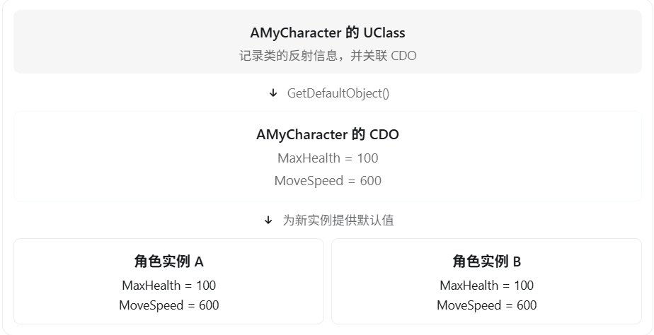
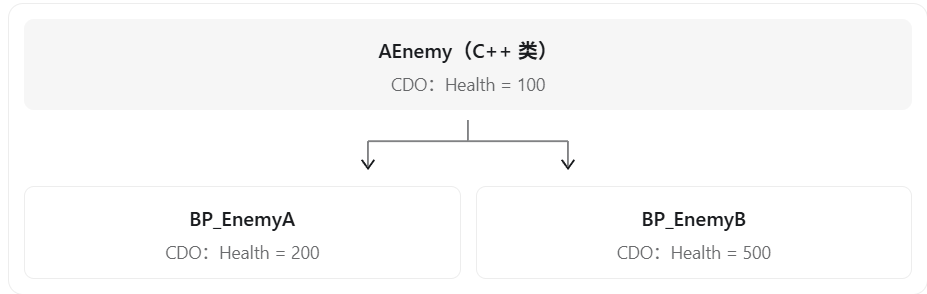
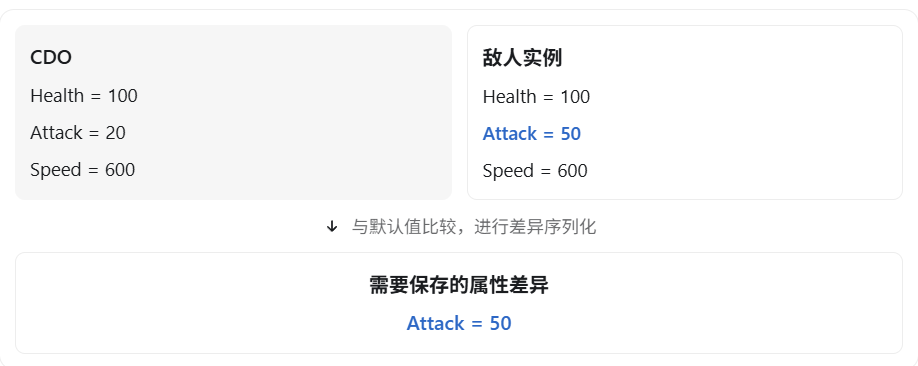
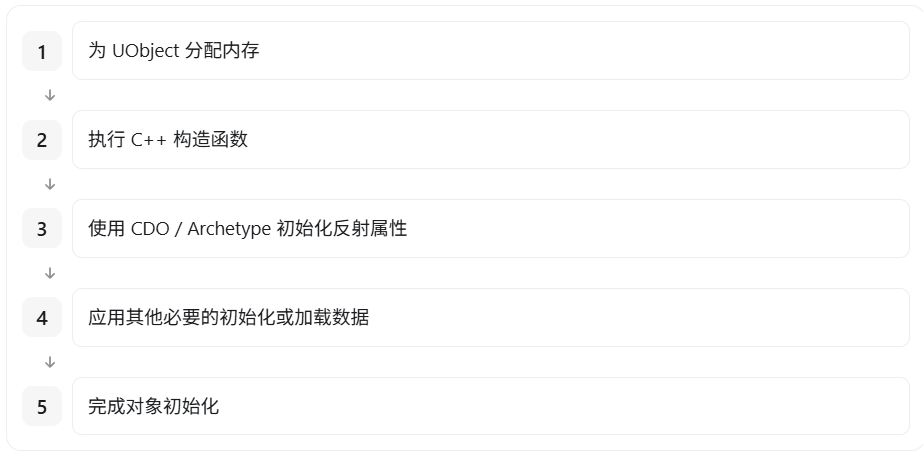

在 UE5 中，**CDO（Class Default Object，类默认对象）是每个 `UClass` 对应的一个特殊 UObject 实例，用于保存该类对象的默认属性值。**

它是 UE5 反射系统和 UObject 创建机制中非常重要的概念，也是 UE5 客户端面试中经常考查的知识点。

## 一、CDO 是什么？

假设我们定义一个角色类：

```c++
UCLASS()
class AMyCharacter : public ACharacter
{
    GENERATED_BODY()

public:
    AMyCharacter();

    UPROPERTY(EditAnywhere, BlueprintReadWrite)
    int32 MaxHealth = 100;

    UPROPERTY(EditAnywhere, BlueprintReadWrite)
    float MoveSpeed = 600.f;
};
```

在 UE5 中，`AMyCharacter` 对应的 `UClass` 会关联一个 CDO。

可以理解为：



在没有其他配置或覆盖值的情况下，新创建的角色实例会根据 CDO 的属性值进行初始化。

需要注意：

- **一个 UClass 对应一个 CDO**，而不是每创建一个对象就创建一个 CDO。
- CDO 本身也是 UObject，但它并不是普通的游戏实例。
- CDO 会在类默认对象初始化过程中执行该类的构造函数。
- C++ 类与其蓝图派生类拥有不同的 UClass，因此也拥有各自的 CDO。

## 二、CDO 有什么作用？

### 1. 为新创建的 UObject 提供默认属性值

这是 CDO 最核心的作用。

假设我们创建两个角色：

```c++
AMyCharacter* CharacterA =
    GetWorld()->SpawnActor<AMyCharacter>();

AMyCharacter* CharacterB =
    GetWorld()->SpawnActor<AMyCharacter>();
```

在对象创建过程中，引擎会以类的 CDO 为默认数据模板，对实例属性进行初始化。

之后每个实例拥有自己的属性数据：

```c++
CharacterA->MaxHealth = 200;

// CharacterB->MaxHealth 仍然是 100
```

注意，这不是简单地对整个 CDO 对象做 `memcpy`。UE 会通过对象初始化、属性复制以及相应的序列化机制完成初始化。

### 2. 支持蓝图修改类的默认属性

假设有一个 C++ 类：

```c++
UPROPERTY(EditDefaultsOnly, BlueprintReadOnly)
float Attack = 100.f;
```

然后创建两个蓝图子类：

- `BP_Warrior`：将 Attack 修改为 200。
- `BP_Mage`：将 Attack 修改为 50。

这时实际上会存在不同的 CDO：

| 类           | CDO 中的 Attack |
| ------------ | --------------- |
| AMyCharacter | 100             |
| BP_Warrior   | 200             |
| BP_Mage      | 50              |

当生成 `BP_Warrior` 时，它会使用 `BP_Warrior` 对应的 CDO，而不是直接使用 C++ 父类的 CDO。

这就是为什么我们可以通过蓝图配置不同角色的默认属性，而不需要修改 C++ 代码。

### 3. 不创建对象就能读取默认属性

这是 CDO 在实际开发中非常有用的功能。

例如，我们有一个技能类：

```c++
UCLASS()
class UMyGameplayAbility : public UGameplayAbility
{
    GENERATED_BODY()

public:
    UPROPERTY(EditDefaultsOnly)
    float Damage = 100.f;
};
```

如果想获得技能默认伤害，不需要先创建技能实例，可以直接读取 CDO：

```c++
const UMyGameplayAbility* CDO =
    GetDefault<UMyGameplayAbility>();

float Damage = CDO->Damage;
```

如果想读取一个蓝图技能类的默认值：

```c++
TSubclassOf<UMyGameplayAbility> AbilityClass;
```

在 `AbilityClass` 已经指定有效技能类的前提下：

```c++
const UMyGameplayAbility* CDO =
    AbilityClass->GetDefaultObject<UMyGameplayAbility>();

float Damage = CDO->Damage;
```

这样就能获取该蓝图技能配置的默认伤害，而不需要实例化技能。

这在读取技能配置、角色基础属性、物品静态参数等场景中很有用。

### 4. 支持默认子对象的初始化

例如：

```c++
AMyCharacter::AMyCharacter()
{
    SpringArm = CreateDefaultSubobject<USpringArmComponent>(
        TEXT("SpringArm")
    );

    Camera = CreateDefaultSubobject<UCameraComponent>(
        TEXT("Camera")
    );

    Camera->SetupAttachment(SpringArm);
}
```

创建类的 CDO 时，构造函数会建立相应的默认子对象。后续创建角色实例时，引擎利用这些默认子对象模板来创建和初始化实例自己的组件。

**因此，CDO 不仅保存普通属性默认值，也与组件的默认配置密切相关。** 

## 三、CDO 和构造函数是什么关系？

这是面试中非常容易被追问的地方。

**UObject 的 C++ 构造函数不仅会在创建 CDO 时执行，也会在创建普通对象实例时执行。**

因此不能认为构造函数只执行一次。

可以使用以下方法判断当前对象是否是 CDO：

```c++
AMyCharacter::AMyCharacter()
{
    if (HasAnyFlags(RF_ClassDefaultObject))
    {
        UE_LOG(LogTemp, Warning, TEXT("Creating CDO"));
    }
    else
    {
        UE_LOG(LogTemp, Warning, TEXT("Creating Instance"));
    }
}
```

由于 CDO 可能在游戏世界建立之前创建，因此构造函数中不应该依赖 `GetWorld()` 获取有效世界，也不应该进行依赖具体游戏场景的初始化操作。

对于 Actor，这类逻辑通常应该放在 `BeginPlay()` 等适当的生命周期函数中。

## 四、CDO 和单例有什么区别？

两者虽然都涉及某种共享对象，但用途完全不同。

| 对比项                 | CDO              | 单例                 |
| ---------------------- | ---------------- | -------------------- |
| 主要用途               | 保存类默认属性   | 提供全局共享实例     |
| 创建方式               | UE 的类系统管理  | 程序自行实现         |
| 数量                   | 每个 UClass 一个 | 通常每个单例类型一个 |
| 是否用于运行时业务状态 | 通常不应该       | 可以                 |
| 是否作为实例初始化模板 | 是               | 通常不是             |

CDO 原则上应当作为只读的默认配置对象使用。

虽然可以使用 `GetMutableDefault` 修改 CDO，但这可能影响后续对象创建、编辑器默认配置等行为，不应该将它当作普通的全局数据存储对象。

## 五、面试应该怎么回答？

> CDO 全称 Class Default Object，也就是类默认对象，是 UE5 UObject 体系中的一个重要概念。
>
> 每个 UClass 都有一个对应的 CDO，用于保存该类的默认属性值。
>
> 当我们通过 NewObject 或 SpawnActor 创建对象时，引擎可以利用对应类的 CDO 作为初始化模板，为新实例设置默认属性。
>
> 另外，蓝图类也有自己的 CDO，因此不同蓝图子类可以分别保存自己的默认属性配置。
>
> 在实际开发中，我们还可以通过 GetDefault 或 UClass 的 GetDefaultObject 获取 CDO，在不创建实例的情况下读取默认配置。
>
> 需要注意的是，CDO 本身不应该被当作普通运行时对象使用，通常应该只读取它的默认属性。

## 六、两个值得掌握的面试追问

追问 1：既然 CDO 保存了默认值，为什么创建 UObject 时还需要执行构造函数？

因为 CDO 并不是完全替代构造函数。UE 的对象初始化还涉及 C++ 构造、默认子对象创建、属性初始化以及蓝图默认值的应用。CDO 为实例提供默认属性模板，但不能简单理解为所有对象都只需复制一块内存。

追问 2：修改 CDO 中的属性，会不会影响已经创建的对象？

一般不会自动把修改同步到所有已有实例，因为普通实例拥有自己的属性数据。但编辑器中的默认值传播、实例覆盖处理等有额外机制，因此也不能认为修改 CDO 永远不会影响已有对象。

最需要记住的关系是：

`UClass` 负责描述类的类型信息，`CDO` 负责保存类的默认数据，而普通 `UObject` 实例保存各自的运行时数据。

------

你的疑问很关键：**既然 C++ 类已经通过成员变量初始化或构造函数定义了默认值，为什么 UE5 还需要额外创建一个 CDO 来保存这些默认值？**

答案是：

**C++ 的默认值初始化只是一套初始化规则，而 CDO 是一个真正存在于内存中的、保存了完整默认属性数据的对象。**

UE5 引入 CDO，不仅是为了初始化对象，更是为了支持蓝图继承、编辑器属性修改、对象序列化以及默认值的动态查询。

## 一、首先，C++ 类本身并不保存普通成员变量的值

例如：

```c++
class Enemy
{
public:
    int Health = 100;
    int Attack = 20;
};
```

你可能会认为 `Enemy` 这个类内部已经保存了：

```
Health = 100
Attack = 20
```

但实际上，C++ 类的定义描述了成员布局和初始化规则，普通非静态成员变量的值是存储在具体对象中的。

当执行：

```c++
Enemy A;
Enemy B;
```

会得到两个分别保存数据的对象。

```
Enemy 类
    │
    ├── 对象 A
    │     Health = 100
    │     Attack = 20
    │
    └── 对象 B
          Health = 100
          Attack = 20
```

如果你修改：

```c++
A.Health = 50;
B.Health = 80;
```

那么两个实例都不再保存最初的 Health 值。

虽然可以通过查看 C++ 源码知道默认值是多少，但**运行时无法通过普通非静态成员直接查询类的默认值。**

而 UE5 的 CDO，就提供了一份可以在运行时读取的默认对象数据。

## 二、为什么 UE5 需要 CDO？

### 1. 允许蓝图覆盖 C++ 默认值

这是最重要的原因之一。

假设我们定义一个 C++ 类：

```c++
UCLASS()
class AEnemy : public AActor
{
    GENERATED_BODY()

public:
    UPROPERTY(EditDefaultsOnly)
    int32 Health = 100;
};
```

然后创建两个蓝图子类：



问题来了：

蓝图并没有修改 C++ 构造函数，UE5 又是怎么知道 `BP_EnemyA` 的默认血量应该是 200 的？

因为：

- `AEnemy` 的 CDO 保存 Health = 100。
- `BP_EnemyA` 的 CDO 保存 Health = 200。
- `BP_EnemyB` 的 CDO 保存 Health = 500。

当创建蓝图实例时，引擎使用对应蓝图类的 CDO 提供默认属性数据，而不是简单地只执行 C++ 默认初始化。

这让游戏策划可以在蓝图编辑器中修改默认值，而不需要修改 C++ 代码。

### 2. 支持对象的序列化和默认值比较

这是 CDO 的另一个重要作用。

假设一个敌人类的 CDO 中：

```
Health = 100
Attack = 20
Speed = 600
```

而一个具体敌人实例中：

```
Health = 100
Attack = 50
Speed = 600
```

UE5 可以将实例与 CDO 比较，发现只有 Attack 与默认值不同。



UE5 的属性序列化机制可以利用 CDO 作为默认值基准，只保存必要的属性差异，而不用每次都保存完整的对象状态。

不仅如此，当开发者修改类默认值后，UE5 还可以借助旧 CDO 和新 CDO 判断哪些实例仍然使用默认值、哪些实例具有自己的覆盖值。

### 3. 不实例化对象就能访问默认数据

例如：

```c++
const AEnemy* CDO = GetDefault<AEnemy>();

int32 DefaultHealth = CDO->Health;
```

这时根本不需要在游戏世界中生成敌人 Actor。

对于技能、物品配置、角色属性等系统，这样做非常方便。

## 三、既然有 CDO，为什么还需要构造函数？

因为二者的职责不同：

|                          | C++ 构造函数               | CDO              |
| ------------------------ | -------------------------- | ---------------- |
| 本质                     | 初始化代码                 | UObject 实例     |
| 主要职责                 | 执行对象构造与初始化逻辑   | 保存默认属性数据 |
| 是否包含实际对象数据     | 不是默认属性数据容器       | 是               |
| 是否支持蓝图默认值覆盖   | 不直接负责保存蓝图覆盖值   | 支持             |
| 是否可供运行时查询默认值 | 不能直接读取构造代码中的值 | 可以             |

UE5 并不是创建普通 UObject 时直接跳过构造函数、只复制 CDO。

简化后的流程是：



这是简化的概念流程。实际对象构造还涉及 `FObjectInitializer`、默认子对象、模板和属性序列化等细节。

## 四、总结

如果只考虑最简单的 C++ 类，确实没有必要引入 CDO。构造函数和成员默认初始化已经可以完成工作。

但是 UE5 需要解决更多问题：

1. 蓝图子类能够覆盖 C++ 类的默认值。
2. 编辑器能够读取和修改类的默认属性。
3. 新实例可以使用统一的默认数据模板。
4. 序列化系统能够比较实例与默认值的差异。
5. 运行时能够在不创建普通实例的情况下访问类默认数据。

因此，CDO 的核心价值不是让 C++ 类拥有默认值，而是将默认值从 C++ 初始化代码变成 UE5 反射系统可以统一访问、编辑、继承和比较的数据。

这其实还引出了一个更深入的 UE5 面试问题：

为什么 C++ 构造函数已经将 Health 初始化成 100，但创建 BP_Enemy 实例时，最终 Health 却可以是蓝图配置的 200？

理解 `FObjectInitializer` 如何利用 CDO 初始化实例属性，就能真正理解 UE5 的 UObject 创建机制。