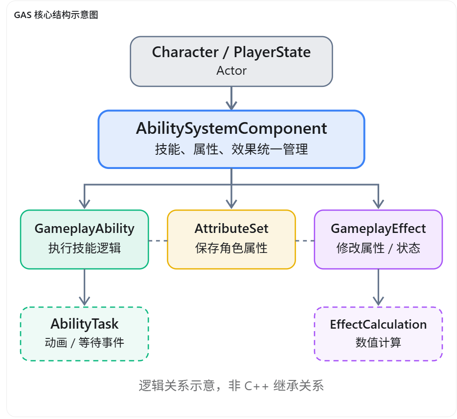
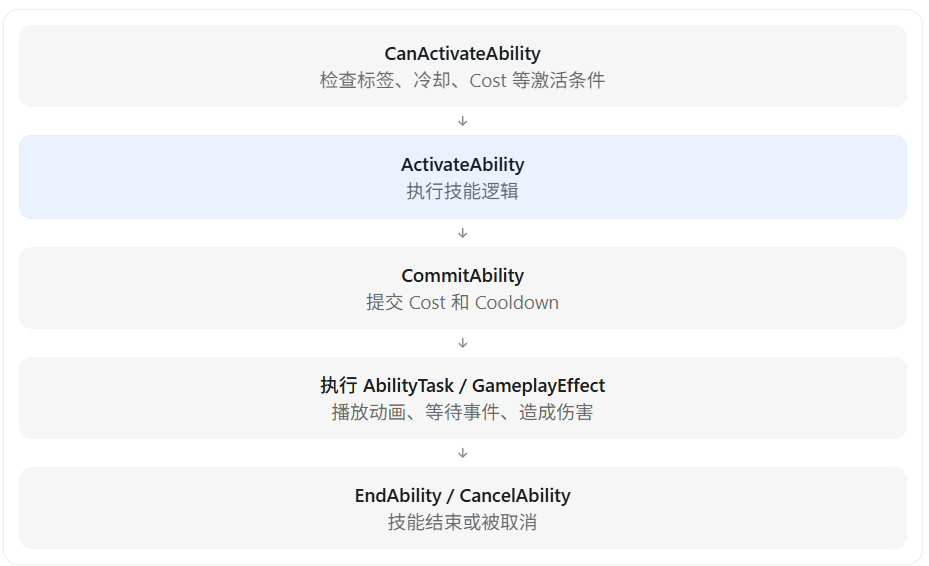
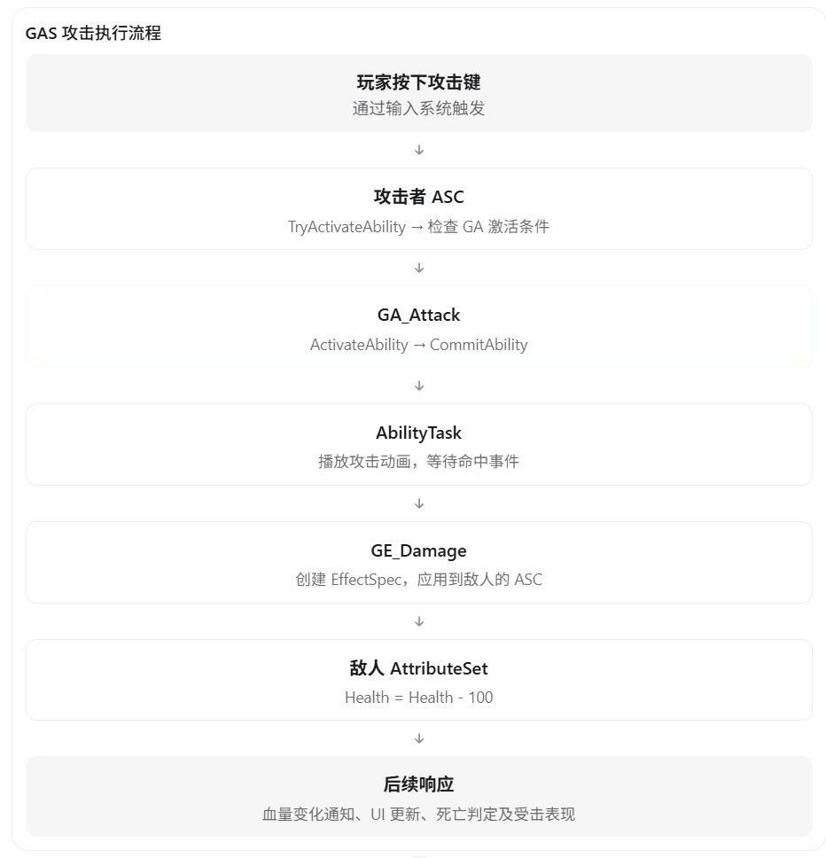

# UE5 GAS 核心类详解

GAS（Gameplay Ability System）是 Unreal Engine 提供的一套技能系统框架，主要用于实现角色技能、属性管理、伤害计算、Buff/Debuff、冷却、技能消耗、技能打断以及多人网络同步等功能。

**理解 GAS 最重要的是掌握五个核心类，以及它们之间的关系。**

## 一、GAS 核心类总览

| 核心类                           | 中文名称     | 主要职责                                           |
| -------------------------------- | ------------ | -------------------------------------------------- |
| `UAbilitySystemComponent`（ASC） | 技能系统组件 | 管理技能、属性、效果、标签以及网络同步             |
| `UGameplayAbility`（GA）         | 游戏技能     | 定义技能的激活条件和执行逻辑                       |
| `UAttributeSet`（AS）            | 属性集       | 保存和管理角色的血量、蓝量、攻击力等属性           |
| `UGameplayEffect`（GE）          | 游戏效果     | 修改角色属性、应用 Buff/Debuff、管理持续效果       |
| `UAbilityTask`                   | 技能任务     | 处理技能执行中的异步操作，例如播放蒙太奇、等待事件 |



可以把这套系统理解成：

ASC 是管理中心，GA 决定做什么，AS 保存数值，GE 负责改变数值，AbilityTask 负责等待和协调技能执行过程。

下面按实际开发的角度逐一讲解。

## 二、UAbilitySystemComponent（ASC）

**ASC 是整个 GAS 的核心管理组件，几乎所有技能相关操作最终都要通过它完成。**

继承关系：

```
UActorComponent
    └── UAbilitySystemComponent
```

它主要负责以下工作：

| 功能                | 常用方法或数据                 |
| ------------------- | ------------------------------ |
| 授予技能            | `GiveAbility()`                |
| 激活技能            | `TryActivateAbility()`         |
| 移除技能            | `ClearAbility()`               |
| 施加 GameplayEffect | `ApplyGameplayEffectToSelf()`  |
| 获取属性            | `GetNumericAttribute()`        |
| 查询 GameplayTag    | `HasMatchingGameplayTag()`     |
| 处理 GameplayEvent  | `HandleGameplayEvent()`        |
| 管理持续效果        | Active Gameplay Effects        |
| 网络同步            | 技能激活、属性、效果及预测管理 |

例如，一个角色有三个技能：普通攻击、冲刺、治疗。ASC 会维护这些技能的授予记录，并负责它们的激活。

### 1. ASC 如何和 Actor 关联？

通常角色需要实现 `IAbilitySystemInterface` 接口：

```c++
class AMyCharacter : public ACharacter,
                     public IAbilitySystemInterface
{
    GENERATED_BODY()

public:
    virtual UAbilitySystemComponent*
        GetAbilitySystemComponent() const override;

protected:
    UPROPERTY(VisibleAnywhere)
    TObjectPtr<UAbilitySystemComponent> ASC;
};
```

通过接口，其他系统就能统一获取该角色使用的 ASC。

### 2. OwnerActor 与 AvatarActor

这是 GAS 面试中非常常见的问题。

ASC 的逻辑拥有者和实际执行技能的 Actor 可以不同。

```c++
ASC->InitAbilityActorInfo(OwnerActor, AvatarActor);
```

- **OwnerActor**：逻辑上拥有 ASC 的 Actor。
- **AvatarActor**：ASC 在世界中实际代表和操作的 Actor，通常是 Character 或 Pawn。

例如：

| 架构                 | OwnerActor  | AvatarActor |
| -------------------- | ----------- | ----------- |
| ASC 放在 Character   | Character   | Character   |
| ASC 放在 PlayerState | PlayerState | Character   |

第二种方案常用于多人游戏，因为 PlayerState 可以在角色死亡、重生、更换 Pawn 后继续保留技能、属性或冷却状态。

注意：**ASC 不一定必须放在 Character 上。**

## 三、UGameplayAbility（GA）

`UGameplayAbility` 负责定义技能的实际执行逻辑。

比如实现冲刺技能，需要处理：

1. 判断角色能否冲刺。
2. 扣除耐力。
3. 应用技能冷却。
4. 播放冲刺动画。
5. 移动角色。
6. 对碰撞到的敌人造成伤害。
7. 在冲刺结束后终止技能。

这些都可以通过一个 GA 来组织。

### 1. GA 的核心生命周期



这是典型的执行流程，并非引擎强制要求 `CommitAbility()` 必须放在某个位置。具体何时扣费、何时开始冷却取决于技能设计。

几个常用方法：

| 方法                   | 作用                 |
| ---------------------- | -------------------- |
| `CanActivateAbility()` | 判断技能是否允许激活 |
| `ActivateAbility()`    | 技能执行入口         |
| `CommitAbility()`      | 提交资源消耗和冷却   |
| `EndAbility()`         | 正常结束技能         |
| `CancelAbility()`      | 取消技能             |
| `CheckCost()`          | 检查资源消耗条件     |
| `CheckCooldown()`      | 检查冷却条件         |

需要特别注意：

`EndAbility()` **必须在合适的时机调用**。 否则 GAS 可能一直认为技能处于激活状态，导致其他技能被持续阻断。

### 2. GA 如何控制技能互斥？

主要通过 GameplayTag。

例如，当前有三个技能：

- 技能 1：普通攻击，可被其他技能打断。
- 技能 2：霸体攻击，不允许被其他技能打断。
- 技能 3：冲刺，可被其他技能打断。

可以使用以下标签：

```
Ability.Attack
Ability.Uninterruptible
Ability.Dash

State.Attacking
State.Dashing
State.Stunned
```

GA 可以配置：

- `Cancel Abilities With Tag`：激活时取消其他匹配标签的技能。
- `Block Abilities With Tag`：激活期间阻止其他匹配标签的技能启动。
- `Activation Required Tags`：激活技能必须满足的标签。
- `Activation Blocked Tags`：存在指定标签时不能激活。

要注意 `Block` 和 `Cancel` 的区别：

**Block 是不允许新技能启动，Cancel 是取消已经执行的技能。**

另外，取消已有技能还需要考虑 `CanBeCanceled` 等条件。

## 四、UAttributeSet（AS）

`UAttributeSet` 用来统一管理角色属性。

继承关系：

```
UObject
    └── UAttributeSet
```

例如，在 C++ 中创建自己的属性集：

```c++
UCLASS()
class UBaseAttributeSet : public UAttributeSet
{
    GENERATED_BODY()

public:
    UPROPERTY(BlueprintReadOnly)
    FGameplayAttributeData Health;

    UPROPERTY(BlueprintReadOnly)
    FGameplayAttributeData MaxHealth;

    UPROPERTY(BlueprintReadOnly)
    FGameplayAttributeData Mana;

    UPROPERTY(BlueprintReadOnly)
    FGameplayAttributeData AttackPower;
};
```

实际项目中还会配合属性访问器宏、复制声明和 `OnRep` 函数等。

### 1. FGameplayAttributeData

GAS 属性通常不是普通的 `float`，而是 `FGameplayAttributeData`。

它包含两个重要数值：

- `BaseValue`：基础值。
- `CurrentValue`：考虑当前生效修饰后的数值。

例如角色基础攻击力是 100，获得持续 10 秒的 +20 攻击力 Buff：

| 数值         | Buff 前 | Buff 期间 | Buff 结束 |
| ------------ | ------- | --------- | --------- |
| BaseValue    | 100     | 100       | 100       |
| CurrentValue | 100     | 120       | 100       |

这里需要区分：`MaxHealth` 并不是 `FGameplayAttributeData` 自动包含的第三个值，而是开发者单独定义的属性。

### 2. AttributeSet 常用回调

`UAttributeSet` 提供了多个属性修改相关的回调。

| 回调                          | 主要作用                    |
| ----------------------------- | --------------------------- |
| `PreAttributeChange()`        | 当前值修改前进行约束        |
| `PreAttributeBaseChange()`    | 基础值修改前进行约束        |
| `PreGameplayEffectExecute()`  | GE 执行修改基础值前进行处理 |
| `PostGameplayEffectExecute()` | GE 执行修改基础值后进行处理 |

例如角色受到伤害后，限制 Health 范围：

```c++
void UBaseAttributeSet::PostGameplayEffectExecute(
    const FGameplayEffectModCallbackData& Data)
{
    Super::PostGameplayEffectExecute(Data);

    if (Data.EvaluatedData.Attribute == GetHealthAttribute())
    {
        SetHealth(FMath::Clamp(
            GetHealth(), 0.f, GetMaxHealth()
        ));
    }
}
```

注意：`PostGameplayEffectExecute()` 主要用于 GE 执行并修改属性基础值的场景，并不是每次 `CurrentValue` 变化都会调用。


## 五、UGameplayEffect（GE）

**GE 专门负责改变 GAS 系统中的属性和状态。**

GA 与 GE 的分工非常重要：

- GA：负责技能的执行流程。
- GE：负责技能产生的属性和状态效果。

例如一个火球技能：

```
GA_Fireball
    │
    ├── 播放施法动画
    ├── 生成火球 Actor
    ├── 检测命中目标
    │
    ├── GE_FireDamage
    │       └── Health -100
    │
    └── GE_Burning
            └── 每秒持续扣血
```

### 1. GE 的三种持续类型

| 类型     | 说明                 | 示例                |
| -------- | -------------------- | ------------------- |
| Instant  | 立即执行             | 一次伤害、一次治疗  |
| Duration | 持续一定时间         | 10 秒攻击力增加 20% |
| Infinite | 无限持续，直到被移除 | 常驻装备 Buff       |

Duration 或 Infinite 的 GE 会作为活跃效果由 ASC 管理；Instant GE 执行后不作为持续效果留在容器中。

此外，Duration 和 Infinite 也可以设置周期执行，实现持续扣血或回血。

### 2. GE 如何修改属性？

常用的 Modifier 操作包括：

- `Add`：加法。
- `Multiply`：乘法。
- `Divide`：除法。
- `Override`：覆盖数值。

例如伤害 100：

```
GE_Damage
    Duration: Instant

    Modifier:
        Attribute = Health
        Operation = Add
        Magnitude = -100
```

目标受到 GE 后，Health 减少 100。

### 3. GE 不只负责修改属性

GE 还可以管理 GameplayTag、叠层、持续时间，以及其他效果。

例如一个沉默 Buff：

```
GE_Silence
    Duration = 5s

    Target Tags:
        State.Silenced
```

随后在部分技能的激活阻断标签中配置 `State.Silenced`，就能让它们在沉默期间无法激活。

在 UE5 较新的版本中，GE 的这些逻辑可以通过 `GameplayEffectComponent` 实现，例如 `UTargetTagsGameplayEffectComponent`。

## 六、UAbilityTask

`UAbilityTask` 主要负责技能执行期间的异步任务。

继承关系：

```
UGameplayTask
    └── UAbilityTask
```

为什么需要 AbilityTask？

因为许多技能不是在一帧中完成的。

比如一个攻击技能：

1. 播放攻击蒙太奇。
2. 等待攻击命中通知。
3. 命中时进行伤害检测。
4. 等待蒙太奇结束。
5. 结束技能。

如果全部写在 GA 内部，需要管理动画委托、事件回调等。

AbilityTask 将这些异步操作封装成能够复用的任务。

常见 AbilityTask：

| AbilityTask          | 作用                   |
| -------------------- | ---------------------- |
| `PlayMontageAndWait` | 播放蒙太奇并等待结果   |
| `WaitGameplayEvent`  | 监听 GameplayEvent     |
| `WaitDelay`          | 等待指定时间           |
| `WaitInputRelease`   | 等待输入释放           |
| `WaitTargetData`     | 等待目标选择或目标数据 |

例如 `WaitGameplayEvent`，可以持续监听相应事件，直到满足结束条件或任务被终止。

在默认监听目标为自己、且 `OnlyTriggerOnce = false` 时，它可以多次响应匹配事件，但不会在所属技能结束后继续无限监听。

## 七、其他需要掌握的 GAS 重要类和结构体

| 类或结构体                                               | 作用                                                         |
| -------------------------------------------------------- | ------------------------------------------------------------ |
| `IAbilitySystemInterface`                                | 对外提供 ASC 的统一访问接口                                  |
| `FGameplayAbilitySpec`                                   | ASC 中技能的授予记录，包含技能类、等级、句柄等               |
| `FGameplayAbilitySpecHandle`                             | 唯一标识一项已授予技能                                       |
| `FGameplayEffectSpec`                                    | 一次 GE 应用的运行时描述，保存等级、计算上下文、SetByCaller 数据等 |
| `FActiveGameplayEffectHandle`                            | 标识已经应用的持续效果，可用于移除                           |
| `FGameplayTag`                                           | 表示技能、状态、事件的层级标签                               |
| `FGameplayEventData`                                     | GameplayEvent 的载荷，包含 Instigator、Target 等信息         |
| `UGameplayModMagnitudeCalculation`                       | MMC，用于计算 Modifier 的数值                                |
| `UGameplayEffectExecutionCalculation`                    | ExecCalc，用于处理复杂 GE 执行计算                           |
| `UGameplayCueNotify_Static` / `UGameplayCueNotify_Actor` | 表现 GameplayCue 的两种常用类                                |

### MMC 和 ExecCalc 的区别

这是一个值得额外掌握的面试点。

`UGameplayModMagnitudeCalculation` 通常用来计算单个 Modifier 的 Magnitude，例如根据法术强度计算一个 Buff 的加成数值。

`UGameplayEffectExecutionCalculation` 则更适合复杂伤害逻辑，例如同时考虑攻击力、防御力、暴击、减伤，并输出多个属性修改结果。

例如：

\[ Damage=\max(0, Attack-Defense)\times CritMultiplier \]

这种涉及多个属性、条件以及结果输出的计算，通常更适合封装在 ExecCalc 中。

## 八、把所有核心类串起来：一次攻击的完整过程

以玩家攻击敌人、造成 100 点伤害为例。



这里要注意，**GA 不负责真正保存敌人的血量，也不需要直接修改敌人的 AttributeSet**。它通常是把 GE 应用到敌人的 ASC，再由 GAS 完成属性修改与相关通知。

而且攻击者的技能结束时机，和敌人身上的持续 GE 何时结束，是两个独立概念。

## 九、面试应该怎么回答？

如果面试官问：“请介绍一下 UE5 GAS 的核心类以及它们之间的关系。”

可以这样回答：

> GAS 主要由 ASC、GameplayAbility、AttributeSet、GameplayEffect 和 AbilityTask 几部分构成。
>
> ASC 是整个 GAS 的管理核心，负责授予和激活技能，同时管理角色的属性、GameplayTag、持续 GameplayEffect 以及网络同步。
>
> GameplayAbility 主要负责技能执行逻辑，例如激活条件检查、播放动画、技能消耗、冷却和结束流程。
>
> AttributeSet 负责定义和管理角色属性，例如生命值、法力值、攻击力等，这些属性通常使用 FGameplayAttributeData 表示。
>
> GameplayEffect 负责对属性和状态进行修改，比如造成伤害、恢复生命值、添加 Buff 或 Debuff。对于复杂的伤害计算，还可以使用 ExecutionCalculation。
>
> AbilityTask 则用于封装技能执行期间的异步任务，例如等待动画播放完成、等待 GameplayEvent、等待玩家输入等。
>
> 整体执行流程就是：玩家输入触发 ASC 激活 GA，GA 执行技能流程，通过 AbilityTask 等待动画或事件，在合适时机将 GE 应用到目标 ASC，由 GE 修改目标 AttributeSet 中的属性，最终触发后续状态和表现更新。
>
> GAS 还通过 GameplayTag 实现技能阻断、互斥和状态判断，并且支持服务端权威执行、客户端预测和网络同步，因此比较适合有大量角色技能和多人联机需求的项目。

**建议后续重点掌握三个面试高频问题：**

1. **GA 和 GE 的区别是什么？** 为什么伤害一般通过 GE 修改属性？
2. **Cost、Cooldown 和 CommitAbility 是什么关系？** 为什么它们通常要使用 GE 实现？
3. **GAS 的客户端预测是如何实现的？** Local Predicted、Server Only 等执行策略有什么区别？

这三个问题能进一步体现你对 GAS 内部机制的理解，而不只是会在蓝图中使用技能节点。