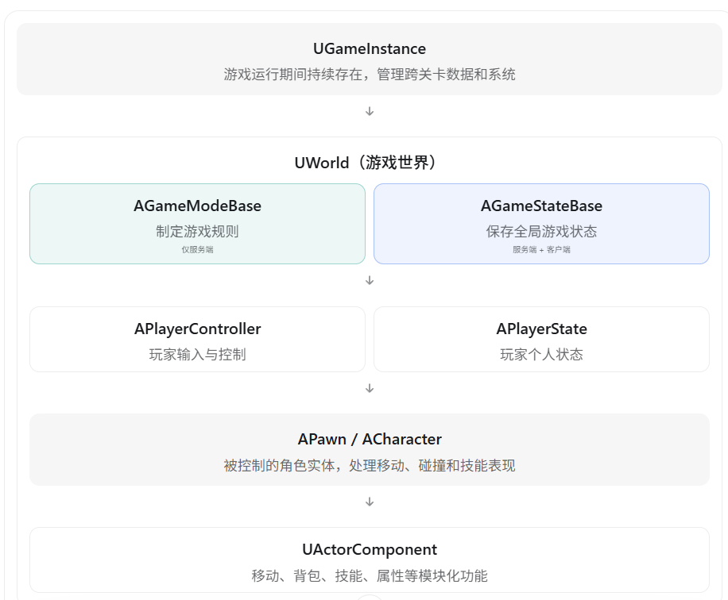
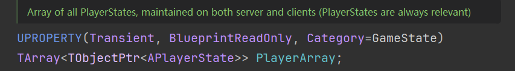
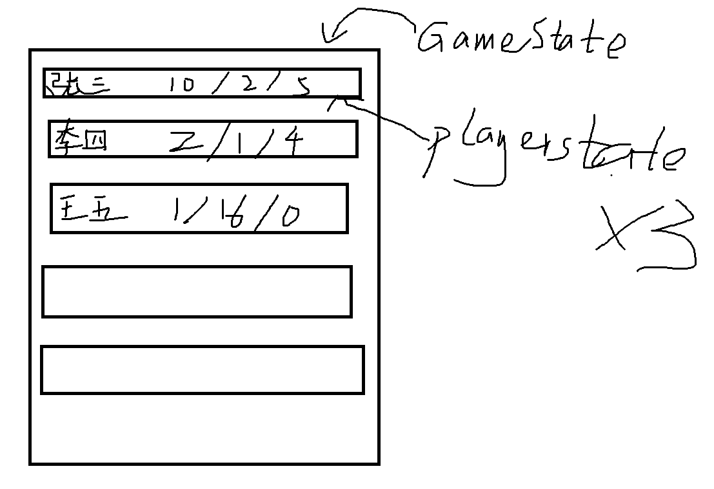
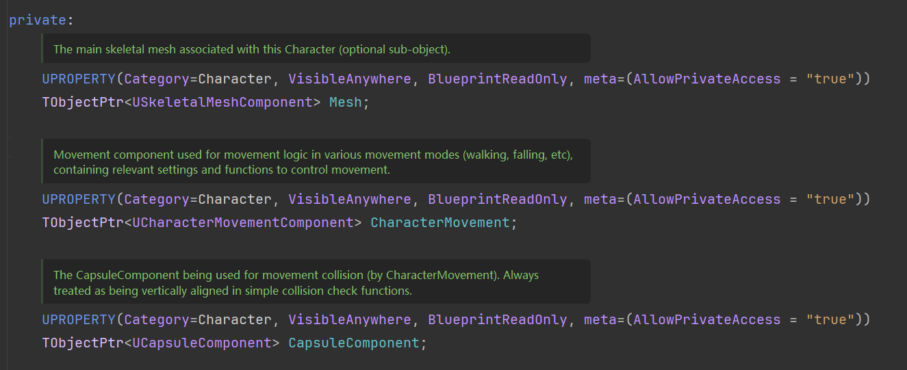
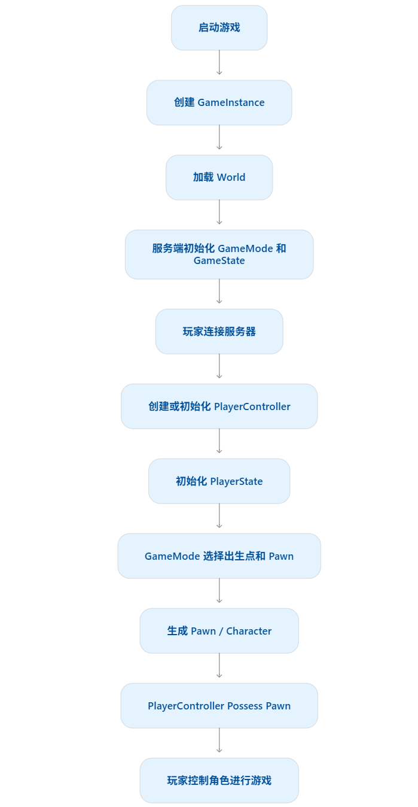

# UE5 Gameplay Framework（游戏玩法框架）详解

UE5 的 Gameplay Framework 是 Unreal Engine 提供的一套用于组织游戏逻辑的基础框架。

它规定了游戏中不同对象应该承担什么职责，以及玩家、角色、游戏规则和游戏状态之间如何协作。

例如：

- 谁负责制定游戏规则？
- 玩家输入由谁接收？
- 谁真正控制角色移动？
- 玩家死亡之后，由谁负责重新生成角色？
- 多人游戏中，游戏状态和玩家数据应该存放在哪里？

这些问题都可以通过 Gameplay Framework 解决。

## 一、Gameplay Framework 的整体架构



可以将 Gameplay Framework 分成三个层次：

1. 游戏管理层：GameInstance、GameMode、GameState。
2. 玩家控制层：PlayerController、PlayerState、AIController。
3. 游戏实体层：Actor、Pawn、Character、ActorComponent。

下面分别介绍。

## 二、Gameplay Framework 的核心类

### 1. UGameInstance：游戏实例

`UGameInstance` 负责管理**整个游戏运行期间需要持续存在**的数据和系统。

**最大特点：跨关卡持续存在。**

例如：

```c++
启动游戏
   ↓
GameInstance 创建
   ↓
进入主菜单关卡
   ↓
进入游戏关卡 A
   ↓
切换到游戏关卡 B
   ↓
返回主菜单
   ↓
退出游戏
   ↓
GameInstance 销毁
```

在正常的地图切换过程中，GameInstance 不会像关卡 Actor 一样被销毁重建。

**典型用途：**

- 全局游戏配置。
- 玩家登录会话信息。
- 存档系统管理。
- 跨关卡数据。
- 在线服务相关管理。

例如可以定义：

```c++
UCLASS()
class UMyGameInstance : public UGameInstance
{
    GENERATED_BODY()

public:
    UPROPERTY()
    int32 SelectedCharacterID = 0;
};
```

需要特别注意：

GameInstance **不会自动进行网络复制**。 在多人联机游戏中，服务器和每个客户端各自拥有自己的 GameInstance。

另外，GameInstance 中的数据也不会自动保存到硬盘。永久存档通常需要使用 `USaveGame` 等机制。

### 2. AGameModeBase：游戏模式

`AGameModeBase` 负责定义游戏规则，是游戏玩法流程的主要管理者。

例如一个 5V5 对战游戏：

- 每队最多 5 名玩家。
- 游戏持续 15 分钟。
- 玩家死亡 5 秒后复活。
- 某队达到 100 分时游戏结束。

这些规则可以由 GameMode 管理。

GameMode 还可以指定：

```
DefaultPawnClass
PlayerControllerClass
PlayerStateClass
GameStateClass
HUDClass
```

分别决定默认角色、控制器和状态等使用哪些类。

UE5 有两个经常用到的基类：

| 类              | 特点                                   |
| --------------- | -------------------------------------- |
| `AGameModeBase` | 基础游戏模式，提供生成玩家等核心功能   |
| `AGameMode`     | 在基础上提供更完整的比赛状态与流程控制 |

**重点：在多人联机游戏中，GameMode 只存在于服务器。**

客户端不能直接访问服务端的 GameMode 实例。

因为游戏规则的裁定通常需要由服务器权威执行。

### 3. AGameStateBase：游戏状态

GameMode 定义规则，GameState 则负责保存需要向玩家同步的全局游戏状态。

例如：

```c++
UCLASS()
class AMyGameState : public AGameStateBase
{
    GENERATED_BODY()

public:
    UPROPERTY(Replicated)
    int32 TeamAScore = 0;

    UPROPERTY(Replicated)
    int32 TeamBScore = 0;
};
```

在一个多人对战游戏中：

- GameMode 判断玩家击杀是否应该加分。
- GameMode 在服务端修改 GameState 中的队伍分数。
- GameState 将分数复制给客户端。
- 客户端 UI 展示最新分数。

**GameMode 与 GameState 的核心区别：**

| GameMode           | GameState            |
| ------------------ | -------------------- |
| 负责规则与裁定     | 负责保存全局游戏状态 |
| 仅服务端存在       | 服务端和客户端均存在 |
| 不直接复制给客户端 | 可以复制属性给客户端 |
| 例如判断胜负       | 例如保存当前比分     |

需要注意，GameState 不只是一个数据容器，也可以包含与全局游戏状态相关的逻辑。

### 4. APlayerController：玩家控制器

`APlayerController` 表示玩家的控制意图，负责连接玩家输入与被控制的 Pawn。

例如玩家按下 W 键：

```
键盘 W
   ↓
Enhanced Input
   ↓
PlayerController
   ↓
Pawn / Character
   ↓
CharacterMovementComponent
   ↓
角色移动
```

玩家控制器常见职责：

- 处理玩家输入。
- 控制 Pawn。
- 切换控制对象。
- 管理摄像机视角。
- 处理客户端与服务器之间的玩家相关 RPC。
- 协调本地 UI 操作。

重要机制是：

```c++
PlayerController->Possess(MyPawn);
```

`Possess()` 可以使 Controller 控制指定的 Pawn。常规联机游戏中，实际的 Possess 应由服务器执行。

还有一个很重要的特点：

PlayerController 和 Pawn 不是一一绑定且永远不变的。

例如：

```
PlayerController
       ↓ Possess
     Character A
       ↓ UnPossess
     无控制 Pawn
       ↓ Possess
     Character B
```

玩家死亡、复活或者切换角色时，可以继续使用原来的 PlayerController 去控制新的 Pawn。

在联机游戏中，一个玩家的 PlayerController 主要存在于服务器和该玩家所属的客户端，其他普通客户端通常不会拥有这个玩家的 PlayerController 实例。

### 5. APlayerState：玩家状态

`APlayerState` 用来保存某个玩家的状态数据。

例如：

- 玩家名称。
- 所属队伍。
- 击杀数。
- 死亡数。
- 积分。
- 玩家等级等。

它与 PlayerController 最大的区别在于：

**PlayerController 侧重控制玩家，PlayerState 侧重记录玩家状态。**

另外，PlayerState 通常会复制给其他客户端，因此适合存储其他玩家也需要知道的信息。

例如在排行榜中，每个玩家都可以通过 GameState 的 `PlayerArray` 获取其他玩家的 PlayerState，从而展示玩家名称、分数等数据。

> [!NOTE]
>
> AGameStateBase类中包含一个PlayerArray数组成员，也就是说GameState一般会包含所有的PlayerState





### 6. APawn：可被控制的游戏对象

`APawn` 继承自 `AActor`，可以被 Controller 控制。

继承关系：

```
UObject
   └── AActor
         └── APawn
               └── ACharacter
```

Pawn 不要求一定是人形角色。

例如：

- 玩家角色。
- 可驾驶的汽车。
- 无人机。
- 飞机。
- 可控制的摄像机 Pawn。

这些都可以通过 Pawn 实现。

Pawn 可以通过 Controller 控制，但并不要求每一个 Pawn 都必须拥有 Controller。

### 7. ACharacter：角色

`ACharacter` 是 `APawn` 的子类，主要用于实现具备典型角色移动能力的游戏角色。

Character 默认提供了一些重要组件：

| 组件                          | 作用                       |
| ----------------------------- | -------------------------- |
| `UCapsuleComponent`           | 角色胶囊体碰撞             |
| `USkeletalMeshComponent`      | 骨骼网格体和动画表现       |
| `UCharacterMovementComponent` | 行走、跳跃、下落等移动机制 |



例如：

```c++
UCLASS()
class AMyCharacter : public ACharacter
{
    GENERATED_BODY()

public:
    virtual void BeginPlay() override;
};
```

Character 相比普通 Pawn，最大的优势之一是具有成熟的移动系统，包括角色移动模式和网络移动预测、校正等能力。

所以第三人称动作游戏、RPG、FPS 游戏通常会基于 Character 开发玩家角色。

### 8. AAIController：AI 控制器

`AAIController` 和 PlayerController 都继承自 `AController`。

区别是：

- `APlayerController`：根据真人玩家的输入控制 Pawn。
- `AAIController`：根据 AI 决策逻辑控制 Pawn。

例如：

```
AIController
      ↓
Behavior Tree
      ↓
Move To / Attack
      ↓
EnemyCharacter
```

AIController 可以结合行为树、黑板和 AI Perception 等系统实现敌人逻辑。

注意，行为树等 AI 系统不是 Gameplay Framework 所有 Controller 都必须使用的功能，而是可以接入 AIController 的专门系统。

## 三、Actor 和 ActorComponent 在框架中的作用

虽然前面介绍了很多管理类，但绝大多数实际游戏逻辑仍然依赖 `AActor` 与 `UActorComponent`。

### Actor

Actor 是 UE 世界中可以放置或生成的对象。

例如：

- 玩家角色。
- 武器掉落物。
- NPC。
- 门。
- 宝箱。
- 投射物。

### ActorComponent

组件负责把功能拆分成可复用的模块。

例如，一个角色可以拥有：

```
APlayerCharacter
    │
    ├── CharacterMovementComponent
    ├── AbilitySystemComponent
    ├── InventoryComponent
    ├── InteractionComponent
    └── EquipmentComponent
```

其中：

- `InventoryComponent`：管理背包。
- `AbilitySystemComponent`：管理技能及 Gameplay Effects。
- `EquipmentComponent`：管理装备。
- `InteractionComponent`：管理交互。

**组件化设计可以避免把所有游戏逻辑都写进一个 Character 类中。**

不过，并不是所有组件都具备 Transform；只有 `USceneComponent` 及其派生类才具有场景变换和附着能力。

## 四、Gameplay Framework 的生命周期

这是 UE5 面试中的重点。

### 1. 各个类存活多久？

| 类型                 | 典型生命周期                               |
| -------------------- | ------------------------------------------ |
| `UGameInstance`      | 整个游戏实例运行期间                       |
| `UWorld`             | 当前游戏世界生命周期                       |
| `AGameModeBase`      | 当前 World 的游戏模式实例                  |
| `AGameStateBase`     | 当前 World 的全局游戏状态实例              |
| `APlayerController`  | 玩家控制会话，可能跨角色重生               |
| `APlayerState`       | 玩家参与当前游戏的状态，通常可跨 Pawn 重生 |
| `APawn / ACharacter` | 具体角色实体的生命周期                     |
| `UActorComponent`    | 通常依附所属 Actor 的生命周期              |

需要注意：无缝旅行（Seamless Travel）存在一些特殊的对象保留与迁移机制，所以不能简单地认为所有 World 相关对象在每次地图切换时都必然销毁。

### 2. 游戏启动和玩家生成流程

下面是常见的多人游戏流程示意：



以上是概念上的简化流程，实际引擎内部的登录、Actor 初始化及复制回调可能相互交错。

重点是：

**GameMode 负责组织玩家的生成流程，PlayerController 负责控制 Pawn，PlayerState 保存玩家状态。**

## 五、多人联机中，这些类分布在哪里？

这个表特别重要，建议面试前记熟。

| 类                         | 服务端 | 本机客户端      | 其他客户端   |
| -------------------------- | ------ | --------------- | ------------ |
| GameInstance               | √      | √               | √            |
| GameMode                   | √      | ×               | ×            |
| GameState                  | √      | √               | √            |
| PlayerController（玩家 A） | √      | 玩家 A 自己拥有 | 通常没有     |
| PlayerState（玩家 A）      | √      | √               | √            |
| Pawn（玩家 A）             | √      | 通常有          | 网络相关时有 |

其中 GameInstance 只是各端独立拥有，并不会自动同步。

GameState、PlayerState、Pawn 在客户端可见的具体内容还受到 Replication 设置、网络相关性和属性复制条件的影响。

### 举个例子：一个 3 人联机游戏

服务器可能有：

```
Server
 ├── GameMode
 ├── GameState
 ├── PlayerController_A
 ├── PlayerController_B
 ├── PlayerController_C
 ├── PlayerState_A / B / C
 └── Character_A / B / C
```

玩家 A 的客户端：

```
Client A
 ├── GameInstance_A
 ├── GameState
 ├── PlayerController_A
 ├── PlayerState_A / B / C
 └── Character_A / B / C
```

玩家 A 可以看到其他玩家的 Character 和 PlayerState，但通常拿不到其他玩家的 PlayerController。

这也是为什么排行榜里的玩家数据一般放在 PlayerState，而不是 PlayerController 中。

## 六、结合 GAS 项目，Gameplay Framework 应该怎么设计？

假设开发一个多人 RPG 游戏，玩家具有技能、生命值、背包和装备系统。

一种合理的组织方式是：

| 类                        | 负责什么                         |
| ------------------------- | -------------------------------- |
| `AMyGameMode`             | 玩家出生、死亡重生、游戏规则     |
| `AMyGameState`            | 全局副本进度、队伍状态           |
| `AMyPlayerController`     | 输入、本地 UI、玩家控制          |
| `AMyPlayerState`          | 玩家等级、队伍信息、持久技能状态 |
| `AMyCharacter`            | 角色移动、动画、碰撞             |
| `UAbilitySystemComponent` | Gameplay Ability、Effect、Tag    |
| `UInventoryComponent`     | 背包物品的增删和存储             |
| `UEquipmentComponent`     | 装备穿戴和卸下                   |
| `UUserWidget`             | 血条、技能栏、背包等 UI          |

### 一个值得了解的设计：把 ASC 放在 PlayerState 中

GAS 的 `AbilitySystemComponent` 可以放在 Character，也可以放在 PlayerState 等合适的对象上。

如果希望角色死亡重生后，技能系统中的部分状态仍然能够保留，可以考虑：

```
PlayerState
    └── AbilitySystemComponent
               │
               │ AvatarActor
               ▼
           Character A
               │
              死亡
               ↓
           Character B
```

在新角色生成后，重新正确初始化 ASC 的 OwnerActor 和 AvatarActor。

但这不是所有项目的固定规则。如果技能和属性本身就应随角色销毁，也可以把 ASC 放在 Character 上。

## 七、UE5 还有哪些重要的 Gameplay 相关系统？

除了上述核心类，现代 UE5 项目还经常使用下面这些系统。

| 系统                           | 作用                                 |
| ------------------------------ | ------------------------------------ |
| Gameplay Ability System（GAS） | 技能、属性、效果、标签               |
| Enhanced Input                 | 输入映射、输入上下文、输入触发       |
| Gameplay Tags                  | 类型标签和状态标记                   |
| Subsystem                      | 管理具有特定生命周期的全局或局部系统 |
| UMG / Slate                    | UI 系统                              |
| AI Framework                   | 行为树、黑板、AI 感知                |
| Mass Entity                    | 数据导向实体管理和批量处理           |

其中 Subsystem 非常值得关注。

例如：

- `UGameInstanceSubsystem`：生命周期随 GameInstance。
- `UWorldSubsystem`：生命周期随 World。
- `ULocalPlayerSubsystem`：生命周期随 LocalPlayer。

一个常见例子就是 Enhanced Input 的 `UEnhancedInputLocalPlayerSubsystem`，用于管理本地玩家的输入映射上下文。

因此，现代 UE5 项目并不是所有全局逻辑都要放在 GameInstance 中，而是可以使用 Subsystem 将职责进一步拆分。

## 八、面试最常见的 6 个问题

1. GameMode 和 GameState 有什么区别？

GameMode 负责游戏规则，只有服务端拥有；GameState 保存游戏全局状态，可以通过属性复制同步给客户端。

2. PlayerController 和 Pawn 有什么区别？

PlayerController 表示玩家的控制意图，Pawn 表示被控制的游戏实体。Controller 可以通过 Possess 切换其控制的 Pawn。

3. PlayerController 和 PlayerState 有什么区别？

PlayerController 负责控制行为与玩家相关的通信；PlayerState 负责保存玩家状态，并可同步给其他客户端。

4. Pawn 和 Character 有什么区别？

Character 继承 Pawn，提供默认的胶囊体、骨骼网格体和 CharacterMovementComponent，适合具有角色移动需求的游戏对象。

5. 玩家死亡后，PlayerController 会销毁吗？

通常不会。死亡可能销毁旧 Pawn，PlayerController 仍然存在，并在之后控制新生成的 Pawn。具体行为由项目的死亡和重生实现决定。

6. GameInstance 和 GameMode 有什么区别？

GameInstance 跨正常关卡切换持续存在，适合跨关卡管理；GameMode 负责当前 World 的游戏规则，并且在联机游戏中仅存在于服务端。

## 九、面试总结（1 分钟回答版本）

> UE5 的 Gameplay Framework 是一套用于组织游戏玩法逻辑的基础框架，核心包含 GameInstance、GameMode、GameState、PlayerController、PlayerState、Pawn 和 Character 等类。
>
> GameInstance 负责管理整个游戏运行期间需要保存的数据，可以跨关卡存在。
>
> GameMode 负责制定游戏规则，例如玩家生成、重生和胜负判断，在联机游戏中只存在于服务器。
>
> GameState 用于保存需要同步给所有玩家的全局游戏状态，例如比赛比分。
>
> PlayerController 负责处理玩家输入，并通过 Possess 控制 Pawn。
>
> PlayerState 保存玩家个人状态，例如玩家名称、分数和队伍信息，也能够同步给其他客户端。
>
> Pawn 是可被控制的游戏实体，Character 则是在 Pawn 基础上提供了角色移动和碰撞等功能。
>
> 最后，实际项目通常还会使用 ActorComponent 将背包、技能和交互等功能模块化，配合 GAS、Enhanced Input 和 UMG 等系统实现完整游戏玩法。

对于 UE5 游戏客户端开发面试，我建议重点掌握：GameMode 与 GameState 的区别、PlayerController 与 PlayerState 的区别、Controller 和 Pawn 的 Possess 关系，以及这些对象在客户端和服务器上的存在位置。 这几个知识点最容易与角色重生、技能系统、网络同步等实际项目问题联系起来。