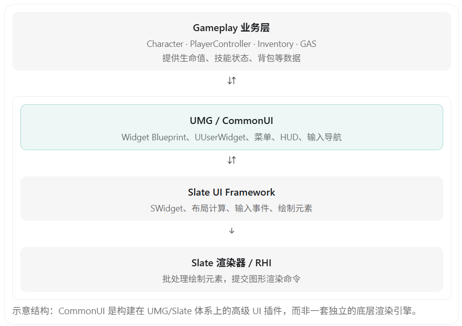
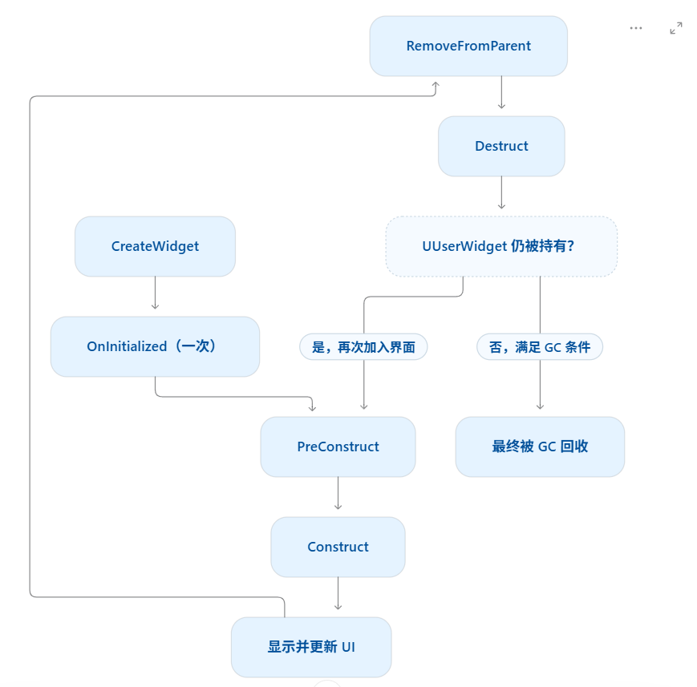
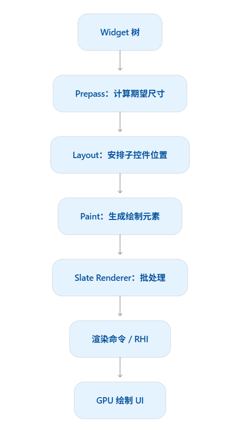

# UE5 原生 UI 系统详解（游戏客户端面试）

UE5 的原生 UI 系统主要由 Slate、UMG（Unreal Motion Graphics）和 CommonUI 组成。

从面试角度来看，除了会使用 UMG 制作血条、背包、技能栏之外，还需要理解：

1. Slate 和 UMG 的区别及底层关系。
2. Widget 的创建、生命周期和内存管理。
3. UI 的布局、渲染和事件处理机制。
4. UI 与 Gameplay 系统如何通信。
5. UI 性能优化，尤其是大量 Widget 的情况。

## 一、UE5 UI 系统的整体架构



### 1. Slate：底层 C++ UI 框架

Slate 是 UE 的底层 UI 框架，使用 C++ 开发。

例如：

```c++
SNew(SVerticalBox)
+ SVerticalBox::Slot()
[
    SNew(STextBlock)
    .Text(FText::FromString(TEXT("Hello UE5")))
];
```

Slate 的主要特点：

- 使用声明式 C++ 语法构建界面。
- 负责 Widget 布局、输入事件和绘制。
- 广泛应用于 Unreal Editor，也可以用于游戏运行时 UI。
- 使用 `TSharedPtr`、`TSharedRef` 等智能指针管理 Slate Widget。
- `SWidget` 通常不是 UObject，不参与 UObject GC。

Slate 的典型类包括 `SWidget`、`SButton`、`STextBlock`、`SVerticalBox`。

### 2. UMG：面向游戏开发的 UI 系统

UMG 建立在 Slate 之上，提供了可视化设计器和蓝图接口。

例如你在 UMG 编辑器中放置一个 Button，表面上使用的是 `UButton`，但底层会使用对应的 Slate Widget 来实现界面功能。

```
UMG：UButton
       │
       ▼
Slate：SButton
       │
       ▼
Slate 绘制系统
```

UMG 中经常使用的类有：

```
UWidget
  │
  ├── UUserWidget
  ├── UTextBlock
  ├── UImage
  ├── UButton
  ├── UProgressBar
  └── UPanelWidget
       ├── UCanvasPanel
       ├── UVerticalBox
       ├── UHorizontalBox
       └── UUniformGridPanel
```

UMG 中的 `UWidget` 继承自 UObject 体系，可以使用 `UPROPERTY`、反射和垃圾回收机制。

### 3. CommonUI：高级 UI 框架

CommonUI 是 UE5 提供的高级 UI 插件，适合大型、多平台游戏。

它主要解决：

- 复杂菜单的分层管理。
- 键盘、鼠标和手柄之间的输入切换。
- UI 焦点与手柄导航。
- UI 输入事件的路由。
- 跨平台 UI 样式复用。

例如 RPG 游戏中有主菜单、背包、地图、装备页面和确认弹窗，使用 CommonUI 能更方便地管理不同页面之间的层级和输入。

CommonUI 中一个重要的类是 `UCommonActivatableWidget`，用于表示可以激活、停用并参与输入管理的界面。

### 三者的区别

| 对比     | Slate            | UMG              | CommonUI                    |
| -------- | ---------------- | ---------------- | --------------------------- |
| 定位     | 底层 UI 框架     | 游戏 UI 开发框架 | 高级 UI 管理插件            |
| 主要语言 | C++              | 蓝图 + C++       | 蓝图 + C++                  |
| 代表类型 | `SWidget`        | `UUserWidget`    | `UCommonActivatableWidget`  |
| 开发方式 | C++ 声明式布局   | 可视化编辑器     | 在 UMG 基础上管理页面和输入 |
| 常见用途 | 编辑器、底层控件 | HUD、血条、背包  | 多层菜单、手柄导航          |

**面试重点：UMG 不是与 Slate 完全独立的 UI 渲染系统。UMG 负责让开发者更方便地构建 UI，而实际的布局、输入处理和底层绘制依赖 Slate。**

## 二、UMG 的核心类和开发方式

UE5 游戏 UI 开发中最常用的是 `UUserWidget`。

它通常用于封装一个完整的 UI 界面，例如血条、背包、技能栏或暂停菜单。

### 1. 使用 UUserWidget 创建 UI

假设我们希望使用 C++ 创建一个玩家 HUD。

先定义自己的 Widget 类：

```c++
UCLASS()
class UMyHUDWidget : public UUserWidget
{
    GENERATED_BODY()

public:
    UPROPERTY(meta = (BindWidget))
    TObjectPtr<UProgressBar> HealthBar;

    UFUNCTION(BlueprintCallable)
    void UpdateHealth(float Percent);
};
```

实现：

```c++
void UMyHUDWidget::UpdateHealth(float Percent)
{
    if (HealthBar)
    {
        HealthBar->SetPercent(Percent);
    }
}
```

之后创建一个继承 `UMyHUDWidget` 的 Widget Blueprint，并在设计器中添加名称为 `HealthBar` 的 ProgressBar。

`BindWidget` 会将蓝图中的指定控件绑定到对应的 C++ 成员。

接着在 PlayerController 中创建 UI：

```c++
void AMyPlayerController::BeginPlay()
{
    Super::BeginPlay();

    if (IsLocalController() && HUDWidgetClass)
    {
        HUDWidget = CreateWidget<UMyHUDWidget>(
            this,
            HUDWidgetClass
        );

        if (HUDWidget)
        {
            HUDWidget->AddToPlayerScreen();
        }
    }
}
```

这里假设已经在头文件中声明了 `HUDWidgetClass`，并通过 `UPROPERTY()` 保存 `HUDWidget` 引用。

其中两个函数非常重要：

| 函数                  | 作用                                           |
| --------------------- | ---------------------------------------------- |
| `CreateWidget()`      | 创建 UUserWidget 对象                          |
| `AddToViewport()`     | 将 Widget 添加到游戏视口                       |
| `AddToPlayerScreen()` | 添加到所属玩家的屏幕 UI 层，适合本地分屏等场景 |
| `RemoveFromParent()`  | 从父控件或视口移除 Widget                      |

**特别注意：CreateWidget 创建的是 UObject 类型的 Widget，而 AddToViewport 是让它参与屏幕 UI 显示，并不是再创建一个新的 UObject。**

## 三、UMG 的生命周期（面试高频）

UMG 和 Actor 的生命周期不同。

Actor 通常关注 `BeginPlay()`、`Tick()`、`EndPlay()`，而 `UUserWidget` 主要关注：

| 回调                    | 作用                                    |
| ----------------------- | --------------------------------------- |
| `NativeOnInitialized()` | Widget 实例初始化时，运行时通常执行一次 |
| `NativePreConstruct()`  | 构造前的界面预览和展示配置              |
| `NativeConstruct()`     | 底层 Slate Widget 构建后触发            |
| `NativeTick()`          | Widget 需要 Tick 时执行                 |
| `NativeDestruct()`      | 底层 Slate Widget 相关资源被解除时触发  |

典型过程可以理解为：



这是便于理解的简化流程，不代表所有编辑器预览、Slate 重建与移除操作都严格按照同一顺序执行。

### 为什么 Construct 可能执行多次？

因为 `Construct` 与底层 Slate Widget 的构建相关，而不是 UObject 只创建一次的标志。

例如：

```c++
Widget->AddToViewport();
Widget->RemoveFromParent();
Widget->AddToViewport();
```

第二次加入时可能再次触发 `Construct`，即使 `Widget` 还是同一个 UObject 实例。

相反，`OnInitialized` 对正常运行时的同一个 UserWidget 实例只调用一次。

因此，一次性的初始化适合放在 `NativeOnInitialized`；界面显示相关的绑定与清理则需要考虑 `NativeConstruct`、`NativeDestruct` 是否会多次发生。

### RemoveFromParent 会直接销毁 Widget 吗？

不会。

因为 UUserWidget 属于 UObject，需要由 GC 管理内存。

`RemoveFromParent()` 只是把 Widget 从 UI 层级中移除。如果其他对象仍然持有对它的强引用，该 Widget 依然可能继续存在。

这也是很多游戏选择**创建一次主 HUD，再通过显示和隐藏管理界面的原因。**

## 四、Slate 与 UMG 的内存管理区别

这是很容易和 UE5 智能指针一起考察的知识点。

| 对比项             | Slate                 | UMG                   |
| ------------------ | --------------------- | --------------------- |
| 主要对象           | `SWidget`             | `UWidget`             |
| 是否继承 UObject   | 通常不是              | 是                    |
| 内存管理           | 智能指针引用计数      | UObject GC            |
| 典型引用方式       | `TSharedRef<SWidget>` | `TObjectPtr<UWidget>` |
| 是否支持 UPROPERTY | 不支持                | 支持                  |

例如 Slate：

```c++
TSharedRef<SButton> Button =
    SNew(SButton);
```

Slate 对象通常通过 `TSharedRef` 或 `TSharedPtr` 管理。

而 UMG：

```c++
UPROPERTY()
TObjectPtr<UUserWidget> MyWidget;
```

UMG Widget 通过 UObject 的垃圾回收机制管理。

**面试加分点：UMG 的 UObject 生命周期和底层 Slate Widget 的生命周期不是完全相同的。**

## 五、UE5 UI 的底层渲染原理

这是相对深入的知识点，面试中能够体现对 UE5 引擎内部的理解。

Slate UI 的渲染大致可以分成以下过程：



### 1. Layout：布局计算

Slate 使用分阶段的布局机制。

首先计算控件希望占用的空间：

```c++
ComputeDesiredSize()
```

然后根据父控件分配的空间，确定子控件的位置与大小：

```c++
ArrangeChildren()
```

例如 `SVerticalBox` 会根据自身的布局规则计算子控件的排列位置。

### 2. Paint：生成绘制元素

Slate 使用 `OnPaint()` 生成 UI 的绘制描述。

它并不是简单地对每个 Widget 都调用一次 GPU Draw Call，而是把需要绘制的内容组织成绘制元素。

例如一个按钮可能包含：

```
Button
  ├── 背景图
  ├── 边框
  └── 文本
```

这些内容会生成相应的 Slate 绘制元素，随后交给渲染器处理。

### 3. Batch：绘制批处理

Slate Renderer 会尝试对满足条件的绘制元素进行合批，从而减少绘制提交开销。

但是否能够合批还受到纹理、材质、裁剪、绘制层级等因素影响。

**因此，Widget 数量不等于 Draw Call 数量。**

例如 100 个 Widget 不意味着一定有 100 个 Draw Call。

## 六、UE5 UI 如何处理输入事件？

UI 输入主要依赖 Slate 的事件系统。

例如玩家点击背包中的物品：

```
鼠标点击
    ↓
Slate 输入系统
    ↓
Hit Test（命中测试）
    ↓
定位目标 Widget
    ↓
分发鼠标事件
    ↓
Button OnClicked
    ↓
背包逻辑
```

### 1. 事件处理机制

Slate 可以通过 `FReply` 表示一个输入事件是否被处理。

例如：

```c++
FReply SMyWidget::OnMouseButtonDown(
    const FGeometry& MyGeometry,
    const FPointerEvent& MouseEvent)
{
    return FReply::Handled();
}
```

其中：

- `FReply::Handled()`：表示事件已被处理。
- `FReply::Unhandled()`：表示当前控件未处理，允许事件继续按照相应路由传递。

Slate 的鼠标输入还涉及命中测试、冒泡路由、鼠标捕获等机制。

### 2. 三种输入模式

在 PlayerController 中，经常会设置：

```c++
FInputModeGameOnly GameOnly;
FInputModeUIOnly UIOnly;
FInputModeGameAndUI GameAndUI;
```

| 输入模式  | 典型场景                 |
| --------- | ------------------------ |
| GameOnly  | 玩家正常移动、战斗       |
| UIOnly    | 主菜单、暂停菜单         |
| GameAndUI | 游戏运行时打开背包、地图 |

`GameAndUI` 模式下，UI 优先获得处理机会；如果 UI 没有处理输入，则游戏控制器仍可能处理该输入。

但不能简单理解成所有键盘鼠标事件都会无条件同时发送给游戏和 UI。

### 3. UI Focus（焦点）

例如玩家使用手柄操作菜单：

```
主菜单
  ├── 开始游戏  ← 当前焦点
  ├── 设置
  └── 退出游戏
```

玩家按下方向键，焦点可以在不同控件之间移动。

焦点、导航和输入路由是 CommonUI 非常重要的功能，尤其适合多平台游戏。

## 七、UI 与 Gameplay 逻辑如何通信？

结合你之前开发的 GAS 技能系统和背包系统，可以把 UI 看作游戏数据的表现层。

不推荐让 Widget 直接负责修改大量业务数据。

例如血条：

```
GameplayEffect 造成伤害
         ↓
AttributeSet 的 HP 变化
         ↓
AbilitySystemComponent 触发属性变化通知
         ↓
HUD 监听到 HP 变化
         ↓
更新 UProgressBar
```

常见实现方式是使用：

```c++
GetGameplayAttributeValueChangeDelegate(...)
```

监听 ASC 中某个 Attribute 的变化。

收到通知后再调用：

```c++
HealthBar->SetPercent(CurrentHP / MaxHP);
```

实际项目应处理 MaxHP 为 0 的情况，以及 Widget 的绑定和解绑生命周期。

### 为什么推荐事件驱动，而不是 Tick？

假设游戏中有 100 个血条。

如果每个血条都在 `NativeTick()` 中查询生命值：

```c++
void UHealthWidget::NativeTick(...)
{
    UpdateHealth();
}
```

即使生命值没有变化，也可能每帧执行大量查询和刷新逻辑。

更好的方式是使用委托：

```
生命值变化
    ↓
广播事件
    ↓
对应 Widget 收到通知
    ↓
只刷新变化的数据
```

可以减少不必要的计算和 UI 更新。

除了事件驱动，UE5 还提供 MVVM（Model-View-ViewModel）相关工具，帮助分离 UI 数据与界面表现，但它不是所有 UI 项目必须采用的架构。

## 八、UE5 UI 如何进行性能优化？

这是游戏客户端岗位最值得重点准备的部分。

| 优化方式            | 解决的问题                           |
| ------------------- | ------------------------------------ |
| 事件驱动更新        | 避免不必要的 Tick 和属性查询         |
| 简化 Widget 层级    | 降低布局与遍历开销                   |
| Invalidation Box    | 缓存不频繁变化的布局和绘制信息       |
| Retainer Box        | 将子 UI 绘制到 Render Target         |
| ListView / TileView | 大量列表条目虚拟化与复用             |
| Widget 复用         | 避免频繁创建和释放界面控件           |
| 控件可见性管理      | 减少不必要的布局、绘制或命中测试工作 |

### 1. Invalidation Box

`Invalidation Box` 可以缓存子控件的布局和绘制相关信息。

当 UI 没有变化时，复用缓存内容，减少重复计算。

例如：长期不变的角色面板背景比较适合缓存；频繁改变的内容则可能反复导致缓存失效。

### 2. Retainer Box

`Retainer Box` 的作用不同。

它可以先把子控件绘制到 Render Target，再将该纹理用于最终显示。

优势是可以控制渲染更新频率、添加 UI 材质效果，并在某些情况下减少最终绘制开销。

缺点是 Render Target 会额外消耗显存，重新绘制也有成本。

**Invalidation Box 主要优化重复的 CPU 布局和绘制计算；Retainer Box 通过离屏渲染缓存结果，可能进一步降低绘制提交成本，但代价更高。** 

### 3. ListView / TileView（大量背包格子）

假设背包有 2000 个物品格子，但屏幕一次只能展示 40 个。

传统做法可能为所有格子创建 Widget。

更好的方式是使用 `TileView`。

```
背包数据：2000 个 Item
          ↓
TileView 虚拟化
          ↓
可见区域：约 40 个 Entry Widget
          ↓
滚动时复用 Entry Widget
```

`TileView` 继承自 `ListView`，而 ListView 通过虚拟化机制只生成可见区域所需的条目 Widget。

对于你之前介绍的 Mass 背包系统，可以采用：

```
Mass Entity / Fragment
          ↓
背包数据访问层
          ↓
物品展示数据
          ↓
TileView
          ↓
可见的格子 Widget
```

这样既可以利用 Mass 管理物品数据，又不会因为背包物品数量过多而生成大量 Widget。

### 4. 使用性能分析工具

UE5 中可以使用 `Widget Reflector` 检查 Widget 层级与布局，使用 `Slate Insights` 和 `Unreal Insights` 分析 UI 执行开销，还可以借助 `stat slate` 查看相关性能统计。

优化时应该优先找出性能瓶颈，再决定是否使用缓存、虚拟化或简化 Widget 层级。

## 九、UI 在网络游戏中如何同步？

UMG Widget 本身通常不会通过 Actor Replication 在客户端之间同步。

例如玩家的血条：

```
服务器
   │
   └── Character / AttributeSet
              │
              │ 属性复制
              ▼
         客户端角色数据
              │
              │ 数据变化事件
              ▼
         客户端 UMG Widget
```

也就是说：

**同步的是 Gameplay 数据，而不是 Widget 对象本身。**

例如玩家受到伤害，服务器计算并更新 HP，再根据对应属性的复制机制同步给客户端，客户端 UI 监听 HP 变化并刷新血条。

这也是通常把 UI 创建与管理放在本地 PlayerController、LocalPlayer 相关系统中的重要原因之一。

## 十、面试高频追问

1. Slate 和 UMG 有什么区别？

Slate 是底层 C++ UI 框架，负责布局、输入和绘制；UMG 基于 Slate，提供 UObject、反射、蓝图及可视化 UI 编辑功能。

2. UMG Widget 是 UObject 吗？

是。`UWidget` 继承 UObject，而底层 `SWidget` 通常不是 UObject，主要通过 UE 智能指针管理。

3. RemoveFromParent 会销毁 Widget 吗？

不会直接销毁 UObject，它主要是将 Widget 从父控件或视口移除，实际内存由 GC 管理。

4. Construct 和 OnInitialized 有什么区别？

`OnInitialized` 对正常运行时的一个 Widget 实例只执行一次；`Construct` 可能随底层 Slate Widget 重新建立而执行多次。

5. 为什么不推荐所有 UI 都使用 Tick 更新？

Tick 可能产生大量无意义的数据查询和重复刷新。事件驱动可以在数据真正变化时更新对应控件。

6. Invalidation Box 和 Retainer Box 有什么区别？

Invalidation Box 主要缓存布局和绘制信息；Retainer Box 使用 Render Target 缓存子界面的渲染结果。

7. UMG 的每个 Widget 都会产生一次 Draw Call 吗？

不会。Slate 会生成绘制元素并尝试合批，实际 Draw Call 数量与材质、纹理、层级、裁剪等因素有关。

## 十一、面试推荐回答（1～2 分钟）

> UE5 的原生 UI 系统主要由 Slate、UMG 和 CommonUI 组成。
>
> Slate 是底层 C++ UI 框架，负责 Widget 的布局计算、输入事件处理和绘制。UMG 是建立在 Slate 上的一套 UI 开发框架，提供可视化编辑器、蓝图支持和 UObject 生命周期管理，让开发者可以更方便地开发游戏 UI。
>
> CommonUI 则在 UMG 的基础上提供多层菜单管理、输入路由、焦点导航和多平台适配等高级功能。
>
> 在实现原理上，UMG 会使用底层 Slate Widget 进行布局和绘制。Slate 会经过布局计算、生成绘制元素以及渲染批处理等过程，最终由渲染系统提交 GPU 绘制。
>
> 生命周期方面，UUserWidget 主要通过 OnInitialized、Construct、Destruct 等回调进行初始化和清理。它本身属于 UObject，由 GC 管理，而底层 Slate Widget 主要通过智能指针管理。
>
> 在实际开发中，我会尽量让 UI 只负责展示和交互，Gameplay 数据由对应的业务系统管理，通过委托或事件通知 UI 更新。
>
> 对于性能优化，我会重点考虑减少 Tick、简化 Widget 层级、使用 Invalidation Box，以及通过 ListView、TileView 实现大量条目的虚拟化。
>
> 对于多人联机游戏，UI 一般在客户端本地创建，服务器复制的是对应的游戏状态，而不是 UI Widget 本身。

## 十二、游戏客户端面试的学习重点

按照优先级，建议这样准备：

| 优先级 | 知识点              | 掌握要求                        |
| ------ | ------------------- | ------------------------------- |
| 高     | Slate 与 UMG 的区别 | 能解释两者关系                  |
| 高     | Widget 生命周期     | 理解初始化、构建、移除和 GC     |
| 高     | UI 数据更新机制     | 理解事件驱动、委托、属性绑定    |
| 高     | UI 性能优化         | 能结合实际项目提出优化方案      |
| 中     | Slate 渲染原理      | 理解 Layout、Paint、Batch       |
| 中     | UI 输入处理         | 理解 InputMode、Focus、事件路由 |
| 中     | CommonUI            | 理解页面层级和输入路由          |
| 中     | UI 与网络复制       | 知道同步数据而非 Widget         |
| 进阶   | 自定义 Slate Widget | 能使用 SWidget 编写底层控件     |

**对于你目前的 UE5 GAS 和 Mass 背包项目，最值得深入学习的三个方向是：Slate 的底层渲染流程、UMG 的生命周期与 GC、大量背包格子的 UI 虚拟化。**

这三个方向既能结合实际开发经验，也很容易被面试官继续追问到引擎原理层面。