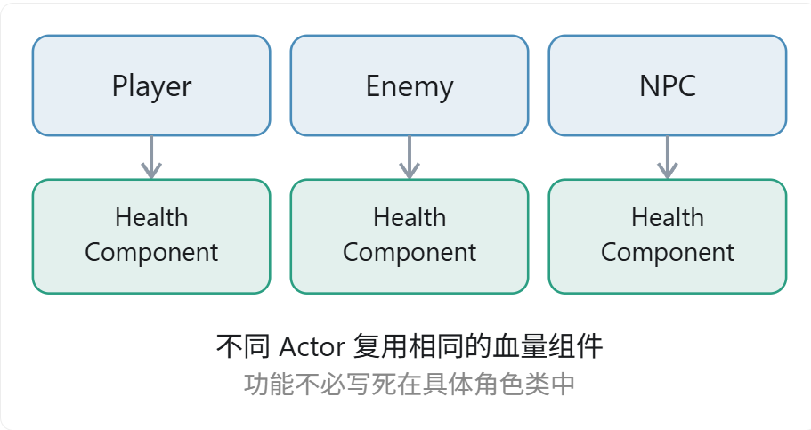
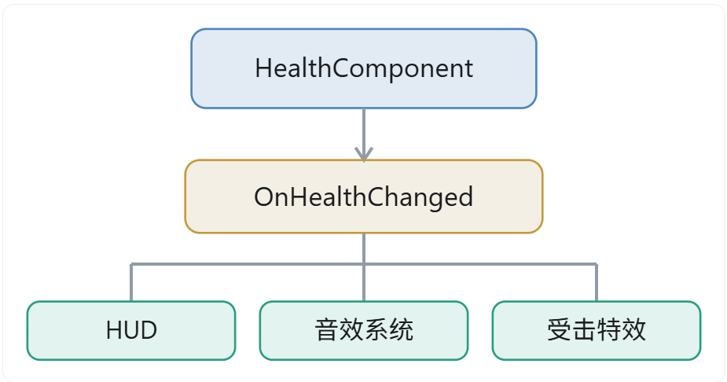
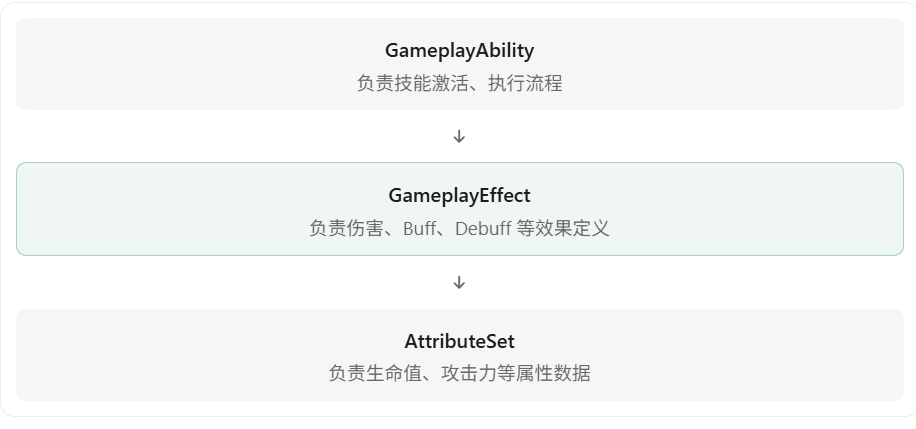
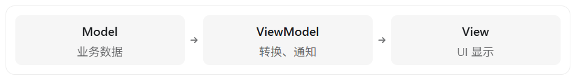

UE5 中很多设计都体现了**解耦（Decoupling）**的思想，例如组件化、委托、接口、GameplayTag、GAS、MVVM、Mass ECS、Subsystem 等。

**解耦的核心思想是：减少模块之间的直接依赖，让一个模块发生变化时，尽量不影响其他模块。**

在 UE5 面试中，可以从以下几个方面回答。

## 一、UE5 中常见的解耦设计

| 设计                | 解耦思想                        | 典型应用               |
| ------------------- | ------------------------------- | ---------------------- |
| ActorComponent      | 功能与 Actor 解耦               | 血量、背包、交互组件   |
| Delegate（委托）    | 事件发送者与接收者解耦          | 血量变化通知 UI        |
| Interface（接口）   | 调用者与具体实现解耦            | 玩家与不同交互物体     |
| GameplayTag         | 逻辑判断与具体类解耦            | 技能互斥、状态判断     |
| GAS                 | 技能、属性、效果相互解耦        | 技能系统、Buff 系统    |
| MVVM                | UI 表现与业务数据解耦           | HUD、背包、属性面板    |
| Mass ECS            | 数据与处理逻辑解耦              | 大量实体的批量处理     |
| Subsystem           | 公共服务与具体 Actor 解耦       | 全局管理、局部系统服务 |
| DataAsset           | 游戏配置与执行逻辑解耦          | 物品、技能和角色配置   |
| 行为树与 Blackboard | AI 决策与具体行为、数据来源解耦 | 敌人 AI                |

## 二、几个典型例子

### 1. ActorComponent：功能与对象解耦

假设玩家、敌人和 NPC 都需要血量系统。

不采用组件化时，需要在每个 Actor 中分别实现血量逻辑，或者依赖共同的继承体系。



采用组件化后：

这样血量逻辑可以独立开发和维护，Actor 只需要持有组件并使用它提供的能力。

**解耦点：将功能实现从具体 Actor 类中拆分出来，通过组合实现复用，而不是依赖继承。**

### 2. Delegate：事件发送者与接收者解耦

例如玩家受到伤害后，需要更新 HUD 血条。

如果直接耦合：

```c++
void AMyCharacter::TakeDamage()
{
    Health -= 10;
    HUD->UpdateHealth(Health);
}
```

Character 必须知道 HUD 的存在以及它提供的更新接口。

使用委托：

```c++
// HealthComponent.h
DECLARE_MULTICAST_DELEGATE_OneParam(
    FOnHealthChanged, float);

FOnHealthChanged OnHealthChanged;
// HealthComponent.cpp
Health -= 10;
OnHealthChanged.Broadcast(Health);
```

UI 订阅这个事件，收到通知后自行更新。



**解耦点：事件发送者不需要知道有哪些接收者，更不需要知道接收者如何处理事件。**

这也是 UE5 中最典型的观察者模式应用之一。

### 3. Interface：调用者与具体实现解耦

例如玩家按 E 键交互时，可能交互的是宝箱、NPC 或门。

如果不使用接口：

```c++
if (Actor->IsA(AChest::StaticClass()))
{
    // 打开宝箱
}
else if (Actor->IsA(ADoor::StaticClass()))
{
    // 打开门
}
```

这种设计使玩家依赖具体交互对象类型。每增加一种交互对象，就可能需要修改玩家代码。

使用 `UInterface`：

```c++
if (Actor->Implements<UInteractInterface>())
{
    IInteractInterface::Execute_Interact(Actor);
}
```

其中 `Interact` 假设是使用 `UFUNCTION` 声明的接口函数。

玩家只关心目标是否支持交互，不关心它具体是宝箱还是门。

**解耦点：调用者依赖抽象接口，而不是依赖具体类。**

### 4. GameplayTag：状态与具体逻辑解耦

假设一个技能只能在角色没有眩晕时释放。

传统做法是直接访问角色的状态变量：

```c++
if (!Character->bIsStunned)
{
    ActivateAbility();
}
```

使用 GameplayTag 后，可以通过统一的状态标签判断：

```c++
if (!ASC->HasMatchingGameplayTag(
    FGameplayTag::RequestGameplayTag("State.Stunned")))
{
    ActivateAbility();
}
```

这样技能不必了解眩晕状态由哪个组件或系统产生，只需要查询对应的 GameplayTag。

**解耦点：技能逻辑不依赖具体状态的实现方式，而依赖统一的标签语义。**

注意 GameplayTag 并不消除所有依赖，使用方和提供方仍需要约定标签含义。

### 5. GAS：技能、属性、效果解耦

GAS 将技能系统拆分成多个模块：



例如一个火球技能，不需要自己实现血量扣除、属性修改和 Buff 持续时间管理，而是通过 GameplayEffect 描述相应效果。

**解耦点：技能执行过程与属性、状态效果的处理逻辑相分离。**

### 6. MVVM：UI 与业务逻辑解耦

MVVM 是 UE5 UI 系统中非常典型的解耦设计。



例如玩家血量发生变化：

- Model 负责保存或提供玩家血量。
- ViewModel 将血量转化为 UI 需要的数据，并通知数据变化。
- View 通过绑定自动更新血条。

这样 Model 不需要直接引用 Widget，而 UI 也不需要了解底层血量数据的存储和计算方式。

**解耦点：数据、展示逻辑和 UI 表现三者分离。**

### 7. Mass ECS：数据与行为解耦

Mass 采用 ECS 思想，将实体、数据和逻辑拆分：

- **Entity：**实体标识。
- **Fragment：**保存实体数据。
- **Processor：**查询符合条件的实体并批量处理数据。

比如敌人的移动速度存储在 Fragment 中，移动计算由 Processor 完成，而不必在每个敌人 Actor 的 Tick 中分别实现。

**解耦点：数据不绑定在具体 Actor 对象中，处理逻辑也不绑定在单个实体对象上。**

### 8. Subsystem：系统级功能与具体对象解耦

例如多个 Actor 都需要访问任务系统。

如果让某个 Actor 负责管理任务，其他对象就必须依赖这个 Actor 的实例及其生命周期。

可以将任务服务放在 `UGameInstanceSubsystem` 中，让不同 Actor 通过统一的服务入口访问它。

**解耦点：把公共服务从具体游戏对象中抽离，避免依赖某个特定 Actor 的存在。**

不过，Subsystem 主要解决服务归属、生命周期和访问方式的问题，并不意味着使用它就一定实现了低耦合。

## 三、面试时如何回答？

如果面试官问：“你认为 UE5 中哪些地方体现了解耦思想？”

可以这样回答：

> UE5 中体现解耦思想的设计非常多。
>
> 首先是组件化设计，比如 ActorComponent，可以把血量、背包等功能从 Actor 中拆出来，通过组合的方式实现复用，避免过度依赖继承。
>
> 其次是委托和接口。委托可以实现事件发送者和接收者的解耦，接口可以让调用者不必依赖具体类。
>
> 另外，GAS 也体现了很明显的解耦思想，它将技能执行、属性管理和 GameplayEffect 分离，通过统一机制组织起来。
>
> UI 方面则有 MVVM，把业务数据、展示逻辑和 UI 表现分开，避免 UI 直接依赖底层业务系统。
>
> 如果项目采用 Mass ECS，还可以通过 Fragment 和 Processor 实现数据与处理逻辑的分离。
>
> 总体来说，我认为 UE5 的很多设计都在强调面向接口编程、组件化、事件驱动以及数据和逻辑分离，目的是降低系统之间的依赖，提高复用性和可维护性。

面试中尤其值得强调的是：解耦不只是把代码拆成不同的类，更重要的是减少模块之间对具体实现的依赖。 例如，把 `UpdateHealthUI()` 从 Character 移到另一个类中，但 Character 仍然直接调用这个类，实际上并没有彻底解决依赖问题；改成事件通知，才真正降低了双方的直接耦合。