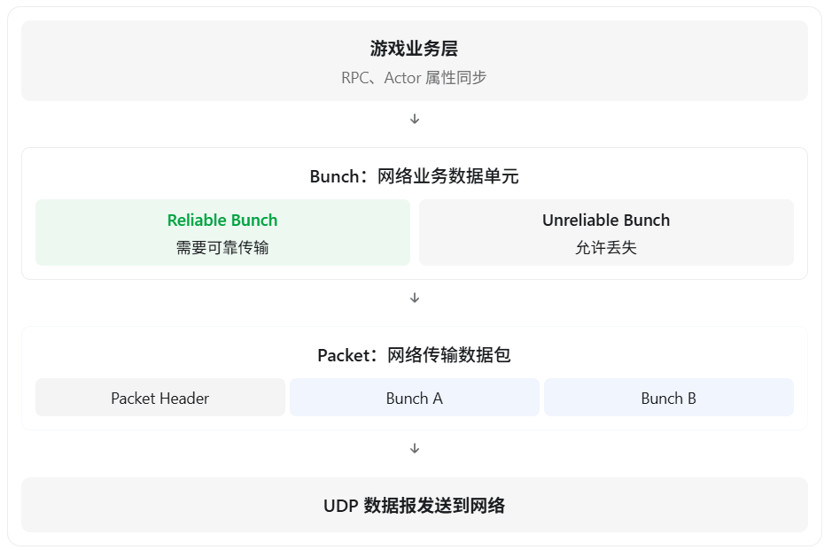
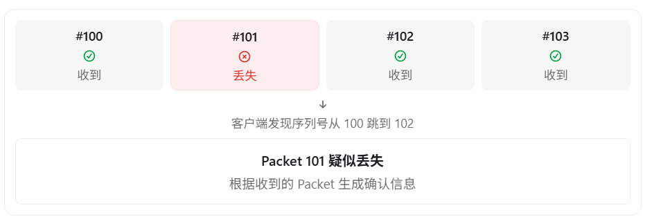
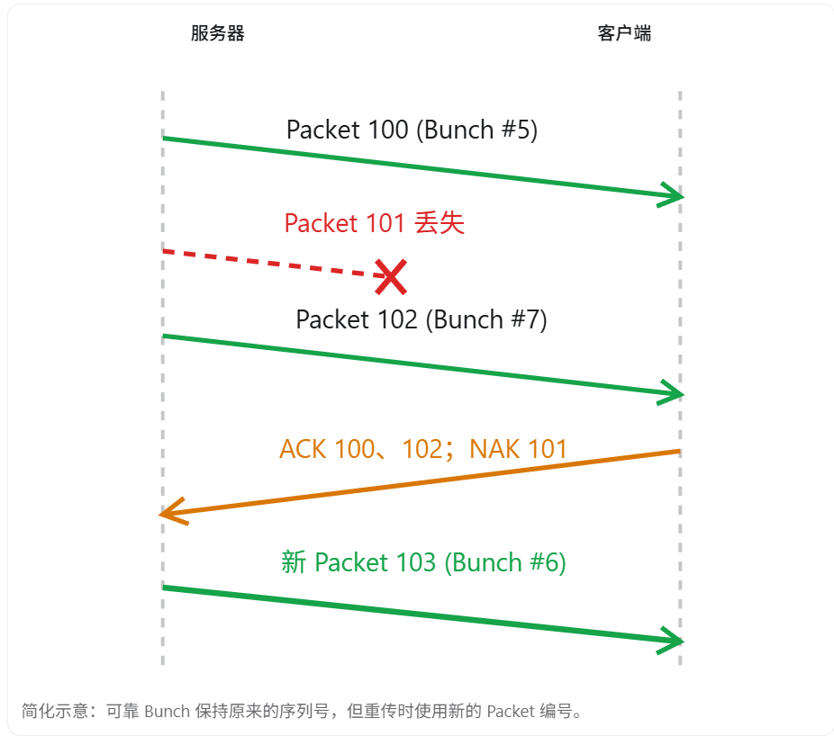

UE5 的网络通信主要采用 **UDP + 应用层可靠传输机制**。

它并不是让 UDP 本身变得可靠，而是在 UDP 之上，由 UE5 自己实现确认应答（ACK）、丢包检测、重传、序列号等机制，从而实现按需可靠传输。

这里有两个核心问题：

1. **为什么 UE5 不直接使用 TCP，而选择 UDP？**
2. **UDP 本身不保证可靠性，UE5 如何保证重要的游戏数据不会丢失？**

## 一、为什么 UE5 选择 UDP，而不是 TCP？

最重要的原因是：游戏中的不同数据，对可靠性和实时性的要求不同。

例如在一款多人 FPS 游戏中：

| 数据类型               | 是否必须可靠             | 原因                       |
| ---------------------- | ------------------------ | -------------------------- |
| 玩家位置               | 通常不需要每次更新都可靠 | 旧位置很快会被新位置取代   |
| 玩家旋转               | 通常不需要               | 过期数据价值很低           |
| 开枪特效               | 不一定需要               | 偶尔丢失通常可以接受       |
| 购买装备               | 需要可靠处理             | 购买请求不能无故丢失       |
| 背包操作               | 需要可靠处理             | 物品操作需要正确执行       |
| 进入游戏的关键控制消息 | 需要                     | 丢失可能影响连接或游戏流程 |

### 1. TCP 的队头阻塞问题

TCP 是可靠、有序的字节流协议。

假设服务器连续发送三个数据：

```
数据包 A：玩家位置 (100, 200)
数据包 B：玩家位置 (110, 200)
数据包 C：玩家位置 (120, 200)
```

如果 A 丢失，但 B、C 成功到达：

```
发送端： A ─── B ─── C
          ✕     ✓     ✓

接收端：等待 A 重传
        ↓
        按序向应用层交付 A、B、C
```

TCP 不会因为 C 的位置更新更有价值，就允许应用层跳过缺失的 A，直接读取 C 后面的数据。

这种现象称为队头阻塞（Head-of-Line Blocking）。

但在实时游戏中，玩家最新的位置通常比过期的位置更有价值。

例如服务器已经知道玩家在 `(120,200)`，那么先等待 `(100,200)` 对游戏体验反而没有帮助。

### 2. UDP 不要求所有数据可靠、有序

UDP 不保证：

- 数据一定到达。
- 数据按照发送顺序到达。
- 数据不会重复。
- 自动进行丢包重传。

这些看起来是缺点，但实际上给游戏引擎提供了更大的控制空间。

UE5 可以根据不同数据的特点选择处理方式：

```
                    游戏网络数据
                         │
               ┌─────────┴─────────┐
               │                   │
          可靠的数据           非可靠的数据
               │                   │
         需要确认与重传      允许丢失或被新状态覆盖
               │                   │
          技能请求等            位置、旋转等
```

所以 UE5 选择 UDP，并不是因为 UDP 天然更快，而是因为：

UDP 允许引擎自行决定哪些消息需要可靠性，哪些消息应该优先保证实时性。

需要注意，UE5 的经典 IP 网络驱动主要使用 UDP，但 UE 网络框架也支持其他传输实现，并不是所有 UE5 联机方案都只能使用 UDP。

## 二、UE5 是怎么在 UDP 基础上实现可靠传输的？

UE5 的可靠传输主要依赖四个机制：

1. 序列号（Sequence Number）
2. 确认应答（ACK）
3. 丢包检测（NAK）
4. 可靠消息缓存与重传

但在了解这些机制前，需要先理解 UE5 网络框架中的两个关键数据结构：

Packet 和 Bunch。

### 1. Packet 和 Bunch 有什么区别？

UE5 并不是直接把每个 RPC 或属性更新作为一个独立的 UDP 数据报发送出去。

在经典 UE 网络架构中，数据会先被序列化到 Bunch，再由网络连接组合成 Packet。



它们的职责不同：

|              | Packet                     | Bunch                              |
| ------------ | -------------------------- | ---------------------------------- |
| 所属层次     | 连接与传输层面的数据包     | Channel 中的业务数据               |
| 序列号       | 每个连接维护 Packet 序列号 | 每个 Channel 维护可靠 Bunch 序列号 |
| 主要作用     | 传输、ACK、丢包检测        | 承载 RPC、属性等数据               |
| 是否原样重传 | 不会                       | Reliable Bunch 可以重传            |

**UE5 真正选择是否重传的关键单位是 Reliable Bunch，而不是整个 UDP Packet。** 

### 2. 序列号如何检测丢包？

假设服务器向客户端发送四个 Packet：



接收端通过 Packet 的序列号识别缺失数据。

在 UE5 的经典网络实现中，接收方会将成功收到的 Packet 编号通过 ACK 返回发送方。发送方根据确认信息中的序列号缺口判断哪些 Packet 未被确认，产生 NAK（Negative Acknowledgment）。

这里的 NAK 可以理解为引擎内部对未确认 Packet 的判定，不一定是一条单独发送的“丢包通知消息”。

### 3. ACK 和 NAK 怎么触发重传？

假设服务器发送了：

```
Packet 100：可靠 Bunch #5
Packet 101：可靠 Bunch #6
Packet 102：可靠 Bunch #7
```

客户端收到 Packet 100 和 102，Packet 101 丢失。

整个流程如下：



服务器收到确认信息后，会发现 Packet 101 没有被成功确认。

由于 Packet 101 中包含 Reliable Bunch #6，因此服务器需要重新发送这份 Bunch。

注意一个重要细节：

**UE5 不会直接原样重传 Packet 101，而是把 Reliable Bunch #6 放进一个新的 Packet，例如 Packet 103。**

这样既保留了 Reliable Bunch 的身份，又保证每个新发送的 Packet 使用新的 Packet ID。

### 4. 发送方为什么必须缓存 Reliable Bunch？

为了能够重传，发送方必须保留尚未被确认的可靠数据。

可以理解为：

```
Reliable Bunch #5 → 已 ACK → 移除缓存
Reliable Bunch #6 → 未 ACK → 保留并等待重传
Reliable Bunch #7 → 已 ACK → 移除缓存
```

在经典 UE 网络系统中，`UChannel` 会维护尚未确认的 Reliable Bunch。对应的核心成员和接口包括：

- `OutRec`：保存未确认的可靠 Bunch。
- `UChannel::SendBunch()`：发送 Bunch，可靠 Bunch 需要进入相关发送缓存。
- `UChannel::ReceivedAck()`：处理成功确认。
- `UChannel::ReceivedNak()`：处理未确认的 Packet，并触发相关的重传处理。

这些机制可以在 `Engine/Source/Runtime/Engine/Private/` 下的 `DataChannel.cpp`、`NetConnection.cpp` 等源码中进一步追踪。

### 5. 如何保证数据有序？

假设同一个 Actor 依次发送三个可靠 RPC：

```c++
ServerEquipWeapon();
ServerReloadWeapon();
ServerFireWeapon();
```

如果第二个 Reliable Bunch 丢失了，而第三个先到达，接收端不能无条件先执行第三个。

因此，UE5 会利用 Channel 内部的可靠 Bunch 序列号进行顺序控制。

接收方可以暂时缓存后续 Bunch，等缺失的可靠 Bunch 补齐后，再继续按顺序处理。

但这种顺序保证**主要针对同一个 Actor/Channel 内的可靠 RPC**，并不意味着不同 Actor 的所有 RPC 都具有全局执行顺序。

## 三、UE5 中如何指定可靠传输？

### 1. Reliable RPC

例如玩家请求服务器购买一件装备：

```c++
UFUNCTION(Server, Reliable)
void ServerBuyItem(int32 ItemID);


void AMyPlayerController::ServerBuyItem_Implementation(
    int32 ItemID)
{
    // 服务端验证玩家金币、物品价格等
    // 执行购买逻辑
}
```

`Reliable` 表示 UE5 会为这次 RPC 提供可靠、有序的网络传输。

如果承载该 RPC 的 Packet 丢失，引擎会在连接正常的条件下尝试重传相应的 Reliable Bunch，直到得到确认。

但 `Reliable` 不意味着断线后还能保证执行，也不意味着业务操作具有事务保证。比如购买请求可能需要额外的请求 ID、重复请求检查和服务器权威校验。

### 2. Unreliable RPC

例如让客户端播放一个爆炸特效：

```c++
UFUNCTION(NetMulticast, Unreliable)
void MulticastPlayExplosion(FVector Location);


void AMyActor::MulticastPlayExplosion_Implementation(
    FVector Location)
{
    UGameplayStatics::SpawnEmitterAtLocation(
        GetWorld(),
        ExplosionFX,
        Location
    );
}
```

这里使用 `Unreliable`，表示允许该 RPC 因网络丢包等原因不执行。

如果特效消息丢失，通常不值得为了补播一个过期的特效而进行可靠重传。

UE5 的 RPC 默认是 Unreliable，需要显式指定 `Reliable` 才会使用可靠 RPC 机制。

### 3. 那 UPROPERTY(Replicated) 是可靠传输吗？

这里有一个非常容易在面试中答错的问题。

```c++
UPROPERTY(Replicated)
float Health = 100.f;
```

**属性复制和 Reliable RPC 的可靠性机制并不一样。**

在经典复制系统中：

- 属性更新通常通过 Unreliable Bunch 发送。
- 但复制系统会追踪发送、确认和丢失状态。
- 如果属性更新丢失，复制系统可以在后续更新中重新发送必要的属性状态。
- 目标是让客户端最终与服务器的最新状态保持一致，而不是可靠传递每一次中间变化。

例如服务器的血量先后变化：

```
100 → 80 → 60 → 40
```

客户端可能实际只收到：

```
100 → 60 → 40
```

虽然没有看到 80，但最终血量仍然同步为 40。

在传统复制路径中，可以查看 `FObjectReplicator::ReceivedNak()`，它就涉及属性丢包后的重新同步处理。

因此可以这样区分：

| 机制            | 可靠性语义                               |
| --------------- | ---------------------------------------- |
| Reliable RPC    | 尽力保证每次有效调用按序送达执行         |
| Unreliable RPC  | 允许调用丢失                             |
| Replicated 属性 | 追求最终状态一致，不保证收到每次中间变化 |

## 四、既然实现了可靠传输，为什么 UE5 不把所有数据都设为 Reliable？

因为 UE5 实现的可靠传输也有代价。

**第一，可靠消息需要缓存。** 发送方必须保留尚未确认的 Reliable Bunch，占用一定内存和网络发送资源。

**第二，可靠消息需要重传。** 丢包越多，重复传输的开销就越大。

**第三，Reliable RPC 仍然可能产生队头阻塞。** 同一个 Channel 中，如果前面的可靠消息丢失，后续相关消息可能需要等待它恢复。

这说明 UE5 使用 UDP，并不是彻底消除了队头阻塞，而是让引擎能够控制可靠性的粒度。

如果在 Tick 中不断调用：

```c++
UFUNCTION(Server, Reliable)
void ServerUpdatePosition(FVector Position);
```

就可能不断积累可靠消息，在网络不稳定时占满可靠发送缓冲区，严重时甚至导致连接断开。

因此，**高频状态数据不应该无脑使用 Reliable RPC。**

## 五、UE5 可靠 UDP 和 TCP 到底有什么区别？

| 对比项       | TCP                    | UE5 的经典 UDP 网络层            |
| ------------ | ---------------------- | -------------------------------- |
| 传输协议     | TCP                    | UDP                              |
| 可靠性       | 整条字节流可靠、有序   | 根据业务数据选择可靠或不可靠     |
| 序列号       | TCP 字节序列号         | Packet ID、Reliable Bunch 序列号 |
| ACK          | 有                     | 引擎自己实现                     |
| 重传         | TCP 自动重传丢失数据   | 由引擎决定是否重传 Bunch         |
| 队头阻塞     | TCP 字节流有序交付     | 可靠 Channel 内也可能发生阻塞    |
| 过期位置数据 | TCP 仍需按序交付字节流 | 可通过非可靠更新避免逐次可靠交付 |

这里主要介绍 UE5 的经典 `NetConnection / Channel / Bunch` 实现。UE5 还有 Iris 等复制系统，内部组织方式可能不同，但按业务选择可靠性、避免高频可靠消息的设计思想仍然适用。

## 六、面试时可以这样回答

> UE5 的经典网络框架主要使用 UDP，是因为实时游戏中的数据对可靠性要求不同。
>
> 比如角色位置等高频状态不需要每次更新都可靠到达，而技能请求、关键控制消息等则可能需要可靠传输。
>
> 如果直接使用 TCP，丢包会导致字节流的队头阻塞，而且无法方便地让不同类型的业务数据采用不同可靠性策略。
>
> 因此 UE5 在 UDP 基础上自己实现了可靠传输机制。
>
> 在底层，UE5 通过 Packet 发送网络数据，而 Packet 内包含一个或多个 Bunch。每个 Packet 有序列号，用于 ACK 和丢包检测。
>
> 对于 Reliable Bunch，发送方会缓存尚未确认的数据。如果对应 Packet 被判定丢失，就把该 Reliable Bunch 重新放入新的 Packet 发送。
>
> 同时，每个 Channel 会维护可靠 Bunch 的序列号，保证相关可靠 RPC 按顺序执行。
>
> 对于 Unreliable Bunch，则允许丢失，不进行可靠重传。
>
> 另外，UE5 的属性复制虽然通常使用非可靠的数据传输，但复制系统能够处理丢包并重新发送必要的最新状态，使客户端最终与服务器保持一致。

最后，建议你特别记住这三个区别：

Packet 负责网络传输和确认，Bunch 负责承载业务数据及其可靠性，Channel 负责组织和管理相关数据的有序处理。

这三个概念连起来，就是理解 UE5 经典可靠 UDP 实现的关键。