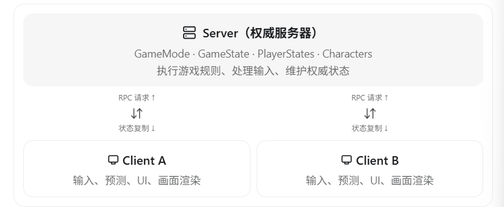
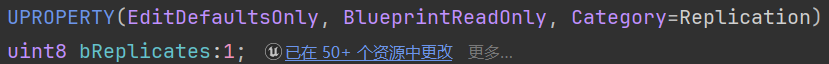
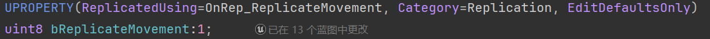
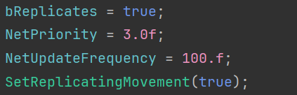
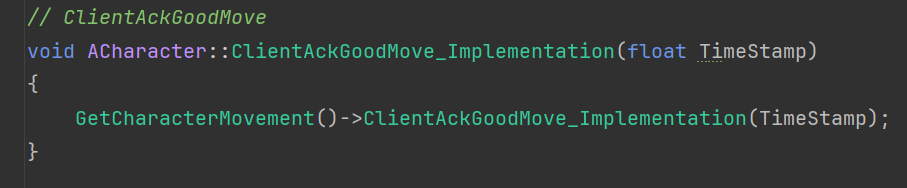
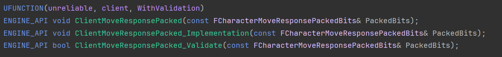
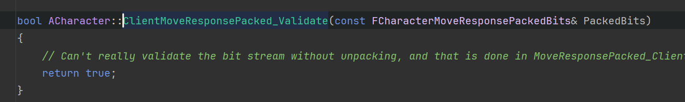
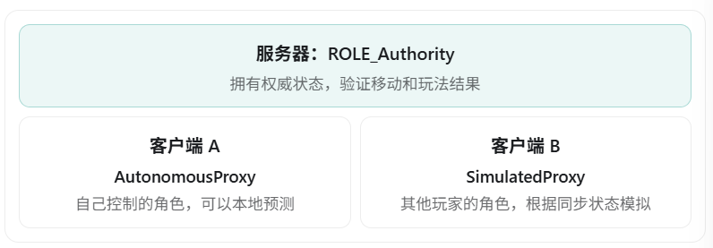
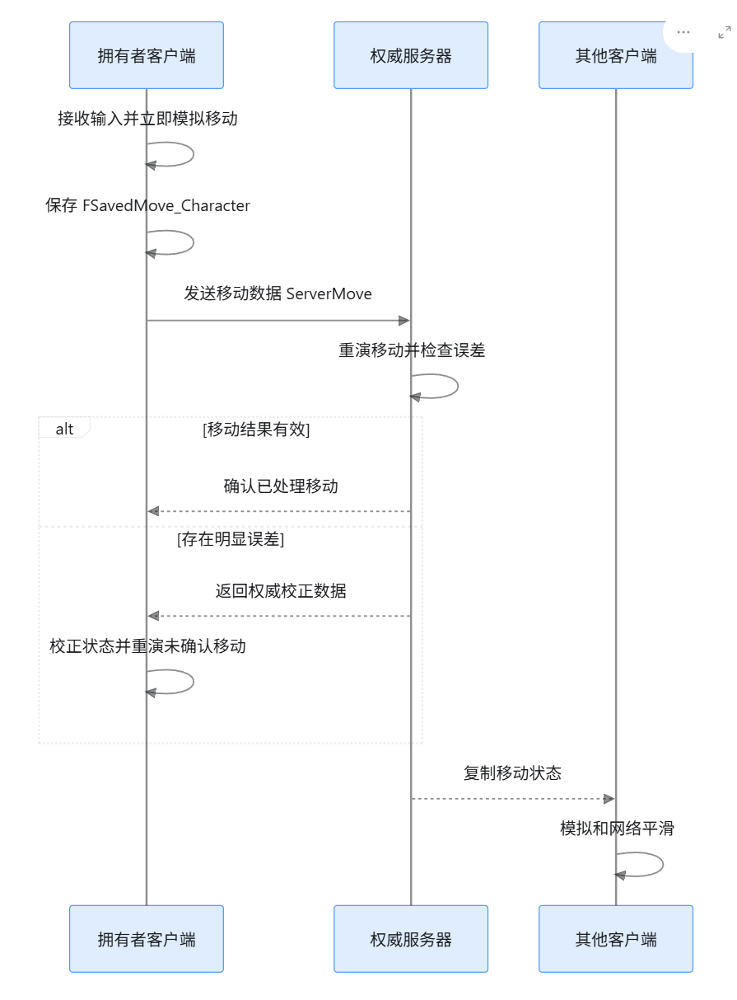

# UE5 网络框架（Networking Framework）详解

UE5 的网络框架主要用于实现多人联机游戏，核心包括 **Client-Server 架构**、**服务器权威机制**、**Actor Replication（属性复制）**、**RPC（远程过程调用）**、**网络角色**、**移动同步和网络优化**。

从游戏客户端开发面试的角度，最重要的是理解以下三个问题：

1. **客户端和服务器之间是如何通信的？**
2. **UE5 如何保证不同客户端看到一致的游戏状态？**
3. **在网络延迟、丢包的情况下，如何保证玩家操作的流畅性？**

## 一、UE5 网络框架的整体架构

UE5 主要采用 **Client-Server（客户端—服务器）架构**，服务器通常负责维护权威游戏状态，客户端负责玩家输入、预测和画面表现。



例如玩家 A 攻击玩家 B：

1. 玩家 A 在客户端按下攻击键。
2. 客户端向服务器提交攻击请求。
3. 服务器验证玩家是否能够攻击、是否命中以及伤害是否合法。
4. 服务器修改玩家 B 的生命值。
5. 服务器通过属性复制将最新生命值同步给相关客户端。
6. 客户端收到更新后刷新血条、播放相应表现。

这个设计的核心就是：

**客户端提交操作意图，服务器决定最终结果，再将结果同步给客户端。**

这样可以减少客户端直接篡改游戏状态造成的作弊问题，同时让服务器成为多名玩家共享的权威状态来源。

### 1. UE5 有哪些服务器运行模式？

| 模式             | 说明                               | 适用场景               |
| ---------------- | ---------------------------------- | ---------------------- |
| Standalone       | 独立单机运行                       | 单人游戏、离线测试     |
| Listen Server    | 玩家客户端同时承担服务器职责       | 好友联机、房主制游戏   |
| Dedicated Server | 独立专用服务器，不负责玩家画面渲染 | 竞技游戏、大型多人游戏 |
| Client           | 连接远程服务器的游戏客户端         | 联机玩家               |

​	在Standalone模式下，本机会同时作为服务端与客户端运行，并且**不支持与其他客户端通信**。客户端会直接获得Authority权限。由于不存在真实的服务端与客户端之间的网络通信，所以无法测试属性复制、网络延迟、RPC 跨网络执行等功能。

​	Standalone并不会使DS专属逻辑失效，但是如果代码明确判断当前网络模式必须是 `NM_DedicatedServer` 或 `NM_ListenServer`，那么 Standalone 模式不会满足这些条件，相关逻辑就不会执行。

​	Listen Server也是本地同时做客户端和服务端，支持其他客户端的连接，由于本地客户端不需要通过网络通信来和服务端通信，所以相较于其他客户端，拥有一定的延迟优势。虽然 Listen Server **能够测试真实网络同步**，但房主玩家本身运行在服务器上，所以无法完整模拟普通远程客户端的网络延迟、预测和服务器校正行为。

​	在 Dedicated Server 模式下，服务器主要负责游戏模拟和网络通信，不需要为本地玩家渲染游戏画面。

### 2. 服务器权威（Server Authority）

在 UE5 中，复制的 Actor 通常以服务器实例为权威。

比如玩家 A 的生命值为 100：

```
服务器：HP = 100
客户端 A：HP = 100
客户端 B：HP = 100
```

客户端 A 如果仅在本地执行：

```c++
Health = 9999;
```

并不会因此改变服务器上的权威生命值，也不会自动同步给客户端 B。

后续服务器的权威属性更新还可能覆盖客户端 A 的本地修改。

因此，正常设计中应由服务器执行生命值修改，再通过网络复制同步结果。

## 二、UE5 的核心网络机制：Replication

Replication（网络复制）是 UE5 网络框架最核心的功能。

它可以将服务器上的 Actor 状态同步到客户端，使各个客户端拥有相应的本地副本。

UE5 主要支持以下几种复制机制：

| 机制                  | 作用                                     |
| --------------------- | ---------------------------------------- |
| Actor Replication     | 复制 Actor 的创建、销毁及相关状态        |
| Property Replication  | 同步 Actor 的指定属性                    |
| RPC                   | 在远程机器上执行函数                     |
| Component Replication | 复制 ActorComponent 的相关状态           |
| Subobject Replication | 复制被 Actor 管理的可复制 UObject 子对象 |
| Movement Replication  | 同步 Actor 的移动状态                    |

需要注意：**启用 Actor Replication 不代表 Actor 的所有成员变量、组件和逻辑都会自动同步。** 

### 1. Actor Replication

例如服务器生成一个敌人：

```c++
AEnemy* Enemy = GetWorld()->SpawnActor<AEnemy>(
    EnemyClass,
    SpawnLocation,
    SpawnRotation
);
```

敌人类在构造函数中开启网络复制：

```c++
AEnemy::AEnemy()
{
    bReplicates = true;
    SetReplicateMovement(true);
}
```

其中：

- `bReplicates = true`：允许 Actor 参与网络复制。
- `SetReplicateMovement(true)`：启用 Actor 的移动状态复制。

服务器生成 Actor 后，网络系统可以在满足相关性等条件时，在客户端建立对应的 Actor 副本。

如果只是客户端本地生成 Actor，它不会因此自动出现在服务器和其他客户端。

> [!NOTE]
>
> ​	AActor定义了成员bReplicates（控制当前Actor是否进行Actor复制）和bReplicateMovement（控制当前Actor是否进行移动复制）
>
> ​	但是，这两个值默认都是false，也就是说AActor默认是不开启Actor复制和移动复制的





> [!NOTE]
>
> ​	在APawn的构造函数中，将这两个变量都设置成了true（bReplicateMovement是调用AActor的函数来设置bReplicateMovement的值的，因为bReplicates是Protected，可以被子类成员函数访问；而bReplicateMovement是Private，无法被子类成员函数访问，只能通过调接口的方式来访问）
>
> ​	ACharacter和ALyraCharacter都直接继承了APawn对这两个值的初始化，所以他们也默认支持Actor复制和移动复制



### 2. Property Replication（属性复制）

假设服务器和客户端都存在一个角色：

```
服务器 Character：Health = 100
客户端 Character：Health = 100
```

服务器修改：

```c++
Health = 80;
```

如果 Health 被正确配置为复制属性，那么客户端会在后续网络更新中收到新的 Health。

实现方式如下。

MyCharacter.h

```c++
UPROPERTY(ReplicatedUsing = OnRep_Health)
float Health = 100.f;

UFUNCTION()
void OnRep_Health();

virtual void GetLifetimeReplicatedProps(
    TArray<FLifetimeProperty>& OutLifetimeProps
) const override;
```

MyCharacter.cpp

```c++
#include "Net/UnrealNetwork.h"

void AMyCharacter::GetLifetimeReplicatedProps(
    TArray<FLifetimeProperty>& OutLifetimeProps
) const
{
    Super::GetLifetimeReplicatedProps(OutLifetimeProps);

    DOREPLIFETIME(AMyCharacter, Health);
}

void AMyCharacter::OnRep_Health()
{
    // 客户端收到更新后刷新血条
    UpdateHealthUI();
}
```

需要在 Actor 构造函数中启用 `bReplicates`。

这里涉及三个重要概念：==Property复制的三要素==

1. 首先，这个Actor得开启Actor复制
2. 反射说明符Replicated，如果需要回调函数，则用ReplicatedUsing，ReplicatedUsing包含Replicated的功能
3. 重写GetLifeTimeReplicatedProps函数，使用宏来注册需要复制的属性

| 机制              | 作用                                   |
| ----------------- | -------------------------------------- |
| `Replicated`      | 标记需要复制的属性                     |
| `ReplicatedUsing` | 指定接收属性更新时的回调函数           |
| `DOREPLIFETIME`   | 在传统复制注册方式中登记需要复制的属性 |

特别注意：

**属性复制是状态同步，而不是保证每一次变量修改都作为独立事件送达客户端。**

例如服务器在两次网络更新之间把 Health 从 100 改为 80，又从 80 改为 60，客户端可能直接收到 60，而不会观察到中间的 80。

另外，C++ 的 `OnRep` 通常在客户端因网络接收而触发，服务器本地修改变量不会自动调用这个回调。

## 三、RPC：远程过程调用

RPC（Remote Procedure Call）的作用是**在一台机器上调用函数，让函数在符合条件的远程机器上执行。**

### 1. UE5 常用的三种 RPC

| RPC 类型         | 通信方向                    | 常见用途                       |
| ---------------- | --------------------------- | ------------------------------ |
| Server RPC       | 客户端 → 服务器             | 请求攻击、拾取物品、使用道具   |
| Client RPC       | 服务器 → 指定拥有者客户端   | 私人通知、针对该玩家的 UI 消息 |
| NetMulticast RPC | 服务器 → 服务器及相关客户端 | 播放公共特效、音效             |

例如：

```c++
UFUNCTION(Server, Reliable)
void ServerAttack();

UFUNCTION(Client, Reliable)
void ClientShowMessage();

UFUNCTION(NetMulticast, Unreliable)
void MulticastPlayEffect();
```

这些函数通常需要通过 Actor 或 ActorComponent 等受支持的复制对象调用，并满足所有权与复制条件。

需要补充：较新的 UE 版本也提供 `Remote` RPC 类型，但面试时先掌握以上三种即可。

> [!NOTE]
>
> RPC函数在实现时需要用Implementation



> [!NOTE]
>
> 如果在反射说明符中加入WithValidation，则说明这次RPC需要校验，校验通过后才能正常执行Implementation





### 2. Server RPC

例如玩家按下攻击键：

```c++
void AMyCharacter::Attack()
{
    ServerAttack();
}
```

服务器执行：

```c++
void AMyCharacter::ServerAttack_Implementation()
{
    // 服务端校验攻击条件
    // 判断命中
    // 计算伤害
}
```

注意，**客户端只有在拥有该 Actor 对应的 Owning Connection 等条件满足时，才能通过它正常调用 Server RPC**。

所以客户端不能随意在一个不属于自己的敌人 Actor 上调用 Server RPC。

对于攻击敌人的情况，通常应通过自己拥有的 Character 或 PlayerController 提交请求，由服务器寻找并处理目标敌人。

服务器可以调用Server RPC，会直接在服务端本地运行

### 3. Client RPC

```c++
UFUNCTION(Client, Reliable)
void ClientShowMessage();
```

服务器调用这个函数时，通常会将 RPC 发送到该 Actor 对应的拥有者客户端。

例如玩家获得一个私人任务奖励，可以通过自己的 PlayerController 通知对应客户端显示 UI。

客户端可以调用Client RPC，会直接在本地运行

### 4. NetMulticast RPC

```c++
UFUNCTION(NetMulticast, Unreliable)
void MulticastPlayExplosion();
```

服务器调用后，可以让服务器和当前符合条件的客户端执行爆炸表现。

但需要注意：

**客户端调用 NetMulticast 并不会将消息广播给所有客户端，而只是本地执行。**

而且，Multicast 通常不会补发给之后才加入游戏的客户端。

因此，它适合短暂的表现事件，不适合保存需要长期一致的游戏状态。

### 5. Reliable 和 Unreliable

RPC 分为可靠与不可靠两种方式。

| 特性       | Reliable                 | Unreliable           |
| ---------- | ------------------------ | -------------------- |
| 丢包后重传 | 会                       | 不保证               |
| 顺序保证   | 同 Actor 的可靠 RPC 保序 | 不保证               |
| 额外开销   | 较高                     | 较低                 |
| 适用场景   | 关键且低频的操作请求     | 可丢失的即时表现事件 |

例如：

玩家点击购买物品，购买请求适合使用 Reliable RPC；一次短暂、不影响玩法判定的粒子特效可以使用 Unreliable RPC。

但是不能因为 Reliable 比较可靠，就给每帧发送的高频事件全部添加 Reliable，否则可能造成可靠队列积压。

另外，**不同 Actor 的 RPC 不保证跨 Actor 的执行顺序，多个 RepNotify 之间也没有确定的触发顺序。** 

> [!NOTE]
>
> **如果我想要让不同Actor之间也有序怎么办？**
>
> ​	最常用的方法是：把需要排序的操作集中到同一个 Actor 的 Reliable RPC 上，再由接收端操作不同 Actor。

### 6. RPC 和属性复制有什么区别？

这是面试高频问题。

| 对比项                     | 属性复制                 | RPC                            |
| -------------------------- | ------------------------ | ------------------------------ |
| 本质                       | 同步状态                 | 执行远程函数                   |
| 方向                       | 主要是服务器到客户端     | 根据 RPC 类型决定              |
| 适合                       | HP、分数、物品数量、状态 | 攻击请求、交互请求、一次性特效 |
| 晚加入的客户端             | 有机会获得最新相关状态   | 不会自动补发历史 RPC           |
| 是否保证每次变化都被观察到 | 不保证                   | 根据可靠性和执行条件决定       |

**推荐记忆：持续存在的状态使用属性复制，短暂发生的事件或操作请求使用 RPC。**

## 四、UE5 网络角色：Authority、AutonomousProxy、SimulatedProxy

UE5 中同一个被复制的 Actor，可能在不同机器上具有不同的网络角色。

例如玩家 A 控制一个 Character：



| 网络角色               | 含义                               |
| ---------------------- | ---------------------------------- |
| `ROLE_Authority`       | 本机对此 Actor 具有权威            |
| `ROLE_AutonomousProxy` | 客户端自主代理，通常是本地控制角色 |
| `ROLE_SimulatedProxy`  | 客户端模拟代理，通常是其他玩家角色 |
| `ROLE_None`            | 不具有远程网络角色                 |

**Authority 不等于 Ownership。**

Authority 决定谁对 Actor 的状态具有权威；Ownership 主要用于确定 Actor 的拥有者以及相应的网络连接，影响 RPC 路由和复制条件。

还有一个细节：客户端自己创建的非复制 Actor 也可能具有本地 `ROLE_Authority`，但这不代表它拥有修改服务器权威状态的权限。

## 五、UE5 的角色移动同步

这是客户端面试中非常重要的部分。

UE5 的 `UCharacterMovementComponent` 已经实现了一套相对成熟的网络移动方案，包括：

**客户端预测（Client Prediction）+ 服务器校正（Server Reconciliation）+ 远端平滑（Network Smoothing）。**

### 1. 为什么不能只依赖服务器同步位置？

假设玩家与服务器之间的单程网络延迟为 50ms。

如果客户端每次按 W 键，都必须等服务器返回位置才能移动，那么操作会产生明显延迟。

因此，UE5 允许拥有角色的客户端提前模拟移动。

### 2. UE5 移动同步的主要流程



具体来讲：

**客户端预测**

玩家输入后，客户端立即使用 CharacterMovementComponent 执行移动，同时生成 `FSavedMove_Character`，记录移动数据。

**服务器验证**

服务器收到移动 RPC 后，根据收到的数据重新模拟移动，并检查结果是否与客户端报告的数据存在明显误差。

**服务器校正**

如果误差超过允许范围，服务器会向拥有者客户端发送校正信息。

客户端恢复权威状态，并重演尚未被确认的移动记录。

其他客户端平滑

其他玩家的 SimulatedProxy 接收服务器复制的移动状态，然后通过网络平滑处理，让角色移动看起来更加连续。

这就是 UE5 角色移动同步的重要原理。

### 3. 为什么还需要插值？

假设客户端画面每秒渲染 120 帧，但网络状态可能只以 20 次/秒的频率更新。

如果每次收到服务器位置就直接把角色移动过去，角色看起来可能不断瞬移。

因此可以使用插值：

\[ P(t)=(1-\alpha)P_0+\alpha P_1 \]

其中：

- \(P_0\)：起始位置。
- \(P_1\)：目标位置。
- \(\alpha\)：插值系数，范围通常是 \([0,1]\)。

实际 UE5 的 CharacterMovement 网络平滑比简单线性插值复杂，还涉及位置、旋转、网络移动状态等因素。

**面试时要区分：拥有者客户端主要依赖预测与校正，而其他客户端主要依赖状态复制与平滑模拟。**

## 六、UE5 网络框架底层如何通信？

在传统 UE 网络复制实现中，可以把主要结构理解为：

```
UWorld
  │
  ▼
UNetDriver
  │
  ├── UNetConnection（客户端 A）
  │      ├── 控制等网络通道
  │      └── ActorChannel
  │              └── Actor 及其复制数据
  │
  └── UNetConnection（客户端 B）
         ├── 控制等网络通道
         └── ActorChannel
                 └── Actor 及其复制数据
```

### 1. UNetDriver

`UNetDriver` 是传统网络架构中的重要管理对象，负责组织网络连接和复制过程。

可以将它理解为连接游戏玩法复制系统与底层网络通信的核心组件之一。

### 2. UNetConnection

`UNetConnection` 表示一条网络连接。

服务器通常会为连接进来的客户端维护对应的连接对象。

它管理对应客户端的网络通信状态及相关通道。

### 3. UActorChannel

在传统网络复制路径中，ActorChannel 用来管理某个 Actor 面向特定连接的网络复制。

服务器可以通过它发送 Actor 的属性和 RPC 等数据。

需要注意，**上述是传统网络复制体系的概念示意**。Iris 等新复制系统在内部对象跟踪和数据传输实现上存在不同，不应将 ActorChannel 理解为所有复制系统都完全相同的内部实现。

## 七、UE5 如何优化网络性能？

多人联机游戏中，如果服务器存在数万个 Actor，不可能无限制地向所有客户端同步全部数据。

UE5 提供了很多网络优化手段。

### 1. Relevancy（网络相关性）

服务器可以根据某个 Actor 是否与某个客户端相关，决定是否需要向该客户端复制。

例如：

```
玩家 A 位于地图左侧
玩家 B 位于地图右侧
```

如果两人距离非常远，那么玩家 A 可能不需要持续接收玩家 B 附近的普通物体状态。

相关配置包括：

```c++
bAlwaysRelevant
bOnlyRelevantToOwner
NetCullDistanceSquared
```

例如一些仅属于玩家自己的 Actor，可以配置 `bOnlyRelevantToOwner`。

### 2. NetUpdateFrequency（网络更新频率）

```
NetUpdateFrequency = 10.0f;
```

表示 Actor 的目标网络更新频率为每秒约 10 次。

这不是绝对的发送保证，实际是否发送还受到状态变化、相关性、网络调度等因素影响。

对于不需要频繁同步的 Actor，可以适当降低频率。

### 3. NetDormancy（网络休眠）

假设地图上有 10000 个宝箱，但大部分宝箱长期没有变化。

如果服务器每次网络更新都检查它们是否需要复制，可能产生较大的 CPU 开销。

可以将状态稳定的 Actor 设置为休眠：

```c++
SetNetDormancy(DORM_DormantAll);
```

当宝箱状态需要同步时，按正确的时机唤醒或刷新其网络休眠状态。

这样可以减少不必要的复制检查。

休眠并不等于客户端销毁 Actor，而是让其暂时退出常规的复制检查流程。

### 4. Replication Graph

Replication Graph 是为大量 Actor 和大量客户端场景设计的复制优化系统。

它可以通过持久维护的复制节点和 Actor 列表来组织网络相关性筛选。

例如将地图划分成不同区域，使服务器能够更有效地找到某个客户端可能关心的 Actor，而不必对所有 Actor 进行同样的处理。

### 5. Iris Replication System

Iris 是 UE5 引入的新一代网络复制系统。

相较于传统复制体系，Iris 更强调：

- 将复制状态与 Gameplay 逻辑进行适当解耦。
- 减少重复的状态处理和序列化工作。
- 支持更灵活的过滤和优先级策略。
- 提升较大规模联机场景下的扩展能力。

当前 Epic 文档仍将 Iris 标为需要谨慎评估的可选实验性系统，具体支持情况需要以项目所使用的 UE 版本为准。

特别注意：**Iris 与 Replication Graph 是不同的复制系统，同一 NetDriver 不能同时使用两者**。 

## 八、结合 GAS，UE5 如何同步技能？

假设玩家使用一次冲刺攻击技能。

使用 Gameplay Ability System 时，可以采用如下流程：

```
玩家按下技能键
       ↓
客户端预测激活 GameplayAbility
       ↓
本地播放技能动画
       ↓
ASC 与服务器进行技能激活通信
       ↓
服务器验证技能条件
       ↓
服务器执行权威伤害计算
       ↓
GameplayEffect 修改目标 Attribute
       ↓
属性变化复制到客户端
       ↓
客户端更新血条
```

GAS 本身支持网络技能激活、预测与同步，因此对于 GAS 已经管理的技能，通常不需要再额外实现一套完全重复的技能 RPC 系统。

GAS 中常见的网络执行策略包括：

| 网络执行策略     | 特点                             |
| ---------------- | -------------------------------- |
| Local Predicted  | 客户端先预测执行，服务器最终确认 |
| Local Only       | 仅本地执行                       |
| Server Only      | 由服务器执行                     |
| Server Initiated | 由服务器发起，并同步相关执行     |

例如冲刺、快速攻击等强调响应性的技能可以考虑 `Local Predicted`。

但是最终的权威伤害、资源扣除等仍应按照服务器权威规则处理。

另外，GAS 还提供 GameplayEffect 的 `Full`、`Mixed` 和 `Minimal` 复制模式，分别适用于不同的信息同步需求。

## 九、网络调试与性能分析

UE5 网络开发中，建议掌握以下工具：

| 工具或命令             | 用途                   |
| ---------------------- | ---------------------- |
| PIE 多客户端模式       | 在编辑器中模拟多客户端 |
| `stat net`             | 查看网络相关统计       |
| `NetEmulation.PktLag`  | 模拟网络延迟           |
| `NetEmulation.PktLoss` | 模拟丢包               |
| Unreal Insights        | 分析网络及 CPU 性能    |
| Network Insights       | 分析网络复制与带宽数据 |

例如可以在测试环境中使用：

```
NetEmulation.PktLag 100
```

模拟约 100ms 的发送延迟，再使用：

```
NetEmulation.PktLoss 5
```

模拟约 5% 的发送丢包概率。

具体命令和可用参数可能随引擎版本有所变化。

## 十、UE5 网络框架的高频面试题

1. **UE5 的网络模型是什么？**

主要使用服务器权威的 Client-Server 模型，客户端提交操作，服务器执行权威逻辑并同步结果。

2. **Replication 和 RPC 的区别是什么？**

Replication 主要同步持续存在的状态，RPC 主要用于跨网络调用函数及执行事件。

3. **客户端能否调用任意 Actor 的 Server RPC？**

不能。必须满足相应的 Owning Connection 和网络复制规则，通常通过自己控制的 Character 或 PlayerController 调用。

4. **Actor 的 Authority 和 Owner 有什么区别？**

Authority 是权威状态的控制权；Owner 是 Actor 的拥有关系，在网络中影响 RPC 路由和复制对象的筛选。

5. **UE5 如何解决客户端移动延迟？**

通过客户端预测、服务器验证与校正、未确认移动重演，以及其他客户端的网络平滑机制。

6. **如果背包有大量物品，如何优化网络同步？**

可以使用 `FFastArraySerializer` 进行条目级增量复制，并利用 `COND_OwnerOnly` 等条件控制接收者，避免将不必要的背包数据同步给所有玩家。Fast Array 需要正确标记已修改或已删除的条目。


## 十一、面试总结（推荐背诵）

> UE5 的网络框架主要基于 Client-Server 架构，采用服务器权威机制，由服务器维护游戏的最终状态。
>
> 在网络通信方面，UE5 主要提供 Replication 和 RPC 两种机制。Replication 负责服务器向客户端同步 Actor 状态和属性，RPC 则用于客户端与服务器之间的远程函数调用。
>
> UE5 通过 Authority、AutonomousProxy 和 SimulatedProxy 区分 Actor 在不同机器上的网络角色。
>
> 对于角色移动，CharacterMovementComponent 采用客户端预测、服务器校正和网络平滑，既保证操作响应速度，也保证服务器的权威性。
>
> 在性能优化方面，可以使用网络相关性、更新频率、休眠机制，以及 Replication Graph 或 Iris 等复制系统，减少不必要的网络同步。
>
> 如果结合 GAS 开发技能系统，还可以利用 GAS 提供的技能预测、属性复制和 GameplayEffect 同步机制，减少重复开发。

**对于 UE5 游戏客户端开发岗位，我建议按照这个顺序深入学习：RPC → 属性复制 → Ownership 和网络角色 → CharacterMovement 网络预测 → GAS 网络同步 → Replication Graph / Iris。**

前四部分尤其重要，因为它们能够直接解释多人游戏中的技能无效、Actor 不同步、客户端位置回弹、RPC 不执行等常见问题。