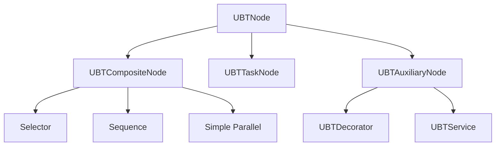
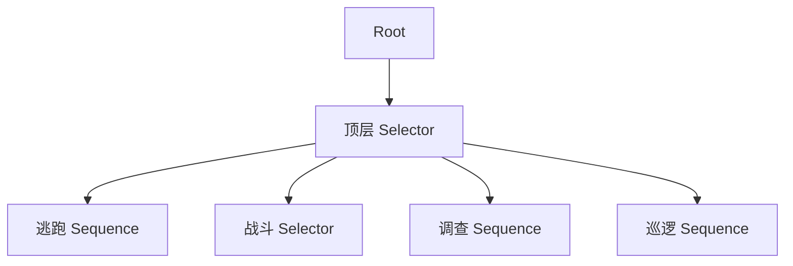
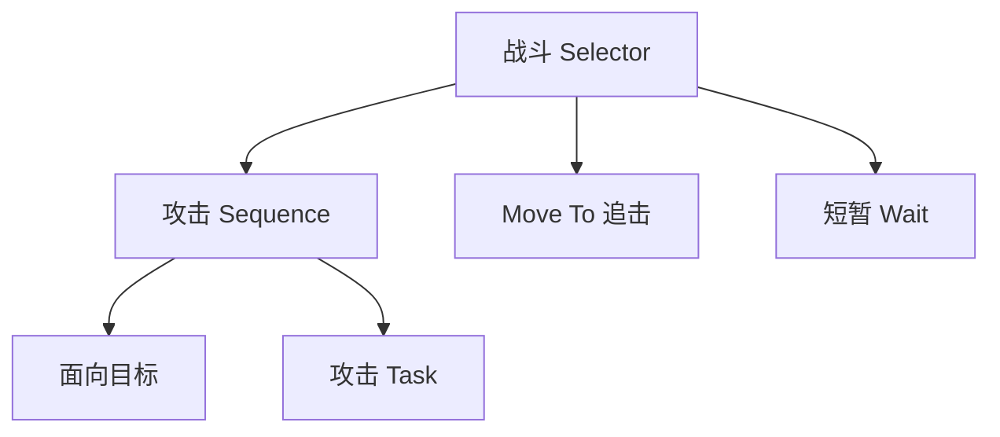

# UE5 行为树全解：原理、开发实践与游戏客户端面试

> 整理日期：2026-10-27。面向 UE5 游戏客户端开发与技术面试。
>
> 本文覆盖经典 Actor / AIController 体系下的 Behavior Tree。通用机制适用于 UE5；具体通知宏、编辑器选项和函数声明以项目版本为准。设计方案属于示例，不代表引擎默认实现。代码经过静态检查，未在 UE 工程中编译或运行。

## 阅读导航

| 基础与运行原理 | 节点与控制流 | 工程开发 | 实战与面试 |
| --- | --- | --- | --- |
| [01 行为树是什么](#s01) | [05 Composite](#s05) | [12 C++ 开发准备](#s12) | [18 完整敌人 AI](#s18) |
| [02 总体架构与核心类](#s02) | [06 Task](#s06) | [13 巡逻点 Task](#s13) | [19 最多两人追击](#s19) |
| [03 实际执行机制](#s03) | [07 Decorator](#s07) | [14 持续 Task 与节点内存](#s14) | [20 稳定性与性能](#s20) |
| [04 Blackboard](#s04) | [08 Observer Aborts](#s08) | [15 节点扩展](#s15) | [21 调试与排错](#s21) |
| [11 节点共享与实例化](#s11) | [09 Service](#s09) | [16 其他 AI 系统](#s16) | [22 架构选型与网络](#s22) |
| [24 源码阅读路线](#s24) | [10 Decorator 与 Service](#s10) | [17 子树复用](#s17) | [23 高频面试问答](#s23) |

---

<a id="s01"></a>
## 01 行为树到底解决什么问题

行为树是一种**用树状结构组织决策和动作**的方式。它把复杂 AI 拆成可组合的分支，再根据条件、优先级和动作结果决定下一步。

以敌人 AI 为例：血量低时逃跑，有敌人时战斗，没有敌人时巡逻。继续细分战斗，又可以拆成接近目标、攻击、找掩体等步骤。

如果全部写在一个 Tick 中，会逐渐形成大量条件、状态和异步回调的交叉依赖。行为树提供的是组织这些逻辑的框架，复杂业务本身仍然需要合理拆分。

| 部分 | 回答的问题 | 例子 |
| --- | --- | --- |
| Composite | 按什么规则组织子行为？ | 优先逃跑，否则战斗，否则巡逻 |
| Decorator | 节点在什么条件或规则下执行？ | 有目标才战斗，冷却结束才攻击 |
| Service | 执行期间哪些信息需要维护？ | 更新距离、重新评估目标 |
| Task | 具体执行什么动作？ | 移动、转向、发动技能 |
| Blackboard | 决策需要记住什么信息？ | 目标、最后目击位置、巡逻点 |

**行为树负责决策组织，导航负责移动求解，感知负责获取刺激，战斗系统负责技能和伤害。行为树不会自动实现这些底层能力。**

<a id="s02"></a>
## 02 总体架构与核心类

### 2.1 资源定义与运行时状态

| 类 | 身份 | 主要职责 |
| --- | --- | --- |
| `AAIController` | AI 控制器 | 控制 Pawn，协调感知、移动与决策，启动行为树 |
| `UBrainComponent` | 决策运行组件基类 | 提供启动、停止、暂停等通用脑逻辑接口 |
| `UBehaviorTree` | 行为树资源 | 保存树结构、节点配置、关联黑板定义 |
| `UBehaviorTreeComponent` | 行为树运行组件 | 搜索分支、执行任务、调度辅助节点、管理中断和运行内存 |
| `UBlackboardData` | 黑板资源 | 定义 Key 的名字、类型、继承关系等 |
| `UBlackboardComponent` | 黑板运行组件 | 保存具体 AI 的决策数据，并通知观察者 |
| `UBehaviorTreeManager` | 行为树管理对象 | 管理行为树模板加载及相关运行支持 |
| `UBTNode` | 节点基类 | 提供初始化、节点内存等基础机制 |
| `UBTCompositeNode` | 组合节点基类 | 组织子节点和执行规则 |
| `UBTTaskNode` | 任务节点基类 | 执行具体动作 |
| `UBTAuxiliaryNode` | 辅助节点基类 | 提供相关性和 Tick 等机制 |
| `UBTDecorator` / `UBTService` | 辅助节点 | 修饰控制流 / 更新辅助信息 |

100 个敌人可以使用同一份 `BT_Enemy` 和 `BB_Enemy` 资源，各自有独立运行状态和普通黑板值。**共享资源不等于共享执行进度。**

### 2.2 节点继承关系



### 2.3 编辑器 Root 与第一个 Composite

编辑器顶端的 `Root` 是特殊入口，只能连接一个下级节点，不支持直接添加 Decorator 和 Service。

口头说“把 Service 放根节点上”，通常指 **Root 下方第一个 Selector 或 Sequence**。不要把它与特殊 Root 混淆。参见 [R1]、[R2]。

<a id="s03"></a>
## 03 行为树实际上如何执行

### 3.1 顺序与搜索

UE 行为树的节点顺序可以通过编辑器节点角上的执行编号观察。但“从上到下、从左到右”不等于所有节点都会执行：Decorator 可能阻止进入，Selector 可能在一个子节点成功后结束，Sequence 可能在一个步骤失败后结束。

**搜索（Search）**：根据当前结构、条件和执行上下文，寻找下一步应该运行的 Task，并处理相关辅助节点变化。

**执行（Execution）**：Task 开始动作，可能立即结束，也可能持续多帧；期间 Service、任务 Tick、感知和其他事件仍然可能工作。

以巡逻为例：

1. Selector 发现战斗条件不满足，选择巡逻 Sequence。
2. 寻点 Task 立即成功，并写入巡逻点。
3. Move To 开始移动，处于 `InProgress`。
4. 等待移动完成或被中断，不必每帧重新执行“寻找巡逻点”。
5. 移动完成后，Sequence 继续执行后面的 Wait。

### 3.2 事件驱动不等于系统没有 Tick

UE 行为树强调事件驱动：任务完成、黑板值变化和外部请求等事件，可以推动执行流更新，避免每帧从 Root 无条件遍历整棵树。

但以下工作仍然可能需要 Tick：

- 正在运行的 Task 的 `TickTask`。
- 活跃 Service 的周期 Tick。
- 某些 Decorator 的条件检查或时间逻辑。
- 移动、动画、感知等外围系统自己的更新。

准确表述是：**通过事件驱动减少无效搜索，同时允许需要持续更新的节点按需 Tick。** 参见 [R1]。

### 3.3 `InProgress` 不会阻塞游戏线程

一个 Move To 可以运行几秒，但它通常只是保留运行状态，等待路径跟随的完成事件。游戏线程仍然处理其他 AI、玩家和动画等工作。

不要用 `while` 等待角色到达。持续任务应返回 `InProgress`，由后续事件或 Tick 完成。

### 3.4 一轮树结束后怎么办

`StartTree` 支持单次和循环等执行模式；常见 `AAIController::RunBehaviorTree` 用法是循环运行行为树。

“循环运行”意味着一轮完成后可以再次开始，不等于每帧强制重做当前尚未结束的 Task。实际执行模式和停止策略应检查启动代码。

<a id="s04"></a>
## 04 Blackboard：AI 的工作记忆

### 4.1 定义与实例

`UBlackboardData` 定义“有哪些字段”，`UBlackboardComponent` 保存“这个 AI 当前的字段值”。

| Key | 类型建议 | 含义 | 常见写入方 |
| --- | --- | --- | --- |
| `TargetActor` | Object，基类限制为 Actor | 当前目标 | 目标选择逻辑 |
| `HasLineOfSight` | Bool | 当前是否可见 | 感知协调逻辑 |
| `LastKnownLocation` | Vector | 最后确认的位置 | 感知或记忆逻辑 |
| `PatrolLocation` | Vector | 下一巡逻点 | 寻点 Task |
| `InAttackRange` | Bool | 是否满足攻击距离 | Service 或战斗状态事件 |
| `IsLowHealth` | Bool | 是否进入低血量策略 | 属性变化事件 |
| `HasChaseToken` | Bool | 是否拥有追击名额 | 群体协调管理器 |

不要默认所有业务数据都必须复制到黑板。完整背包、属性集、技能详情应有各自的数据归属；黑板通常只保存决策所需的引用、状态或摘要。

### 4.2 常见访问接口

```cpp
UBlackboardComponent* BB = OwnerComp.GetBlackboardComponent();
if (!BB)
{
    return EBTNodeResult::Failed;
}

BB->SetValueAsObject(TEXT("TargetActor"), Target);
BB->SetValueAsBool(TEXT("InAttackRange"), true);
BB->SetValueAsVector(TEXT("PatrolLocation"), Location);

AActor* CurrentTarget =
    Cast<AActor>(BB->GetValueAsObject(TEXT("TargetActor")));

BB->ClearValue(TEXT("TargetActor"));
```

通过正常 Set / Clear 接口更新，才能走对应的值比较和观察通知机制。不要绕过接口直接修改内部内存。

### 4.3 `FBlackboardKeySelector`

可复用节点优先暴露 Key Selector，而不是把 `TargetActor` 等名字全部写死。它支持在树中选择 Key、限制类型，并在资源初始化时解析 Key 信息。

```cpp
// 声明片段，需要放入所属 UCLASS。
UPROPERTY(EditAnywhere, Category = "Blackboard")
FBlackboardKeySelector TargetKey;

// 构造函数中限制类型；UMyNode 替换为实际类名。
TargetKey.AddObjectFilter(
    this, GET_MEMBER_NAME_CHECKED(UMyNode, TargetKey),
    AActor::StaticClass());
```

自定义多个 Selector 时，在 `InitializeFromAsset` 中分别调用 `ResolveSelectedKey`。`UBTTask_BlackboardBase` 的父类实现会处理其内置 `BlackboardKey`。

### 4.4 “Is Set”与对象内部变化

“Is Set”要按具体类型理解，不是统一判断数值非零。**世界原点 `(0,0,0)` 可以是合法位置，不能一律当作“没有位置”。**

还要区分：目标从玩家 A 换成玩家 B，是 Object Key 值变化；玩家 A 的血量从 100 降到 50，或者 A 移动了，并不等于这个 Object Key 被替换。

内部属性变化需要属性事件、其他黑板 Key 或专门观察机制来反映。仅观察 `TargetActor`，不会自动观察该 Actor 的所有属性。

### 4.5 `Instance Synced`

普通 Key 通常是每个 AI 自己的数据。`Instance Synced` 可以让指定 Key 在关联黑板实例之间同步，具体范围由黑板资源与实现决定。

**它不是网络复制功能，也不能直接代替完整的小队协调系统。** 目标莫名跟着其他 AI 改变时，要检查这个选项以及节点共享状态问题。参见 [R3]。

### 4.6 维护派生状态一致性

同时保存 `TargetActor`、`HasTarget` 和 `InAttackRange`，需要明确由谁统一维护；目标清空时，范围状态也应清除。

依次设置多个 Key，不能默认所有观察者只会在全部更新完后看到一个完整快照。逻辑应容忍更新中的状态，必要时评估黑板通知暂停/恢复机制，不要假设多字段天然原子更新。

<a id="s05"></a>
## 05 Composite：Selector、Sequence 与 Simple Parallel

### 5.1 Selector：找到一个成功方案

从左向右尝试子节点：失败则尝试下一个，成功则自身成功，全部失败才失败。子节点运行中时，等待。

例如依次放置逃跑、战斗、巡逻：逃跑条件不满足则跳过；战斗分支成功后，本轮不再执行巡逻。

**左侧优先不等于自动实时抢占。** 已在运行右侧 Task 时，左侧条件变化能否切换，还取决于观察机制、Observer Aborts 和执行请求。

### 5.2 Sequence：完成一组步骤

从左向右执行：一个步骤成功才继续下一个，一个步骤失败则自身失败，全部成功才成功。

例如寻找巡逻点、移动、等待。移动失败时，不应继续执行表示“到达后休息”的 Wait。

| 子节点情况 | Selector | Sequence |
| --- | --- | --- |
| `Succeeded` | 自身成功 | 继续下一个步骤 |
| `Failed` | 尝试下一个方案 | 自身失败 |
| `InProgress` | 等待当前子节点 | 等待当前子节点 |
| 全部尝试完 | 全失败才失败 | 全成功才成功 |

不要把 `Aborted` 简单当普通 `Failed` 再套用上表；Abort 属于执行流切换，由调度器处理。

### 5.3 失败与循环

寻路失败、暂时没有目标、技能启动失败，都可以是正常决策结果，需要替代方案或退避策略。

若所有分支瞬间失败，整棵树又立即循环，可能出现频繁搜索和日志刷屏。应提供合理 Wait、重试间隔或有效兜底动作。

### 5.4 Simple Parallel

它允许一个主 Task 配合一个后台子树运行。

| Finish Mode | 主 Task 结束后的行为 |
| --- | --- |
| Immediate | 中止后台子树并结束组合节点 |
| Delayed | 等待后台子树完成后再结束 |

后台子树先完成，不代表自动结束仍在运行的主 Task。主 Task 如果立即成功，也难以形成预期的持续并行窗口。

它是逻辑并行，不保证独立线程。只想定期更新距离时，用 Service 通常更直接。参见 [R4]。

<a id="s06"></a>
## 06 Task：动作、异步完成与中断

### 6.1 返回值

`ExecuteTask` 常规返回以下三种结果：

| 返回值 | 含义 | 后续要求 |
| --- | --- | --- |
| `Succeeded` | 已经成功结束 | 无需再报告该次完成 |
| `Failed` | 已经失败结束 | 父节点处理失败 |
| `InProgress` | 已启动，尚未结束 | 后续必须有完成或中断路径 |

枚举还存在 `Aborted`，但 `AbortTask` 才是处理中断的主要入口。不要把四个枚举值都当作 `ExecuteTask` 的常规返回方式。

### 6.2 同步与异步任务

同步：算出巡逻点，写黑板，返回成功。

异步：启动移动、攻击蒙太奇或能力，返回 `InProgress`，之后报告结束。

```cpp
// 示意流程，省略所属类和回调绑定。
EBTNodeResult::Type UMyTask::ExecuteTask(
    UBehaviorTreeComponent& OwnerComp, uint8* NodeMemory)
{
    if (!CanStartAction())
    {
        return EBTNodeResult::Failed;
    }

    StartActionAndBindCompletion();
    return EBTNodeResult::InProgress;
}

// 收到属于本次执行的完成回调后：
FinishLatentTask(OwnerComp, EBTNodeResult::Succeeded);
```

**蒙太奇开始播放不等于攻击完成，移动请求提交成功也不等于已经到达。** Task 成功的业务语义必须明确。

### 6.3 Tick 与通知

需要 Tick 时启用 `bNotifyTick`，实现 `TickTask`；需要结束通知时启用 `bNotifyTaskFinished`，实现 `OnTaskFinished`。部分版本提供自动设置通知标志的宏。

如果底层已有完成事件，通常直接等待事件更合适。**返回 `InProgress` 本身不会自动打开 Tick。**

### 6.4 Abort 的两种方式

| 情况 | `AbortTask` 返回值 | 后续 |
| --- | --- | --- |
| 立即取消完成 | `Aborted` | 同步清理 |
| 必须异步取消 | `InProgress` | 清理完成后调用 `FinishLatentAbort` |

```cpp
// 以下清理函数是项目自定义语义，不是引擎内置 API。
EBTNodeResult::Type UMyTask::AbortTask(
    UBehaviorTreeComponent& OwnerComp, uint8* NodeMemory)
{
    InvalidateCurrentExecution();
    UnbindExternalCallbacks();
    CancelOwnedAction();
    ReleaseOwnedResources();
    return EBTNodeResult::Aborted;
}
```

先使当前执行失效，再取消动作，有助于避免取消操作同步触发旧完成回调。

### 6.5 行为树切走，为什么攻击还在播

Abort 不会自动理解并撤销所有外部副作用。自定义 Task 可能需要停止自己启动的蒙太奇、取消能力、解绑委托、清计时器、释放追击名额。

不要每个 Task 都无差别停止所有移动或动画。只清理该次执行拥有的请求，避免误伤新行为。

### 6.6 旧回调与同步完成

攻击 A 被中断后，节点开始攻击 B；A 的旧回调迟到，可能错误地结束 B。

常用防护：执行序号、底层请求 ID、委托句柄，以及组件和 Owner 有效性检查。单个 `bIsRunning` 不足以区分两次执行。

启动 API 如果可能同步回调，也不能先在回调中完成 Task，再无条件返回 `InProgress`。应根据底层约定缓存启动阶段的完成结果，或设计准确的启动状态机。

### 6.7 蓝图 Task

常用事件：`ReceiveExecuteAI`、`ReceiveTickAI`、`ReceiveAbortAI`。正常结束用 `FinishExecute`；结束自定义中断流程用 `FinishAbort`。

实现了自定义中断事件，就要保证结束路径。蓝图延迟动作的内部处理，也不能替代外部委托和业务资源的清理。参见 [R5]、[R6]。

<a id="s07"></a>
## 07 Decorator：条件与执行规则

### 7.1 它修饰的是节点的执行关系

Decorator 在编辑器中显示在 Composite 或 Task 上，概念上修饰父子连接上的执行条件和规则，并不是需要单独连线执行的普通叶子 Task。

最常见的检查：有目标、血量低、是否进入攻击范围、目标是否可达。

当搜索准备进入节点时，条件不通过可以直接阻止进入。**这与 Task 已经运行后返回失败不同。**

### 7.2 不只有布尔条件

| Decorator | 用途 | 容易误解的地方 |
| --- | --- | --- |
| Blackboard | 根据黑板 Key 判断条件 | 只观察该 Key，不会自动观察目标全部属性 |
| Compare BBEntries | 比较两个 Key | 注意类型与比较规则 |
| Cooldown | 限制再次执行 | 需要理解本节点何时开始冷却 |
| Tag Cooldown | 依据标签冷却限制执行 | 标签冷却不能一概等同于 GAS 的 GE 冷却 |
| Loop | 重复执行节点 | 无限循环需要退出或中断策略 |
| Time Limit | 限制执行时长 | 超时终止也要保证 Task 的取消路径 |
| Force Success | 修饰执行结果 | 滥用可能掩盖真实失败 |
| Does Path Exist | 查询路径是否存在 | 查询成本和可用中断模式依具体实现 |

因此“Decorator 就是一个 if”只适合入门记忆，不足以覆盖完整职责。参见 [R7]。

### 7.3 多个条件如何组合

同一节点上的多个普通条件通常按 AND 理解：有目标、距离满足、允许攻击都满足，才能进入。

更复杂的 AND / OR / NOT 可以通过 Composite Decorator 等方式组织。不要把“条件组合器”与 Selector / Sequence 这种 Composite 节点混为一谈。

涉及 Lower Priority 抢占时，还要满足进入该分支所需的其他条件，不能仅因为其中一个条件变为 true 就断言一定能抢占。

### 7.4 条件检查应尽量保持无副作用

`CalculateRawConditionValue` 在搜索或重评估中可能被多次调用，返回的是原始条件；引擎再处理反转等规则。

不适合在这里扣血、启动技能或永久占用追击名额。否则“检查一次”就可能改变世界，重复搜索又产生额外副作用。

资源申请应交给有明确开始、成功、失败和释放路径的逻辑，再由条件检查资源是否已经拥有。

<a id="s08"></a>
## 08 Observer Aborts：动态抢占的关键

### 8.1 进入条件与持续约束

“允许进入追击”与“追击过程中目标消失，要不要退出”是两件事。

在 Selector 中安排左侧追击、右侧巡逻，给追击附加 `TargetActor Is Set`，可以用下表理解条件型 Decorator 的中断设置：

| 配置 | 作用 | 示例 |
| --- | --- | --- |
| None | 不因该条件变化主动中断 | 等当前行为结束或其他事件推动重新选择 |
| Self | 条件不再满足时中断自身分支 | 丢失目标，退出追击 |
| Lower Priority | 条件满足时可中断较低优先级分支 | 巡逻时发现目标，切入追击 |
| Both | 同时具备两种能力 | 发现目标切入，丢失目标退出 |

“较低优先级”是树结构与执行范围中的概念，不是画布上所有位置更靠右的节点。父 Composite 对中断方式也可能有约束，某些 Decorator 只开放部分模式。

`Apply Decorator Scope` 会影响离开某个 Composite 分支后，下方 Decorator 的观察范围；调试跨分支抢占时应一并检查。

### 8.2 一次完整的 Both 切换

1. 初始目标为空，追击条件不满足，巡逻 Task 运行。
2. 感知逻辑写入目标。
3. Blackboard Decorator 收到相关通知并检查条件。
4. 条件允许进入追击，发出执行流请求。
5. 行为树要求巡逻 Task 中断。
6. 巡逻完成取消后，行为树根据当前条件重新搜索，执行追击。
7. 后续目标清空时，通过 Self 方向退出追击。

所谓“立即切换”是对变化作出响应，不保证在任意代码行、同一个调用栈中完成全部动作。如果旧 Task 需要异步取消，新行为还可能等待取消结束。

### 8.3 `Notify Observer` 与 `Observer Aborts` 不同

| 选项 | 回答的问题 |
| --- | --- |
| Notify Observer | 关注值变化，还是条件结果变化？ |
| Observer Aborts | 需要中断时，允许影响哪些执行范围？ |

对 Blackboard Decorator 的 `TargetActor Is Set`：

- `nullptr → 玩家 A`：值变化，条件也从 false 变成 true。
- `玩家 A → 玩家 B`：值变化，但条件仍为 true。

`On Result Change` 关注条件结果是否改变；`On Value Change` 让值替换本身也能触发相应观察处理。它们不等于“每帧检查”和“不检查”。

目标替换时，Move To 是否更新目的地，还要看 Task 自身的 Blackboard 观察、目标追踪和重启配置，不能只凭这一项断言。参见 [R7]。

### 8.4 写了条件函数，为什么不会自动中断

只在 C++ 的 `CalculateRawConditionValue` 中读取血量，不等于自动订阅血量变化。

完整逻辑至少需要：

1. 能发现条件变化的机制，例如 Blackboard Observer、属性事件或 Tick。
2. 条件变化后，向行为树请求适当的重评估或中断。
3. 合适的 FlowAbortMode。
4. 当前 Task 能正确结束取消。

C++ 自定义 Decorator 可以在相关事件中使用 `ConditionalFlowAbort` 等接口。只设置 `bNotifyBecomeRelevant` 并不会自动订阅任意变量。参见 [R8]。

### 8.5 Decorator 可以在自己的分支未执行时观察

如果追击分支只能在自己执行时观察目标，那么巡逻期间就无法通过它抢占。

因此要区分“执行生命周期”和“观察生命周期”。蓝图 Decorator 提供 Execution Start / Finish 和 Observer Activated / Deactivated 两组事件。

观察范围不是整棵树所有 Decorator 永久启用，而是由当前搜索、相关性、中断设置与作用域共同决定。参见 [R9]。

<a id="s09"></a>
## 09 Service：分支相关的信息维护

### 9.1 Service 不返回任务执行结果

Service 常用于更新距离、威胁评分、目标选择、是否需要换弹等信息。它没有通过 `Succeeded / Failed / InProgress` 选择下一个分支的普通 Task 语义。

它通常写 Blackboard，让 Decorator 或 Task 使用这些信息。默认关注点是辅助维护，不建议把完整攻击动作塞到 Service 中。

### 9.2 挂载位置就是生效范围

挂在 Composite 上的 Service，在执行停留于其子树期间活跃；子 Task 切换并不一定使父 Service 停用。离开整个子树后，Service 才停止相关的周期执行。

挂在 Task 上的 Service，范围则与该任务执行相关。特殊 Root 不能直接挂载。

例如“发现目标”必须在巡逻期间有效，不能仅依赖挂在被 `HasTarget` 阻挡的战斗分支内部的周期 Service。否则可能形成“有目标才进入，进入后才开始找目标”的依赖循环。

### 9.3 常见回调

| C++ | 蓝图 AI 版本 | 用途 |
| --- | --- | --- |
| `OnSearchStart` | `ReceiveSearchStartAI` | 搜索进入时准备数据 |
| `OnBecomeRelevant` | `ReceiveActivationAI` | 服务开始活跃 |
| `TickNode` | `ReceiveTickAI` | 周期更新 |
| `OnCeaseRelevant` | `ReceiveDeactivationAI` | 服务停用、解除绑定等 |

不能把 Search Start 和 Activation 当成完全相同的时机。下方条件搜索时就需要的数据，可以在 Search Start 快速同步准备；这里不能阻塞等待复杂异步操作。

### 9.4 更新频率

假设 `Interval = 0.2`、`Random Deviation = 0.05`，周期更新约在 0.15～0.25 秒范围内调度，实际执行还受帧与运行环境影响。

| 设置 | 含义 |
| --- | --- |
| Interval | 周期 Tick 的基本间隔 |
| Random Deviation | 为间隔添加随机偏差 |
| Call Tick on Search Start | 搜索进入时也调用一次 Tick |
| Restart Timer on Each Activation | 每次激活时重新安排 Tick 计时 |

不要假设第一次 Tick 一定发生在激活后的完整 Interval，也不要将它当作严格实时计时器。重写原生 `TickNode` 时应注意父类的调度工作，通常调用 `Super::TickNode`。参见 [R10]、[R11]。

<a id="s10"></a>
## 10 Decorator 和 Service 的准确区别

| 对比 | Decorator | Service |
| --- | --- | --- |
| 主要职责 | 执行条件、约束、结果修饰 | 周期更新或相关状态维护 |
| 流程影响 | 可阻止进入或请求中断等 | 通常更新数据，间接影响决策 |
| 典型结果 | 条件是否成立或被修饰的执行规则 | 写黑板、设置辅助状态 |
| 运行范围 | 搜索、执行与观察范围由机制决定 | 与附着分支或任务的活跃范围相关 |
| 是否支持 Tick | 支持 | 支持，通常按间隔调度 |
| 是否天然独立线程 | 否 | 否 |

例子：Service 更新 `InAttackRange`，Decorator 决定能否进入攻击，Task 启动攻击并等待结束。

职责划分不能死记为“Decorator 不 Tick，Service 会 Tick”，也不能认为“凡是写黑板的逻辑只能放 Service”。一个寻点 Task、感知事件、管理器都可以合理地写黑板。

<a id="s11"></a>
## 11 节点共享、实例化与运行内存

### 11.1 原生节点默认的共享问题

原生行为树节点通常不为每个 AI 创建独立 UObject 实例。使用同一树模板的多个行为树组件，可能共享对应的节点对象。

这里共享的是模板中的对应节点，不是“所有同一个 C++ 类的节点在整个世界只有一个对象”。同一棵树放两个不同配置的节点，也不能理解为同一个配置对象。

危险示例：

```cpp
// 如果节点没有实例化，不应把每个 AI 的运行状态直接放这里。
AActor* CurrentTarget;
float RemainingTime;
```

AI A 执行时写入自己的状态，AI B 又覆盖它，就可能串目标、串计时器。这通常是状态归属错误，即使没有多线程也会发生。

### 11.2 三种常用存储方案

| 方案 | 适合存什么 | 代价与边界 |
| --- | --- | --- |
| Blackboard | 跨节点使用的决策数据 | 类型与通知管理需要设计 |
| NodeMemory | 某节点独有的轻量运行状态 | 需要正确计算大小与处理生命周期 |
| `bCreateNodeInstance = true` | 需要每 AI 独立成员、委托状态的节点 | 增加 UObject 与内存成本 |

蓝图节点通常采用实例化机制，但仍要管理异步回调和外部资源。实例化解决状态隔离，不自动解决旧回调问题。

### 11.3 NodeMemory 的边界

```cpp
struct FMyTaskMemory
{
    float RemainingTime;
};

uint16 UMyTask::GetInstanceMemorySize() const
{
    return sizeof(FMyTaskMemory);
}
```

在执行函数中通过传入的 `NodeMemory` 访问相应运行状态，不是把它保存成全局静态数据。

简单、平凡类型可以按明确的初始化约定使用；含有非平凡成员时，要通过 `InitializeMemory`、`CleanupMemory` 等正确处理构造和清理。

**NodeMemory 不是普通 UObject 的 UPROPERTY 扫描区域。** 不要把原始 UObject 指针塞进去，就假设 GC 一定会追踪；应使用合适的弱引用或在受 GC 管理的位置维持强引用。

### 11.4 该怎么选

一个等待 Task 只需剩余时间，适合轻量 NodeMemory。一个节点要拥有多个委托句柄、对象状态和复杂异步流程，可以评估实例化。

无论哪种，编辑器里的半径、阈值等通常是共享配置，运行中的当前目标、剩余时间才是每个 AI 的状态。参见 [R2]、[R5]、[R8]。

<a id="s12"></a>
## 12 C++ 开发准备与启动行为树

### 12.1 模块依赖

在项目的 `Build.cs` 中按使用情况加入：

```csharp
// 在现有配置上追加，避免重复添加。
PrivateDependencyModuleNames.AddRange(new string[]
{
    "AIModule",
    "NavigationSystem",
    "GameplayTasks"
});
```

如果公共头文件暴露了相关模块类型，可能需要放入 `PublicDependencyModuleNames`。`GameplayAbilities` 等依赖仅在实际集成 GAS 时加入。

### 12.2 启动示例

下面是类声明与实现片段，需放到项目自己的 AIController 中。

```cpp
// EnemyAIController.h 中，位于所属 UCLASS 内。
UPROPERTY(EditDefaultsOnly, Category = "AI")
TObjectPtr<UBehaviorTree> BehaviorTreeAsset;

virtual void OnPossess(APawn* InPawn) override;
```

```cpp
// EnemyAIController.cpp
#include "EnemyAIController.h"
#include "BehaviorTree/BehaviorTree.h"
#include "BehaviorTree/BlackboardComponent.h"

void AEnemyAIController::OnPossess(APawn* InPawn)
{
    Super::OnPossess(InPawn);

    if (!InPawn || !BehaviorTreeAsset)
    {
        return;
    }

    UBlackboardComponent* BB = nullptr;
    if (!BehaviorTreeAsset->BlackboardAsset ||
        !UseBlackboard(BehaviorTreeAsset->BlackboardAsset, BB) || !BB)
    {
        return;
    }

    // 本例假设黑板已经声明了 Vector 类型的 HomeLocation。
    BB->SetValueAsVector(TEXT("HomeLocation"), InPawn->GetActorLocation());

    if (!RunBehaviorTree(BehaviorTreeAsset))
    {
        UE_LOG(LogTemp, Warning, TEXT("Failed to start behavior tree"));
    }
}
```

`RunBehaviorTree` 本身会处理关联黑板的使用；这里先显式 `UseBlackboard`，是为了在树开始搜索前初始化出生点等数据。

在 AIController 头文件中正确前置声明 `UBehaviorTree`，保持 `.generated.h` 是最后一个 include。示例未加入项目模块导出宏，跨模块使用时按项目规则添加。

### 12.3 编辑器设置

1. 创建 Blackboard 资源，定义 Key 和类型。
2. 创建 Behavior Tree，指定关联 Blackboard。
3. 为 Pawn 设置 AIController Class 与合适的 Auto Possess AI 方式。
4. 给控制器配置行为树资源。
5. 地面移动时放置 NavMesh Bounds Volume，检查导航覆盖。
6. PIE 后选中正确 AI 的调试实例，观察执行和黑板变化。

### 12.4 停止与销毁

行为树组件可使用 `StopTree` 等接口停止。Safe 停止会考虑任务的中断过程，Forced 停止也不能替代业务资源清理。

死亡、UnPossess、EndPlay、切换控制器、关卡卸载都可能打断 AI 生命周期。避免定时器或委托在 Pawn 失效后继续写黑板、报告完成。

<a id="s13"></a>
## 13 C++ 示例：寻找可到达的巡逻点

这是一个同步 Task，使用内置 `BlackboardKey` 输出 Vector。以下两段组成 `.h` 和 `.cpp`；类位于同一项目模块，未写项目专用导出宏。

### 13.1 头文件

```cpp
// BTTask_FindPatrolPoint.h
#pragma once

#include "CoreMinimal.h"
#include "BehaviorTree/Tasks/BTTask_BlackboardBase.h"
#include "BTTask_FindPatrolPoint.generated.h"

UCLASS()
class UBTTask_FindPatrolPoint : public UBTTask_BlackboardBase
{
    GENERATED_BODY()

public:
    UBTTask_FindPatrolPoint();

protected:
    UPROPERTY(EditAnywhere, Category = "Patrol", meta = (ClampMin = "1.0"))
    float SearchRadius = 1000.0f;

    virtual EBTNodeResult::Type ExecuteTask(
        UBehaviorTreeComponent& OwnerComp, uint8* NodeMemory) override;
};
```

### 13.2 实现文件

```cpp
// BTTask_FindPatrolPoint.cpp
#include "BTTask_FindPatrolPoint.h"
#include "AIController.h"
#include "GameFramework/Pawn.h"
#include "NavigationSystem.h"
#include "BehaviorTree/BehaviorTreeComponent.h"
#include "BehaviorTree/BlackboardComponent.h"

UBTTask_FindPatrolPoint::UBTTask_FindPatrolPoint()
{
    NodeName = TEXT("Find Patrol Point");
    BlackboardKey.AddVectorFilter(
        this, GET_MEMBER_NAME_CHECKED(UBTTask_FindPatrolPoint, BlackboardKey));
}

EBTNodeResult::Type UBTTask_FindPatrolPoint::ExecuteTask(
    UBehaviorTreeComponent& OwnerComp, uint8* NodeMemory)
{
    AAIController* AI = OwnerComp.GetAIOwner();
    APawn* Pawn = AI ? AI->GetPawn() : nullptr;
    UBlackboardComponent* BB = OwnerComp.GetBlackboardComponent();

    if (!Pawn || !BB || BlackboardKey.SelectedKeyName.IsNone())
    {
        return EBTNodeResult::Failed;
    }

    UNavigationSystemV1* Nav =
        FNavigationSystem::GetCurrent<UNavigationSystemV1>(Pawn->GetWorld());
    if (!Nav)
    {
        return EBTNodeResult::Failed;
    }

    FNavLocation Result;
    if (!Nav->GetRandomReachablePointInRadius(
            Pawn->GetActorLocation(), SearchRadius, Result))
    {
        return EBTNodeResult::Failed;
    }

    BB->SetValueAsVector(BlackboardKey.SelectedKeyName, Result.Location);
    return EBTNodeResult::Succeeded;
}
```

### 13.3 放入行为树

创建巡逻 Sequence，依次放入本 Task、Move To、Wait。本 Task 与 Move To 都选择 `PatrolLocation`。

这里有四个值得解释的设计点：

- 使用可到达随机点，不能把“在 NavMesh 上”完全等价于“从当前位置可达”。
- 本 Task 成功只代表找到点，不代表已经到达。
- 当前实现围绕当前位置取点，长时间运行可能逐渐远离出生点；想限制巡逻区域，应围绕 `HomeLocation` 或巡逻区域取点并验证可达性。
- 地面默认导航配置只是最小示例；多种 NavAgent、特殊过滤器或自定义移动方式应选择对应 NavData 和查询规则。

找不到点时返回失败，父层应提供稍后重试策略，不能不断立即重试耗尽预算。

<a id="s14"></a>
## 14 C++ 示例：用 NodeMemory 实现持续任务

这个例子演示 `InProgress`、Tick、完成和同步 Abort。实际业务直接使用内置 Wait 即可，无需重复造轮子。

### 14.1 头文件

```cpp
// BTTask_DemoWait.h
#pragma once

#include "CoreMinimal.h"
#include "BehaviorTree/BTTaskNode.h"
#include "BTTask_DemoWait.generated.h"

UCLASS()
class UBTTask_DemoWait : public UBTTaskNode
{
    GENERATED_BODY()

public:
    UBTTask_DemoWait();

    virtual uint16 GetInstanceMemorySize() const override;

protected:
    UPROPERTY(EditAnywhere, Category = "Wait", meta = (ClampMin = "0.0"))
    float Duration = 1.0f;

    virtual EBTNodeResult::Type ExecuteTask(
        UBehaviorTreeComponent& OwnerComp, uint8* NodeMemory) override;

    virtual void TickTask(
        UBehaviorTreeComponent& OwnerComp,
        uint8* NodeMemory, float DeltaSeconds) override;

    virtual EBTNodeResult::Type AbortTask(
        UBehaviorTreeComponent& OwnerComp, uint8* NodeMemory) override;
};
```

### 14.2 实现文件

```cpp
// BTTask_DemoWait.cpp
#include "BTTask_DemoWait.h"
#include "BehaviorTree/BehaviorTreeComponent.h"

namespace
{
    // 只有一个平凡类型字段，且每次执行前都会初始化。
    struct FDemoWaitMemory
    {
        float RemainingTime;
    };
}

UBTTask_DemoWait::UBTTask_DemoWait()
{
    NodeName = TEXT("Demo Wait With Memory");
    bNotifyTick = true;
}

uint16 UBTTask_DemoWait::GetInstanceMemorySize() const
{
    return sizeof(FDemoWaitMemory);
}

EBTNodeResult::Type UBTTask_DemoWait::ExecuteTask(
    UBehaviorTreeComponent& OwnerComp, uint8* NodeMemory)
{
    if (Duration <= 0.0f)
    {
        return EBTNodeResult::Succeeded;
    }

    auto* Memory = reinterpret_cast<FDemoWaitMemory*>(NodeMemory);
    Memory->RemainingTime = Duration;
    return EBTNodeResult::InProgress;
}

void UBTTask_DemoWait::TickTask(
    UBehaviorTreeComponent& OwnerComp,
    uint8* NodeMemory, float DeltaSeconds)
{
    auto* Memory = reinterpret_cast<FDemoWaitMemory*>(NodeMemory);
    Memory->RemainingTime -= DeltaSeconds;

    if (Memory->RemainingTime <= 0.0f)
    {
        FinishLatentTask(OwnerComp, EBTNodeResult::Succeeded);
        return;
    }
}

EBTNodeResult::Type UBTTask_DemoWait::AbortTask(
    UBehaviorTreeComponent& OwnerComp, uint8* NodeMemory)
{
    // 没有外部动作、委托或资源，可以直接完成中断。
    return EBTNodeResult::Aborted;
}
```

`Duration` 是节点配置，可以共享；`RemainingTime` 是执行状态，放入每次实例运行所对应的 NodeMemory。

如果换成等待蒙太奇，不能照搬“直接返回 Aborted”，还应取消该次动画请求并处理回调。若换成非平凡的内存结构，也需要补上内存生命周期管理。

<a id="s15"></a>
## 15 C++ 扩展 Service 与 Decorator

### 15.1 更新攻击范围的 Service

下面给出一个无每 AI 成员状态的 Service。为缩短例子，固定使用 `TargetActor`、`InAttackRange`，必须提前在黑板中配置为 Object / Bool；生产节点可以改成 Key Selector。

它使用滞回：进入攻击范围用较小半径，退出用较大半径，避免临界距离附近来回切分支。

```cpp
// BTService_UpdateAttackRange.h
#pragma once

#include "CoreMinimal.h"
#include "BehaviorTree/BTService.h"
#include "BTService_UpdateAttackRange.generated.h"

UCLASS()
class UBTService_UpdateAttackRange : public UBTService
{
    GENERATED_BODY()

public:
    UBTService_UpdateAttackRange();

protected:
    UPROPERTY(EditAnywhere, Category = "Range", meta = (ClampMin = "0.0"))
    float EnterRange = 150.0f;

    UPROPERTY(EditAnywhere, Category = "Range", meta = (ClampMin = "0.0"))
    float ExitRange = 180.0f;

    virtual void TickNode(
        UBehaviorTreeComponent& OwnerComp,
        uint8* NodeMemory, float DeltaSeconds) override;
};
```

```cpp
// BTService_UpdateAttackRange.cpp
#include "BTService_UpdateAttackRange.h"
#include "AIController.h"
#include "GameFramework/Pawn.h"
#include "BehaviorTree/BehaviorTreeComponent.h"
#include "BehaviorTree/BlackboardComponent.h"

UBTService_UpdateAttackRange::UBTService_UpdateAttackRange()
{
    NodeName = TEXT("Update Attack Range");
    bNotifyTick = true;
    Interval = 0.2f;
    RandomDeviation = 0.05f;
    bCallTickOnSearchStart = true;
}

void UBTService_UpdateAttackRange::TickNode(
    UBehaviorTreeComponent& OwnerComp,
    uint8* NodeMemory, float DeltaSeconds)
{
    Super::TickNode(OwnerComp, NodeMemory, DeltaSeconds);

    UBlackboardComponent* BB = OwnerComp.GetBlackboardComponent();
    if (!BB)
    {
        return;
    }

    AAIController* AI = OwnerComp.GetAIOwner();
    APawn* Pawn = AI ? AI->GetPawn() : nullptr;
    AActor* Target = Cast<AActor>(BB->GetValueAsObject(TEXT("TargetActor")));

    bool bInRange = false;
    if (IsValid(Pawn) && IsValid(Target))
    {
        const bool bWasInRange =
            BB->GetValueAsBool(TEXT("InAttackRange"));
        const float Enter = FMath::Max(0.0f, EnterRange);
        const float Exit = FMath::Max(Enter, ExitRange);
        const float Radius = bWasInRange ? Exit : Enter;

        bInRange = FVector::DistSquared(
            Pawn->GetActorLocation(), Target->GetActorLocation())
            <= FMath::Square(Radius);
    }

    if (BB->GetValueAsBool(TEXT("InAttackRange")) != bInRange)
    {
        BB->SetValueAsBool(TEXT("InAttackRange"), bInRange);
    }
}
```

这里计算的是 Actor 原点间三维距离。真正近战命中可能需要平面距离、胶囊表面距离、朝向、视线和武器碰撞，不能仅凭本 Key 判定伤害命中。

如果目标切换，需要统一清理派生状态，避免新目标继承旧目标的滞回状态。攻击 Task 在执行前仍应做最终合法性校验。

### 15.2 自定义条件 Decorator

下面是条件函数片段，所属类继承 `UBTDecorator`，并在头文件中声明相同签名。

```cpp
bool UBTDecorator_HasValidTarget::CalculateRawConditionValue(
    UBehaviorTreeComponent& OwnerComp, uint8* NodeMemory) const
{
    const UBlackboardComponent* BB = OwnerComp.GetBlackboardComponent();
    if (!BB)
    {
        return false;
    }

    const AActor* Target =
        Cast<AActor>(BB->GetValueAsObject(TEXT("TargetActor")));
    return IsValid(Target);
}
```

这只说明“如何计算”，不包含动态观察实现。判断 Object Key 是否设置时，优先使用内置 Blackboard Decorator；只有复杂条件确有需要时，再自定义观察。

### 15.3 自定义事件观察的实现思路

以下是机制说明，不是可直接编译的完整代码：

```text
OnBecomeRelevant:
    从 OwnerComp 找到当前 AI 的属性源
    绑定属性变化事件
    把绑定句柄存入该 AI 的运行状态

属性变化事件:
    验证 Owner 与当前观察生命周期有效
    请求 ConditionalFlowAbort 或对应的重评估

OnCeaseRelevant:
    解绑本次订阅
    清理句柄
```

如果节点没有实例化，不要用共享成员保存某个 AI 的委托句柄。蓝图 Decorator 使用延迟逻辑时，也应检查当前执行链或观察链是否仍然活跃。

<a id="s16"></a>
## 16 行为树如何与其他系统配合

### 16.1 AI Perception：提供感知信息

常见链路：感知事件进入控制器或协调组件，先按阵营、有效性和目标策略筛选，再更新 Blackboard，最后由行为树条件响应。

不要收到任何 Actor 的感知更新就直接覆盖目标。目标选择可能要考虑威胁、距离、当前目标保持时间和玩法限制。

“当前看不见”“仍然记得位置”“完全遗忘目标”也不同。可以丢失视线后保存 `LastKnownLocation`，转入搜索分支；记忆过期后才彻底清空。

多种感官同时存在时，视觉丢失不一定代表听觉也失效。Max Age、刺激过期和 Forget Stale Actors 等设置，需要与自己的记忆策略配合。参见 [R12]。

### 16.2 Move To、PathFollowing 与 NavMesh

Behavior Tree 决定何时移动；Move To 提交导航移动请求；导航系统求路径；路径跟随与移动组件推动角色。

| 问题 | 对应层面 |
| --- | --- |
| 为什么开始追玩家 | 行为树决策 |
| 目标更新后去哪里 | Move To 与目标观察 |
| 能不能找到路 | NavMesh、过滤器、Agent 配置 |
| 为什么走着卡住 | 路径跟随、碰撞、动态障碍等 |
| 到多近算完成 | 接受半径、胶囊半径与到达规则 |

Actor 目标移动与 Blackboard Object Key 替换是两种变化。使用 Actor 作为移动目标，可以结合相关选项追踪移动；若每隔一段时间把坐标写成 Vector，就需要维护该坐标并配置相应更新机制。

`Allow Partial Path` 表示允许部分路径，不保证真正到达最终目标；业务需要决定“走到最近可达处”算成功还是后续仍要失败处理。参见 [R13]。

### 16.3 EQS：选择位置或对象

EQS 常用 Generator 生成候选项，Context 提供参考对象或位置，Test 对候选项过滤、评分，最终得到选定结果。

例如寻找掩体：生成周围点，过滤不可达点、暴露点，再根据距离和战术价值评分。

行为树可以通过 Run EQS Query Task 等方式调用它，并把结果写入 Blackboard。**EQS 负责回答选哪个，行为树负责决定何时查询和选完做什么。** 大规模 AI 要限制候选数、Trace 数量和查询频率。参见 [R14]。

### 16.4 GAS：执行能力而非重写技能系统

常见方案是 Task 请求激活能力，等待该次能力结束，再向行为树报告结果。冷却、费用、状态限制由能力系统处理，行为树保留决策层职责。

不能把“能力激活请求被接受”一律当作“能力已经执行完毕”。也不要因为任意一个 Ability 结束，就结束当前攻击 Task；需要关联本次能力与执行标识。

行为树中断是否取消能力取决于业务：受击可以取消蓄力，已经出手的投射物可能继续存在。把取消策略交给明确的动作契约，而不是无差别撤销整个战斗系统。

### 16.5 Mass 与自定义 ECS 数据

如果项目通过 Fragment 保存角色状态，可以由桥接层把决策摘要同步进 Blackboard，或由节点通过受控接口查询。

原生 Behavior Tree 的经典用法围绕 Actor / AIController，不能假定给每个 Mass Entity 运行传统行为树天然低成本。海量单位应评估数据导向决策、Mass 配套逻辑和分层激活方案。

项目自定义的 MassFeature、FigureProxy、SignalSubsystem 桥接流程应按项目源码说明，不能当成所有 UE 项目都有的统一接口。

<a id="s17"></a>
## 17 子树复用与动态替换

### 17.1 Run Behavior

把巡逻、战斗、调查等逻辑拆成子树，可以避免一张图无限膨胀。Run Behavior 会把子树压入行为树的执行栈。

它不是启动一个完全独立 AI，也不应默认获得完全隔离的黑板。主树和子树需要兼容的黑板定义与约定。

普通 Run Behavior 受到子树根级 Decorator 注入等机制影响，不适合直接当作任意运行时资源替换入口。

### 17.2 Run Behavior Dynamic

需要按武器、职业或阶段替换子行为时，可以使用 Run Behavior Dynamic，通过 Injection Tag 标识注入点，并由 `SetDynamicSubtree` 等接口设置目标子树。

它与普通 Run Behavior 的根级 Decorator 支持存在区别；动态节点不支持同样的子树根级 Decorator 注入方式。关键条件可放在父树调用处，或子树内部明确的 Composite 上。

### 17.3 复用需要输入输出契约

| 子树 | 需要什么 | 产生什么 | 退出时保证什么 |
| --- | --- | --- | --- |
| Patrol | 巡逻区域或出生点 | 巡逻点 | 取消自己的移动 |
| Combat | 有效目标 | 动作结果、战斗决策状态 | 解绑回调、释放资源 |
| Investigate | 最后目击位置 | 搜索完成或重新发现目标 | 不继续追踪失效引用 |

避免子树悄悄清空父树拥有的目标，或把整个系统的共享标记留在错误状态。参见 [R13]。

<a id="s18"></a>
## 18 实战：巡逻、发现、追击、攻击、搜索、逃跑

本节给出一套设计示例，重点是状态来源、优先级和退出路径，不是唯一正确结构。

### 18.1 顶层策略



| 顺序 | 分支 | 进入条件 | 中断意图 |
| --- | --- | --- | --- |
| 1 | 逃跑 | `IsLowHealth` | 血量低时抢占普通行为；恢复后允许退出 |
| 2 | 战斗 | 目标有效，且满足当前交战策略 | 发现可交战目标时进入；失去交战资格时退出 |
| 3 | 调查 | 有最后目击位置 | 丢失视线后调查；重新发现目标时让位 |
| 4 | 巡逻 | 默认后备 | 战斗或逃跑出现时被抢占 |

本例将战斗资格约定为“有效目标且当前具有视线”，视线丢失则转调查。其他游戏也可以允许短时间盲追，只要明确记忆和退出策略。

### 18.2 战斗子树



| 分支 | 条件与动作 |
| --- | --- |
| 攻击 | `InAttackRange` 且具备攻击资格；转向后发动攻击 |
| 追击 | `InAttackRange == false`；Move To 当前目标 |
| 短暂等待 | 已到攻击位置但冷却未好，或本轮动作暂时不可执行 |

攻击范围 Service 可以挂在战斗 Selector 上，使追击、攻击和等待期间都能更新距离。

攻击分支的范围条件需要能 Self 退出与抢占追击；但是否允许中途取消已经出手的攻击，应由动作阶段策略控制，不能不加区分地中断。

**为什么需要 Wait 后备？** 已在范围内但技能冷却时，攻击不能进入，追击条件也不满足。短暂等待避免无意义地回巡逻，或快速失败重试。

### 18.3 巡逻与调查

巡逻 Sequence：寻找巡逻点 → Move To → Wait。

调查 Sequence：移动到最后目击位置 → 观察或搜索 → 清理该次搜索记忆。搜索期间重新看到目标，战斗分支抢占。

清理记忆时要确认清理的是本次调查的数据，不能把调查途中刚刚更新的新目击位置误删。可使用记忆版本号或时间戳区分。

### 18.4 数据由谁写

| 状态 | 建议来源 |
| --- | --- |
| 当前目标、可见性、目击位置 | 感知与目标选择协调组件 |
| 低血量状态 | 属性变化事件 |
| 攻击范围 | Service 或相关移动/状态事件 |
| 技能资格 | 战斗系统或能力系统摘要 |
| 巡逻点 | 寻点 Task |
| 追击名额 | 群体协调管理器 |

尽量避免两个 Service 争相覆盖 `TargetActor`。如需多个候选来源，由一个目标选择模块统一仲裁。

### 18.5 一次实际运行

1. AI 没目标，进入巡逻并开始移动。
2. 感知发现玩家，目标选择模块更新目标、视线与记忆。
3. 战斗条件满足，通过 Lower Priority 方向请求中断巡逻。
4. 巡逻移动取消后，进入追击。
5. 范围 Service 检测到可以攻击，攻击分支抢占追击。
6. 攻击 Task 校验目标和技能资格，启动并等待动作完成。
7. 冷却中保持等待；玩家离开范围后继续追击。
8. 失去视线转调查；记忆用尽后恢复巡逻。
9. 任意普通阶段进入低血量策略时，允许更高优先级逃跑分支接管。

事件传递与顺序应按项目需要处理，不能假设多个 Blackboard Set 自动构成事务。

<a id="s19"></a>
## 19 实战：最多两个敌人追击玩家，其余原地踱步

### 19.1 为什么只写一个 Decorator 不够

每个敌人的行为树主要管理自己。要约束所有敌人的共同上限，需要一个共享的名额分配者。

仅在每个敌人中检查 `ChasingCount < 2`，再各自启动追击，会把“检查”和“占用”分开。即使在单线程中，多个逻辑依次看到了尚未更新的值，也可能发生业务竞态。

**核心是统一分配名额，并明确名额何时真正释放。**

### 19.2 管理器与行为树分工

| 部分 | 职责 |
| --- | --- |
| 战斗协调器 / WorldSubsystem | 维护按玩家或遭遇区域划分的名额集合 |
| 申请或选择策略 | 按距离、威胁、等待时间等决定获准者 |
| 授权结果 | 更新各 AI 的 `HasChaseToken` |
| Decorator | 只有目标有效且有授权，才能进入追击范围 |
| Task 与退出钩子 | 执行移动、取消动作、通知释放 |
| 踱步分支 | 未获得授权时围绕当前位置小范围活动 |

`TryAcquire` 应在同一个管理操作中完成检查与登记：

```text
TryAcquire(AI, Target):
    清理无效持有者
    已持有该目标的有效名额 -> 返回现有授权
    名额已满 -> 返回失败
    登记持有者并生成授权标识 -> 返回成功
```

这是伪代码。游戏线程统一分配时不必凭空加互斥锁；如果数据真的跨线程访问，再选择对应同步策略。

### 19.3 两种可行的授权流程

**集中分配**：管理器在目标或成员状态变化时选出最多两人，先登记名额，再给他们写 `HasChaseToken`。其余 AI 执行踱步。

**主动申请**：AI 在独立申请逻辑中请求名额，成功后才进入被 `HasChaseToken` 限制的追击子树。申请可以有间隔、队列或事件唤醒，避免忙等。

不要在纯条件函数里偷偷占名额；也不要把“申请名额”放进必须先有名额才能进入的分支内部。

### 19.4 名额覆盖哪个行为范围

先明确玩法含义：

- 如果只限制“正在向玩家接近”的人数，攻击时可以释放，但可能导致两人攻击、另外两人继续逼近。
- 如果希望任何时刻最多两人压迫玩家，名额应覆盖追击、近身等待和攻击整个交战范围。

大多数“其余敌人围观或踱步”的需求，更接近第二种定义。

### 19.5 释放与取消握手

需要覆盖：离开交战范围、目标消失、AI 死亡、UnPossess、EndPlay、关卡卸载和超时回收。

不要把 Decorator 的 Observer Deactivated 一律当作“该敌人不再追击”；观察生命周期与执行生命周期不同。

严格要求物理上最多两人在追时，还应区分：

1. 管理器撤销授权。
2. 原持有者收到中断，停止追击。
3. 原动作确认取消，名额真正归还。
4. 再授权给下一人。

如果撤销授权后立即把名额发给新人，而旧 Task 还在异步取消，短时间内可能实际有三人移动。可以设置“取消中”状态，保留该名额直至退出确认。

授权应带标识或代次，防止旧回调释放了新申请的名额。管理器使用合适的弱引用，并让释放操作具备幂等性。

### 19.6 公平性与稳定性

只选最近两人可能让其他敌人长期没机会。可以结合等待时间、最短持有时长和重选间隔，减少频繁换人。

原地踱步应围绕等待区域取小范围点，不应继续使用一个无限扩散的普通巡逻中心。

面试回答可概括为：**共享管理器统一分配最多两个追击令牌，黑板保存授权，Decorator 控制进入，Task 负责执行并完成取消，所有退出路径回收名额，同时通过队列或评分保证公平。**

<a id="s20"></a>
## 20 稳定性与性能优化

### 20.1 先减少无效决策，再看语言开销

| 常见成本 | 改进方向 |
| --- | --- |
| 每个 AI 每帧全场搜索 Actor | 使用感知候选集、空间索引或统一管理 |
| 每次条件检查都跑完整寻路 | 缓存、降频、只在必要变化后重新查询 |
| 大量 Service 同帧更新 | 随机偏差、分批调度、预算控制 |
| 每帧重复发相同 Move 请求 | 复用运行请求，按目标变化合理更新 |
| 条件临界点频繁切换 | 滞回、最短保持时间、目标切换阈值 |
| 所有分支立即失败再循环 | Wait、退避、兜底状态 |
| 大量蓝图高频逻辑 | 先测热点，再把确有成本的部分迁移 C++ |

随机偏差有助于分散负载，但不能保证绝不出现峰值；严格预算仍需集中调度或限流。

### 20.2 不要让事件驱动变成事件风暴

同一帧频繁写入波动数据，可能引起大量观察通知。应只更新有意义的状态，合理使用阈值和聚合。

距离需要连续数值时可以保存 Float；仅决定能否攻击时，维护一个具有滞回的 Bool 往往更稳定。不要因为位置每帧变化，就让所有高层策略反复重启。

### 20.3 控制抖动

典型抖动：距离在 149 与 151 之间变化，AI 不断在攻击和追击之间切换。

改为进入半径 150、退出半径 180，或者加入最短保持时间。追击目标选择也可以要求新目标评分比旧目标高出一定幅度，防止来回切目标。

这些数值只是示例，需要按移动速度、碰撞大小和玩法调整。

### 20.4 分级更新

近处且参与战斗的 AI 可以高频更新，远处或不可见 AI 可以降低决策频率；长期休眠单位可以停用部分感知与逻辑。

但降频前应区分哪些状态必须及时响应，例如死亡或关键剧情事件；不能把所有逻辑统一变慢。

### 20.5 资源清理比“图看起来正确”更重要

每个持续任务都应回答：正常结束怎么清理，失败怎么清理，中断怎么清理，Owner 销毁怎么清理，重复回调怎么处理。

给外部动作、名额和回调明确所有者。Task 完成后不要再访问已经可能被重新用于下一次执行的状态。

<a id="s21"></a>
## 21 调试与常见故障

### 21.1 调试顺序

1. 先确认 Pawn 被正确控制，行为树启动成功，黑板资源一致。
2. 在行为树编辑器选择正确的运行实例，查看当前活跃 Task。
3. 同时检查 Blackboard 值与写入来源，而不只看条件节点颜色。
4. 查 Decorator 中断模式、观察机制和作用域。
5. 查 Task 是否在等待完成或中断完成。
6. 最后沿移动、动画、能力等外围链路定位。

必要时使用 Visual Logger、Gameplay Debugger、导航显示和性能工具。快捷键可能随键位与版本变化，不把某个默认键当作唯一入口。

### 21.2 故障速查表

| 现象 | 优先检查 |
| --- | --- |
| 行为树完全没运行 | Possess、AIController Class、启动返回值、资源配置 |
| 一直停在某 Task | 是否返回 InProgress 却没有完成路径；回调是否丢失 |
| 发现玩家仍巡逻 | Blackboard 是否写对实例；Lower Priority；观察机制 |
| 目标丢失仍追击 | Self；目标引用与视线是否混用；Task 取消逻辑 |
| Service 不 Tick | 分支是否活跃；Tick 标志；Interval；是否很快退出 |
| 第一次进入条件数据不对 | 初始化顺序、Search Start 与首次 Tick 时机 |
| 换目标后仍走向旧目标 | Actor 与 Vector 目标差别、Key 观察和任务更新配置 |
| Move To 一直失败 | 导航覆盖、目标可达性、Agent 尺寸、过滤器、有效 Pawn |
| 到附近却不攻击 | 到达半径与攻击半径不匹配；胶囊与原点距离混用 |
| 多个 AI 串状态 | 共享节点成员、Instance Synced、全局缓存归属 |
| 中断后仍播放技能 | 未取消该次外部动作或未解绑回调 |
| 行为切换延迟很大 | Service 间隔、异步取消耗时、感知与记忆策略 |
| 性能峰值或疯狂重启 | 瞬间失败循环、事件风暴、反复发移动请求 |
| 追击人数超过限制 | 分配不统一、旧动作未退出、漏释放或授权代次错误 |

### 21.3 日志建议记录什么

至少记录 AI 标识、节点名称、执行序号或请求 ID、开始与结束原因、目标、关键 Blackboard 状态。区分正常成功、失败、中断请求与中断完成。

只打印“Attack End”无法判断结束的是哪次攻击，也难以定位旧回调。

<a id="s22"></a>
## 22 与 FSM、StateTree、Utility AI 及网络的关系

### 22.1 思路比较

| 方案 | 组织方式 | 常见适用情况 | 主要挑战 |
| --- | --- | --- | --- |
| FSM | 状态及状态之间的转换 | 少量明确状态、严格动作阶段 | 状态和转换增多后关系复杂 |
| Behavior Tree | 条件、优先级、步骤组合 | 分支层次清晰、行为可复用的 AI | 中断、共享状态和隐式流程需要理解 |
| StateTree | 层次状态、条件和转换 | 希望明确表达层级状态与转换的逻辑 | 需要掌握数据绑定与状态生命周期 |
| Utility AI | 对候选行为评分后选择 | 多因素权衡、动态偏好 | 评分调参和选择稳定性 |

StateTree 是结合行为树选择方式与状态、转换概念的通用层次状态机。没有必要宣称它在所有项目中都优于行为树。参见 [R15]。

它们可以组合：高层评分选战术，行为树组织战术步骤，动画或能力内部使用状态机管理不可打断阶段。

### 22.2 行为树能不能直接管一切

不建议把动画帧级命中、技能结算、移动求解、背包数据与团队协调全部塞进节点。

一个 Task 可以调用业务组件，但业务系统应提供清晰的开始、取消、完成契约。行为树作为使用方，不必掌握其所有内部细节。

### 22.3 多人游戏中的位置

标准 AIController 在网络游戏中通常存在于服务器，AI 决策也通常由服务器执行。客户端观察被控制 Pawn 的移动和必要的表现状态。参见 [R16]。

Behavior Tree 和 Blackboard 不是开箱即用的完整网络同步协议。通常不需要把整棵树每次搜索和所有 Key 都复制给客户端，而是同步游戏结果：位置、朝向、目标表现、技能或能力状态等。

Dedicated Server 也必须能让持续任务完成。若攻击 Task 只等一个依赖客户端动画更新的通知，服务端可能永远等不到；需要权威的计时、能力事件或正确配置的服务端动画更新策略。

客户端装饰性 AI、预测行为可以有自己的逻辑，但要与服务器权威职责明确区分。

<a id="s23"></a>
## 23 高频面试问答

### 1. 一分钟介绍 UE5 行为树

行为树用 Composite 组织优先级和步骤，用 Decorator 约束执行，用 Task 执行动作，用 Service 维护辅助信息，Blackboard 保存决策数据。运行由 BehaviorTreeComponent 管理，结合任务完成和条件变化事件推进，支持通过 Observer Aborts 中断相关分支。

### 2. 行为树与黑板是什么关系？

行为树负责决策与执行组织，黑板提供工作记忆。黑板既能被树内节点更新，也能由感知、属性事件和协调管理器更新。

### 3. `UBehaviorTree` 与 `UBehaviorTreeComponent` 有何区别？

前者是可复用资源与配置，后者是每个运行者的执行组件。共享一份资源，不代表共享执行进度。

### 4. Selector 与 Sequence 的区别？

Selector 尝试找到一个成功方案；Sequence 要把步骤依次全部完成。运行中的子 Task 不会因为还没结束，就被当作失败跳过。

### 5. 左边的分支是不是永远会抢占右边？

不是。左侧规定优先尝试关系；运行中抢占还要有条件变化观察、允许的中断模式和执行流请求。

### 6. 为什么 UE 行为树说自己是事件驱动？

任务结束、黑板变化等事件可以推动重新选择，减少整树无条件轮询。但 Task、Service 和部分 Decorator 仍可能 Tick。

### 7. Service 与 Decorator 的区别？

Decorator 修饰节点的执行条件、约束和结果，Service 维护辅助信息。典型配合是 Service 写状态，Decorator 选分支，Task 做动作。

### 8. Decorator 是否只能在进入前检查一次？

不是。它还可以在观察期间响应条件变化，并结合中断策略改变执行流；也有循环、时间限制和结果修饰类装饰器。

### 9. Self 与 Lower Priority 分别做什么？

Self 让自己的分支在条件不满足时退出；Lower Priority 让条件满足的高优先级分支有机会中断较低优先级分支。Both 同时支持。

### 10. 改了 Blackboard，为什么 AI 没切分支？

先确认写的是正确实例和正确 Key，再看结果是否实际变化、是否有观察、中断范围是否正确、旧任务是否卡在取消中。

### 11. Object Key 指向的对象血量变了，会自动通知吗？

对象内部属性变化不等于 Object Key 值变化。需要属性事件、另一个 Key 或自定义观察。

### 12. `On Result Change` 与 `On Value Change` 的区别？

前者关注条件结果改变，后者关注值改变。例如目标 A 换 B，引用变了，但“目标已设置”的条件仍为真。

### 13. `InProgress` 的含义？

任务还没结束，需要之后用完成事件、消息或 Tick 报告结束，不能只返回它就不再处理。

### 14. 异步 Task 怎么完成？

原生任务通常通过 `FinishLatentTask`，蓝图通过 `FinishExecute`。中断的异步完成则分别使用 `FinishLatentAbort` 与 `FinishAbort`。

### 15. Abort 是否等于 Failed？

不是。Failed 是任务正常执行得到的失败结果；Abort 是外部执行流变化要求它停止，需要考虑动作取消和资源清理。

### 16. Task 为什么要处理旧回调？

同一节点可能再次执行，上一轮事件迟到会误结束新任务。需要执行代次、请求 ID 与正确解绑。

### 17. 为什么多个敌人会互相改节点状态？

原生节点默认可能共享模板对象，把每个 AI 的目标或计时状态存在共享成员会串数据。应放黑板、NodeMemory 或实例化节点中。

### 18. 开启节点实例化是不是最好？

它简化每 AI 状态存储，但增加 UObject 与内存开销。轻量节点可使用 NodeMemory，复杂异步状态可评估实例化。

### 19. Service 是不是全局一直运行？

不是，周期执行与挂载分支的活跃范围相关。搜索回调也有单独时机，不能简单当作全局定时器。

### 20. Simple Parallel 是否会创建线程？

不代表。它组织一个主 Task 和后台子树的逻辑并行，不承诺多线程执行。

### 21. 为什么“找目标 Service”挂战斗分支里会有问题？

如果该分支又要求先有目标才能进入，可能永远无法依靠内部周期更新得到第一个目标。应调整范围或由外部感知驱动。

### 22. 为什么追击与攻击来回抖动？

常见原因是进入和退出使用同一阈值，距离在临界点反复变化。采用滞回、保持时间和合理更新频率。

### 23. 移动成功是否一定等于进入攻击范围？

不一定。接受半径、胶囊半径、三维与平面距离、部分路径等语义可能不同，需要统一规则并在攻击前校验。

### 24. 如何做最多两名敌人追击？

共享协调器分配追击令牌，黑板保存授权，Decorator 控制进入，Task 负责执行与取消。退出时回收并处理异步取消窗口与公平性。

### 25. 行为树、感知、EQS、导航分别负责什么？

感知提供信息，EQS 从候选对象或位置中选择，行为树组织决策与动作，导航求路径并配合移动系统执行移动。

### 26. 行为树怎么接 GAS？

Task 请求能力并关联本次执行，等待对应能力结束；冷却和费用等由能力系统判断。中断时按玩法取消，避免误取消无关能力。

### 27. 行为树如何优化？

减少每帧全场搜索、昂贵条件与重复移动请求，使用事件、降频、分散更新、缓存和稳定阈值；通过性能工具确认热点后再优化实现。

### 28. 子树是不是另一套完全独立 AI？

不是。Run Behavior 在执行栈中运行子树，仍要明确黑板兼容与输入输出契约。动态替换还有专门节点与约束。

### 29. 行为树需要复制到客户端吗？

标准权威 AI 通常在服务器决策，复制 Pawn 和必要玩法、表现状态。Blackboard 不等于网络复制系统。

### 30. 讲一个行为树实际开发难点，怎么讲才具体？

不要只说“行为复杂”。可以描述“攻击中断后旧蒙太奇回调会结束下一次攻击”，解释复现条件、执行代次与取消契约、回归场景和结果。也可以讲追击名额的异步释放窗口，而不只说做了一个计数器。

<a id="s24"></a>
## 24 源码阅读路线与复习清单

### 24.1 先从可观察行为出发

| 想验证的问题 | 建议阅读入口 |
| --- | --- |
| 控制器如何启动树 | `AIController.h/.cpp` 的 `RunBehaviorTree`、`UseBlackboard` |
| 谁进行搜索与任务切换 | `BehaviorTreeComponent.h/.cpp` |
| 树模板如何加载 | `BehaviorTreeManager.h/.cpp` |
| Task 完成与中断契约 | `BTTaskNode.h/.cpp` |
| 条件、中断与包装调用 | `BTDecorator.h/.cpp` |
| Blackboard 观察方式 | `BTDecorator_Blackboard.h/.cpp` |
| Service 相关性与调度 | `BTAuxiliaryNode`、`BTService` |
| 共享配置与 NodeMemory | `BTNode`、节点内存相关函数 |
| Move To 如何管理异步动作 | `BTTask_MoveTo`、PathFollowing 相关类 |
| Key 变化怎样通知 | `BlackboardComponent`、具体 BlackboardKeyType |

这些文件主要位于 `Engine/Source/Runtime/AIModule/Classes` 与 `Private` 下对应目录。源码布局和细节以安装版本为准。

不要只看一个函数名就猜完整执行顺序。结合调用方、通知标志、节点是否实例化以及当前实例栈分析。

### 24.2 建议亲手验证的场景

- [ ] 巡逻过程中发现目标，成功抢占。
- [ ] 追击过程中清空目标，成功取消移动。
- [ ] 目标从 A 换 B，移动目标正确更新。
- [ ] 攻击范围临界点不会频繁抖动。
- [ ] 攻击中断后旧回调不会结束新攻击。
- [ ] AI 死亡、销毁和 UnPossess 后没有残留回调与名额。
- [ ] 多个 AI 同时使用相同树，不会串运行状态。
- [ ] 所有路径失败时有合理等待或后备策略。
- [ ] Dedicated Server 上持续任务也能正常结束。
- [ ] 追击令牌撤销和重新分配期间仍满足人数约束。

### 24.3 面试最少要讲清的主线

**资源与实例分离 → Composite 组织流程 → Task 的同步/异步契约 → Blackboard 与事件通知 → Decorator 抢占 → Service 范围 → 节点状态隔离 → 外部动作取消 → 性能与调试。**

## 25 官方参考资料

以下资料用于核对引擎机制。Epic 在线文档可能默认跳转到较新 UE5 版本，阅读时应切换到项目使用的版本；文中的设计例子与示例代码由本文自行组织。

- [R1：Behavior Tree Overview](https://dev.epicgames.com/documentation/en-us/unreal-engine/behavior-tree-in-unreal-engine---overview) — 事件驱动、执行顺序、并行与观察。
- [R2：Behavior Tree Node Reference](https://dev.epicgames.com/documentation/unreal-engine/behavior-tree-node-reference-in-unreal-engine) — 节点类型、Root 限制与实例化策略。
- [R3：Behavior Tree User Guide](https://dev.epicgames.com/documentation/unreal-engine/behavior-tree-in-unreal-engine---user-guide?lang=en-US) — 资源编辑、黑板与 Instance Synced。
- [R4：Composite Nodes](https://dev.epicgames.com/documentation/unreal-engine/unreal-engine-behavior-tree-node-reference-composites) — Selector、Sequence、Simple Parallel 与作用域。
- [R5：UBTTaskNode API](https://dev.epicgames.com/documentation/unreal-engine/API/Runtime/AIModule/UBTTaskNode) — 任务结果、完成、中断、通知与内存。
- [R6：UBTTask_BlueprintBase API](https://dev.epicgames.com/documentation/unreal-engine/API/Runtime/AIModule/UBTTask_BlueprintBase) — 蓝图任务生命周期。
- [R7：Decorator Nodes](https://dev.epicgames.com/documentation/unreal-engine/unreal-engine-behavior-tree-node-reference-decorators) — Blackboard Observer、中断模式与各类修饰器。
- [R8：UBTDecorator API](https://dev.epicgames.com/documentation/unreal-engine/API/Runtime/AIModule/UBTDecorator) — 条件检查、流程请求与共享节点约束。
- [R9：UBTDecorator_BlueprintBase API](https://dev.epicgames.com/documentation/en-us/unreal-engine/API/Runtime/AIModule/UBTDecorator_BlueprintBase) — 执行与观察双生命周期。
- [R10：Service Nodes](https://dev.epicgames.com/documentation/unreal-engine/unreal-engine-behavior-tree-node-reference-services) — Interval、随机偏差与首次 Tick 设置。
- [R11：UBTService API](https://dev.epicgames.com/documentation/unreal-engine/API/Runtime/AIModule/UBTService) — 搜索准备、相关性与 Tick 调度。
- [R12：AI Perception](https://dev.epicgames.com/documentation/unreal-engine/ai-perception-in-unreal-engine?lang=en-US) — 感知事件、刺激与遗忘设置。
- [R13：Task Nodes](https://dev.epicgames.com/documentation/unreal-engine/unreal-engine-behavior-tree-node-reference-tasks) — Move To、Run Behavior 与动态子树。
- [R14：EQS Quick Start](https://dev.epicgames.com/documentation/unreal-engine/environment-query-system-quick-start-in-unreal-engine) — Generator、Context、Test 与行为树配合。
- [R15：StateTree Overview](https://dev.epicgames.com/documentation/unreal-engine/overview-of-state-tree-in-unreal-engine?lang=en-US) — 层次状态与转换。
- [R16：AAIController API](https://dev.epicgames.com/documentation/unreal-engine/API/Runtime/AIModule/AAIController) — AIController 职责与网络侧归属。
