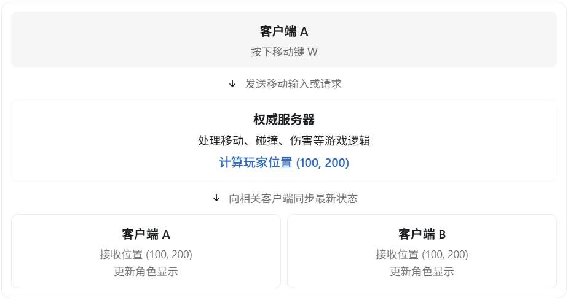
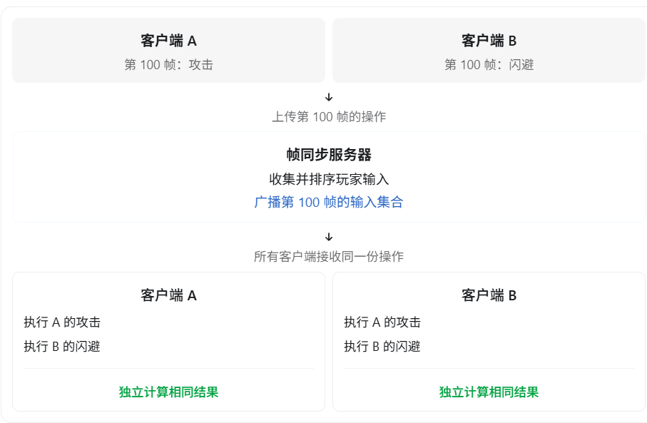
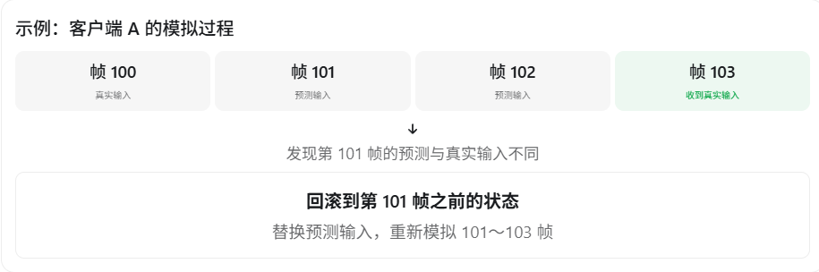
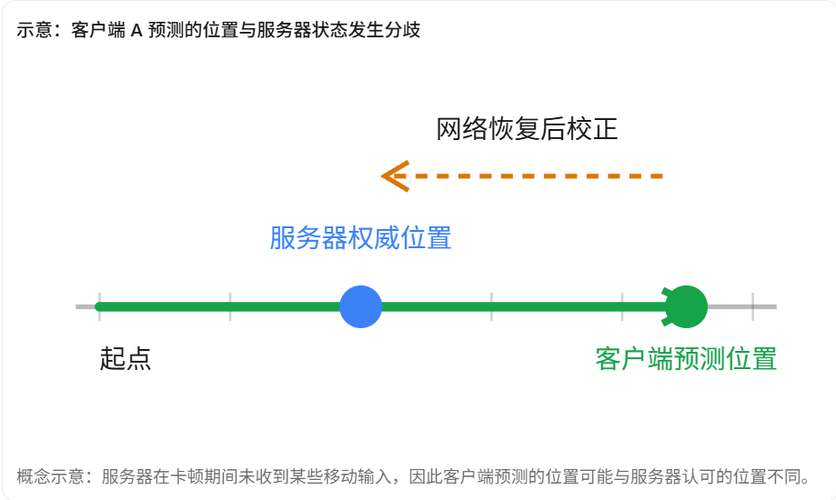
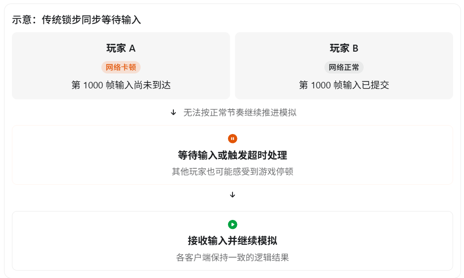
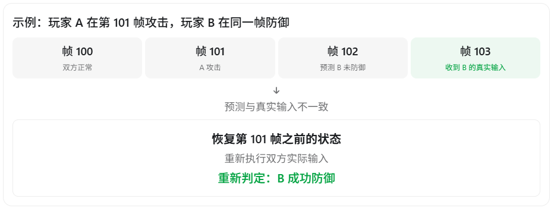
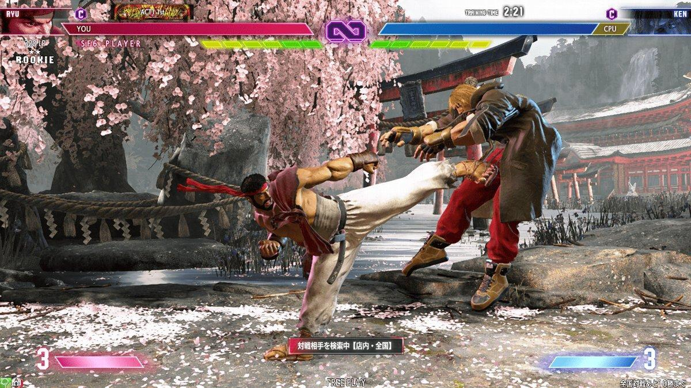
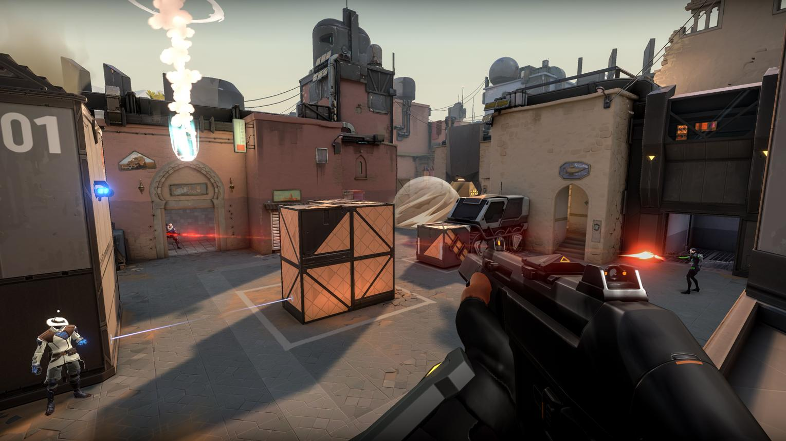

在游戏客户端开发中，**状态同步（State Synchronization）和帧同步（Frame Synchronization）是多人联机游戏中两种常见的同步方案**，也是 UE5 游戏客户端面试中的高频问题。

两者最核心的区别是：

- **状态同步：同步游戏运行的结果**。 例如服务器告诉客户端，角色现在的位置是 `(100, 200)`，血量是 `80`。
- **帧同步：同步玩家的操作输入**。 例如服务器告诉所有客户端，第 100 帧玩家 A 按下了攻击键，玩家 B 按下了移动键，各客户端执行相同逻辑来计算结果。

可以用一句话总结：

**状态同步是“服务器算好了告诉你结果”，帧同步是“服务器告诉大家做了什么，大家自己算结果”。**

## 一、状态同步的原理

状态同步通常采用权威服务器架构（Server Authoritative）。

客户端负责发送操作请求，服务端负责执行权威游戏逻辑，再将游戏状态同步给客户端。



### 举个例子

假设玩家 A 攻击玩家 B，造成 20 点伤害。

状态同步的过程可以是：

1. 玩家 A 的客户端发送攻击操作请求。
2. 服务器验证攻击是否合法，判断是否命中。
3. 服务器计算伤害，将 B 的血量从 100 改成 80。
4. 服务器将 B 的最新血量同步给相关客户端。
5. 客户端更新 B 的血条。

客户端不需要各自计算出最终的权威伤害结果。

### 状态同步的特点

优点：

- 对客户端计算的确定性要求较低。
- 服务器统一控制游戏逻辑，比较容易实现反作弊。
- 适合复杂物理、碰撞、AI 和动态场景。
- 可以根据玩家距离、网络相关性，只同步客户端需要的数据。

缺点：

- 需要持续同步游戏状态，可能占用较多带宽。
- 存在网络延迟，远程角色移动可能不流畅。
- 需要客户端插值、预测及服务器校正等技术来优化体验。

例如 UE5 默认的 Actor 属性复制、Actor 移动同步等机制，主要属于状态同步体系。

## 二、帧同步的原理

帧同步最重要的特点是：**不同客户端在相同的逻辑帧，使用相同的输入，执行相同的游戏逻辑，从而得到相同的结果。**

假设有两个玩家，游戏以每秒 60 个逻辑帧运行。

在第 100 帧：

- 玩家 A 按下攻击键。
- 玩家 B 按下闪避键。

帧同步的典型流程如下：



这意味着，服务器通常不需要每帧把玩家位置、血量等所有状态都广播出去，只需要同步必要的输入。

### 为什么不同客户端能计算出相同结果？

这依赖一个非常重要的条件：**确定性（Determinism）。**

可以用下面的公式表示：

\[ S_{n+1}=F(S_n,I_n) \]

其中：

- \(S_n\)：第 n 帧的游戏状态。
- \(I_n\)：第 n 帧所有玩家的输入集合。
- \(F\)：游戏逻辑计算函数。
- \(S_{n+1}\)：下一帧游戏状态。

只要所有客户端的初始状态相同、输入相同、计算逻辑具有确定性，那么理论上它们就会得到相同的结果。

但是这里有一个难点。

假设某个玩家的移动代码是：

```c++
Position += Velocity * DeltaTime;
```

如果客户端 A 的 `DeltaTime = 0.016`，客户端 B 的 `DeltaTime = 0.018`，那么即使两个客户端输入一样，最终位置也可能不同。

因此，帧同步通常要求：

**逻辑模拟使用固定时间步长，而不是直接依赖每台机器的实际渲染帧时间。**

同时还需要控制随机数种子、浮点计算差异、物理模拟顺序、容器遍历顺序等影响确定性的因素。固定时间步长是重要条件，但不能单独保证确定性。

## 三、状态同步和帧同步的详细对比

| 比较维度               | 状态同步                   | 帧同步                      |
| ---------------------- | -------------------------- | --------------------------- |
| 同步内容               | 游戏状态、事件             | 玩家输入、操作指令          |
| 游戏逻辑主要在哪里执行 | 权威服务器                 | 各客户端都执行确定性模拟    |
| 服务器计算压力         | 通常较高                   | 纯输入转发方案通常较低      |
| 客户端计算压力         | 取决于本地预测和表现逻辑   | 需要运行完整同步模拟        |
| 网络带宽               | 随同步实体和属性增加       | 通常与玩家输入量相关        |
| 确定性要求             | 不要求所有机器完全一致     | 非常高                      |
| 延迟处理               | 预测、插值、服务器校正     | 输入延迟、预测回滚          |
| 反作弊                 | 服务器权威，通常更容易控制 | 纯客户端模拟更难保证权威性  |
| 中途加入游戏           | 相对容易获取当前状态       | 通常需要状态快照和输入追赶  |
| 常见适用场景           | FPS、MMORPG、大型动作游戏  | RTS、格斗游戏及部分竞技游戏 |

这里需要强调，**两种同步方式不一定决定是否使用 DS（Dedicated Server）**。

状态同步通常使用权威服务器，而帧同步同样可以使用服务器，只不过服务器的职责可能主要是收集、排序和转发输入，而非模拟全部游戏逻辑。

## 四、网络延迟时，两种方案如何处理？

这是面试中最容易深入追问的部分。

### 1. 状态同步：客户端预测 + 服务器校正

假设玩家按下 W 向前移动。

如果每次都要等待服务器返回新位置，玩家就会感受到明显的移动延迟。

所以现代状态同步方案通常会进行客户端预测。

```
玩家按下 W
    │
    ├── 客户端立即预测移动
    │
    └── 将移动输入发送服务器
              │
              ▼
       服务器验证并计算移动
              │
              ▼
       返回权威结果或确认信息
              │
              ▼
       客户端比较预测和权威结果
              │
       ┌──────┴──────┐
       │             │
     一致          不一致
       │             │
    继续运行      校正位置
                     │
                  重放未确认输入
```

这里的“重放”是把尚未被服务器确认的移动输入重新模拟一遍，而不是简单地将角色传送到服务器位置。

UE5 的 `UCharacterMovementComponent` 就实现了类似机制，包括 `FSavedMove_Character`、`ServerMove`、服务器校正和网络平滑。

### 2. 帧同步：等待输入或预测回滚

假设现在客户端 A 已经到达第 100 帧，但是客户端 B 的第 100 帧操作还没有收到。

如何处理？

**方法一：等待输入（Lockstep）**

客户端 A 等待客户端 B 的输入到达，然后一起执行第 100 帧。

优点是逻辑简单，缺点是网络延迟可能造成操作延迟或游戏卡顿。

**方法二：预测回滚（Rollback）**

客户端 A 不等待，而是假设玩家 B 继续执行上一帧的操作。



预测回滚的优点是降低输入等待带来的延迟，但要求能够保存历史状态、恢复状态并快速重新模拟。

这种技术在格斗游戏的网络同步中尤其重要。

## 五、结合 UE5，应该如何理解？

UE5 原生多人游戏网络框架主要采用权威服务器 + 状态复制的体系。

例如：

```c++
UPROPERTY(ReplicatedUsing = OnRep_Health)
float Health = 100.f;
```

服务端修改血量后，引擎可以把新值复制给客户端：

```c++
void AMyCharacter::OnRep_Health()
{
    UpdateHealthUI();
}
```

再比如使用 `bReplicates`、`SetReplicateMovement(true)`，以及 `Server RPC` 实现网络交互。

这些都属于状态同步架构的典型机制。

但有一个细节不能误解：

**状态同步不代表客户端完全不执行游戏逻辑，帧同步也不代表服务器绝对不计算游戏逻辑。**

UE5 的 CharacterMovement 就会在客户端预测移动，并在服务器上重新执行和校验移动逻辑。这仍然属于服务器权威的状态同步体系，而不是传统意义上所有客户端共同推进完整世界的帧同步。

如果要在 UE5 中实现严格的帧同步，一般还需要自己设计固定步长逻辑模拟、确定性计算、输入缓冲、帧编号、掉线恢复和状态校验等机制。不能直接认为开启 Actor Replication 就实现了帧同步。

## 六、面试时怎么回答？

> 状态同步和帧同步最主要的区别在于同步的数据不同。
>
> 状态同步主要同步游戏运行结果，一般采用权威服务器架构。客户端向服务器发送操作请求，服务器计算权威游戏状态，然后同步给客户端。为了降低延迟，客户端通常会使用预测、插值和服务器校正等技术。
>
> 帧同步主要同步玩家的操作输入。各个客户端在相同的逻辑帧执行相同输入，通过确定性模拟得到一致的游戏状态。
>
> 状态同步的优点是服务器容易控制游戏规则，对确定性要求较低，适合 FPS、MMORPG 等游戏；缺点是需要同步大量状态，对带宽和服务器计算能力有一定要求。
>
> 帧同步通常可以减少游戏状态的传输量，但要求逻辑具有严格确定性，同时需要解决输入延迟、不同步、断线恢复等问题。
>
> 在 UE5 中，原生网络复制框架主要属于状态同步体系，CharacterMovement 还使用了客户端预测与服务器校正来改善操作体验。

## 七、面试中可能继续追问的问题

我建议重点掌握下面三个问题：

问题一：帧同步是不是一定比状态同步节省带宽？

不一定。纯输入同步通常传输量较小，但还可能需要快照、校验信息、重传数据等。最终带宽取决于玩家数量、实体数量、同步频率和具体实现。

问题二：为什么帧同步中浮点数计算可能造成不同步？

因为不同的硬件、编译优化、运算顺序等可能产生浮点计算差异。这些微小误差会在不断模拟中累积，最终可能影响碰撞、技能命中等结果。

问题三：既然帧同步只同步输入，那么玩家中途加入游戏怎么办？

因为新玩家没有参与之前的模拟，只接收最新输入无法还原当前状态。一般需要向新客户端发送某个时刻的游戏状态快照，再补充后续输入，使其追赶到当前逻辑帧。

这也是帧同步系统的重要工程难点之一。

对于 UE5 客户端面试，我建议优先深入掌握状态同步中的三个技术：Actor Replication、RPC、客户端预测与服务器校正。 它们与 UE5 原生网络框架的实际开发联系最紧密。

------

状态同步和帧同步在网络卡顿时，最直观的区别是：

- **状态同步：玩家通常还能继续操作，但可能出现角色瞬移、位置回弹、其他玩家动作卡顿等现象。**
- **传统锁步式帧同步：如果某个玩家的操作数据迟迟没有到达，其他玩家可能也要等待，表现为游戏停顿或者操作延迟。**

不过，现代帧同步还可以使用输入预测、回滚等技术，因此并非所有帧同步游戏都会出现全员卡顿。

下面结合两款真实游戏说明。

## 一、状态同步：以《反恐精英 2》（CS2）为例

Counter-Strike 2 使用服务器权威的网络架构，并结合客户端预测、状态快照、插值和延迟补偿来处理网络同步。

Valve 官方也明确提到了网络问题可能导致的卡顿、回弹（Rubber-banding）现象。

### 假设玩家 A 的网络突然卡顿 500ms

玩家 A 正在向前奔跑，此时网络突然中断半秒。



从不同玩家的角度看：

**玩家 A 自己看到的：**

1. 按下 W，角色可能继续向前移动，因为客户端正在预测移动。
2. 网络中断期间，客户端无法及时获得服务器的权威结果。
3. 网络恢复后，如果预测与服务器状态差异较大，角色可能突然向后回弹。
4. 如果此前开枪，命中反馈也可能延迟，或者出现自己认为打中了但服务器没有认可的情况。

**玩家 B 看到的：**

1. 玩家 B 的网络正常，自己的角色仍然可以移动、射击。
2. 由于 A 的状态更新不及时，B 看到的 A 可能短暂卡住，或者按照旧速度继续移动。
3. 新状态到达后，A 的位置可能发生突然变化。

这并不表示 CS2 每次 500ms 卡顿都会回弹。是否出现、回弹多大，取决于丢失了哪些数据以及预测、缓冲和校正机制。

**关键特点：玩家 A 的网络出现问题，通常不会导致整个服务器和其他玩家一起停止游戏。**

## 二、帧同步：以《星际争霸 2》为例

StarCraft II 是确定性锁步同步（Deterministic Lockstep）的经典案例。

游戏中玩家的操作指令被同步到其他客户端，各客户端分别推进相同的游戏模拟。这种架构在网络延迟较大时，可能使所有玩家受到最慢输入方的影响。

### 假设玩家 A 的网络突然卡顿 500ms

现在 A 和 B 正在进行一场星际争霸对战。

当前双方准备执行第 1000 个逻辑帧，但玩家 A 的操作数据没有及时到达。



从玩家的角度：

**玩家 A 自己看到的：**

- 点击让部队移动，但部队可能没有立即响应。
- 严重时，整个游戏模拟可能短暂停顿。
- 网络恢复后，等待中的操作开始执行。

**玩家 B 看到的：**

- 虽然 B 自己的网络正常，但也可能感觉部队不再移动。
- 游戏可能出现等待其他玩家的提示。
- 如果延迟一直持续，系统可能根据超时规则断开延迟玩家。

《星际争霸 2》历史版本确实存在 `Waiting for Players` 等待玩家界面，暴雪的补丁说明中也提到过该界面及相关问题。

但需要注意，这只是典型锁步同步的表现。具体会等待多久、是否暂停所有玩家、是否忽略超时输入，要看游戏自身的协议和超时策略。

## 三、放在一起比较

假设两款游戏中都有一名玩家网络卡顿 500ms：

| 现象           | CS2（状态同步）            | 星际争霸 2（锁步帧同步） |
| -------------- | -------------------------- | ------------------------ |
| 自己还能操作吗 | 本地预测可能继续           | 操作可能延迟执行         |
| 其他玩家会卡吗 | 通常不会因为你卡而整体暂停 | 可能一起停顿或变慢       |
| 网络恢复后     | 可能发生位置校正、回弹     | 恢复同步模拟             |
| 常见异常       | 瞬移、回弹、命中反馈异常   | 指令延迟、游戏停顿       |
| 最核心的原因   | 本地状态和服务器状态不一致 | 缺少推进逻辑帧所需的输入 |

## 四、为什么会出现这种差异？

根本原因在于：**游戏逻辑推进是否必须等待其他玩家的数据。**

对于 CS2 这样的状态同步游戏，服务器拥有权威状态。即使玩家 A 的输入暂时没有到达，服务器仍然可以继续处理其他玩家的操作。

而严格锁步帧同步要求同一个逻辑帧使用完整且一致的输入集合。如果缺少必要输入，就不能直接按照普通规则推进这一帧，否则不同客户端可能产生不一致的模拟结果。

但现代帧同步也可以使用输入超时、默认空输入、输入预测和回滚等技术来避免长期等待，因此“一个人卡，全员卡”并不是帧同步的必然结果。

## 五、面试时可以这样回答

> 状态同步和帧同步在网络卡顿时的表现不同，主要是因为两者推进游戏逻辑的方式不同。
>
> 例如 CS2 使用服务器权威的状态同步架构。如果一个玩家网络卡顿，由于客户端有预测机制，自己可能仍然能移动，但网络恢复后可能受到服务器校正，出现位置回弹或者瞬移。其他玩家通常可以继续正常游戏。
>
> 而《星际争霸 2》采用确定性锁步同步。多个客户端需要按照相同输入推进相同的逻辑帧，因此如果某个玩家的输入延迟，其他玩家也可能被迫等待，表现为游戏整体停顿或者操作延迟。
>
> 不过，帧同步可以通过超时机制、预测和回滚优化卡顿问题，不能简单认为所有帧同步游戏都会因为一个玩家卡顿而全员卡住。

还有一个面试中非常值得注意的细节：

网络卡顿和客户端 FPS 低不是一回事。

例如，帧同步需要一致的是逻辑模拟帧，而不是渲染帧。如果客户端渲染从 120 FPS 降到 30 FPS，但仍能按时推进同步逻辑，其他玩家未必会受到影响。只有当逻辑模拟或网络输入跟不上同步要求时，才可能影响整个对局。

------

格斗游戏经常采用帧同步，尤其是**输入同步 + 预测回滚（Rollback Netcode）**，主要有两个原因：

1. **格斗游戏对操作延迟极其敏感，甚至一帧的延迟都可能影响胜负。**
2. **格斗游戏通常只有两名玩家、少量战斗实体，游戏逻辑相对容易实现确定性模拟和回滚。**

而一个游戏究竟采用状态同步还是帧同步，主要取决于：**操作实时性、游戏逻辑的确定性、玩家和实体数量、服务器权威需求，以及开发成本。**

## 一、为什么格斗游戏更适合帧同步？

### 1. 格斗游戏对操作延迟极其敏感

以 Street Fighter 6 这种格斗游戏为例。

假设游戏以 60 个逻辑帧每秒运行：

​								\[ 1\text{帧}=\frac{1000}{60}\approx16.67\text{ms} \]

玩家可能需要根据对方的出招动作，在非常短的时间窗口内进行格挡、闪避或者反击。

例如：

- 对手的攻击即将命中。
- 你在最后的有效时机按下防御键。
- 游戏必须准确判断防御输入在哪一帧生效。

假设你的网络 RTT 是 100ms。

如果采用一种简单的服务器权威状态同步方案，必须等服务器确认后才执行防御，那么操作反馈就可能明显滞后。

当然，**状态同步也可以通过客户端预测来降低输入延迟，**并不是说采用状态同步就一定要等待服务器。

但是对于格斗游戏，预测的不只是自己的移动，还包括双方的攻击判定、防御判定、硬直、连招状态等相互依赖的战斗逻辑。这些状态紧密耦合，要在服务器权威框架下实现流畅、准确的本地预测与校正，难度不低。

### 2. 帧同步可以让本地操作立即生效

现代格斗游戏广泛采用 Rollback Netcode。

它不要求每一帧都等对方输入到达，而是先预测对方操作。

例如：



具体流程是：

1. A 按下攻击键，本地立即模拟攻击。
2. B 的输入尚未到达，A 预测 B 保持之前的操作。
3. A 的客户端暂时判定 B 被攻击命中。
4. 收到 B 的真实防御输入后，发现预测错误。
5. A 回滚到相关历史状态，用正确输入重新模拟。
6. 最终修正为 B 成功防御。

这样做的好处是：**玩家自己的操作不必等待网络往返，就可以得到及时反馈。**

这也是 GGPO 这类格斗游戏网络方案的核心思想。

但它有代价：如果预测失败，画面可能出现状态突变，例如对方的受击动作突然被修正为格挡动作。

现实案例是 Dragon Ball FighterZ。它在 2024 年推出了回滚网络代码更新，官方明确解释了预测、立即执行和之后修正的机制。

### 3. 格斗游戏的状态比较容易保存和重新模拟

Rollback 需要三个关键能力：

- 保存历史游戏状态。
- 恢复到之前的某一逻辑帧。
- 使用正确输入快速重新模拟后续帧。

格斗游戏通常只有两个主要战斗角色、少量投射物和有限的战斗状态，因此相对容易实现。

例如一份简化的角色状态：

```c++
struct FighterState
{
    FVector2D Position;

    int32 Health;
    int32 CurrentMove;
    int32 MoveFrame;
    int32 HitStunFrames;

    bool bIsBlocking;
};
```

保存这类纯逻辑状态并快速重新执行几帧，通常比较可控。

但假设是一个有 100 名玩家、大量刚体物理和复杂场景交互的游戏，回滚整个世界的成本就可能非常高。

**这也是格斗游戏特别适合帧同步加回滚，而大型多人动作游戏通常更偏向状态同步的重要原因。**

## 二、游戏应该依据什么选择同步方案？

可以从以下五个维度考虑。

### 1. 游戏对延迟的容忍度

| 游戏类型   | 延迟特点                       | 常见选择                   |
| ---------- | ------------------------------ | -------------------------- |
| 格斗游戏   | 需要精确到逻辑帧的操作响应     | 输入同步 + 回滚            |
| FPS 游戏   | 瞄准、射击需要极低延迟         | 状态同步 + 预测 + 延迟补偿 |
| MMORPG     | 大量玩家，操作类型复杂         | 状态同步                   |
| RTS 游戏   | 单位很多，但玩家操作指令相对少 | 确定性锁步或混合方案       |
| 回合制游戏 | 对毫秒级实时性要求低           | 服务器权威状态或指令同步   |

注意：**低延迟要求并不必然意味着选择帧同步**。

例如 VALORANT 同样对射击时机非常敏感，却使用服务器权威的状态同步架构。

它通过本地预测、服务器校正和命中延迟补偿来保证操作手感与判定公平性。

### 2. 游戏逻辑是否容易实现确定性

这是决定能否采用纯输入同步的关键因素之一。

帧同步要求：

\[ S_{n+1}=F(S_n,I_n) \]

相同状态、相同输入必须产生相同结果。

例如普通的逻辑：

```c++
Position += Direction * FixedSpeed;
```

如果用固定点数值、统一时间步长和稳定的运算规则实现，就比较容易保证确定性。

但如果涉及：

```c++
// 依赖复杂的物理计算
Mesh->AddImpulse(Impulse);

// 依赖游戏世界的碰撞结果
GetWorld()->SweepSingleByChannel(...);
```

就必须考虑物理系统、浮点误差、碰撞求解顺序等因素。

像 UE5 原生 Chaos 物理，并不能默认保证跨机器严格确定性。

因此，想在 UE5 中做严格帧同步，往往需要开发独立的确定性战斗模拟层，而不能简单地让所有客户端各自运行 Actor Tick 后就期望结果一致。

### 3. 玩家数量与游戏实体数量

帧同步不一定在玩家多时就不合适，但系统规模会影响它的成本。

例如 RTS 游戏可能有几千个单位，为什么仍然适合确定性锁步？

因为玩家实际发送的指令可能只是：

```
第 100 帧：
    玩家 A：选中 20 个士兵，移动到 (100, 200)
    玩家 B：建造一个建筑
```

即使场上有几千个单位，也可以只传递少量操作命令，其他单位行为由各客户端自行模拟。

反过来，一款拥有大量动态物理交互的游戏，即使玩家不多，想让所有机器保持完全一致也可能非常困难。

因此，**实体数量并不是唯一依据，更重要的是模拟的确定性和状态管理复杂度。**

### 4. 是否需要很强的服务器权威与反作弊

对于 MMORPG、FPS 等游戏，服务器通常需要控制：

- 玩家是否合法移动。
- 攻击是否命中。
- 是否有权限获得道具。
- 技能是否处于冷却状态。
- 玩家是否作弊。

服务器权威状态同步更容易建立统一的可信裁决点。

而纯客户端确定性帧同步，如果服务器只负责转发输入，客户端就可能通过修改游戏程序获取额外信息或实施作弊。

不过这不代表帧同步一定不安全。帧同步同样可以使用权威服务器验证输入、执行模拟、进行状态校验，甚至裁定最终结果，只是服务器成本会上升。

### 5. 服务器压力和网络带宽

假设有 100 个角色，每个角色都需要同步：

- 位置。
- 旋转。
- 血量。
- 动作状态。

状态同步可能需要持续向客户端发送这些状态或状态增量。

输入同步通常只需要发送操作数据，因此在确定性模拟可行时，可能大幅减少网络传输量。

但帧同步也可能需要状态快照、重传和校验数据；回滚还会增加客户端的计算负担。

所以不能简单认为帧同步一定更省带宽、更省服务器资源，要看具体实现。

## 三、两个实际项目应该如何选？



**项目 A：1v1 格斗游戏**

玩家数量少，战斗状态相对紧凑，操作按逻辑帧判定，要求极低输入延迟。

**优先考虑：确定性输入同步 + Rollback。**



**项目 B：多人 FPS 游戏**

存在射击命中、复杂移动、地图碰撞、服务器反作弊以及玩家中途加入等要求。

**优先考虑：服务器权威状态同步 + 客户端预测 + 延迟补偿。**

## 四、要特别区分：帧同步不等于回滚同步

这也是我认为最值得在面试中讲清楚的一点。

“帧同步”回答的是各个客户端如何通过一致的输入推进模拟；“回滚”回答的是远程输入延迟到达时，如何在不长时间等待的情况下进行修正。

因此，同样是输入同步，可以采用两种方式：

|                      | 传统锁步（Lockstep） | 预测回滚（Rollback） |
| -------------------- | -------------------- | -------------------- |
| 是否等待远端输入     | 通常需要             | 可以不等待           |
| 本地输入延迟         | 可能较明显           | 通常较低             |
| 网络抖动的表现       | 停顿、输入延迟       | 状态突变、修正       |
| 是否需要保存历史状态 | 不一定               | 需要                 |
| 是否需要重新模拟     | 通常不需要           | 需要                 |
| 实现复杂度           | 相对较低             | 较高                 |

此外，**回滚技术也不专属于帧同步**。服务器权威游戏也可以利用历史状态恢复和重新模拟，只是其用途和裁决方式有所不同。

## 五、面试时可以这样回答

> 我认为选择状态同步还是帧同步，主要需要考虑游戏的实时性要求、游戏逻辑的确定性、玩家数量、模拟复杂度以及服务器权威需求。
>
> 格斗游戏经常采用输入同步，是因为它对操作帧数非常敏感，比如格挡、连招和反击都需要准确处理输入时机。同时，格斗游戏参与模拟的主要角色数量通常比较少，容易保存状态并进行确定性模拟。
>
> 现代格斗游戏一般还会配合 Rollback 技术，让本地输入立即执行，对远程输入进行预测，如果预测错误，就回滚历史状态重新模拟。
>
> 对于 FPS、MMORPG 这样的游戏，通常采用服务器权威的状态同步，因为它们涉及复杂的物理、碰撞、多人交互以及反作弊需求，要求所有客户端严格确定性计算的成本较高。
>
> 但状态同步也可以通过客户端预测、插值和服务器校正降低网络延迟，因此并不是说帧同步的实时性就一定比状态同步好。
>
> 最终选择要根据具体游戏的业务特点，在延迟、带宽、确定性、权威性和开发成本之间进行权衡。

再补充一个 UE5 面试很可能继续追问的技术问题：

假如让你用 UE5 + GAS 制作一款支持 Rollback 的格斗游戏，你会如何处理 `GameplayEffect`、`GameplayTag`、`GameplayAbility` 的回滚？

这实际上很有挑战性，因为除了恢复血量、位置，还需要考虑技能激活状态、冷却、定时器、GameplayEffect 持续时间，以及 GameplayCue 产生的表现副作用。直接恢复几个 Attribute 的值，通常不足以完成整个 GAS 战斗状态的回滚。