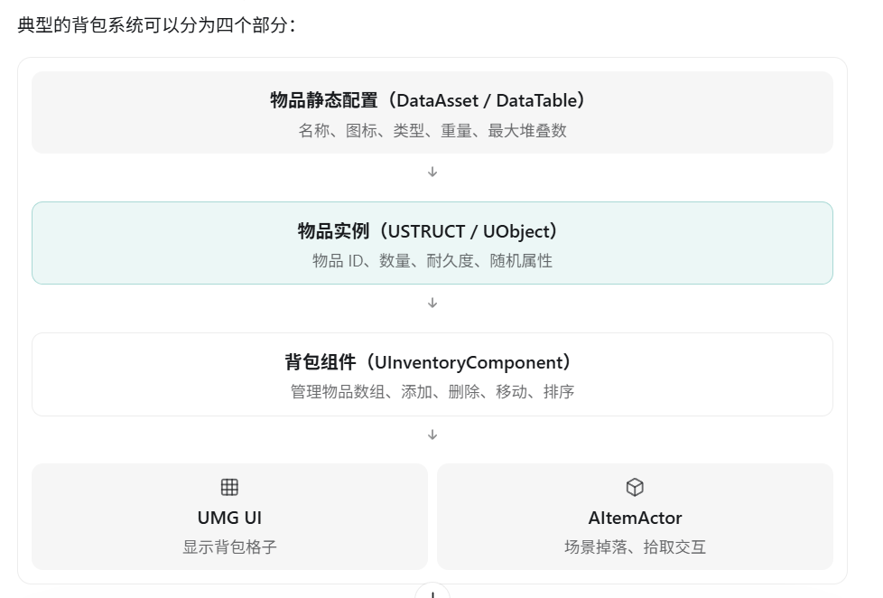
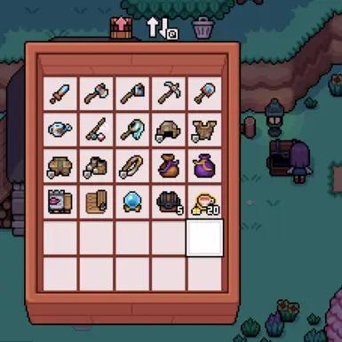
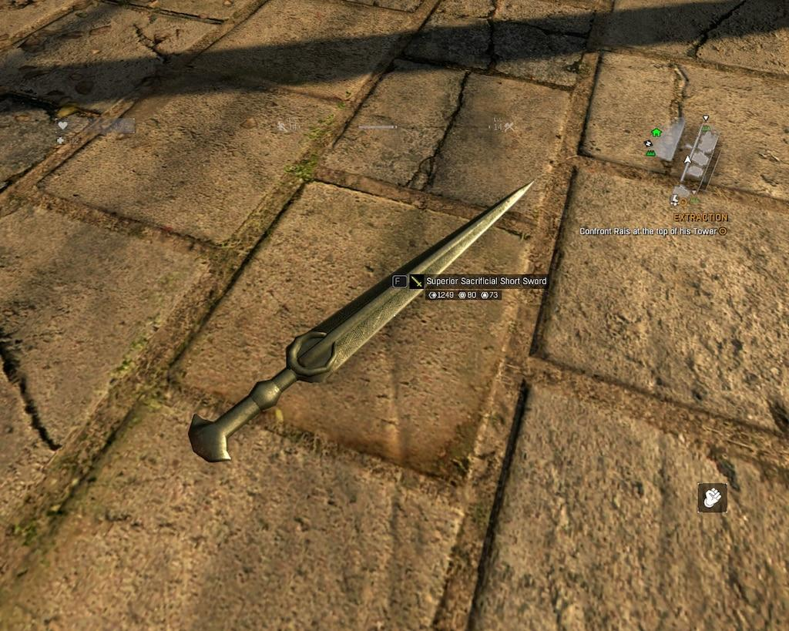

在 UE5 原生框架下开发背包系统，一般不会为背包里的每件物品都创建一个 Actor，而是使用 `USTRUCT` 或 `UObject` 管理物品数据，只有物品真正出现在游戏世界中时，才考虑使用 Actor。

这也是 UE5 游戏开发中比较常见的设计方式。

## 一、UE5 背包系统通常怎么设计？



## 二、物品数据通常使用什么类型？

### 1. USTRUCT：适合简单物品

例如，一个游戏背包只需要保存物品 ID、数量和耐久度：

```
USTRUCT(BlueprintType)
struct FInventoryItem
{
    GENERATED_BODY()

    UPROPERTY()
    int32 ItemID = 0;

    UPROPERTY()
    int32 Count = 0;

    UPROPERTY()
    float Durability = 100.f;
};
```

背包组件：

```
UCLASS()
class UInventoryComponent : public UActorComponent
{
    GENERATED_BODY()

public:
    UPROPERTY()
    TArray<FInventoryItem> Items;
};
```

优点：

- 内存开销较低。
- `TArray` 连续存储，遍历效率高。
- 不需要为每个物品创建 UObject。
- 适合数量大、逻辑比较简单的物品。

### 2. UObject：适合复杂物品实例

如果每件装备都可能拥有独立的随机属性、强化等级、耐久度等，可以考虑使用 UObject。

```
UCLASS(BlueprintType)
class UItemInstance : public UObject
{
    GENERATED_BODY()

public:
    UPROPERTY()
    int32 ItemID = 0;

    UPROPERTY()
    float Durability = 100.f;

    UPROPERTY()
    int32 EnhanceLevel = 0;
};
```

背包管理：

```
UPROPERTY()
TArray<TObjectPtr<UItemInstance>> Items;
```

这样每件物品就是一个独立的 UObject 实例。

它相比 Actor 更轻量，不需要 Actor 的世界生命周期管理，也不要求具有场景位置。

不过，UObject 依然存在对象分配和垃圾回收开销，所以并不是所有物品都必须创建 UObject。

## 三、什么时候需要 Actor？

例如玩家拥有一把剑。



剑在背包中

使用 `USTRUCT` 或 `UObject` 保存剑的数据，UMG 显示其图标。

不需要 Actor，也不需要碰撞组件。



剑掉落到游戏世界中

可以创建 `AItemActor`，负责剑的 Mesh、世界位置、碰撞检测和拾取交互。


玩家装备剑

可以使用武器 Actor 附着到角色骨骼插槽，负责武器表现、碰撞和相关交互；物品属性仍由独立的数据对象管理。

注意：装备到角色身上的武器也不一定必须是 Actor。如果只是视觉模型，使用 `UStaticMeshComponent` 或 `USkeletalMeshComponent` 也可能足够。

## 四、UE5 官方示例 Lyra 是怎么做的？

UE5 的 Lyra Starter Game 就是一个值得参考的例子。

它的背包系统主要包含：

| 类型                             | 职责                                     |
| -------------------------------- | ---------------------------------------- |
| `ULyraInventoryItemDefinition`   | 定义物品类型及静态配置                   |
| `ULyraInventoryItemInstance`     | 表示具体的物品实例，继承 `UObject`       |
| `ULyraInventoryManagerComponent` | 管理玩家持有的物品                       |
| `FLyraInventoryList`             | 管理背包条目，并使用 Fast Array 复制机制 |
| 装备和拾取相关 Actor             | 处理场景表现及交互                       |

可以看到，Lyra 并不是使用一个 Actor 表示背包中的每一件物品，而是通过 UObject 表示物品实例，通过组件管理物品集合。

## 五、和你之前的 Mass 背包架构相比

| 对比     | 原生常见方案             | Mass 方案                 |
| -------- | ------------------------ | ------------------------- |
| 物品实例 | USTRUCT / UObject        | Mass Entity               |
| 属性数据 | 结构体成员、UObject 属性 | Fragment                  |
| 物品标识 | ID、指针或实例标识       | TID / EntityHandle        |
| 背包管理 | ActorComponent + TArray  | 背包系统 + EntityManager  |
| 批量处理 | 遍历数组或对象           | Mass Processor            |
| 适用场景 | 普通 RPG、ARPG 背包      | 已采用 ECS 的数据驱动项目 |

你之前提到的通过 TID 查找物品 Fragment，本质上和 UObject 物品实例方案有相似之处：物品的数据独立于它在背包 UI 或世界中的表现。

区别是，Mass 进一步将对象属性拆解成 Fragment，能够通过 Archetype 和 Processor 高效组织批量计算。

## 六、面试应该怎么回答？

> 在 UE5 原生环境下，我通常不会为背包中的每件物品创建 Actor，因为背包物品大多数时候只需要保存数据，并不需要世界位置、Tick、碰撞等 Actor 相关功能。
>
> 对于简单物品，我会使用 USTRUCT 保存实例数据，通过 TArray 统一管理；对于有复杂实例属性和独立逻辑的装备，可以使用 UObject 表示物品实例。
>
> 背包本身可以通过 UActorComponent 实现，挂载在 PlayerState 或角色等合适的对象上。物品的静态配置可以放在 DataAsset 或 DataTable 中。
>
> 当物品掉落到场景，需要 Mesh、碰撞和拾取等功能时，才考虑创建 Actor。
>
> 这样可以减少大量不必要的 Actor 开销，实现物品数据与场景表现分离，也方便后续扩展存档、装备和网络同步功能。

如果是面试，我还建议重点了解 Lyra 的 `ULyraInventoryItemInstance` 和 `ULyraInventoryManagerComponent`。 它们能帮助你把 UE5 原生物品架构和你目前使用的 Mass Entity 架构进行对比，这在解释项目技术选型时很有价值。