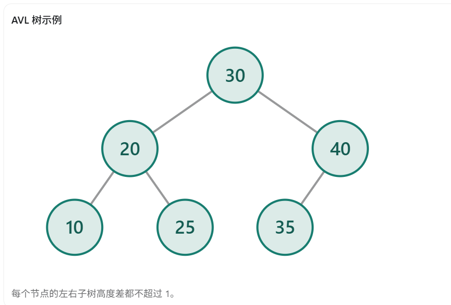
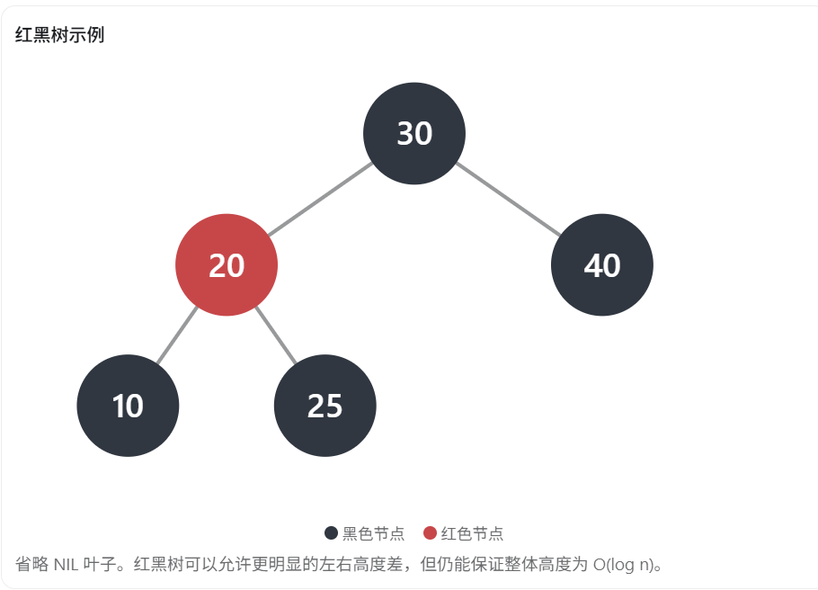
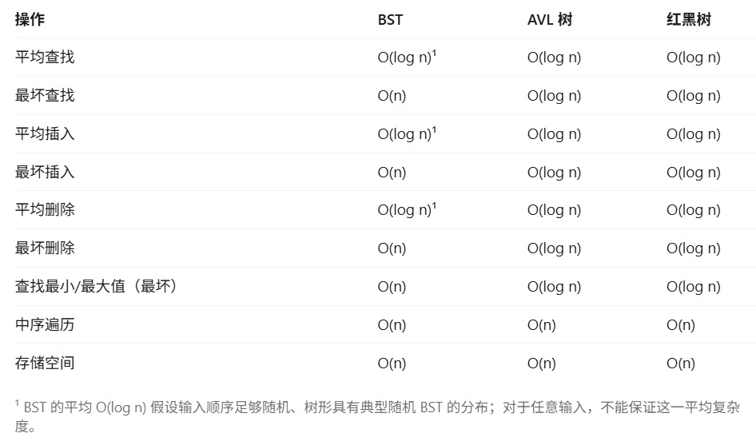
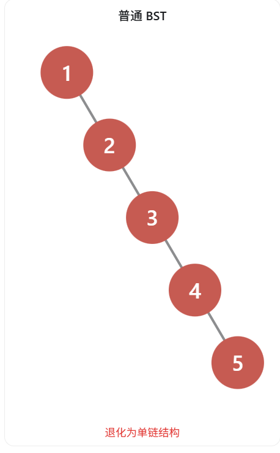

红黑树（Red-Black Tree）和 AVL 树都是**自平衡二叉搜索树（BST）**，它们的查找、插入、删除操作都能保证最坏时间复杂度为 O(log n)。

但是，两者最大的区别在于：

**AVL 树追求更严格的平衡，因此查找性能通常更好；红黑树允许一定程度的不平衡，因此在频繁插入、删除的场景下通常更有优势。**

## 一、红黑树和 AVL 树的核心区别

| 对比维度       | AVL 树             | 红黑树                        |
| -------------- | ------------------ | ----------------------------- |
| 平衡方式       | 高度平衡           | 颜色规则约束平衡              |
| 平衡条件       | 左右子树高度差 ≤ 1 | 最长路径不超过最短路径的 2 倍 |
| 树的高度       | 通常更低           | 通常略高                      |
| 查找复杂度     | O(log n)           | O(log n)                      |
| 插入复杂度     | O(log n)           | O(log n)                      |
| 删除复杂度     | O(log n)           | O(log n)                      |
| 插入旋转次数   | 最多 2 次          | 最多 2 次                     |
| 删除旋转次数   | 最坏 O(log n) 次   | 最多 3 次                     |
| 维护信息       | 高度或平衡因子     | 颜色（红/黑）                 |
| 查找性能       | 通常更好           | 通常略逊                      |
| 插入、删除性能 | 维护平衡可能更频繁 | 通常更适合频繁更新            |

注意：这里的旋转次数是指单次基本旋转，双旋计为两次；旋转次数少不等于操作总复杂度低，因为还可能存在沿路径向上的平衡维护。

## 二、平衡条件不同（核心考点）

### 1. AVL 树：严格平衡

AVL 树要求任意节点的左右子树高度差的绝对值不超过 1。

\[ |h_{left}-h_{right}|\leq1 \]

AVL 树在插入和删除节点后，如果某个节点的平衡因子超出 `[-1, 1]`，就需要通过旋转来恢复平衡。

常见的旋转类型有 LL、RR、LR、RL 四种。

### 2. 红黑树：相对宽松的平衡

红黑树不要求左右子树高度差小于等于 1，而是通过红黑颜色规则约束树的高度。

其中两个关键性质是：

- 红色节点不能有红色子节点。
- 从任意节点到其后代 NIL 叶子的所有路径包含相同数量的黑色节点。

红黑树高度满足：

\[ h\leq 2\log_2(n+1) \]

因此即使没有 AVL 树那么平衡，也不会退化为链表。

## 三、查找、插入、删除的性能差异

### 1. 查找：AVL 树通常更快

因为 AVL 树更加平衡，平均搜索路径通常更短，查找时需要比较的节点数量可能更少。

因此，对于查找远多于插入、删除的场景，AVL 树通常更有优势。

### 2. 插入：红黑树通常更适合频繁更新

AVL 树插入后，可能需要重新计算高度、平衡因子，并执行旋转。

红黑树插入后，可能需要重新着色或旋转恢复红黑性质。

两者插入操作都是 O(log n)，但是红黑树平衡条件更加宽松，在更新密集的场景中通常表现较好。

### 3. 删除：红黑树的旋转次数优势更明显

AVL 树删除节点后，可能导致祖先节点连续失衡，因此需要一路向上调整。

红黑树删除时也可能向上传播修复过程，但最多需要 3 次基本旋转。

所以两者虽然都是 O(log n)，但红黑树对结构调整的旋转次数有更严格的上界。

## 四、为什么 C++ STL 的 map 通常使用红黑树，而不是 AVL 树？

这是 C++ 面试非常经典的追问。

`std::map` 不只需要查找，还要支持频繁的插入和删除。

红黑树的优势在于：

1. 插入和删除最坏时间复杂度都是 O(log n)。
2. 不需要维护 AVL 树那么严格的平衡条件。
3. 插入和删除需要的旋转次数有常数上界。
4. 能够支持有序遍历，以及稳定的节点式迭代器行为。

因此，主流 STL 实现通常选择红黑树作为 `map`、`set` 等有序关联容器的底层数据结构。

不过要注意，**C++ 标准没有强制要求 `map` 必须使用红黑树**，只规定了容器的行为和相关复杂度要求。

## 五、面试时可以这样回答

> AVL 树和红黑树都是自平衡二叉搜索树，查找、插入、删除的最坏时间复杂度都是 O(log n)。
>
> 它们最大的区别是平衡要求不同。AVL 树要求任意节点左右子树高度差不超过 1，属于严格平衡；红黑树通过颜色规则保证树的高度是 O(log n)，属于相对宽松的平衡。
>
> 因此，AVL 树通常高度更低，查找性能更好，适合查询密集的场景。
>
> 红黑树维护平衡时通常需要较少的旋转，尤其删除时最多只需要 3 次旋转，而 AVL 树最坏可能需要 O(log n) 次旋转，因此红黑树通常更适合频繁插入和删除的场景。
>
> C++ STL 中的 map 和 set 通常采用红黑树实现，也是为了兼顾查找和更新性能。

**记住一句话：AVL 树更重视查找效率，红黑树更重视查找与更新之间的平衡。**

------

## 附加内容：BST、AVL、与红黑树

​	BST是最普通的二叉搜索树，满足的条件有且仅有左儿子小于根节点，右儿子大于根节点，他在极端情况下会退化成链表，导致查找、插入、删除复杂度达到最坏的O(n)

​	AVL和红黑树都是自平衡的二叉搜索树，但是他们的平衡规则不一样