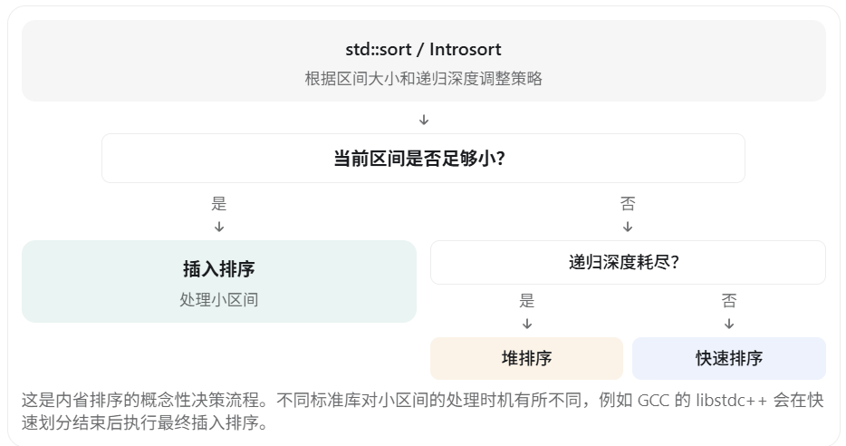
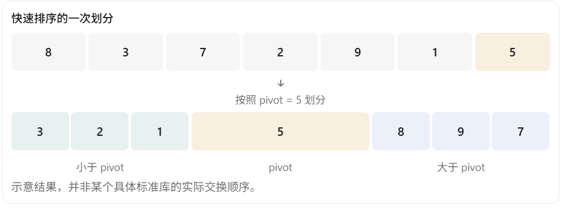

在 C++ 中，`std::sort` 是 STL 中最常用的排序算法之一，也是 C++ 面试中的高频考点。

面试官通常不满足于你回答“`std::sort` 使用快速排序”，而是会进一步问：

- `std::sort` 到底使用哪种排序算法？
- 它什么时候使用快速排序，什么时候使用堆排序？
- 为什么小数据量时要使用插入排序？
- 它如何判断快速排序可能退化？
- `std::sort` 为什么能够保证最坏情况下 \(O(n\log n)\) 的比较复杂度？

下面从**算法原理、切换条件、源码实现和面试回答**四个角度讲解。

# 一、std::sort 的底层到底是什么？

先说结论：

**主流 C++ 标准库的 `std::sort` 通常使用内省排序（Introsort），它综合了快速排序、堆排序和插入排序的优势。**

不过 C++ 标准并没有规定必须使用这三种算法，只规定了排序的行为及复杂度要求。

三种算法的分工：

| 排序算法                   | 作用             | 使用时机                     |
| -------------------------- | ---------------- | ---------------------------- |
| 快速排序（Quick Sort）     | 主要排序过程     | 数据区间较大、递归深度未超限 |
| 堆排序（Heap Sort）        | 防止最坏情况退化 | 快排递归深度达到限制         |
| 插入排序（Insertion Sort） | 优化小区间性能   | 待处理的数据区间较小         |



这里最重要的是：**`std::sort` 并不是提前扫描整个数组，然后判断“这个数组适合哪种算法”。**

它主要根据排序过程中的状态动态调整策略。

# 二、为什么主要使用快速排序？

## 1. 快速排序的基本原理

快速排序采用分治思想：

1. 选择一个基准元素 `pivot`。
2. 将比 `pivot` 小的元素放在一侧，其他元素放在另一侧（具体如何处理相等元素取决于实现）。
3. 对划分后的子区间继续排序。

例如：

```c++
int arr[] = {8, 3, 7, 2, 9, 1, 5};
```

假设选择 `5` 为 pivot，一次划分后，可以得到类似下面的结果：



接下来分别对子区间 `{3,2,1}` 和 `{8,9,7}` 进行排序。

## 2. 为什么快速排序性能好？

快速排序的平均时间复杂度为：

\[ O(n\log n) \]

而且有三个重要优势：

- **原地排序**：划分通常只需要少量额外存储。
- **缓存局部性较好**：经常对连续内存中的数据进行访问。
- **实际性能优秀**：比较和交换操作比较简单。

所以对于较大的随机数据区间，快速排序通常是很好的选择。

## 3. 快速排序的致命问题

快速排序存在最坏情况：

\[ O(n^2) \]

假设每次划分都极不均衡：

```
1000 个元素
    ↓
999 个元素 + 0 个元素
    ↓
998 个元素 + 0 个元素
    ↓
997 个元素 + 0 个元素
    ↓
   ...
```

这种情况下，递归会不断向一侧深入。

比较次数大致为：

​										\[ (n-1)+(n-2)+\cdots+1 \]

最终达到：

​												\[ O(n^2) \]

**注意：不能简单认为有序数组一定会导致 `std::sort` 的快排退化。** 现代实现通常会采用更好的基准选择策略，例如三数取中，降低不平衡划分的风险。

但三数取中也不能彻底消除最坏情况。

这就引出了堆排序。

# 三、什么时候切换到堆排序？（核心）

这是 `std::sort` 最重要的设计之一。

## 1. 设置一个递归深度限制

以内省排序的经典实现，以及 GCC 的 libstdc++ 为例，初始深度限制通常为：

​								\[ \text{depthLimit}=2\lfloor\log_2 n\rfloor \]

例如：

对于 `n = 1024`：

​										\[ \log_2 1024=10 \]

因此：

​									\[ \text{depthLimit}=20 \]

含义是：**沿着某条快速排序划分路径，如果已经深入到深度限制，却仍然存在需要排序的大区间，那么就切换为堆排序。**

在 libstdc++ 中，对应的核心逻辑包含 `__introsort_loop`、深度计数和 `__partial_sort` 调用。

## 2. 为什么用递归深度来判断？

因为理想的快速排序，每次都把区间大致平分。

例如：

```
1024
 ↓
512
 ↓
256
 ↓
128
 ↓
64
 ↓
32
 ↓
16
```

只需要大约 6 次划分，就能把 1024 个元素缩小到长度为 16 的区间。

但如果划分一直不平衡：

```
1024
 ↓
1023
 ↓
1022
 ↓
1021
 ↓
1020
 ↓
...
```

那么划分深度就会增长得非常快。

因此：

**递归深度是识别快速排序可能持续退化的一种低开销指标。**

它不需要先检查整个数组是否有序，也不需要精确预测接下来的划分情况。

## 3. 为什么选择堆排序作为后备算法？

堆排序有一个关键优势：

​											\[ T(n)=O(n\log n) \]

它的最坏情况复杂度也是 \(O(n\log n)\)。

| 排序算法 | 平均时间复杂度 | 最坏时间复杂度 |
| -------- | -------------- | -------------- |
| 快速排序 | \(O(n\log n)\) | \(O(n^2)\)     |
| 堆排序   | \(O(n\log n)\) | \(O(n\log n)\) |
| 插入排序 | \(O(n^2)\)     | \(O(n^2)\)     |

所以内省排序可以同时利用快速排序较好的平均性能，以及堆排序稳定的最坏情况复杂度保证。

这里需要特别区分：l**ibstdc++ 的实际源码通过 `std::__partial_sort(first, last, last, comp)` 完成后备排序，本质上使用的是堆排序相关机制，而不是直接在源码中写 `std::make_heap` 和 `std::sort_heap` 两个公共接口。** 

# 四、为什么数据量小时使用插入排序？

这是另一个高频面试考点。

很多人会疑惑：

插入排序的时间复杂度是 \(O(n^2)\)，而快速排序是 \(O(n\log n)\)，为什么 `std::sort` 还要使用插入排序？

答案是：**时间复杂度描述的是渐近增长趋势，不等于实际运行时间。**

## 1. 小区间内插入排序可能更快

假设只有 5 个元素：

```c++
int arr[] = {5, 2, 4, 1, 3};
```

插入排序会依次把元素插入左侧已经有序的部分。

它的实现简单，而且具有：

- 常数开销低。
- 不需要递归。
- 连续内存访问，缓存友好。
- 对接近有序的区间非常高效。

所以在很小的数据区间上，插入排序经常比快速排序更合适。

## 2. 到底多小才会使用插入排序？

这个数字由标准库实现决定，并不是 C++ 标准规定的。

| 标准库实现    | 源码中的小区间阈值 |
| ------------- | ------------------ |
| GCC libstdc++ | 16                 |
| LLVM libc++   | 24                 |

这里特别需要注意边界：libstdc++ 在内省排序循环中对长度不超过 16 的区间停止继续快速划分，最后统一执行插入排序；当前查看的 libc++ 源码对长度小于 24 的区间执行插入排序，并对长度 2～5 的情况提供专门处理。

这些阈值是实现细节，可能随标准库版本变化。

# 五、从 GCC 源码看 std::sort 怎么选择算法

下面以 GCC 的 libstdc++ 为例，解释它的核心工作流程。

首先调用：

```c++
sort(v.begin(), v.end());
```

经过内部接口进入内省排序逻辑。

可以把关键思想简化为下面的伪代码：

```c++
void introSort(first, last, depthLimit) {
    while (last - first > 16) {

        // 快排递归深度达到限制
        if (depthLimit == 0) {
            heapSort(first, last);
            return;
        }

        --depthLimit;

        // 选择 pivot，并划分区间
        auto mid = partition(first, last);

        // 继续处理两个子区间
        introSort(mid, last, depthLimit);

        last = mid;
    }
}

void sortImpl(first, last) {
    int depthLimit = 2 * floor(log2(last - first));

    introSort(first, last, depthLimit);

    // 最后使用插入排序完成收尾
    finalInsertionSort(first, last);
}
```

以上是便于理解的伪代码，不是可直接编译的源码。真实实现还有迭代器模板、比较器、三数取中、边界处理等细节。

这段代码揭示了三个判断条件。

**第一个条件：区间长度**

```c++
while (last - first > 16)
```

如果区间足够小，就不再继续快速划分。

**第二个条件：剩余深度**

```c++
if (depthLimit == 0)
```

如果深度限制被耗尽，使用堆排序完成当前区间。

**第三个条件：正常情况下继续快速划分**

```c++
auto mid = partition(first, last);
```

选取 pivot，分割数据，并继续处理两个子区间。

还有一个容易忽略的细节：

```c++
finalInsertionSort(first, last);
```

在 GCC 的实现中，快速划分阶段结束后，再对整个区间进行最终插入排序。由于之前已经完成大量划分，这时数据已经具有一定的有序结构，插入排序收尾的效率较高。

# 六、还有哪些底层优化？

实际的 `std::sort` 不只是机械地组合三种排序算法。

## 1. 三数取中（Median-of-Three）

如果快速排序每次都选择区间第一个元素作为 pivot，很容易产生较差的划分。

三数取中会从例如：

- 第一个元素。
- 中间元素。
- 最后一个元素。

这三个候选元素中，选出大小居中的元素。

例如：

```
第一个：10
中间：  50
最后：  30

选出的 pivot：30
```

这样通常能降低选择极端 pivot 的概率。

GCC 的 libstdc++ 就使用了类似的三数取中优化。

## 2. libc++ 还有更复杂的优化

LLVM 的 libc++ 实现也采用内省排序，但包含更多针对不同情况的优化，例如：

- 对较大的区间使用 Tukey's Ninther，即通过多个样本选择更好的 pivot。
- 对特定类型和比较器使用位集辅助的划分方式。
- 判断某次划分是否几乎不需要移动元素，并尝试有限的插入排序优化。
- 针对大量相等元素进行特殊处理。

在查看的 libc++ 源码中，Tukey's Ninther 的切换阈值是区间长度大于 128。

所以对于 libc++，算法选择还会参考划分结果、元素类型和比较器等因素，而不只是区间长度与递归深度。

# 七、std::sort 的时间复杂度和稳定性

| 属性               | `std::sort`          |
| ------------------ | -------------------- |
| 平均比较复杂度     | \(O(n\log n)\)       |
| 最坏比较复杂度     | \(O(n\log n)\)       |
| 常见实现的额外空间 | \(O(\log n)\) 递归栈 |
| 是否稳定           | 不保证稳定           |
| 迭代器要求         | 随机访问迭代器       |

需要注意：C++ 标准约束的是 \(O(n\log n)\) 的比较次数，不是规定每种类型、每个实现的总运行时间都必须具有相同特性。

### 为什么 std::sort 不稳定？

假设我们有三个学生：

```c++
struct Student {
    int score;
    char name;
};
```

数据：

```
(90, A)
(80, B)
(90, C)
```

按成绩升序排序后，可能得到：

```
(80, B)
(90, C)
(90, A)
```

成绩同为 90 的 A、C，原来的相对顺序发生了变化。

如果希望相同成绩的学生保持原有的相对顺序，就应该使用：

```c++
std::stable_sort(v.begin(), v.end(),
    [](const Student& a, const Student& b) {
        return a.score < b.score;
    });
```

# 九、面试时应该怎么回答？（建议掌握）

如果面试官问：

“介绍一下 std::sort 的底层原理，以及它是怎么选择排序算法的。”

你可以这样回答：

> `std::sort` 在主流标准库中通常采用内省排序，也就是 Introsort，结合了快速排序、堆排序和插入排序。
>
> 首先，对于较大的数据区间，主要使用快速排序。快速排序平均时间复杂度为 \(O(n\log n)\)，实际性能较好，但最坏情况下可能退化到 \(O(n^2)\)。
>
> 为了避免这种退化，内省排序会设置递归深度限制，常见的限制为 \(2\lfloor\log_2n\rfloor\)。当快速排序的划分深度耗尽时，就切换到堆排序，从而保证最坏情况下 \(O(n\log n)\) 的比较复杂度。
>
> 对于较小的数据区间，则使用插入排序。虽然插入排序的理论复杂度较高，但它在小区间内常数开销低，而且处理近乎有序的数据时效率较高。
>
> 此外，具体的标准库实现还会使用三数取中等 pivot 选择策略，减少不平衡划分，提高实际性能。
>
> 所以 `std::sort` 不是单纯的快速排序，而是结合不同排序算法优点的一种混合排序实现。具体切换阈值和优化策略由标准库决定。

最后记住最核心的三个判断条件：

- 区间大、深度正常： 快速排序。
- 区间大、深度耗尽： 堆排序。
- 区间小： 使用插入排序收尾或直接排序。

如果后续面试官追问源码，建议重点准备 `__introsort_loop` 的递归深度限制、`__unguarded_partition_pivot` 的划分原理，以及 `__final_insertion_sort` 为什么能高效完成最后的排序。这些都是从算法基础深入到 STL 源码时非常有价值的考点。