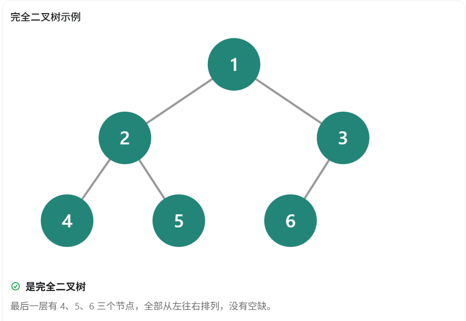
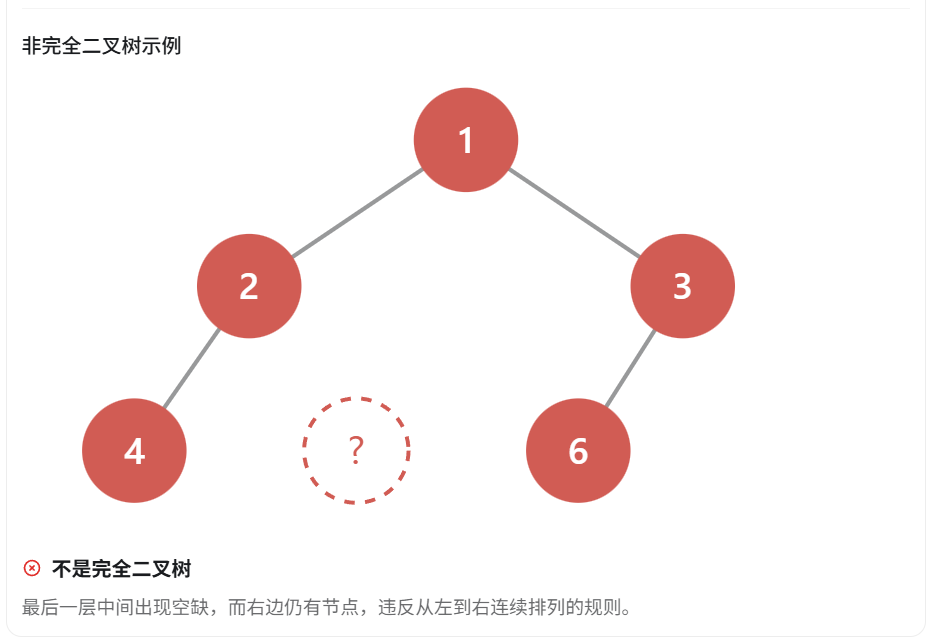
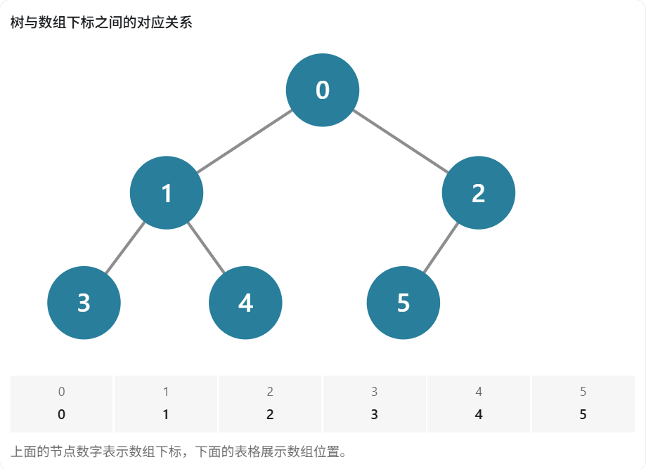

完全二叉树（Complete Binary Tree）是数据结构面试中的高频考点，尤其容易和**满二叉树、二叉搜索树（BST）、AVL 树、红黑树以及堆（Heap）**联系起来考察。

对于 C++ 面试，我建议你重点记住 定义、节点数量、树的高度、数组下标关系、叶子节点数量这几个知识点。

# 一、什么是完全二叉树？

**定义：一棵深度为 h 的二叉树，如果前 h-1 层都是满的，并且最后一层的节点从左到右连续排列，那么它就是完全二叉树。**

换句话说：

1. 除了最后一层，其他层必须全部填满。
2. 最后一层允许不满，但节点必须全部靠左。
3. 不能出现左边有空位、右边却还有节点的情况。





# 二、完全二叉树必须背住的 6 个性质

## 性质 1：节点数量与树高的关系

假设完全二叉树共有 n 个节点，树的高度为 h（根节点为第 1 层）。

那么：

\[ \boxed{2^{h-1}\leq n\leq 2^h-1} \]

例如：

| 树高 h | 最少节点数 | 最多节点数 |
| ------ | ---------- | ---------- |
| 1      | 1          | 1          |
| 2      | 2          | 3          |
| 3      | 4          | 7          |
| 4      | 8          | 15         |
| 5      | 16         | 31         |

**面试记忆：第 h 层的节点数可以不满，但前 h-1 层必须全满**。

## 性质 2：已知节点数 n，求树的高度 h

这是非常重要的公式：

\[ \boxed{h=\lfloor\log_2 n\rfloor+1} \]

例如：

- n = 7，高度 h = 3。
- n = 8，高度 h = 4。
- n = 15，高度 h = 4。
- n = 16，高度 h = 5。

这也说明完全二叉树的高度始终是：

\[ \boxed{O(\log n)} \]

注意：这个公式适用于 n ≥ 1，并且这里的高度按层数计算。如果根节点高度定义为 0，则高度应为 \(\lfloor\log_2 n\rfloor\)。

## 性质 3：叶子节点的数量

假设完全二叉树有 n 个节点，那么：

\[ \boxed{n_0=\left\lceil\frac n2\right\rceil} \]

其中 \(n_0\) 表示叶子节点数量。

也可以写成：

\[ n_0=\left\lfloor\frac{n+1}{2}\right\rfloor \]

例如：

| 总节点数 n | 叶子节点数 |
| ---------- | ---------- |
| 5          | 3          |
| 6          | 3          |
| 7          | 4          |
| 8          | 4          |
| 9          | 5          |

**记住：完全二叉树的叶子节点数量大约占总节点数的一半。**

## 性质 4：度为 1 的节点最多只有一个

节点的度，指的是该节点拥有多少个子节点。

在完全二叉树中：

- 度为 0：叶子节点。
- 度为 1：只有一个子节点，并且一定是左孩子。
- 度为 2：同时拥有左右孩子。

特别重要的是：

**完全二叉树中，度为 1 的节点最多只有一个。**

进一步可以得出：

- 当 n 为偶数时，恰好有 1 个度为 1 的节点。
- 当 n 为奇数时，没有度为 1 的节点。

这也是面试常见的判断题。

## 性质 5：完全二叉树可以使用数组高效存储

这是 C++ 面试中最值得掌握的性质之一。

因为完全二叉树的节点按照层序排列时不存在中间空洞，所以可以直接存储在连续数组中，而不必为每个节点单独保存左右孩子指针。

假设数组从下标 0 开始：



对于下标为 i 的节点：

\[ \boxed{\text{左孩子}=2i+1} \]

\[ \boxed{\text{右孩子}=2i+2} \]

\[ \boxed{\text{父节点}=\left\lfloor\frac{i-1}{2}\right\rfloor} \]

其中父节点公式要求 i > 0，左右孩子的下标也必须小于 n 才存在。

C++ 代码示例：

```c++
int n = nums.size();
int i = 2;

int parent = (i - 1) / 2;
int left = 2 * i + 1;
int right = 2 * i + 2;
```

如果是从 1 开始编号，公式会发生变化：

| 关系   | 下标从 0 开始 | 编号从 1 开始 |
| ------ | ------------- | ------------- |
| 左孩子 | `2*i+1`       | `2*i`         |
| 右孩子 | `2*i+2`       | `2*i+1`       |
| 父节点 | `(i-1)/2`     | `i/2`         |

这几个公式一定要背住，因为**堆排序、优先队列和二叉堆的实现都需要使用它们。**

## 性质 6：最后一个非叶子节点的位置

对于下标从 0 开始的数组，长度为 n：

\[ \boxed{\text{最后一个非叶子节点}=\lfloor n/2\rfloor-1} \]

适用于 n ≥ 2。

例如：

```c++
vector<int> nums = {10, 20, 30, 40, 50, 60, 70};
```

n = 7，最后一个非叶子节点的下标为：

\[ 7/2-1=2 \]

所以：

- 下标 0、1、2 是非叶子节点。
- 下标 3、4、5、6 是叶子节点。

这个性质特别重要，因为**堆排序中的建堆操作通常从最后一个非叶子节点开始，自底向上调整。**

# 三、完全二叉树和满二叉树有什么区别？

这是面试最常见的追问。

| 比较              | 满二叉树         | 完全二叉树               |
| ----------------- | ---------------- | ------------------------ |
| 前 h-1 层         | 必须填满         | 必须填满                 |
| 最后一层          | 必须填满         | 可以不满                 |
| 节点排列          | 每层全部填满     | 最后一层靠左排列         |
| 高度为 h 的节点数 | \(2^h-1\)        | \(2^{h-1}\) 到 \(2^h-1\) |
| 关系              | 一定是完全二叉树 | 不一定是满二叉树         |

**记住：满二叉树一定是完全二叉树，但完全二叉树不一定是满二叉树。**

# 四、完全二叉树与堆有什么关系？

在 C++ 中，`priority_queue` 通常基于二叉堆实现，而二叉堆就是满足堆序性质的完全二叉树。

- 完全二叉树：约束的是树的形状。
- 大顶堆：除了形状满足完全二叉树，还要求父节点的值不小于孩子节点。
- 小顶堆：除了形状满足完全二叉树，还要求父节点的值不大于孩子节点。

因此，堆的常见时间复杂度为：

| 操作             | 时间复杂度 |
| ---------------- | ---------- |
| 获取堆顶元素     | O(1)       |
| 插入元素         | O(log n)   |
| 删除堆顶元素     | O(log n)   |
| 建堆（自底向上） | O(n)       |

需要区分：这些复杂度是堆这个数据结构的操作复杂度，并不是所有完全二叉树都自动具备的性质。

# 五、面试必背总结

完全二叉树核心公式速记

| 树高（n ≥ 1）      | \(h=\lfloor\log_2n\rfloor+1\) |
| ------------------ | ----------------------------- |
| 节点数范围         | \(2^{h-1}\leq n\leq2^h-1\)    |
| 叶子节点数         | \(\lceil n/2\rceil\)          |
| 左孩子下标         | `2*i+1`                       |
| 右孩子下标         | `2*i+2`                       |
| 父节点下标         | `(i-1)/2`                     |
| 最后一个非叶子节点 | `n/2-1`                       |

下标公式采用 C++ 中常见的从 0 开始编号，除法按整数除法计算。

对于 C++ 面试，建议优先掌握性质 2、3、5、6。 因为这些性质既容易作为直接考题，也经常出现在 `priority_queue`、堆排序、建堆算法以及二叉树相关的 LeetCode 题目中。