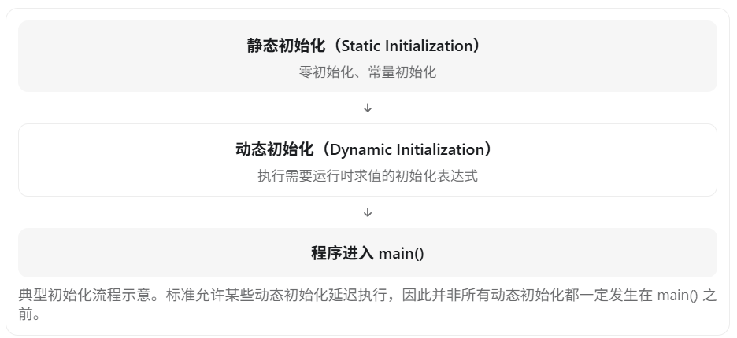

#### 全局变量与静态全局变量

**全局变量**的作用域是程序中所有文件，拥有**全局作用域**，但是对于其他文件**可见而不可用**，其他文件想要用全局变量需要用extern再次声明

```c++
//sub.cpp

int a = 5;
```

```c++
//main.cpp

int main(){
    a = 2;  //虽然sub.cpp中的a的作用域包含main.cpp，但是可见不可用
}
```

```c++
//main.cpp

extern int a;  //用extern再次声明a，就可以让main.cpp访问sub.cpp中的全局变量

int main(){
	a = 2;  
}
```

------

由于全局变量的作用域是所有文件，所以如果在main中也定义一个全局变量a，就会导致报错

```c++
//main.cpp

int a = 2;  //重复定义导致报错
```

------

**静态全局变量**缩小了全局变量的作用域，使其只对本文件有效，即**文件作用域**

```c++
//sub.cpp
static int a = 5;  //sub.cpp的静态全局变量只对sub.cpp有效
```

```c++
//main.cpp
# include <iostream>

static int a = 2;  //由于两个a的作用域不重合，所以不会互相干扰

int main() {
	std::cout << a << std::endl;  //输出2
	return 0;
}
```

------

#### 局部变量与静态局部变量

**局部变量**的作用域在函数内，即**局部作用域**，生命周期在函数执行完之后就会结束

**静态局部变量**的作用域依旧是**局部作用域**，但是生命周期扩大了，在程序开始时被创建，结束时被销毁

```c++
# include <iostream>

//静态全局变量和静态局部变量同样遵循覆盖原则，局部变量会覆盖全局变量在函数中生效
static int a = 2;

void test() {
	static int a = 0;
	std::cout << a << std::endl;
	a++;
}

//由于a是静态局部变量，所以在第一个test()结束后并没有被销毁，而是变成了1
int main() {
	test();  //输出0
	test();  //输出1
	test();  //输出2

	return 0;
}
```

------

#### 全局函数与静态全局函数

- c++中没有局部函数，只有全局函数，lambda表达式虽然看上去像是局部的，实际上也还是全局函数

**全局函数**与**全局变量**一样，拥有**全局作用域**和**外部链接性**，而且也需要额外声明才能在其他文件中使用

```c++
//sub.cpp
# include <iostream>

void test() {
	std::cout << 2 << std::endl;
}
```

```c++
//main.cpp
# include <iostream>

void test(); //额外声明，但是不需要extern之类的标识符

int main() {
	test();  //输出2

	return 0;
}
```

------

**静态全局函数**与**静态全局变量**一样，作用域被锁在了**文件作用域**

```c++
//sub.cpp
# include <iostream>

static void test() {
	std::cout << 2 << std::endl;
}
```

```c++
//main.cpp
# include <iostream>

static void test() {
	std::cout << 5 << std::endl;
}

int main() {
	test();  //输出5

	return 0;
}
```

------

#### 成员变量与静态成员变量

- 静态成员变量可以通过对象和类名进行访问，也可以被修改

| **特性**     | **成员变量 (Non-static)**        | **静态成员变量 (Static)**        |
| ------------ | -------------------------------- | -------------------------------- |
| **所属关系** | 属于**对象**。每个对象各有一份。 | 属于**类**。所有对象共用同一份。 |
| **内存分配** | 在对象创建时分配（栈或堆）。     | 在程序启动时分配（静态存储区）。 |
| **初始化**   | 通过构造函数初始化。             | **必须在类外单独初始化**。       |
| **访问方式** | 必须通过对象名访问：`obj.var`。  | 可通过类名访问：`Class::var`。   |

```c++
# include <iostream>

class Person {
public:
    //静态成员变量只能在外部初始化，不能在类内初始化
	static int a;
};

//类外初始化
int Person::a = 2;

int main() {
    //由于静态成员变量不属于某个对象，而是属于类本身，所以调用也是用类名进行调用
	std::cout << Person::a << std::endl;
    
    //静态成员变量虽然不属于对象，但是可以用对象访问，并非只能用类名来访问
    Person p;
    std::cout << p.a << std::endl;     //这里的p.a等价于Person::a，编辑器会自动去找Person类里面的a

	return 0;
}
```

==为什么静态成员变量不能在类内初始化==

- 因为变量在定义时会分配内存而声明不会，如果新建两个对象Person p1， Person p2，就会尝试给a分配两次内存，这明显是错误的；而在类内声明，就只会进行两次声明，声明是可以重复的

------

#### 成员函数与静态成员函数

| **特性**        | **成员函数 (Non-static)**          | **静态成员函数 (Static)**            |
| --------------- | ---------------------------------- | ------------------------------------ |
| **`this` 指针** | **有** `this` 指针，指向当前对象。 | **没有** `this` 指针。               |
| **访问权限**    | 可以访问静态和非静态的所有成员。   | **只能访问静态成员**（变量或函数）。 |
| **调用方式**    | 必须通过对象调用：`obj.func()`。   | 推荐通过类名调用：`Class::func()`。  |
| **虚函数**      | 可以是虚函数（支持多态）。         | **不能是虚函数**。                   |

- 成员函数和成员对象一样是属于对象的，但是**成员函数在内存中只有一份**；不同对象调用成员函数时，是通过this指针来区分不同对象对该成员函数的使用的

- 静态成员函数属于类，对象不再能使用this指针来调用（因为直接没有this指针了）
- 静态成员函数不需要在类外定义，因为成员函数本来就不会因为多个对象而导致多次定义

==为什么静态成员函数只能访问静态成员函数（或变量）==

- 因为成员函数和成员变量属于对象，而静态成员函数可能在没有对象的时候就会被调用，这时根本就没有成员函数和成员变量可以给他调用

```c++
# include <iostream>

class Person {
public:
	static int a;

    //静态成员变量在类内定义，调用静态成员变量
	static void test() {
		std::cout << a << std::endl;
	}
};

int Person::a = 2;

int main() {
	std::cout << Person::a << std::endl; //输出2

	Person::test();  //输出2

	return 0;
}
```

==为什么静态成员函数不能是const成员函数==

- 首先，const只能修饰成员函数，不能修饰全局函数。
- const的作用是锁住了this，把this从指针常量变成了常量指针常量，也就是指向不能变，指向的目标也不能变
- 而静态成员函数没有this，自然不能用const

==为什么静态成员函数不能是虚函数==

- 因为静态成员函数的地址是早绑定，而虚函数的地址是晚绑定，互相冲突

------

#### static重复定义

static变量在作用域内不能重复定义，否则会报错

```c++
static int a = 0;
static int a = 0;  //报错，在文件作用域内重复定义
```

```c++
static int a = 0;

void func() {
    static int a = 1;    //正确，因为第一个a的是文件作用域，而第二个是函数内作用域
}
```

```c++
void func() {
    static int a = 1;
    static int a = 2;      //报错，在函数作用域内重复定义
}
```

==同一个定义的多次调用（比如某个函数被多次调用）不会产生重复定义==

```c++
void func() {
    static int a = 1;    //虽然被多次调用，但是只有第一次会产生有效的定义
    a++;
    cout << a << endl;
}

int main() {

    func();  //2
    func();  //3
    func();  //4

    return 0;
}
```

但是类中的定义会导致重复定义，所以static成员变量只能在类外初始化，声明是可以重复的

```c++
class Person {
public:
    static int a;
    
};

int Person::a = 1;
```


------

# static变量在什么时候初始化

在 C++ 中，**`static` 修饰的变量什么时候初始化，取决于它是全局静态变量、局部静态变量，还是类的静态成员变量，以及初始化表达式是否需要在运行时计算。**

这是 C++ 面试中的高频问题，尤其容易考察**静态初始化、动态初始化、线程安全和生命周期。**

## 一、先记住核心结论

| 变量类型         | 初始化时机                                                   | 生命周期         |
| ---------------- | ------------------------------------------------------------ | ---------------- |
| 全局静态变量     | 通常在 `main()` 之前完成初始化                               | 整个程序运行期间 |
| 局部静态变量     | 常量初始化可能在首次调用前完成；动态初始化在第一次执行到声明处时进行 | 整个程序运行期间 |
| 类的静态成员变量 | 与全局静态变量遵循类似的初始化规则                           | 整个程序运行期间 |

需要特别注意：**初始化时机和生命周期不是一回事。**

无论是全局静态变量还是局部静态变量，只要具有静态存储期，其存储空间都会在程序运行期间持续存在，不会因为函数执行结束而释放。

## 二、全局静态变量

```c++
#include <iostream>

static int a = 10;
static int b;

int main() {
    std::cout << a << " " << b << std::endl;
}
```

输出：

```
10 0
```

其中：

- `a` 可以在静态初始化阶段完成常量初始化。
- `b` 没有显式初始化，会被零初始化，值为 `0`。

C++ 对具有静态存储期的变量，通常将初始化分为两个阶段：



例如：

```c++
int getValue() {
    return 100;
}

static int a = 10;          // 常量初始化
static int b = getValue();  // 动态初始化
```

`a` 可以在程序启动阶段完成初始化，而 `b` 通常需要执行 `getValue()` 才能完成初始化。

## 三、局部静态变量（面试重点）

局部静态变量定义在函数内部，它最重要的特点是：**只初始化一次，多次调用函数时复用同一个变量。**

```c++
#include <iostream>
using namespace std;

int getValue() {
    cout << "初始化" << endl;
    return 10;
}

void func() {
    static int a = getValue();
    a++;
    cout << a << endl;
}

int main() {
    func();
    func();
    func();
}
```

输出：

```
初始化
11
12
13
```

执行过程：

1. 第一次调用 `func()`，执行到 `static int a = getValue()`，调用 `getValue()` 完成初始化，然后执行 `a++`。
2. 第二次调用 `func()`，不再执行初始化，直接使用之前的 `a`，此时 `a` 是 `11`。
3. 第三次调用，同理，`a` 继续累加。

这里还有一个容易忽略的细节：

```c++
void func() {
    static int a = 10;
    static int b = getValue();
}
```

- `a` 是常量初始化，可以在第一次进入函数之前完成初始化。
- `b` 需要动态初始化，因此在第一次执行到对应声明时调用 `getValue()`。

所以不能笼统地说，所有局部静态变量都是第一次调用函数时才初始化。

## 四、类的静态成员变量

```c++
#include <iostream>
using namespace std;

class Student {
public:
    static int count;

    Student() {
        count++;
    }
};

int Student::count = 0;

int main() {
    Student s1;
    Student s2;

    cout << Student::count << endl;
}
```

输出：

```
2
```

这里的 `count`：

- 不属于某一个 `Student` 对象，而是属于整个类。
- 在上述代码中，其定义处的 `= 0` 可以在静态初始化阶段完成。
- 即使没有创建 `Student` 对象，静态成员变量也可以存在。
- 所有 `Student` 对象共享同一个 `count`。

注意，类的静态成员变量并不是在创建第一个类对象时才初始化的。

## 五、static 初始化是线程安全的吗？

**从 C++11 开始，局部静态变量的初始化是线程安全的。**

例如：

```c++
class Singleton {
public:
    static Singleton& getInstance() {
        static Singleton instance;
        return instance;
    }

private:
    Singleton() = default;
};
```

假设两个线程同时第一次调用 `getInstance()`：

- 只有一个线程会执行 `Singleton` 构造函数。
- 另一个线程会等待初始化完成。
- 最终两个线程得到同一个对象。

这种写法也叫作 **Meyers Singleton（局部静态单例）。**

但要注意，C++11 保证的是局部静态变量的初始化过程线程安全，并不意味着初始化完成后，对该对象的所有读写操作都自动线程安全。

## 六、面试延伸：static 变量存储在哪里？

从典型的程序内存布局来看：

| 变量                    | 常见存储区域 |
| ----------------------- | ------------ |
| 已初始化的全局/静态变量 | `.data` 段   |
| 零初始化的全局/静态变量 | `.bss` 段    |
| 普通局部变量            | 通常在栈上   |
| `new` 创建的对象        | 通常在堆上   |

这里的 `.data`、`.bss` 是常见编译和链接实现中的概念，并不是 C++ 标准强制要求的内存布局。常量初始化的静态对象也可能位于只读数据区域。

另外，不同源文件中的非局部静态对象，动态初始化顺序可能存在不确定性，这也是常见的 **Static Initialization Order Fiasco（静态初始化顺序问题）**。

## 七、面试时如何回答？

如果面试官问你：

“C++ 中 static 修饰的变量在什么时候初始化？”

可以这样回答：

> C++ 中 static 变量具有静态存储期，生命周期通常贯穿整个程序运行过程。
>
> 对于全局静态变量和类的静态成员变量，如果能够进行常量初始化，就会在静态初始化阶段完成；否则通常先零初始化，再进行动态初始化。非局部变量的动态初始化一般在 main 函数之前完成，但标准允许部分情况延迟执行。
>
> 对于局部静态变量，如果需要动态初始化，则会在程序第一次执行到它的声明语句时进行初始化，并且只初始化一次。能够常量初始化的局部静态变量则可以提前完成初始化。
>
> 此外，C++11 开始保证局部静态变量的初始化是线程安全的。
