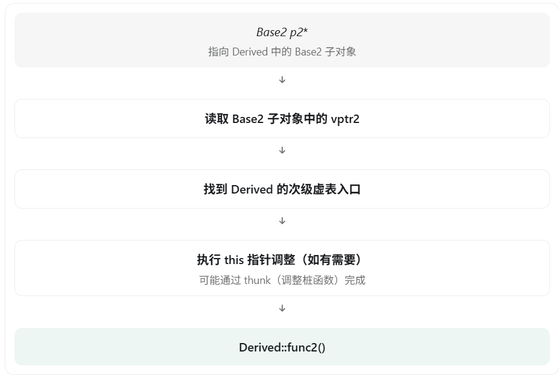

在 C++ 多重继承中，**为什么一个对象通常需要多个 vptr（虚指针），以及对应的多个虚函数表入口，而不是所有父类共用一套？**

核心原因是：

**多重继承时，每个具有虚函数的父类都会在子类对象中形成一个基类子对象。为了让指向不同基类子对象的指针都能正确调用虚函数，主流编译器通常会保留各自的 vptr。**

另外需要明确：并不是 C++ 标准规定多继承一定有多个 vptr。这是主流编译器为了支持多态、对象布局和高效虚函数调用所采用的实现方式。

## 一、先看一个多继承的例子

```c++
#include <iostream>
using namespace std;

class Base1 {
public:
    int a;

    virtual void func1() {
        cout << "Base1::func1()" << endl;
    }
};

class Base2 {
public:
    int b;

    virtual void func2() {
        cout << "Base2::func2()" << endl;
    }
};

class Derived : public Base1, public Base2 {
public:
    int c;

    void func1() override {
        cout << "Derived::func1()" << endl;
    }

    void func2() override {
        cout << "Derived::func2()" << endl;
    }
};
```

这里 `Base1` 和 `Base2` 都具有虚函数，因此都是多态类。

在常见的 64 位编译器实现中，`Derived` 对象的内存布局可以简化理解为：


这里的关键是：`Derived` **对象虽然是一个完整对象，但内部包含两个不同的基类子对象。**

接下来就可以解释为什么两个 vptr 有实际意义。

## 二、最关键的原因：不同父类指针指向的地址可能不同

考虑：

```c++
Derived d;

Base1* p1 = &d;
Base2* p2 = &d;

p1->func1();
p2->func2();
```

输出：

```
Derived::func1()
Derived::func2()
```

虽然两个指针都指向同一个完整的 `Derived` 对象，**但 `p1` 和 `p2` 保存的地址不一定相同**。

例如，假设 `Derived` 对象起始地址为 `0x1000`，在某种典型 64 位布局中：

```
Derived 对象
起始地址：0x1000

0x1000 ┌──────────────────┐
       │ Base1::vptr      │ ← p1 指向这里
0x1008 │ Base1::a         │
       │ 对齐填充         │
0x1010 ├──────────────────┤
       │ Base2::vptr      │ ← p2 指向这里
0x1018 │ Base2::b         │
       │ 对齐填充         │
0x1020 ├──────────────────┤
       │ Derived::c       │
       └──────────────────┘
```

因此：

```c++
Base1* p1 = &d;  // 假设地址 0x1000
Base2* p2 = &d;  // 假设地址 0x1010
```

为什么 `p2` 需要指向 `0x1010`？

因为 `Base2*` 指针指向的是 `Derived` 对象内部的 Base2 **基类子对象**，而不是一定指向整个 `Derived` 对象的起始位置。

这也解释了为什么向上转换时，编译器有时候不仅仅改变指针类型，还需要调整指针地址。

## 三、为什么不能只使用一个 vptr？

假设 `Derived` 只有一个 vptr，放在整个对象的开头。

那么：

```c++
Base1* p1 = &d;
p1->func1();
```

没有太大问题，因为 `p1` 指向对象开头，可以按预期找到 vptr。

但是：

```c++
Base2* p2 = &d;
p2->func2();
```

问题就来了。

`p2` 指向 `Base2` 子对象，而不是整个 `Derived` 对象的开头。

更关键的是，**编译器在编译 `p2->func2()` 时，只知道 `p2` 是 `Base2*`，不知道它实际指向的是一个独立的 `Base2` 对象，还是某个 `Derived` 对象中的 `Base2` 子对象。**

因此，主流 ABI 采用的解决方案是：

- 让 `Base1` 子对象拥有它自己的虚表入口。
- 让 `Base2` 子对象拥有它自己的虚表入口。
- 编译器按照基类的固定布局，从基类指针找到对应 vptr，再完成虚函数调用。

这样，无论 `Base2*` 实际指向哪一种派生对象，都可以遵循同一套调用约定。

例如：

```c++
void test(Base2* p) {
    p->func2();
}

int main() {
    Base2 b;
    Derived d;

    test(&b);
    test(&d);
}
```

`test` 不需要知道传入的是 `Base2` 还是 `Derived` 对象。

## 四、多个 vptr 如何完成虚函数调用？

以 `p2->func2()` 为例，典型的调用过程是：



这里又涉及一个非常重要的细节：**this 指针调整。**

对于成员函数：

```c++
void Derived::func2() {
    cout << c << endl;
}
```

在典型实现中，`Derived::func2()` 需要能够通过 `this` 访问完整的 `Derived` 对象。

但从 `Base2*` 发起调用时，最初的 `this` 地址可能是 `0x1010`，而 `Derived` 对象起始地址是 `0x1000`。

因此，编译器可能生成一个称为 thunk 的辅助入口，将 `this` 调整到正确的位置，再进入真正的 `Derived::func2()`。

Itanium C++ ABI 就明确描述了主虚表、次级虚表及这种 `this` 指针调整机制。

## 五、那能不能把多个虚函数表合并成一个？

**可以在一定程度上合并，而且主流编译器实际上已经这样做了。**

以 Itanium C++ ABI 为例：

- `Derived` 与它的主基类（例如 `Base1`）可以共享一个主虚指针及主虚表布局。
- 其他多态基类（例如 `Base2`）使用次级虚指针和对应的次级虚表入口。
- 主虚表和次级虚表可能被组织成一个虚函数表组（Virtual Table Group），并不一定是完全独立的内存分配。

因此，并不是严格的：

```
一个父类 → 一张完全独立的虚函数表
```

而是可以理解为：

```
Derived 对象
    │
    ├── 主 vptr
    │     └── 主虚表入口
    │
    └── 次级 vptr
          └── 次级虚表入口

虚表入口可能属于同一个虚函数表组
```

也就是说，**即使虚表在存储上可以组合，为了兼容不同基类子对象的虚调用布局，仍然可能需要多个 vptr。**

至于能不能设计一种所有对象都只用一个 vptr 的机制？理论上可以设计其他实现，但需要不同的对象布局与动态派发规则，不能直接套用上述主流 ABI 的调用约定。

## 六、为什么不把 vptr 和整个 vtable 直接放在对象里？

如果你的问题还包括“为什么 vptr 要指向 vtable，而不是把整个虚表放进对象”，答案则是 **节省内存并共享类型元数据。**

例如：

```c++
Derived d1;
Derived d2;
Derived d3;
```

在典型实现中，这三个对象通常各自保存自己的 vptr，但它们的对应 vptr 可以指向同一组虚表。

如果将完整的虚函数表复制到每个对象内部，就会产生大量不必要的重复数据。

## 七、面试标准回答

> 在 C++ 多重继承中，如果多个父类都有虚函数，那么派生类对象通常会包含多个虚指针。
>
> 这是因为多重继承会产生多个基类子对象，而不同的基类指针可能指向完整派生类对象中的不同位置。
>
> 为了保证通过任意基类指针调用虚函数时，都能按照该基类的对象布局正确找到虚函数入口，主流编译器通常会为不同的多态基类子对象保留对应的虚指针。
>
> 同时，由于不同基类子对象的地址可能不同，虚函数调用还可能需要通过 thunk 调整 this 指针。
>
> 另外，多个虚指针并不一定意味着虚函数表在内存中完全独立。在一些 ABI 中，主虚表和次级虚表可以组成一个虚函数表组，主基类甚至可以与派生类共享一个虚指针。
>
> 因此，多个 vptr 的核心目的，是兼容不同基类子对象的布局，并高效实现多态调用。

最后记住两个关键点：

1. 为什么需要多个 vptr？ 因为不同父类指针可能指向不同的基类子对象，需要能够从各自的位置找到对应的虚函数派发信息。
2. 为什么不能简单共用一个 vptr？ 因为编译器不能假定一个 `Base2*` 指向完整 `Derived` 对象的开头，而且还要考虑虚函数调用时 `this` 指针的正确性。

这也是多继承相比单继承，在 C++ 对象内存布局和虚函数调用实现方面更复杂的根本原因。