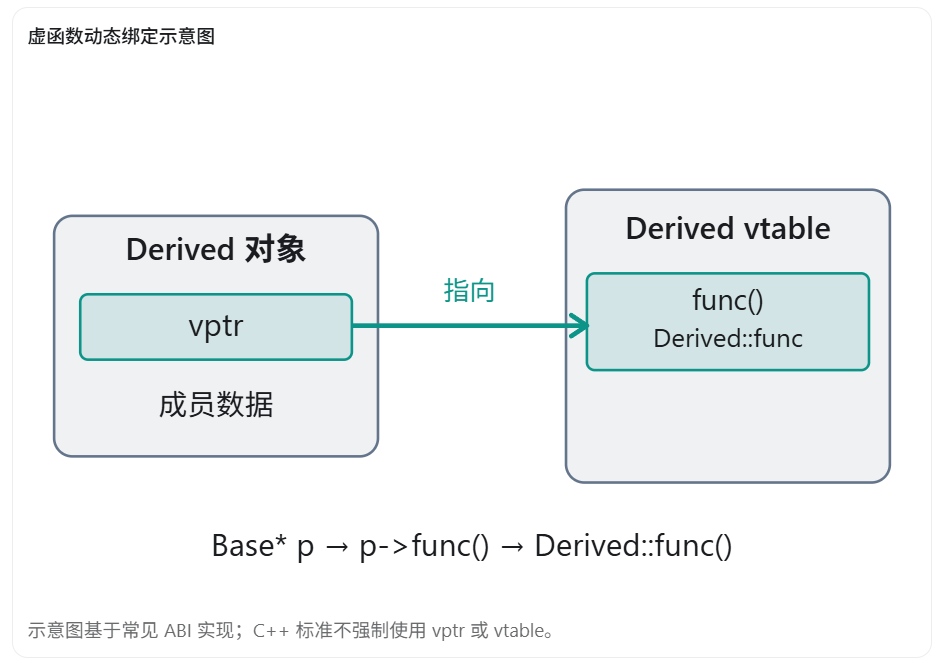
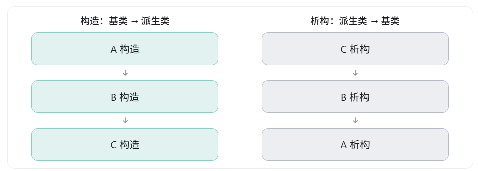

在 C++ 面试中，这是一个非常经典的问题，主要考察三个知识点：

1. **虚函数的实现原理（虚函数表和虚函数指针）**
2. **对象的构造与析构顺序**
3. **多态机制与动态绑定**

先给出结论：

- **构造函数不能是虚函数**：构造函数的职责是初始化对象，而虚函数主要用于对已经具有相应动态类型的对象进行多态调用。C++ 不允许将构造函数声明为 `virtual`。
- **析构函数可以是虚函数**：在通过基类指针删除派生类对象时，虚析构函数能够确保调用正确的析构函数链。
- **并不是所有类的析构函数都应该是虚函数**：通常只有需要支持多态删除的基类，才需要将析构函数声明为虚函数。

下面从底层原理展开。

## 一、为什么构造函数不能是虚函数？

### 1. 首先理解虚函数的工作原理

假设有两个类：

```c++
class Base
{
public:
    virtual void func()
    {
        cout << "Base::func" << endl;
    }
};

class Derived : public Base
{
public:
    void func() override
    {
        cout << "Derived::func" << endl;
    }
};
```

执行：

```c++
Base* p = new Derived();
p->func();
```

输出：

```
Derived::func
```

这是因为虚函数采用动态绑定。

在常见的 C++ 编译器实现中，虚函数通常通过虚函数表（vtable）和虚函数指针（vptr）实现。



虚函数调用大致经历：

1. 根据对象地址找到虚函数指针 `vptr`。
2. 通过 `vptr` 找到相应的虚函数表。
3. 查找虚函数表中对应的函数入口。
4. 调用实际类型对应的虚函数实现。

关键在于：**虚函数动态绑定依赖对象的当前动态类型**。

### 2. 构造函数执行时，对象正在逐步建立

考虑：

```c++
class Base
{
public:
    Base()
    {
        cout << "Base 构造" << endl;
    }
};

class Derived : public Base
{
public:
    Derived()
    {
        cout << "Derived 构造" << endl;
    }
};
```

执行：

```c++
Derived d;
```

构造顺序是：

```
1. 构造 Base 子对象
        ↓
2. 构造 Derived 自身的成员
        ↓
3. 执行 Derived 构造函数体
        ↓
4. Derived 对象构造完成
```

当 `Base` 构造函数正在执行时，`Derived` 部分尚未完成构造。

在 C++ 的语义中，**构造函数和析构函数中的虚函数调用，不会分派到尚未构造或已经析构的更派生类部分**。

例如：

```c++
class Base
{
public:
    Base()
    {
        func();
    }

    virtual void func()
    {
        cout << "Base::func" << endl;
    }
};

class Derived : public Base
{
public:
    void func() override
    {
        cout << "Derived::func" << endl;
    }
};

int main()
{
    Derived d;
}
```

输出：

```
Base::func
```

而不是：

```
Derived::func
```

这是因为在 `Base` 构造函数中，虚函数调用按照 `Base` 这一构造阶段进行分派。

在常见 ABI 下，编译器会在对象构造过程中设置或调整相应的虚函数指针，以满足这种行为。

### 3. 为什么不能直接把构造函数设为 virtual？

假设 C++ 允许：

```c++
class Base
{
public:
    virtual Base(); // C++ 不允许，会编译报错
};
```

那么问题就在于：虚构造函数应该如何被调用？

普通虚函数的调用通常是：

```c++
Base* p = /* 已存在的对象 */;
p->func();
```

此时已经有一个对象，可以根据其动态类型进行分派。

但构造函数是负责创建和初始化对象的：

```c++
Base* p = new Derived();
```

在执行构造函数之前，编译器就必须确定需要分配哪种对象、分配多少内存，以及应该调用哪个构造函数。

因此，构造函数不能像普通成员虚函数那样，依靠一个已经存在的完整对象来决定创建哪种类型。

**注意：这不是简单地说“因为 vptr 还没初始化，所以构造函数不能是虚函数”。** 更准确地说，这是 C++ 对象生命周期与虚函数动态分派语义的设计：构造函数不参与虚函数覆盖，构造对象的类型由创建表达式或其他工厂逻辑确定。

如果希望实现类似“多态构造”的效果，可以使用工厂模式：

```c++
class Base
{
public:
    virtual ~Base() = default;
};

class Derived : public Base
{
};

std::unique_ptr<Base> CreateObject()
{
    return std::make_unique<Derived>();
}
```

这里通过工厂函数决定创建的实际类型，而不是使用虚构造函数。

## 二、为什么析构函数最好是虚函数？

这个问题的核心是：

**当使用基类指针删除派生类对象时，如何正确销毁整个对象？**

### 1. 如果析构函数不是虚函数

看下面这段代码：

```c++
class Base
{
public:
    ~Base()
    {
        cout << "Base 析构" << endl;
    }
};

class Derived : public Base
{
public:
    ~Derived()
    {
        cout << "Derived 析构" << endl;
    }
};

int main()
{
    Base* p = new Derived();

    delete p;
}
```

这里：

```c++
Base* p = new Derived();
```

存在两个不同的类型：

- `p` 的静态类型是 `Base*`。
- `p` 所指向对象的实际动态类型是 `Derived`。

执行：

```c++
delete p;
```

因为 `Base` 的析构函数不是虚函数，在这个例子中，通过 `Base*` 删除 `Derived` 对象属于**未定义行为**（Undefined Behavior）。

有些编译环境下，你可能只观察到：

```
Base 析构
```

但不能认为标准保证只调用基类析构函数。未定义行为意味着程序没有可靠结果。

例如，`Derived` 如果持有动态资源：

```c++
class Derived : public Base
{
public:
    int* data = new int[100];

    ~Derived()
    {
        delete[] data;
    }
};
```

缺少正确的派生类析构过程，就可能造成资源泄漏或其他严重错误。

### 2. 使用虚析构函数

只需要修改：

```c++
class Base
{
public:
    virtual ~Base()
    {
        cout << "Base 析构" << endl;
    }
};
```

派生类：

```c++
class Derived : public Base
{
public:
    ~Derived() override
    {
        cout << "Derived 析构" << endl;
    }
};
```

此时：

```c++
Base* p = new Derived();
delete p;
```

输出：

```
Derived 析构
Base 析构
```

原理是：

1. `delete p` 使用虚析构机制，确定需要销毁的是 `Derived` 对象。
2. 先执行 `Derived` 的析构函数体。
3. 再销毁 `Derived` 的成员和基类子对象。
4. 执行 `Base` 的析构函数。
5. 最后释放整个对象的存储空间。

这样才能正确清理整个对象。

## 三、为什么构造函数和析构函数的调用顺序相反？

假设：

```c++
class A
{
public:
    A() { cout << "A 构造" << endl; }
    virtual ~A() { cout << "A 析构" << endl; }
};

class B : public A
{
public:
    B() { cout << "B 构造" << endl; }
    ~B() override { cout << "B 析构" << endl; }
};

class C : public B
{
public:
    C() { cout << "C 构造" << endl; }
    ~C() override { cout << "C 析构" << endl; }
};
```

执行：

```c++
A* p = new C();
delete p;
```

输出：

```
A 构造
B 构造
C 构造
C 析构
B 析构
A 析构
```



为什么这样设计？

因为派生类通常依赖基类提供的功能。

构造时需要先建立基类，再初始化派生类；析构时需要先清理派生类，再清理它所依赖的基类。

这种顺序确保对象在每个阶段都具有符合生命周期规则的状态。

## 四、为什么并不是所有析构函数都需要 virtual？

虽然经常听到“析构函数最好是虚函数”，但这个说法并不完全准确。

例如：

```c++
class Vector3
{
public:
    float x, y, z;

    ~Vector3() = default;
};
```

这样的普通数据类型通常不需要虚析构函数。

因为加入虚函数可能带来：

- 对象中额外的虚函数指针（常见实现）。
- 对象大小增加。
- 构造、析构以及某些操作产生额外的开销。
- 类型不再满足某些简单数据类型特征。

对于大量创建的小型对象，例如游戏中的数学向量、普通数据结构，没必要增加这些成本。

更加合理的设计原则是：

**基类如果需要支持通过基类指针删除派生类对象，通常应该提供 public virtual 析构函数。**

另一种合理设计是使用 `protected` 非虚析构函数，禁止外部通过基类指针进行删除。

例如：

```c++
class Base
{
protected:
    ~Base() = default;
};
```

这样普通代码无法直接：

```c++
Base* p = new Derived();
delete p; // 编译错误：析构函数不可访问
```

从而避免错误使用。

## 五、UE5 中为什么 UObject 的析构函数不需要你声明为 virtual？

结合 UE5 的对象系统，这里还有一个非常重要的区别。

`UObject` 体系并不依赖开发者使用普通 C++ 的 `delete` 来管理对象生命周期，而是主要依赖 Unreal Engine 的垃圾回收系统（GC）。

例如：

```c++
UCLASS()
class UMyObject : public UObject
{
    GENERATED_BODY()
};
```

通常不能直接对 `UObject` 写：

```c++
UMyObject* Obj = NewObject<UMyObject>();

delete Obj; // 错误的 UObject 生命周期管理方式
```

UE 的对象创建和回收机制与普通 C++ 类不同。

`UObject` 基类已经有引擎定义的虚析构函数，因此派生类不需要再次声明 `virtual` 才能获得虚析构语义。不过，**这不代表可以手动 delete UObject。**

对于一般 UE5 开发，更应该记住：

- 普通 C++ 对象：通过 RAII、`unique_ptr` 等方式管理生命周期。
- `UObject` 对象：通过 `NewObject` 等方式创建，按 UE 的 GC 规则管理引用与生命周期。
- `AActor` 对象：通常使用 `SpawnActor` 创建，使用 `Destroy()` 请求销毁，而不是直接 `delete`。

## 六、面试中怎么回答？

如果面试官问：

“为什么构造函数不能是虚函数，为什么析构函数最好是虚函数？”

可以这样回答：

> 构造函数不能是虚函数，主要是因为虚函数的作用是基于已有对象的动态类型进行多态调用，而构造函数负责创建和初始化对象。在构造过程中，派生类部分可能尚未完成构造，因此 C++ 不允许构造函数参与虚函数机制。
>
> 而析构函数可以是虚函数，因为对象销毁时可能通过基类指针操作派生类对象。如果基类析构函数不是虚函数，直接通过基类指针 `delete` 派生类对象通常会导致未定义行为。
>
> 将基类析构函数声明为虚函数后，可以通过动态绑定执行正确的派生类析构过程，并按照派生类到基类的顺序完成销毁。
>
> 但不是所有析构函数都要声明为虚函数，只有需要支持多态删除的基类通常才需要这样设计。

最后有一个值得特别区分的点：

虚析构函数解决的是“通过基类指针删除时，应该销毁哪种类型的对象”；构造函数不能为虚函数解决的不是某个简单的技术限制，而是 C++ 的对象构造和动态分派本来就遵循不同的语义。