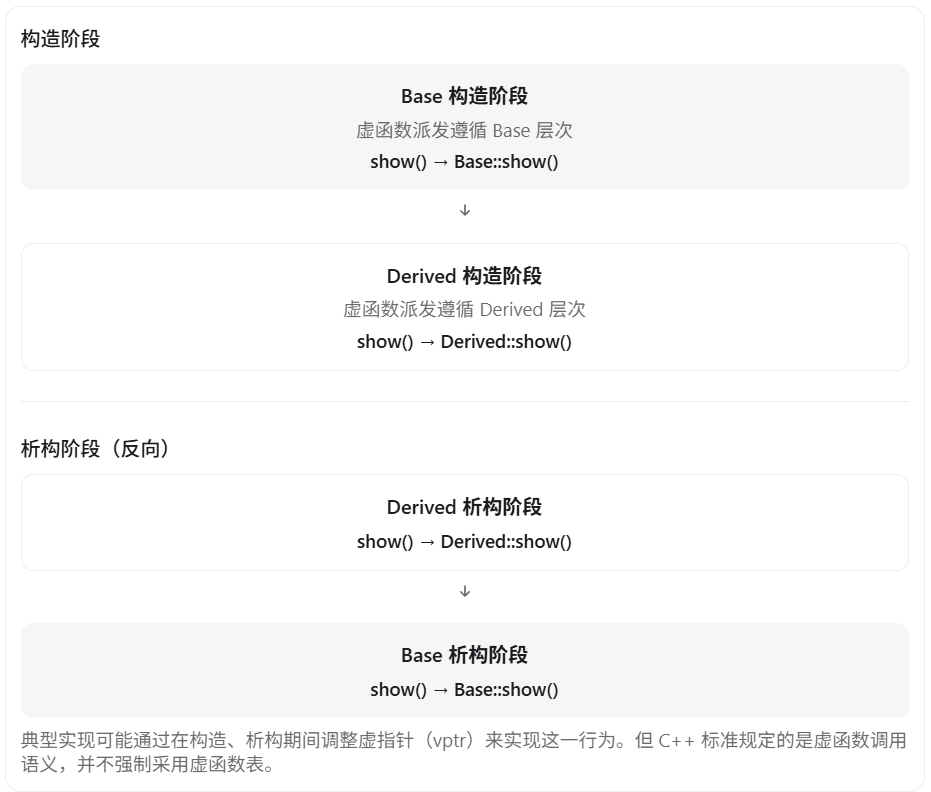
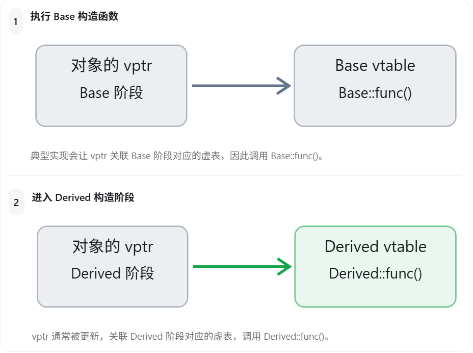
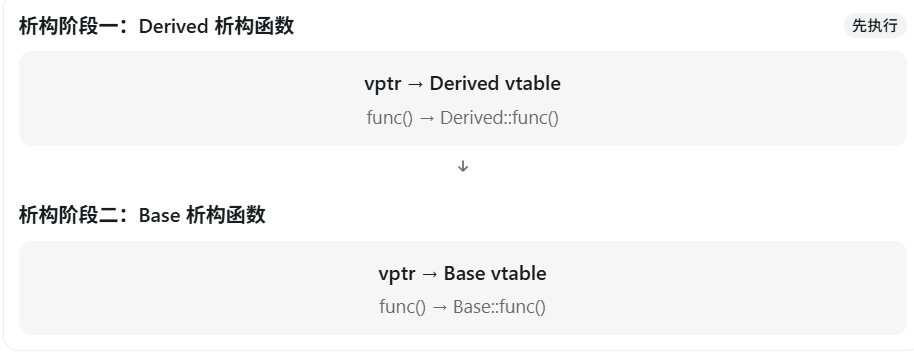

可以！C++ 的构造函数和析构函数都可以调用虚函数，但是在构造和析构过程中，虚函数不会表现出我们通常理解的“调用最派生类重写函数”的多态行为。

这是 C++ 面试中非常经典的一道题，主要考察 虚函数、动态绑定、对象生命周期和虚函数表（vtable）。

## 一、先看一个例子

```c++
#include <iostream>
using namespace std;

class Base {
public:
    Base() {
        cout << "Base 构造函数" << endl;
        show();
    }

    virtual ~Base() {
        cout << "Base 析构函数" << endl;
        show();
    }

    virtual void show() {
        cout << "Base::show()" << endl;
    }
};

class Derived : public Base {
public:
    Derived() {
        cout << "Derived 构造函数" << endl;
        show();
    }

    ~Derived() override {
        cout << "Derived 析构函数" << endl;
        show();
    }

    void show() override {
        cout << "Derived::show()" << endl;
    }
};

int main() {
    Base* p = new Derived();
    delete p;
}
```

运行结果：

```
Base 构造函数
Base::show()
Derived 构造函数
Derived::show()
Derived 析构函数
Derived::show()
Base 析构函数
Base::show()
```

注意这里的关键现象：

- 在 `Base` 构造函数中调用 `show()`，执行的是 `Base::show()`。
- 在 `Derived` 构造函数中调用 `show()`，执行的是 `Derived::show()`。
- 在 `Derived` 析构函数中调用 `show()`，执行的是 `Derived::show()`。
- 在 `Base` 析构函数中调用 `show()`，执行的是 `Base::show()`。

**即使最终创建的是 `Derived` 对象，`Base` 构造函数和析构函数中的虚函数调用也不会动态派发到 `Derived::show()`。**

## 二、为什么会这样？

根本原因是：C++ 对象在构造和析构过程中，其当前有效的类型层次会随着执行阶段发生变化。

### 1. 构造函数执行过程

假设：

```c++
Derived d;
```

对象构造顺序是：

1. 构造 `Base` 基类子对象。
2. 构造 `Derived` 自身的成员及类部分。
3. 执行 `Derived` 构造函数体。

当执行 `Base` 的构造函数时，`Derived` 部分还没有完成构造。

因此，此时如果调用虚函数，应该调用 `Base` 版本，而不能调用尚未完成构造的 `Derived` 版本。

### 2. 析构函数执行过程

析构顺序与构造顺序相反：

1. 执行 `Derived` 析构函数体。
2. 析构 `Derived` 的成员。
3. 执行 `Base` 析构函数。

当执行 `Base` 析构函数时，`Derived` 部分已经结束生命周期，不应再调用依赖于 `Derived` 部分的虚函数。

因此，此时虚函数调用也只会派发到 `Base` 层次。

## 三、从虚函数表的底层原理理解

在主流编译器采用的虚函数表实现中，可以将整个过程理解为对象的虚函数派发机制随着构造、析构阶段进行调整。



所以要注意：

**并不是虚函数在构造函数或析构函数中失效了，而是虚函数的动态派发范围被限定在当前正在构造或析构的类层次。**

## 四、面试追问：构造函数和析构函数本身可以是虚函数吗？

这是另一个容易混淆的问题。

| 问题                       | 结论                           |
| -------------------------- | ------------------------------ |
| 构造函数能调用虚函数吗？   | 可以                           |
| 析构函数能调用虚函数吗？   | 可以                           |
| 构造函数本身能是虚函数吗？ | 不可以                         |
| 析构函数本身能是虚函数吗？ | 可以，而且多态基类通常应该如此 |

### 为什么构造函数不能是虚函数？

虚函数调用通常需要通过已有对象的动态类型确定目标函数。

但构造函数负责创建和初始化对象，此时对象还没有完成构造，不存在通常意义上可以用来选择构造函数的完整动态对象。

而且，创建什么类型的对象必须在构造之前确定，不能依靠待创建对象的虚函数机制来决定。

### 为什么析构函数可以是虚函数？

因为通过父类指针删除子类对象时，需要正确调用整个对象的析构过程。

```c++
Base* p = new Derived();

delete p;
```

如果 `Base` 的析构函数是虚函数，就能正确销毁 `Derived` 对象，再销毁它的 `Base` 基类子对象。

如果基类析构函数不是虚函数，在一般情况下，通过这样的基类指针删除派生类对象会产生未定义行为（C++20 的 destroying delete 等机制存在特定例外）。

## 五、另一个陷阱：构造函数中调用纯虚函数

例如：

```c++
class Base {
public:
    Base() {
        show();  // 危险
    }

    virtual void show() = 0;
};

class Derived : public Base {
public:
    void show() override {
        cout << "Derived::show()" << endl;
    }
};
```

`Base` 构造函数中调用 `show()` 不会派发到 `Derived::show()`。

而此时 `Base::show()` 又是纯虚函数，**这种在构造期间对正在构造对象的纯虚函数进行虚调用的行为是未定义行为。**

即使 `Derived` 实现了该函数，也无法解决问题。

注意：纯虚函数可以在类外提供定义，但这不意味着可以在构造函数中通过虚调用安全地调用它。

## 六、面试标准回答（建议背诵）

> C++ 中构造函数和析构函数都可以调用虚函数，但是在构造和析构过程中，虚函数的动态派发范围受到限制。
>
> 在构造基类对象时，派生类部分还没有完成构造，因此基类构造函数中调用虚函数，只会调用基类或者其已构造基类层次中的最终重写版本，不会调用尚未构造的派生类版本。
>
> 在析构过程中则相反，派生类部分会先被析构。当执行基类析构函数时，派生类部分已经结束生命周期，因此也不会调用派生类重写的虚函数。
>
> 从底层来看，主流编译器通常通过构造和析构过程中对虚指针的调整，实现这种分阶段的虚函数派发。
>
> 另外，构造函数本身不能是虚函数，但析构函数可以是虚函数。对于需要通过基类指针删除派生类对象的多态基类，通常应将析构函数声明为虚函数。

最后记住一句话：构造、析构期间可以调用虚函数，但调用会受当前正在构造或析构的类层次限制，不会跨越到尚未构造或已经析构的派生类。

------

在 C++ 中，对象构造和析构时，虚指针（vptr）通常会随着构造、析构阶段发生变化，但虚函数表（vtable）本身一般不会改变。

这也是为什么在父类构造函数或析构函数中调用虚函数，不会执行子类重写版本的底层原因之一。

我们从 内存布局 → 构造过程 → 析构过程 → 底层实现 四个方面来理解。

## 一、首先区分 vptr 和 vtable

在主流编译器实现中：

- **虚指针（vptr）**：通常存放在对象内部，用于关联相应的虚函数表。
- **虚函数表（vtable）**：通常由编译器生成，保存虚函数入口地址及相关信息。
- **一个类通常有相应的虚函数表**，而不同对象各自拥有自己的虚指针（具体数量和布局取决于继承结构及 ABI）。

例如：

```c++
class Base {
public:
    virtual void func() {}
};

class Derived : public Base {
public:
    void func() override {}
};

Derived d;
```

在简单的单继承情况下，可以这样理解：


需要注意，C++ 标准并没有强制规定必须使用 vptr 和 vtable。下面描述的是 GCC、Clang、MSVC 等主流编译器常见的实现思路。

## 二、对象构造过程中，虚指针会发生什么？

来看一个例子：

```c++
#include <iostream>
using namespace std;

class Base {
public:
    Base() {
        cout << "Base 构造" << endl;
        func();
    }

    virtual void func() {
        cout << "Base::func()" << endl;
    }

    virtual ~Base() = default;
};

class Derived : public Base {
public:
    Derived() {
        cout << "Derived 构造" << endl;
        func();
    }

    void func() override {
        cout << "Derived::func()" << endl;
    }
};

int main() {
    Derived d;
}
```

输出：

```
Base 构造
Base::func()
Derived 构造
Derived::func()
```

### 构造阶段的 vptr 变化



所以，构造过程可以理解为：

```
分配对象所需内存
       ↓
进入 Base 构造阶段
       ↓
设置 Base 阶段的 vptr
       ↓
执行 Base 构造函数体
       ↓
进入 Derived 构造阶段
       ↓
更新为 Derived 阶段的 vptr
       ↓
执行 Derived 构造函数体
       ↓
对象构造完成
```

这里是对单继承常见实现的简化描述。实际编译器还要处理成员初始化、异常清理等步骤。

**关键点：不是虚函数表中的函数地址发生了变化，而是对象内部的 vptr 通常被调整为指向不同阶段对应的虚函数表。**

## 三、对象析构过程中，虚指针会发生什么？

析构过程恰好相反。

假设：

```c++
Base* p = new Derived();
delete p;
```

这里 `Base` 的析构函数是虚函数，因此 `delete p` 能正确启动 `Derived` 对象的析构过程。

对于 `Derived` 对象：



这就解释了为什么父类析构函数中调用虚函数，不会执行子类版本。

因为在执行 `Base` 析构函数时，`Derived` 层次已经完成析构，虚函数派发遵循 `Base` 当前的析构阶段。

## 四、虚函数表本身会发生变化吗？

**一般不会。**

对于普通的单继承场景，编译器通常会提前生成 `Base` 和 `Derived` 对应的虚函数表。

构造和析构过程中，通常是对象内部的虚指针被修改，而不是去修改虚函数表的内容。

例如：

```
Base vtable
    └── Base::func()

Derived vtable
    └── Derived::func()
```

这两张虚函数表通常一直存在于程序相应的静态存储区域中。

构造和析构时只是让 vptr 在这些表对应的地址之间切换。

不过，多重继承、虚继承可能涉及多个 vptr、多个虚表以及构造专用虚表，具体布局会更复杂。

另外，编译器优化时也可能直接确定调用目标，不一定真的通过 vptr 查询虚函数表。

## 五、面试时还可以补充的一个细节

假设继承关系变成：

```c++
class A {
public:
    virtual void func() {}
    virtual ~A() = default;
};

class B : public A {
public:
    void func() override {}
};

class C : public B {
public:
    void func() override {}
};
```

对于：

```
C obj;
```

在典型单继承实现下，构造和析构的虚指针关联关系可以概括为：

| 阶段   | vptr 通常关联的虚表 |
| ------ | ------------------- |
| A 构造 | A 的虚表            |
| B 构造 | B 的虚表            |
| C 构造 | C 的虚表            |
| C 析构 | C 的虚表            |
| B 析构 | B 的虚表            |
| A 析构 | A 的虚表            |

因此，我们可以将虚指针的变化概括为：

**构造：A → B → C**

**析构：C → B → A**

这也说明，构造和析构期间，虚函数调用遵循的是当前构造或析构阶段的类层次，而不是始终按照完整对象的最派生类型进行派发。

## 六、面试标准回答

如果面试官问：

“C++ 对象构造和析构过程中，虚指针和虚函数表会发生什么变化？”

可以这样回答：

> 在主流 C++ 编译器实现中，虚函数表通常在编译、链接阶段生成，不会在每次构造或析构对象时重新创建。
>
> 但是对象内部的虚指针可能随着构造和析构阶段发生变化。
>
> 在构造过程中，先执行父类构造函数。此时对象的虚指针通常关联父类对应的虚函数表，因此父类构造函数内调用虚函数，只会调用当前父类层次中的最终重写版本。
>
> 当进入子类构造阶段时，编译器通常会更新虚指针，使其关联子类对应的虚函数表。
>
> 在析构过程中顺序相反，先执行子类析构函数，随后进入父类析构阶段，虚指针也会相应调整。
>
> 因此，构造和析构期间调用虚函数，表现出的动态绑定行为受到当前构造或析构阶段的限制。
>
> 需要注意，虚指针和虚函数表属于编译器常见的实现机制，并不是 C++ 标准强制规定的内存布局。

最后强调一个容易误解的地方：

构造和析构阶段的虚函数派发限制是 C++ 语言规则，而 vptr 的调整只是编译器实现这些规则的一种常见方式。

所以最值得记住的是：

虚函数表通常不变，虚指针通常会变；构造时逐层切换到派生类，析构时逐层切回基类。