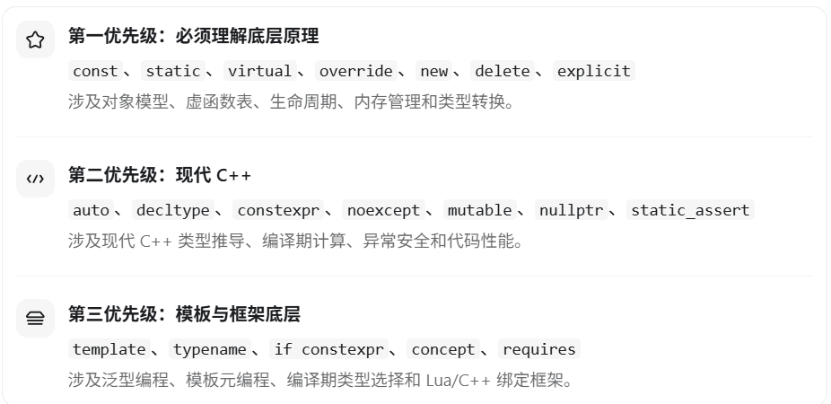

`constexpr` 是 C++11 引入的关键字，也是 C++ 模板元编程、编译期计算和性能优化 中的重要知识点。

从 C++ 游戏客户端开发面试的角度，我建议重点掌握 `constexpr`、`const`、`static`、`inline`、`virtual`、`explicit`、`mutable`、`noexcept`、`auto` 等关键字，以及 C++11/17/20 引入的一些新特性。

# 一、constexpr 是什么？

`constexpr` 的核心作用是：**让变量或函数能够参与编译期常量表达式的计算。**

### 1. constexpr 修饰变量

```c++
constexpr int a = 10;
constexpr int b = a * 2;

int arr[b];  // b 是编译期常量
```

这里的 `a` 和 `b` 在编译期就可以确定数值。

对于普通的 `const`：

```c++
int n;
cin >> n;

const int a = n;      // 正确
constexpr int b = n;  // 错误
```

因为 `n` 的值只有在程序运行时才能确定，所以不能用它初始化 `constexpr` 变量。

`const` 和 `constexpr` 的区别：

| 关键字      | 含义                         | 要求编译期确定值吗？ |
| ----------- | ---------------------------- | -------------------- |
| `const`     | 对象不能通过该名字修改       | 不要求               |
| `constexpr` | 对象必须使用常量表达式初始化 | 要求                 |

可以简单理解为：

- `const` 主要强调**只读**。
- `constexpr` 主要强调**编译期可计算**。

### 2. constexpr 修饰函数

```c++
constexpr int Square(int x) {
    return x * x;
}

int main() {
    constexpr int a = Square(5);

    int n;
    cin >> n;

    int b = Square(n);
}
```

这里有一个很重要的细节：

`constexpr` **函数不代表一定在编译期执行**。

- `Square(5)` 用于初始化 `constexpr` 变量，因此必须在编译期求值。
- `Square(n)` 中的 n 是运行时输入，可以在运行时执行该函数。

所以 `constexpr` 函数既可以参与编译期计算，也可以在运行时调用。

### 3. if constexpr（C++17）

这是模板元编程中非常常见的写法。

```c++
#include <iostream>
#include <type_traits>
using namespace std;

template<typename T>
void Print(T value) {
    if constexpr (is_integral_v<T>) {
        cout << "整数类型" << endl;
    }
    else {
        cout << "非整数类型" << endl;
    }
}

int main() {
    Print(10);     // 整数类型
    Print(3.14);   // 非整数类型
}
```

与普通 `if` 不同，`if constexpr` 会在编译期判断条件，并在模板实例化时丢弃不适用的分支。

因此，在模板编程中，它可以根据不同类型选择不同的实现。

比如在 **Lua 和 C++ 的参数转换** 中，可以根据参数类型在编译期选择对应的转换函数。

### 4. constexpr、consteval、constinit 的区别

| 关键字      | 引入版本 | 作用                                                       |
| ----------- | -------- | ---------------------------------------------------------- |
| `constexpr` | C++11    | 支持编译期常量表达式计算                                   |
| `consteval` | C++20    | 要求函数调用必须在编译期求值                               |
| `constinit` | C++20    | 要求静态或线程存储期变量进行静态初始化，但变量不一定是常量 |

例如：

```c++
constexpr int F1(int x) {
    return x * 2;
}

consteval int F2(int x) {
    return x * 2;
}

int n = 10;

int a = F1(n);  // 正确，可以运行时计算
int b = F2(n);  // 错误，n 不是编译期常量
int c = F2(10); // 正确
```

面试中最常考的是 `constexpr` 与 `const` 的区别，以及 `if constexpr` 在模板中的作用。

# 二、C++ 常用关键字分类

## 1. 变量、类型和存储相关

| 关键字         | 作用                            | 面试重点                   |
| -------------- | ------------------------------- | -------------------------- |
| `const`        | 修饰只读对象或成员函数          | const 指针、const 成员函数 |
| `constexpr`    | 编译期常量表达式                | 与 const 的区别            |
| `static`       | 静态存储或类静态成员            | 生命周期、作用域、共享成员 |
| `extern`       | 声明外部链接的变量或函数        | 多文件编译、全局变量       |
| `mutable`      | 允许在 const 对象中修改特定成员 | const 成员函数             |
| `volatile`     | 表示访问具有特殊可观察副作用    | 为什么不能保证线程安全     |
| `thread_local` | 每个线程拥有独立变量实例        | 线程局部存储               |
| `auto`         | 由初始化表达式推导类型          | auto 类型推导规则          |
| `decltype`     | 获取表达式的声明类型            | `decltype(auto)`、泛型编程 |
| `using`        | 别名、命名空间或引入声明        | 和 typedef 的区别          |

其中 `static`、`const`、`auto` 是非常高频的面试知识点。

## 2. 面向对象相关

| 关键字      | 作用                   | 面试重点                  |
| ----------- | ---------------------- | ------------------------- |
| `public`    | 公有访问权限           | 封装                      |
| `protected` | 保护访问权限           | 继承中的访问控制          |
| `private`   | 私有访问权限           | 类的封装                  |
| `virtual`   | 声明虚函数             | 虚函数表、动态多态        |
| `override`  | 显式声明重写虚函数     | 编译期检查重写是否正确    |
| `final`     | 禁止进一步继承或重写   | final 类、final 函数      |
| `explicit`  | 限制隐式转换           | 构造函数、转换函数        |
| `friend`    | 声明友元               | 友元函数、友元类          |
| `this`      | 指向当前对象的指针     | this 指针、const 成员函数 |
| `class`     | 定义类                 | class 和 struct 的区别    |
| `struct`    | 定义结构体             | 默认访问权限              |
| `delete`    | 禁用函数或释放动态对象 | `=delete`、`delete` 运算  |
| `default`   | 请求编译器生成默认实现 | `=default`                |

注意：`override` 和 `final` 严格来说是具有特殊上下文含义的标识符，而不是普通的保留关键字，但面试中一般会和关键字一起考察。

### 重点：explicit

例如：

```c++
class Player {
public:
    Player(int id) {}
};

void Test(Player p) {}

int main() {
    Test(10); // 可以隐式构造 Player
}
```

如果构造函数使用 `explicit`：

```c++
explicit Player(int id) {}
```

那么：

```c++
Test(10);         // 错误
Test(Player(10)); // 正确
```

`explicit` 可以防止不符合预期的隐式类型转换。

### 重点：mutable

```c++
class Player {
public:
    void Print() const {
        count++;
    }

private:
    mutable int count = 0;
};
```

正常情况下，`const` 成员函数不能修改对象的普通成员变量，但 `mutable` 成员可以修改。

这种机制常用于缓存、统计、互斥锁等不改变对象逻辑状态的成员。

## 3. 内存管理和异常相关

| 关键字     | 作用                   | 面试重点             |
| ---------- | ---------------------- | -------------------- |
| `new`      | 动态分配并构造对象     | 与 malloc 的区别     |
| `delete`   | 销毁对象并释放内存     | 与 free 的区别       |
| `sizeof`   | 查询类型或对象占用大小 | 内存对齐、结构体大小 |
| `alignof`  | 查询类型的对齐要求     | 内存对齐             |
| `alignas`  | 指定对齐要求           | SIMD、缓存对齐       |
| `noexcept` | 声明函数不应抛出异常   | 移动构造、容器优化   |
| `try`      | 异常处理               | 异常机制             |
| `catch`    | 捕获异常               | 异常类型匹配         |
| `throw`    | 抛出异常               | 异常传播             |

### 重点：noexcept

```c++
class Player {
public:
    Player(Player&& other) noexcept {
        // 移动构造
    }
};
```

`noexcept` 表示函数承诺不让异常传播出去。

对于 `std::vector` 等容器，当发生扩容时，如果移动构造函数声明为 `noexcept`，容器通常可以更放心地使用移动构造，而不是为了维持异常安全保证而选择复制。

这也是为什么移动构造函数和移动赋值运算符经常建议在确实不会抛异常时使用 `noexcept`。

## 4. 模板与现代 C++ 相关

这些关键字与你刚才提到的模板元编程联系最紧密。

| 关键字          | 引入版本 | 作用                       |
| --------------- | -------- | -------------------------- |
| `template`      | C++98    | 定义函数或类模板           |
| `typename`      | C++98    | 模板类型参数、依赖类型标识 |
| `constexpr`     | C++11    | 编译期计算                 |
| `decltype`      | C++11    | 获取表达式类型             |
| `static_assert` | C++11    | 编译期断言                 |
| `nullptr`       | C++11    | 类型安全的空指针常量       |
| `if constexpr`  | C++17    | 编译期条件分支             |
| `concept`       | C++20    | 定义模板参数约束           |
| `requires`      | C++20    | 声明或检查模板约束         |
| `consteval`     | C++20    | 强制函数调用在编译期求值   |

例如 `static_assert`：

```c++
template<typename T>
void Test() {
    static_assert(sizeof(T) >= 4,
                  "Type size must >= 4");
}
```

如果模板参数类型的大小小于 4 字节，编译就会失败。

相比运行时的 `assert`，`static_assert` 可以在编译阶段发现问题。

# 三、面试最容易混淆的几个关键字

建议重点掌握下面这几组。

| 对比                          | 核心区别                             |
| ----------------------------- | ------------------------------------ |
| `const` vs `constexpr`        | 只读约束 vs 必须具备编译期常量表达式 |
| `static` vs `extern`          | 静态成员/存储及链接控制 vs 外部声明  |
| `virtual` vs `override`       | 声明虚函数 vs 确认正确重写           |
| `override` vs `final`         | 确认重写 vs 禁止后续重写             |
| `new/delete` vs `malloc/free` | 对象构造析构 vs 内存分配释放         |
| `class` vs `struct`           | 默认成员访问和继承权限不同           |
| `auto` vs `decltype`          | 根据初始化推导 vs 根据表达式获取类型 |
| `typedef` vs `using`          | 都可定义类型别名，using 支持别名模板 |

另外，`std::move`、`std::forward`、`std::shared_ptr` 都不是 C++ 关键字，而是标准库提供的函数或类型。

对于 UE5，`UCLASS`、`UPROPERTY`、`UFUNCTION`、`GENERATED_BODY` 也不是 C++ 原生关键字，而是 UE 反射系统使用的宏。

# 四、针对 UE5 游戏客户端面试，应该优先掌握哪些？

我建议按照以下顺序准备：



对于你之前那场聊到 Lua 和 UE 通信的面试，我认为尤其应该深入学习以下四个知识点：

1. 模板特化和偏特化。
2. 可变参数模板 `template<typename... Args>`。
3. `if constexpr` 和类型萃取 `std::is_same_v` 等。
4. C++ 模板元编程与 UE5 运行时反射的区别。

把这四个知识点串起来，就能够比较系统地解释：UnLua 如何将静态类型的 C++ 函数和动态类型的 Lua 连接起来。