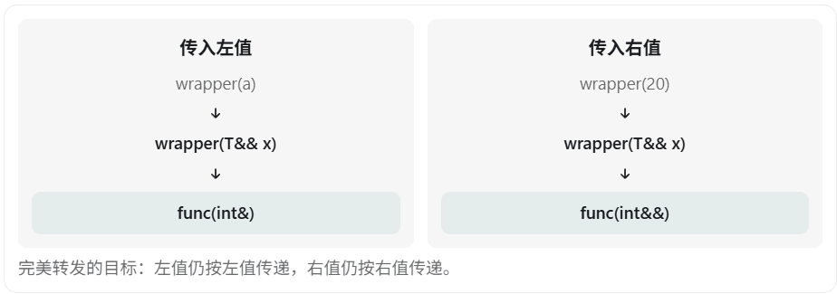

在 C++ 中，**完美转发（Perfect Forwarding）是 C++11 引入的重要特性，主要用于泛型编程、模板、移动语义和 STL 容器的实现。**

从面试角度来看，完美转发通常会和以下知识点一起考察：

- 左值、右值和右值引用
- 万能引用（转发引用，Forwarding Reference）
- 引用折叠（Reference Collapsing）
- `std::forward` 和 `std::move` 的区别
- 模板类型推导

下面按照 基本概念 → 为什么需要 → 底层原理 → 代码实现 → 面试高频问题 的顺序讲解。

## 一、什么是完美转发？

先给出定义：

**完美转发是指：在函数模板中，将接收到的参数转发给另一个函数时，尽可能保留实参原本的左值/右值属性以及 `const` 等类型限定。**

例如：

```c++
void func(int& x) {
    cout << "左值引用" << endl;
}

void func(int&& x) {
    cout << "右值引用" << endl;
}
```

我们希望实现一个中间函数 `wrapper()`：

```c++
int a = 10;

wrapper(a);   // 希望调用 func(int&)
wrapper(20);  // 希望调用 func(int&&)
```

也就是说：



但是，直接编写普通模板并不能实现这个目标。

## 二、为什么需要完美转发？

### 1. 不使用完美转发的情况

```c++
#include <iostream>
using namespace std;

void func(int& x) {
    cout << "左值引用" << endl;
}

void func(int&& x) {
    cout << "右值引用" << endl;
}

template<typename T>
void wrapper(T&& x) {
    func(x);
}

int main() {
    int a = 10;

    wrapper(a);
    wrapper(20);
}
```

输出：

```
左值引用
左值引用
```

发现问题了吗？

明明 `wrapper(20)` 传入的是右值，为什么最终调用的还是 `func(int&)`？

### 2. 核心原因：具名的右值引用是左值表达式

这是理解完美转发最重要的前提。

```c++
int&& r = 10;
```

这里：

- `10` 是右值。
- `r` 的类型是 `int&&`。
- 但是表达式 `r` 是左值！

也就是说，**变量的类型是右值引用，不代表使用该变量名形成的表达式就是右值。**

例如：

```c++
int&& r = 10;

func(r);             // 调用 func(int&)
func(std::move(r));  // 调用 func(int&&)
```

因为 `r` 是一个有名字、可以取地址的表达式，所以属于左值表达式。

回到我们的模板：

```c++
template<typename T>
void wrapper(T&& x) {
    func(x);
}
```

即使调用：

```c++
wrapper(20);
```

`x` 的类型被推导成 `int&&`，但 `x` 作为表达式仍然是左值，因此调用了 `func(int&)`。

这就导致参数原本的右值属性在转发时丢失。

## 三、如何实现完美转发？

C++ 提供了 `std::forward`，专门解决这个问题。

```c++
#include <iostream>
#include <utility>
using namespace std;

void func(int& x) {
    cout << "左值引用" << endl;
}

void func(int&& x) {
    cout << "右值引用" << endl;
}

template<typename T>
void wrapper(T&& x) {
    func(std::forward<T>(x));
}

int main() {
    int a = 10;

    wrapper(a);
    wrapper(20);
}
```

输出：

```
左值引用
右值引用
```

这就实现了完美转发。

但真正理解其原理，还需要掌握两个关键知识点：

1. 万能引用（转发引用）。
2. 引用折叠。

## 四、万能引用（Forwarding Reference）

首先思考：

```c++
template<typename T>
void wrapper(T&& x);
```

为什么 `T&&` 既能接收左值，又能接收右值？

按照普通右值引用的理解：

```c++
int&& x = 10; // 正确

int a = 10;
int&& y = a;  // 错误
```

右值引用不能直接绑定普通左值。

但是在模板中：

```c++
template<typename T>
void wrapper(T&& x);
```

这里的 `T&&` 在 `T` 是待推导的模板类型参数时，属于转发引用（Forwarding Reference），也常被称为万能引用。

它的特殊之处在于模板类型推导：

| 实参                | 推导出的 T   | 参数类型 T&& |
| ------------------- | ------------ | ------------ |
| `int a` 左值        | `int&`       | `int&`       |
| `const int a` 左值  | `const int&` | `const int&` |
| `10` 右值           | `int`        | `int&&`      |
| `std::move(a)` 右值 | `int`        | `int&&`      |

注意第一行：

```c++
int a = 10;
wrapper(a);
```

这里模板参数 `T` 被推导为：

```c++
T = int&
```

代入 `T&&`：

```c++
int& &&
```

它最终会变成：

```c++
int&
```

这就涉及下面的引用折叠规则。

## 五、引用折叠（Reference Collapsing）——核心原理

C++ 不允许直接声明引用的引用，例如：

```c++
int& & x;  // 非法
```

但是在模板类型推导、类型别名等场景中，可能间接形成引用的引用。

此时 C++ 会应用**引用折叠**规则。

| 原始组合 | 折叠结果 |
| -------- | -------- |
| `T& &`   | `T&`     |
| `T& &&`  | `T&`     |
| `T&& &`  | `T&`     |
| `T&& &&` | `T&&`    |

记忆方法：

**只要出现一个 `&`，最终就是左值引用；只有两个都是 `&&`，最终才是右值引用。**

例如：

```c++
template<typename T>
void wrapper(T&& x);
```

当传入左值：

```c++
int a = 10;
wrapper(a);
```

推导过程：

```
T = int&

T&& = int& &&

引用折叠后：

int&
```

当传入右值：

```c++
wrapper(10);
```

推导过程：

```
T = int

T&& = int&&
```

因此，`T&&` 配合模板推导和引用折叠，可以同时接收左值与右值。

## 六、std::forward 的底层实现（面试重点）

我们已经知道：

```c++
template<typename T>
void wrapper(T&& x) {
    func(std::forward<T>(x));
}
```

现在最重要的问题是：

**`std::forward` 到底做了什么，为什么可以恢复参数原本的左值或右值属性？**

从原理上看，`std::forward` 可以简化理解为：

```c++
template<typename T>
T&& forward(std::remove_reference_t<T>& x) {
    return static_cast<T&&>(x);
}
```

这是用于理解的简化实现，实际标准库中还包含另一个重载和相关约束。

核心就是：

```c++
static_cast<T&&>(x)
```

下面分别分析。

### 情况一：传入左值

```c++
int a = 10;
wrapper(a);
```

第一步：模板类型推导

```c++
T = int&
```

第二步：执行 `std::forward<T>(x)`

等价于：

```c++
std::forward<int&>(x)
```

第三步：执行类型转换

```c++
static_cast<int& &&>(x)
```

发生引用折叠：

```c++
static_cast<int&>(x)
```

最终结果仍然是左值。

因此调用：

```c++
func(int&);
```

### 情况二：传入右值

```c++
wrapper(10);
```

第一步：

```c++
T = int
```

第二步：

```c++
std::forward<int>(x)
```

第三步：

```c++
static_cast<int&&>(x)
```

这次得到的是右值表达式（准确地说，是将亡值 xvalue）。

因此调用：

```c++
func(int&&);
```

### 完整推导对比

| 执行步骤             | 传入左值 `a`           | 传入右值 `10`           |
| -------------------- | ---------------------- | ----------------------- |
| 模板推导 T           | `int&`                 | `int`                   |
| 形参 T&& 折叠后      | `int&`                 | `int&&`                 |
| 表达式 `x`           | 左值                   | 左值                    |
| `std::forward<T>(x)` | `static_cast<int&>(x)` | `static_cast<int&&>(x)` |
| 转发结果             | 左值                   | 右值                    |
| 最终调用             | `func(int&)`           | `func(int&&)`           |

**这张表是理解完美转发底层原理最关键的内容。**

## 七、std::move 和 std::forward 的区别

这是面试中非常容易被追问的问题。

它们底层都与类型转换有关，但使用目的完全不同。

### 1. std::move

`std::move` 的主要作用是将表达式转换成右值（更准确地说是将亡值），不管原来是左值还是右值。

```c++
int a = 10;

func(std::move(a));  // 调用 func(int&&)
```

它并不会自己移动数据，只是让后续操作有机会选择移动语义。

### 2. std::forward

`std::forward<T>` 根据模板参数 `T`，有条件地将表达式转换为右值。

```c++
template<typename T>
void wrapper(T&& x) {
    func(std::forward<T>(x));
}
```

如果原始实参是左值，就转发为左值；如果原始实参是右值，就转发为右值。

### 区别总结

| 比较项目             | std::move          | std::forward       |
| -------------------- | ------------------ | ------------------ |
| 主要作用             | 转换为右值         | 保留原始值类别     |
| 传入左值             | 变成右值           | 保持左值           |
| 传入右值             | 保持右值           | 保持右值           |
| 是否依赖模板推导信息 | 不需要调用者提供 T | 通常使用推导出的 T |
| 常见用途             | 触发移动语义       | 完美转发           |

来看一个例子：

```c++
template<typename T>
void wrapper(T&& x) {
    func(std::move(x));
}
```

如果写成 `std::move(x)`：

```c++
int a = 10;

wrapper(a);   // 调用 func(int&&)
wrapper(20);  // 调用 func(int&&)
```

两次都会选择右值引用重载。

这样做就失去了左值和右值的区别，因此不属于完美转发。

## 八、完美转发的实际应用

完美转发在 STL 中使用得非常广泛，典型场景就是 `emplace_back()`。

例如：

```c++
#include <vector>
#include <string>
#include <utility>

class Student {
public:
    Student(std::string name, int age) {
        // 构造函数
    }
};

int main() {
    std::vector<Student> v;

    v.emplace_back("Tom", 20);
}
```

`emplace_back` 可以直接接收构造参数，在容器内部构造对象。

它的核心实现思想可以简化为：

```c++
template<typename... Args>
void emplace_back(Args&&... args) {
    // 在目标存储位置构造对象
    // 使用 std::forward<Args>(args)...
}
```

其中：

```c++
Args&&... args
```

表示接收任意数量的参数。

而：

```c++
std::forward<Args>(args)...
```

表示把每个参数分别进行完美转发。

这样就可以保留每个参数的左值/右值属性，并调用合适的构造函数。

注意，这只是展示核心原理的简化示例，真实 `std::vector::emplace_back()` 还需要处理内存分配、异常安全和对象生命周期等问题。

## 九、容易混淆的一个问题：所有 T&& 都是万能引用吗？

不是。

例如：

```c++
template<typename T>
void func1(T&& x);  // 转发引用
```

这里 `T` 可以在函数调用时推导，因此 `T&&` 是转发引用。

但是：

```c++
template<typename T>
void func2(const T&& x);  // 普通右值引用
```

这里有 `const` 修饰，不符合转发引用的形式。

再比如：

```c++
template<typename T>
class MyClass {
public:
    void func(T&& x);
};
```

这里的 `T` 是类模板参数，不是在调用 `func` 时推导出来的，因此 `func` 的参数不是转发引用。

还有一种常见写法：

```c++
auto&& x = expression;
```

在 `auto` 进行类型推导时，通常也具有转发引用的特性（花括号初始化列表有特殊规则）。

因此，判断是不是转发引用，关键不是只看有没有 `&&`，**还要看类型是否在相应上下文中参与推导。**

## 十一、面试时应该如何回答？

“什么是 C++ 完美转发？它是怎么实现的？”

可以按照下面的思路回答：

> 完美转发是 C++11 引入的特性，主要用于函数模板中，在将参数继续传递给其他函数时，保留参数原本的左值、右值属性以及 `const` 等限定。
>
> 完美转发主要依赖三个机制：转发引用、模板类型推导和引用折叠，以及 `std::forward`。
>
> 首先，对于 `template<typename T> void func(T&& x)`，这里的 `T&&` 是转发引用。当传入左值时，`T` 会被推导为左值引用类型；传入右值时，`T` 则被推导为非引用类型。
>
> 然后根据引用折叠规则，确定函数参数的引用类型。
>
> 但是，不管参数本身是左值引用还是右值引用，只要它有名字，使用这个名字形成的表达式就是左值。
>
> 因此，需要通过 `std::forward<T>(x)` 恢复原本的值类别。
>
> `std::forward` 的核心是 `static_cast<T&&>(x)`，通过模板参数和引用折叠，使左值继续作为左值转发，使右值继续作为右值转发。
>
> 与 `std::move` 无条件转换为右值不同，`std::forward` 是有条件的转换，因此更适合泛型编程。
>
> 在实际开发中，完美转发经常用于 STL 容器的 `emplace_back`、泛型工厂函数以及模板包装函数中。

最后记住这三行：

```c++
template<typename T>
void wrapper(T&& x) {
    func(std::forward<T>(x));
}
```

其中：

- `T&&`：通过转发引用和模板推导接收左值或右值。
- 引用折叠：确定最终的引用类型。
- `std::forward<T>(x)`：根据推导出的 `T` 恢复原始实参的值类别。

**完美转发的本质并不是避免所有拷贝，而是让被调用函数能够根据原始实参的类型和值类别，正确选择相应的重载、拷贝或移动操作。**