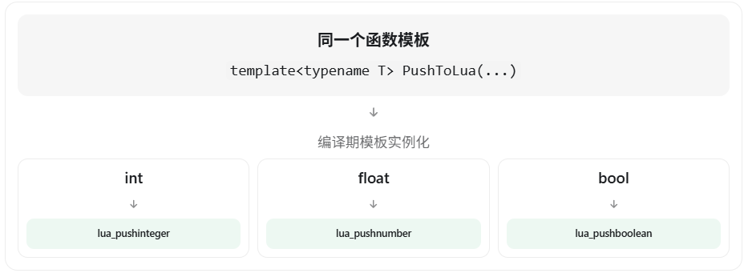
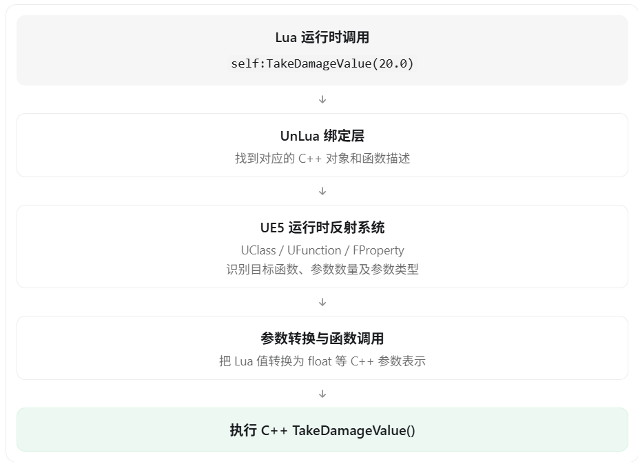

结合你之前的 UE5 客户端面试经历，以及刚才关于模板实例化、模板特化和 `if constexpr` 的讨论，我们可以把 **C++ 模板元编程（Template Metaprogramming，TMP）** 放到 UnLua 的实际通信流程中理解。

先明确一个核心观点：

**在 UnLua 中，模板元编程主要解决的是 C++ 与 Lua 之间的类型适配、参数转换、函数调用封装等问题；而 UE5 反射系统主要解决的是运行时如何找到并操作 C++ 中的类、属性和函数。**

UnLua 官方提供了通过 UE 反射动态导出类型，以及不依赖反射的静态导出方式。这两种方式都可以让 Lua 访问 C++ 功能，但底层实现路径有所不同。

## 一、为什么 Lua 和 UE5 通信需要模板元编程？

先来看最基础的需求。

假设 UE5 有三个函数：

```c++
void SetHealth(int32 Health);
void SetSpeed(float Speed);
void SetName(const FString& Name);
```

我们希望 Lua 能调用这些函数：

```lua
self:SetHealth(100)
self:SetSpeed(600.0)
self:SetName("Warrior")
```

这里存在一个问题：

**Lua 是动态类型语言，而 C++ 是静态类型语言。**

例如：

| C++ 类型           | Lua 中的表示                 |
| ------------------ | ---------------------------- |
| `int32`            | integer（整数）              |
| `float` / `double` | number（数值）               |
| `bool`             | boolean                      |
| `FString`          | string                       |
| `UObject*`         | 通常通过 userdata 等绑定表示 |
| `FVector`          | 通过 UnLua 导出的结构体表示  |

Lua 5.3/5.4 区分整数和浮点数；具体表示也会受到 Lua 版本和构建配置影响。

如果没有通用的类型转换机制，我们可能需要手动编写大量函数：

```
void PushInt(lua_State* L, int Value);
void PushFloat(lua_State* L, float Value);
void PushBool(lua_State* L, bool Value);
void PushString(lua_State* L, const FString& Value);
```

随着项目中的类型越来越多，还会出现 `FVector`、`FRotator`、`TArray`、`UObject*` 等各种需要处理的类型。

模板元编程就可以帮助我们解决这个问题：

**根据 C++ 类型，在编译期选择对应的参数转换实现，不需要为每种调用场景重复编写胶水代码。**

## 二、模板元编程的第一个应用：类型萃取 + if constexpr

例如，我们希望只提供一个通用接口：

```c++
PushToLua(L, 100);
PushToLua(L, 3.14f);
PushToLua(L, true);
```

虽然传入的数据类型不同，但接口名称完全一样。

我们可以这样设计一个简化版本：

```c++
#include <type_traits>
#include "lua.hpp"

template<typename T>
void PushToLua(lua_State* L, T Value)
{
    if constexpr (std::is_same_v<T, bool>)
    {
        lua_pushboolean(L, Value);
    }
    else if constexpr (std::is_integral_v<T>)
    {
        lua_pushinteger(L, Value);
    }
    else if constexpr (std::is_floating_point_v<T>)
    {
        lua_pushnumber(L, Value);
    }
}
```

这是教学示例，不是 UnLua 的实际源码。

### 编译器是如何处理的？

例如：

```c++
PushToLua(L, 100);   // T = int
PushToLua(L, 3.14f); // T = float
PushToLua(L, true);  // T = bool
```



比如 `T = int` 时，编译器可以得到类似下面的实例化结果：

```c++
void PushToLua(lua_State* L, int Value)
{
    lua_pushinteger(L, Value);
}
```

这正是你之前问的 `if constexpr` 的作用：

- 模板实例化时，`T` 已知。
- `std::is_integral_v<T>` 可以在编译期得到结果。
- `if constexpr` 保留适用的代码分支。

不过，**在编译期确定使用 `lua_pushinteger`，不代表整数 100 已经在编译期被压入 Lua 栈**。 真正的压栈操作依然发生在程序运行时。

这就是模板元编程在 Lua 绑定中的第一个价值：**编译期选择类型转换策略，运行期执行具体转换**。

## 三、模板元编程的第二个应用：可变参数模板

刚才的例子只能解决一个参数的转换，但在实际开发中，C++ 调用 Lua 函数时，参数的数量和类型可能都不同。

例如，Lua 中存在函数：

```lua
function UpdateCharacter(Health, Speed, Name)
    print(Health, Speed, Name)
end
```

我们希望 C++ 可以通过统一的接口调用它。

UnLua 官方文档提供了如下形式的 API：

```c++
template<typename... T>
FLuaRetValues Call(
    lua_State* L,
    const char* FuncName,
    T&&... Args
);
```

这里的 `typename... T` 就是**可变参数模板**，允许接收任意数量的模板参数。

为了理解原理，我们自己模拟其中的参数压栈操作：

```c++
template<typename... Args>
void PushArgs(lua_State* L, Args&&... args)
{
    (PushToLua(L, args), ...);
}
```

这里的：

```c++
(PushToLua(L, args), ...);
```

是 C++17 的**折叠表达式（Fold Expression）。**

假设调用：

```c++
PushArgs(L, 100, 600.0f, true);
```

编译器推导出三个参数的类型，并展开为类似：

```c++
PushToLua(L, 100);
PushToLua(L, 600.0f);
PushToLua(L, true);
```

因此，我们只需要实现统一的参数转换模板和可变参数模板，就能够支持不同数量、不同类型的参数。

要注意，这只是模拟压栈的核心原理。真正完成一次 C++ → Lua 函数调用，还需要获取 Lua 函数、处理调用栈、执行 Lua 函数以及处理返回值和错误等。

**这一部分体现了模板元编程的另一个重要价值：在编译期根据参数数量和类型，生成相应的函数调用代码**。

## 四、模板元编程的第三个应用：模板特化和类型萃取

这部分可以结合 UnLua 的真实源码来理解。

在 UnLua 的 `UnLuaTemplate.h` 文件中，有一个叫 `TType` 的模板，它能够根据 C++ 类型特征选择不同的类型信息处理方式。

其设计包含类似下面的结构：

```c++
// 简化示意，并非完整 UnLua 源码

template<typename T, bool IsUObject>
struct TType
{
    static const char* GetName()
    {
        // 处理结构体等类型
    }
};

// 针对 UObject 类型的偏特化
template<typename T>
struct TType<T, true>
{
    static const char* GetName()
    {
        // 处理 UObject 类型
    }
};
```

真实源码会使用 UE 的 `TPointerIsConvertibleFromTo`、`TDecay` 等类型工具判断 UObject 类型，并使用 `StaticClass()`、`StaticStruct()` 等接口获取相关信息。

这和你之前问的“为什么不用 `if constexpr`，而使用模板特化”正好对应。

例如：

```c++
TType<AActor, true>::GetName();
TType<FVector, false>::GetName();
```

这两种模板实例化，会在编译期选择不同的实现。

但需要特别注意：

**编译期确定的是选择哪种类型处理逻辑，不代表 `UClass` 或 `UScriptStruct` 对象本身一定在编译期生成或被访问。**

调用 `StaticClass()` 取得反射类型对象，依然涉及运行时的 UE 反射系统。

所以这里是编译期模板机制与运行期反射机制的结合。

## 五、反过来：Lua 调用 UE5 的 C++ 函数时，模板元编程如何参与？

这是更容易被面试官追问的部分。

假设你定义了一个 UE5 角色类：

```c++
UCLASS()
class AMyCharacter : public ACharacter
{
    GENERATED_BODY()

public:
    UFUNCTION(BlueprintCallable)
    void TakeDamageValue(float Damage);
};
```

在 Lua 中调用：

```lua
self:TakeDamageValue(20.0)
```

UnLua 可以通过 UE5 反射系统导出这样的函数，让 Lua 直接访问。

它的大致调用流程是：



这里有一个非常重要的区别：

假设 Lua 在运行时传入：

```lua
local x = 20.0
self:TakeDamageValue(x)
```

C++ 编译器不可能在编译期知道 Lua 变量 `x` 的实际值。

甚至如果 Lua 写的是：

```lua
self:TakeDamageValue("hello")
```

编译器也无法提前判断这段 Lua 代码传递的参数是否符合 C++ 函数要求。

因此绑定层需要在运行时进行必要的类型检查、参数转换与错误处理。

这也说明：

**模板元编程不能代替 UE5 的运行时反射。**

它们的分工是：

|                                       | 模板元编程             | UE5 反射                            |
| ------------------------------------- | ---------------------- | ----------------------------------- |
| 什么时候确定类型信息                  | C++ 模板实例化时       | 查询发生在运行时                    |
| 根据什么进行判断                      | 静态类型 T、类型特征   | UClass、UFunction、FProperty 等     |
| 主要解决什么问题                      | 生成类型适配和调用实现 | 动态查找类型、属性和函数            |
| 能否单独判断 Lua 运行时传入的动态类型 | 不能                   | 需要结合 Lua 运行时类型信息及绑定层 |

另外，UnLua 还支持静态导出非反射类和函数，例如通过 `BEGIN_EXPORT_CLASS`、`ADD_FUNCTION` 等宏注册接口。静态导出可以利用已知的 C++ 类型和模板技术构造调用适配器，不必对每个函数都通过 UFunction 查找

## 六、面试时可以怎么回答？

如果面试官问：“讲一下模板元编程，以及它在 UnLua 和 UE5 通信中的作用。”

建议这样回答：

> 模板元编程是 C++ 的一种编译期编程技术，主要利用模板特化、类型萃取和可变参数模板等机制，在编译阶段根据类型生成不同的代码。
>
> 在 UnLua 和 UE5 通信的过程中，它的一个重要应用就是类型适配和函数调用封装。
>
> 因为 Lua 是动态类型语言，而 C++ 是静态类型语言，两者相互调用时，需要完成参数类型转换。
>
> 比如 C++ 调用 Lua 时，可以利用模板特化或者 `if constexpr`，在编译期根据参数类型选择不同的转换逻辑；通过可变参数模板，还可以实现不同数量参数的统一传递。
>
> 而在 Lua 调用 C++ 时，UnLua 可以通过 UE5 的反射系统获取 UFunction、FProperty 等信息，动态确定需要调用的函数和参数类型，并完成转换与调用。
>
> 对于已经明确类型的静态导出接口，也可以使用模板生成相应的调用包装逻辑，减少重复代码。
>
> 所以我的理解是，模板元编程主要负责编译期的类型适配和代码生成，UE5 反射主要负责运行时的类型查询与动态调用，两者结合，实现了 Lua 和 UE5 之间比较灵活的交互。

最后，还要注意一个面试中容易出现的误区：模板元编程不等于所有调用都在编译期完成，也不代表使用模板就一定比反射快。 模板能够消除某些运行时类型分支，但 Lua 虚拟机调用、参数压栈、对象绑定和类型转换等工作仍然存在。

我建议你将这三个技术点联系起来理解：

模板特化负责针对不同 C++ 类型选择实现，可变参数模板负责适配不同参数列表，UE5 反射系统负责支持运行时动态查找和调用。

这三个知识点串起来，就基本能够应对面试官围绕 UnLua 底层通信机制提出的第一轮技术追问。