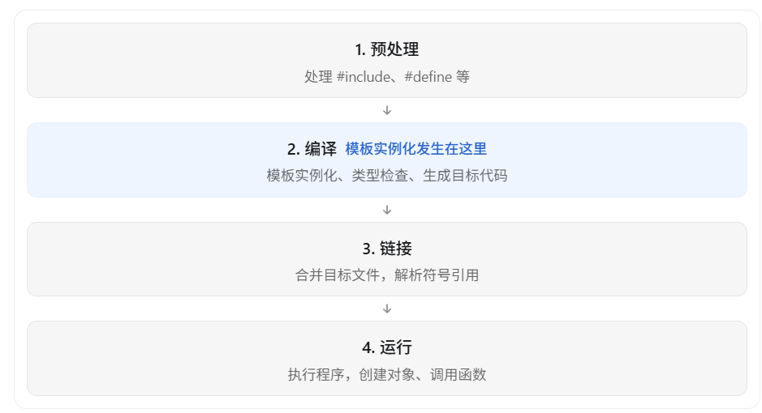

这里你混淆了两个概念：**模板实例化（Template Instantiation）和对象实例化（Object Instantiation）**。

它们虽然都叫“实例化”，但发生的阶段完全不同。

**C++ 模板实例化发生在编译期，而普通对象的创建通常发生在运行期。**

## 一、先理解 C++ 程序的执行流程

一个 C++ 程序从源代码到运行，大致经过：



其中，**模板实例化是编译器根据具体类型生成函数或类的具体版本的过程**，不需要等程序真正运行。

## 二、用具体代码理解

例如：

```c++
template<typename T>
void Print(T value)
{
    if constexpr (std::is_integral_v<T>)
    {
        cout << "整数" << endl;
    }
    else
    {
        cout << "非整数" << endl;
    }
}

int main()
{
    Print(10);
    Print(3.14);
}
```

### 1. 编译期发生了什么？

编译器看到：

```c++
Print(10);     // T = int
Print(3.14);   // T = double
```

便知道需要实例化两个具体版本的函数。

可以把编译器的处理结果理解为类似下面的代码：

```c++
void Print_int(int value)
{
    cout << "整数" << endl;
}

void Print_double(double value)
{
    cout << "非整数" << endl;
}

int main()
{
    Print_int(10);
    Print_double(3.14);
}
```

注意，这只是方便理解的示意，不是编译器实际生成的源代码。

这里 `if constexpr` 的分支已经在编译期完成选择，不需要在运行时再进行判断。

### 2. 运行期发生了什么？

当程序真正运行时，只需要执行：

```c++
Print_int(10);
Print_double(3.14);
```

运行时执行的是已经编译好的具体函数实现。

因此，模板实例化属于编译过程，函数调用和函数内部的实际操作则可以发生在运行时。

## 三、为什么会觉得实例化是在运行期？

很可能是因为你之前接触过这样的代码：

```c++
class Player
{
public:
    int HP = 100;
};

int main()
{
    Player p;
}
```

这里的 `Player p` 是创建一个对象，它与模板实例化并不是一回事。

| 对比     | 模板实例化                     | 对象实例化（对象创建） |
| -------- | ------------------------------ | ---------------------- |
| 含义     | 根据模板参数生成具体类型或函数 | 创建某个类型的对象     |
| 典型阶段 | 编译期                         | 通常为运行期           |
| 示例     | `Print<int>`                   | `Player p;`            |
| 结果     | 形成具体的类或函数实现         | 获得一个对象           |

严格来说，局部对象也可能参与编译期常量求值，但一般讨论普通程序执行时，对象创建属于运行过程。

## 四、模板实例化时，T 是否一定已知？

对于某次具体的模板实例化，答案是 一定已知。

而且，即使参数值是运行时才能确定的，也不影响模板参数类型在编译期确定。

例如：

```c++
int main()
{
    int n;
    cin >> n;

    Print(n);
}
```

虽然 `n` 的数值在运行时才知道，但编译器已经知道：

```
n 的类型是 int
```

因此它可以在编译期实例化：

```c++
Print<int>
```

并选择 `if constexpr` 的整数分支。

这里要区分：

- 变量的类型：C++ 编译期通常就能够确定。
- 变量的数值：可能只有运行时才能确定。

`if constexpr (std::is_integral_v<T>)` 判断的是类型，而不是变量的运行时数值。

## 五、最终总结

理解下面这三个阶段就可以了：

1. 模板定义：编译器看到 `template<typename T>`，此时 T 还没有具体类型。
2. 模板实例化（编译期）：根据调用处的类型确定 T，并对 `if constexpr` 进行分支选择。
3. 程序运行：调用已经生成的具体函数，不需要再判断 T 的类型。

所以你可以这样记忆：

模板实例化不是程序运行时创建对象，而是编译器在编译过程中，根据具体类型生成对应的代码。

这也是 C++ 模板元编程能够实现编译期计算和编译期类型选择的基础。

------

## 自己的总结

​	模板在编译期进行实例化的时候，他怎么知道自己要实例化哪个版本呢?

```c++
template<typename T>
void Print(T value)
{
    if constexpr (std::is_integral_v<T>)
    {
        cout << "整数" << endl;
    }
    else
    {
        cout << "非整数" << endl;
    }
}

int main()
{
    Print(10);
    Print(3.14);
}
```

答案是，代码里面用了什么版本，他就要实例化哪个版本。比如这里就实例化了int和double的版本

​	在编译期完成模板的实例化之后，这个函数模板其实就相当于变成了

```c++
void Print_int(int value)
{
    cout << "整数" << endl;
}

void Print_double(double value)
{
    cout << "非整数" << endl;
}

int main()
{
    Print_int(10);
    Print_double(3.14);
}
```

------

​	如果是print(a)呢？

对于一个变量a，他在声明的时候肯定是有类型的，比如int，所以直接获取他的类型就可以了