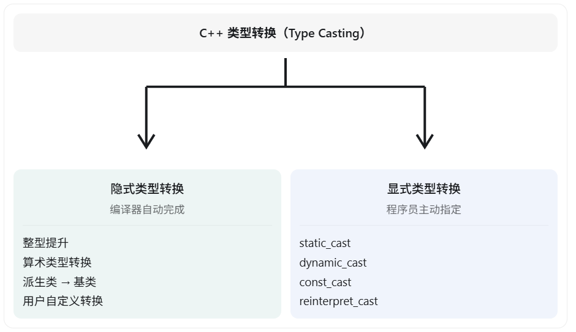
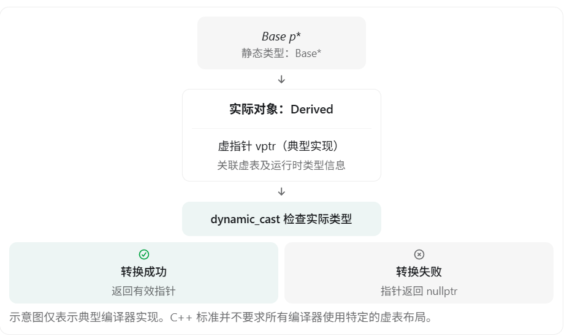

从 C++ 面试的角度来看，类型转换（Type Casting）是一个高频考点，尤其是在 C++ 基础、面向对象、多态和内存安全相关的面试中。

面试官通常不会只问“四种类型转换分别是什么”，还会进一步考察：

- 隐式类型转换和显式类型转换有什么区别？
- C++ 的四种强制类型转换分别有什么作用？
- `static_cast` 和 `dynamic_cast` 有什么区别？
- 为什么 `dynamic_cast` 通常要求基类是多态类型？
- `const_cast` 去掉 `const` 后是否可以修改对象？
- `reinterpret_cast` 为什么危险？
- `explicit` 关键字有什么作用？

下面按照 基础概念 → 四种类型转换 → 底层原理 → 常见面试题 的顺序介绍。

# 一、C++ 类型转换的分类

C++ 中的类型转换主要分成两大类：



## 1. 隐式类型转换

隐式类型转换是指编译器在满足语言规则的情况下，自动完成的类型转换，不需要程序员显式指定。

例如：

```c++
int a = 10;
double b = a;  // int -> double

double x = 3.14;
int y = x;     // double -> int，结果是 3

class Base {};
class Derived : public Base {};

Derived d;
Base* p = &d;  // Derived* -> Base*
```

常见的隐式转换包括：

| 转换类型       | 例子                   |
| -------------- | ---------------------- |
| 整型提升       | `char → int`           |
| 数值类型转换   | `int → double`         |
| 指针转换       | `T* → void*`           |
| 派生类转基类   | `Derived* → Base*`     |
| 用户自定义转换 | 转换构造函数、转换函数 |

需要注意：**隐式转换不一定安全，可能造成精度丢失、数据截断，甚至出现不符合预期的结果**。

例如：

```c++
int a = -1;
unsigned int b = 1;

std::cout << (a < b) << '\n';
```

在常见的 32 位 `int` 环境下，输出：

```
0
```

原因是 `a` 会被转换成无符号整数，对应的值通常是 `4294967295`，因此比较结果为 `false`。

这也是面试经常考察的 **有符号与无符号整数混合运算** 问题。

## 2. 显式类型转换

显式类型转换是程序员主动指定的类型转换。

C 语言风格的写法：

```c++
double a = 3.14;
int b = (int)a;
```

C++ 推荐的写法：

```c++
double a = 3.14;
int b = static_cast<int>(a);
```

C++ 提供了四种命名强制类型转换，可以更加明确地表达转换意图，并让编译器进行相应的合法性检查。

# 二、C++ 四种强制类型转换（重点）

这是面试中最重要的部分。

| 转换方式           | 主要作用                             | 运行时类型检查 |
| ------------------ | ------------------------------------ | -------------- |
| `static_cast`      | 常规类型转换、继承层次转换           | 无             |
| `dynamic_cast`     | 多态类型安全向下转换                 | 有             |
| `const_cast`       | 添加或移除底层 `const/volatile` 限定 | 无             |
| `reinterpret_cast` | 底层指针等重新解释                   | 无             |

## 1. static_cast：静态类型转换

`static_cast` 是最常用的 C++ 显式类型转换。

**特点：转换合法性主要在编译期检查，不进行运行时动态类型验证。**

### 使用场景一：基本数据类型转换

```c++
double a = 3.14;
int b = static_cast<int>(a);

std::cout << b;  // 3
```

`double` 转换为 `int` 时会截断小数部分，而不是四舍五入。

### 使用场景二：将 `void*` 转换成具体指针

```c++
int a = 10;

void* p = &a;

int* q = static_cast<int*>(p);

std::cout << *q;  // 10
```

这里 `p` 原本就指向一个 `int` 对象，因此转换和访问是有效的。

但如果 `p` 实际指向的是其他类型的对象，即使转换能编译通过，也不代表通过 `q` 访问是安全的。

> [!NOTE]
>
> new中就使用了静态类型转换将malloc返回的无类型指针转换为相应类型的指针

> [!NOTE]
>
> 无类型指针虽然可以指向任意类型的对象，但是无法使用取地址符*访问他，因为指针的值只是内存的起始地址，而编译器还需要知道对象的类型来得知对象占用了多大的内存

### 使用场景三：继承关系中的类型转换

这是高频面试场景。

```c++
class Base {
public:
    virtual ~Base() = default;
};

class Derived : public Base {
public:
    void func() {}
};

int main() {
    Derived d;

    // 向上转换：安全
    Base* p1 = static_cast<Base*>(&d);

    // 向下转换：编译通过
    Derived* p2 = static_cast<Derived*>(p1);

    p2->func();
}
```

这里：

- **向上转换（Upcasting）**：`Derived* → Base*`，对于可访问且无歧义的基类，通常是安全的，也通常不需要写 `static_cast`。
- **向下转换（Downcasting）**：`Base* → Derived*`，编译器不检查指针实际指向的动态类型。

例如：

```c++
Base b;

Base* p = &b;

Derived* d = static_cast<Derived*>(p);
```

这里 `static_cast` 可能通过编译，但 `p` 实际指向一个 `Base` 对象，而不是 `Derived` 对象。

**这种错误的向下转换会产生未定义行为（Undefined Behavior，UB）。**

### 面试总结

`static_cast` 适用于编译期可以确定转换关系的场景，但它不能保证向下转换时对象的真实类型正确。

## 2. dynamic_cast：动态类型转换

`dynamic_cast` 主要用于具有多态性质的继承体系中，进行安全的向下转换或交叉转换。

**与 `static_cast` 最大的区别：`dynamic_cast` 可以在运行时检查对象的实际类型。**

看代码：

```c++
#include <iostream>

class Base {
public:
    virtual ~Base() = default;
};

class Derived : public Base {
public:
    void func() {
        std::cout << "Derived\n";
    }
};

int main() {
    Base* p1 = new Derived();

    Derived* p2 = dynamic_cast<Derived*>(p1);

    if (p2 != nullptr) {
        p2->func();
    }

    delete p1;
}
```

输出：

```
Derived
```

因为 `p1` 实际指向的是 `Derived` 对象，所以转换成功。

再看另一种情况：

```
Base* p = new Base();

Derived* d = dynamic_cast<Derived*>(p);

if (d == nullptr) {
    std::cout << "转换失败\n";
}

delete p;
```

输出：

```
转换失败
```

`dynamic_cast` 检查出该对象不是 `Derived` 类型，因此返回 `nullptr`。

### 为什么 dynamic_cast 要求多态类型？

> [!NOTE]
>
> ​	多态类型，也就是包含虚函数的类型
>
> ​	如果不包含虚函数，使用dynamic_cast会报错，因为dynamic_cast无法判断p指向的到底是什么类型的对象

> [!NOTE]
>
> ​	dynamic_cast无法用于int*，void*之类的对象，**只能用于多态类**

对于常见的基类指针向派生类指针转换，基类必须是多态类型，也就是至少包含一个虚函数。

例如：

```c++
class Base {
public:
    virtual void func() {}
};
```

它可以通过虚函数机制支持运行时类型识别（RTTI）。



### dynamic_cast 转换失败会发生什么？

分为两种情况。

① 指针转换失败：返回 `nullptr`

```c++
Derived* d = dynamic_cast<Derived*>(p);
```

② 引用转换失败：抛出 `std::bad_cast` 异常

```c++
#include <typeinfo>

try {
    Derived& d = dynamic_cast<Derived&>(*p);
} catch (const std::bad_cast& e) {
    std::cout << e.what();
}
```

这道题面试非常喜欢问。

### static_cast 和 dynamic_cast 对比

| 维度      | static_cast           | dynamic_cast           |
| --------- | --------------------- | ---------------------- |
| 类型检查  | 编译期检查转换关系    | 运行时检查实际对象类型 |
| RTTI 依赖 | 不依赖                | 运行时检查依赖         |
| 向下转换  | 不验证真实对象类型    | 验证真实对象类型       |
| 转换失败  | 不安全转换可能导致 UB | 返回空指针或抛异常     |
| 性能      | 通常开销较低          | 运行时检查有额外开销   |

面试重点：`static_cast` 并不是不安全，而是它无法验证运行时动态类型；`dynamic_cast` 的优势就是提供运行时类型检查。

## 3. const_cast：去除或添加 const 属性

> [!NOTE]
>
> ​	const_cast不能用于对象

`const_cast` 主要用于添加或移除指针、引用指向类型上的 `const` 或 `volatile` 限定。

例如：

```c++
int a = 10;

const int* p = &a;

int* q = const_cast<int*>(p);

*q = 20;

std::cout << a;  // 20
```

这里是合法的。

因为：

- `a` 本身不是 `const` 对象。
- 只是通过 `const int*` 指向了它。
- 移除限定后修改的是原本可修改的对象。

但是下面的情况不同。

```c++
const int a = 10;

const int* p = &a;

int* q = const_cast<int*>(p);

*q = 20;  // 未定义行为
```

虽然 `const_cast` 可以去掉类型上的 `const`，但 `a` 本身就是一个真正的常量对象。

通过去除 `const` 限定的指针去修改原本的 `const` 对象，属于未定义行为。

### 面试总结

`const_cast` 只是改变访问对象所使用的类型限定，不能改变对象本身是否是 `const` 的事实。

## 4. reinterpret_cast：重新解释类型

`reinterpret_cast` 用于一些底层类型转换，例如不同对象指针类型之间的转换，以及指针和足够大的整数类型之间的转换。

例如：

```c++
int a = 100;

int* p = &a;

char* q = reinterpret_cast<char*>(p);
```

这里相当于用 `char*` 的视角访问 `a` 的对象表示。

注意：`reinterpret_cast` 通常不会修改对象内部的二进制数据，它主要改变程序如何解释一个地址或值。

再看：

```c++
int a = 10;

int* p = &a;

double* q = reinterpret_cast<double*>(p);
```

虽然这种转换本身可以通过编译，但是：

```c++
std::cout << *q;  // 未定义行为
```

因为实际对象是 `int`，并不是 `double`，通过 `double*` 访问会违反类型访问规则，也可能涉及对齐问题。

### reinterpret_cast 常见使用场景

- 底层内存操作。
- 与硬件、操作系统接口交互。
- 特定的序列化或二进制处理代码。
- 某些指针和整数表示之间的转换。

不过，以上用途都必须严格考虑类型别名、对象生命周期、对齐和平台依赖等问题。

如果真正想安全地获取一个对象的二进制表示，在 C++20 中可以考虑 `std::bit_cast`（满足相同大小、可平凡复制等条件时）。

```c++
#include <bit>
#include <cstdint>

float f = 1.0f;

// 在 float 和 uint32_t 均为 32 位的平台上
std::uint32_t bits = std::bit_cast<std::uint32_t>(f);
```

`std::bit_cast` 是按对象表示进行转换，与使用错误指针类型访问对象不是同一种操作。

### 面试总结

`reinterpret_cast` 是四种转换中底层特征最明显的一种，风险通常较高。它允许程序员表达某些底层转换，但不负责保证转换后的访问安全。

# 三、explicit 关键字与隐式类型转换（高频）

面试官还经常会问：

如何防止 C++ 中不希望发生的隐式类型转换？

答案是 `explicit` 关键字。

## 1. 转换构造函数

```c++
class A {
public:
    A(int x) {}
};

int main() {
    A a = 10;  // 允许隐式转换
}
```

这里发生了：

```c++
int -> A
```

编译器可以调用 `A(int)` 构造函数，创建一个 `A` 类型对象。

但有时这不是我们希望的行为。

## 2. 使用 explicit 禁止隐式转换

```c++
class A {
public:
    explicit A(int x) {}
};

int main() {
    A a = 10;  // 编译错误

    A b(10);   // 正确
    A c{10};   // 正确
}
```

原因是 `explicit` 阻止该构造函数被用于这种隐式转换（包括这里的拷贝初始化），但仍然允许直接初始化。

`explicit` 也能用于转换函数，例如：

```c++
class A {
public:
    explicit operator bool() const {
        return true;
    }
};

int main() {
    A a;

    if (a) {             // 正确
    }

    // bool b = a;       // 错误
    bool b(a);           // 正确
}
```

这里容易被问到：为什么 `explicit operator bool()` 还能用于 `if`？

因为 `if` 的条件属于特殊的 上下文布尔转换，允许使用显式的 `operator bool()`。

# 四、面试中的其他重要考点

## 1. 为什么推荐 static_cast，而不是 C 风格强制转换？

C 风格：

```c++
int a = (int)3.14;
```

C++ 风格：

```c++
int a = static_cast<int>(3.14);
```

主要原因不是 C++ 风格转换一定更安全，而是：

1. 意图明确：能区分常规转换、动态检查、修改 `const` 和底层重新解释。
2. 限制更明确：每种命名转换只允许特定范围内的操作。
3. 容易审查：代码中可以直接搜索 `reinterpret_cast` 等高风险操作。

C 风格强制转换可能尝试多种转换方式，容易掩盖危险转换。

## 2. 什么是窄化转换（Narrowing Conversion）？

窄化转换是指可能丢失数值范围、精度等信息的转换。

例如：

```c++
double a = 3.14;

int b = a;    // 允许，但丢失小数部分

int c{a};     // 编译错误：列表初始化禁止这种窄化
```

C++11 引入的花括号列表初始化，能够帮助阻止许多危险的窄化转换。

这是实际项目中非常有用的特性。

## 3. 指针转换与对象切片有什么区别？

看下面的代码：

```c++
class Base {
public:
    int a = 10;

    virtual void func() {}
};

class Derived : public Base {
public:
    int b = 20;
};

int main() {
    Derived d;

    Base* p = &d;

    Base obj = d;
}
```

其中：

```c++
Base* p = &d;
```

属于派生类指针向基类指针转换，不会复制对象，也不会产生对象切片。

但是：

```c++
Base obj = d;
```

会发生 对象切片（Object Slicing）。

原因是按值初始化 `Base` 对象时，只复制了派生对象中的基类子对象部分，`Derived` 特有的数据和对象身份不会被保留。

因此在面向对象设计中，如果需要多态行为，通常使用基类指针或引用，而不是按值传递基类对象。

# 六、面试时应该如何回答？（建议背诵）

如果面试官问：

“介绍一下 C++ 中的类型转换。”

可以按照下面的思路回答：

> C++ 的类型转换主要分为隐式类型转换和显式类型转换。
>
> 隐式类型转换由编译器自动完成，比如整数提升、数值转换以及派生类指针向基类指针的转换。但隐式转换可能造成精度丢失，因此需要注意窄化转换和有符号、无符号类型混用的问题。
>
> 显式类型转换主要有四种。
>
> 第一种是 `static_cast`，主要用于基本类型转换和继承体系中的类型转换，主要在编译期检查转换关系，但不进行运行时动态类型检查。
>
> 第二种是 `dynamic_cast`，主要用于多态继承体系中安全地向下转换，它可以利用 RTTI 在运行时检查对象的真实类型，指针转换失败返回 `nullptr`，引用转换失败抛出 `std::bad_cast`。
>
> 第三种是 `const_cast`，主要用来增加或移除 `const`、`volatile` 限定，但不能通过它安全地修改原本就是 `const` 的对象。
>
> 第四种是 `reinterpret_cast`，主要用于底层指针等转换，它不保证转换后的访问合法，使用时需要特别注意对象类型、内存对齐和类型别名规则。
>
> 此外，C++ 还提供 `explicit` 来限制用户自定义类型的隐式转换，以及列表初始化来避免部分窄化转换。
>
> 在实际开发中，我会优先避免不必要的强制转换，必要时使用对应的 C++ 命名转换，而不是 C 风格强制转换。

## 最后总结：面试需要记住的核心区别

static_cast

知道类型之间存在合法的转换关系，不需要运行时动态类型检查。

dynamic_cast

需要检查多态对象的真实类型，确保向下转换有效。

const_cast

改变类型的 const/volatile 限定，不改变对象本身的常量属性。

reinterpret_cast

用于底层重新解释，风险较高，不保证后续访问安全。

面试准备建议： 最应该深入掌握的是 `static_cast` 和 `dynamic_cast` 的区别，尤其是向上转换、向下转换、多态、虚函数、RTTI 以及转换失败后的行为。因为这一部分很容易从“类型转换”进一步延伸到 C++ 的虚函数表、多态实现、对象内存布局和未定义行为等更深入的知识点。