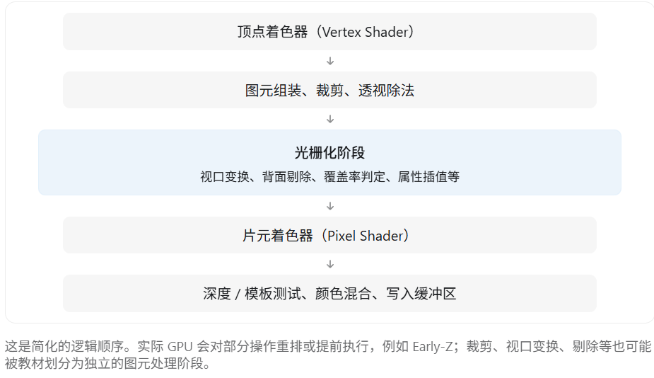
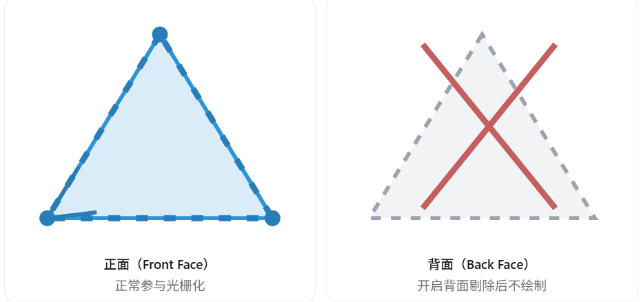
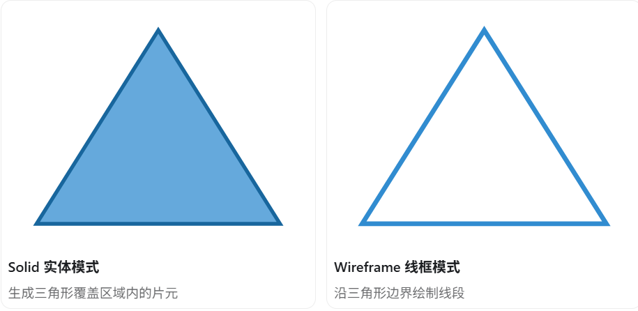
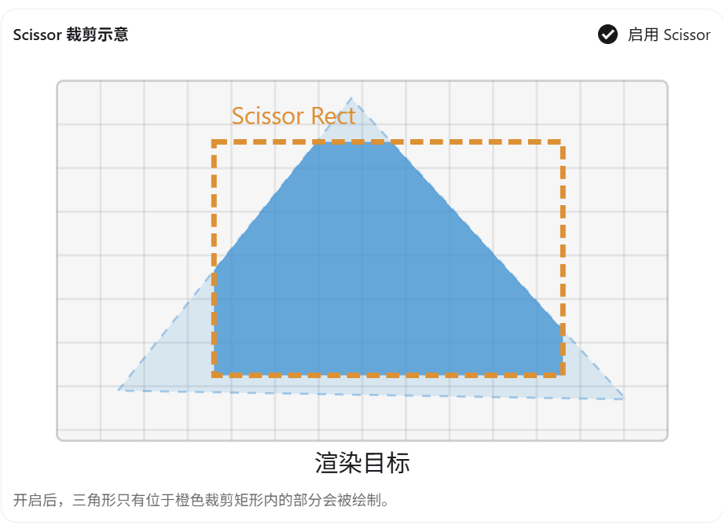
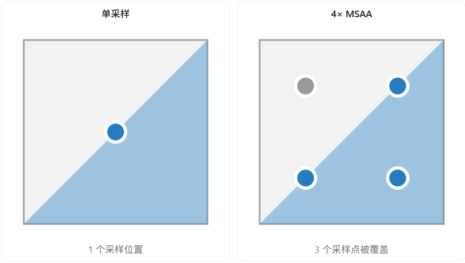
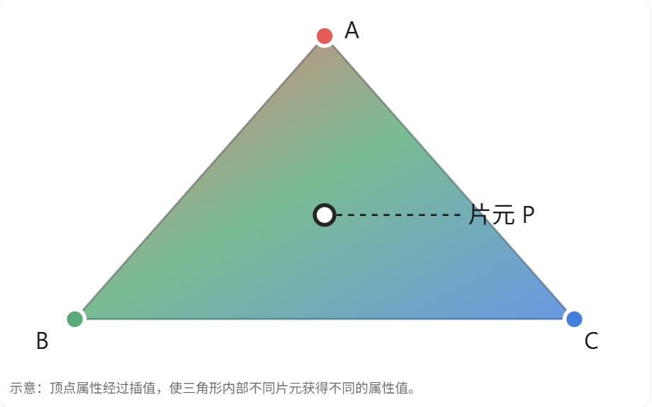
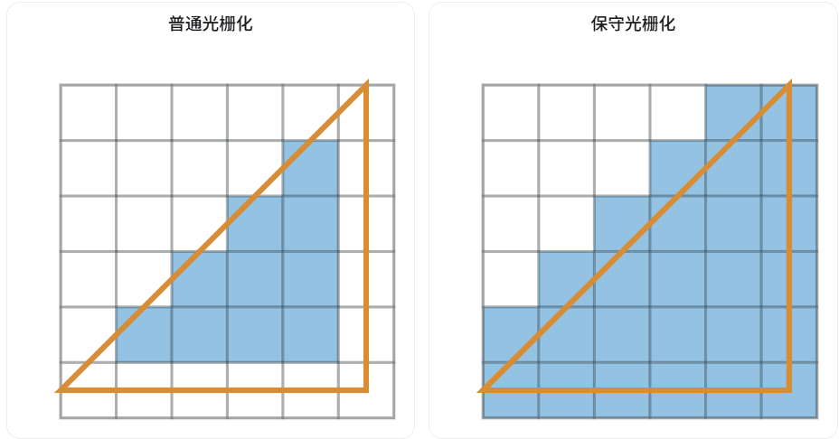

在光栅渲染管线中，**光栅化（Rasterization）的核心任务，是把屏幕空间中的三角形、线段等几何图元转换为片元（Fragment）**，并为后续片元着色器提供深度、纹理坐标、法线等插值数据。

虽然光栅化主要由 GPU 的固定功能硬件完成，但游戏引擎仍然可以通过图形 API 配置许多行为，例如：

- **背面剔除（Back-face Culling）**：决定哪些朝向的三角形不需要绘制。
- **填充模式（Fill Mode）**：选择实体填充还是线框绘制。
- **视口与裁剪矩形（Viewport / Scissor）**：控制渲染到屏幕的哪个区域。
- **多重采样（MSAA）**：控制像素内部的覆盖率采样。
- **深度偏移（Depth Bias）**：调整光栅化产生的深度值，缓解 Z-Fighting。
- **插值模式（Interpolation）**：控制顶点属性如何传递给片元。
- **保守光栅化（Conservative Rasterization）**：改变图元覆盖像素的判定规则。

这些控制项在 Direct3D 的 Rasterizer State 中都有相应的体现。

但要注意：**深度测试、模板测试、颜色混合、片元光照计算并不属于狭义的光栅化本身**，只是它们和光栅化在流水线中紧密相连。

下面结合图形学原理和 UE5 的实际应用逐个解释。

## 一、先明确光栅化处于什么位置



## 二、背面剔除（Back-face Culling）

这是非常常见的光栅化配置。

一个三角形在屏幕上的三个顶点存在特定的环绕顺序（Winding Order），通常可以根据顺时针或逆时针方向判断它是正面还是背面。



引擎通常有三种剔除模式：

| 模式       | 行为             |
| ---------- | ---------------- |
| Cull Back  | 剔除背面，最常见 |
| Cull Front | 剔除正面         |
| Cull None  | 两面都绘制       |

注意，**顺时针究竟代表正面还是背面，并不是固定不变的**，而是由图形 API、坐标约定和引擎配置共同决定。

实际应用中，封闭模型的内部背面通常不需要绘制，因此剔除这些三角形可以减少后续光栅化和着色工作。

例如在 UE5 中，把材质设置为 `Two Sided`，通常就会关闭该材质的背面剔除，从而使纸片、树叶、布料等双面可见。

不过 Two Sided 也可能增加需要处理的片元数量，因此不应对所有模型无差别开启。

## 三、填充模式（Fill Mode）

游戏引擎可以决定一个三角形如何被光栅化。

最常见的是：

- `Solid`：正常填充三角形内部。
- `Wireframe`：只绘制三角形的边。



线框模式在 UE5 中主要用于检查模型的三角形数量、拓扑结构、网格密度等。

尤其是排查模型面数过高、细分异常、LOD 切换问题时非常有用。

要注意，线框渲染不意味着三角形顶点不用处理。顶点着色器和图元组装等阶段通常仍然需要执行。

## 四、视口变换（Viewport）与剪裁矩形（Scissor）

这两个功能容易混淆。

### 1. Viewport：决定绘制到哪里

经过透视除法之后，顶点坐标位于 NDC（标准化设备坐标）中。

GPU 需要通过 Viewport Transform，把这些坐标映射到渲染目标的具体区域。

例如，可以只使用屏幕左半部分作为视口，绘制玩家一的摄像机画面；右半部分作为另一个视口，绘制玩家二的画面。

这也是分屏游戏中常见的处理方式。

### 2. Scissor：限制允许绘制的区域

Scissor 不会重新映射顶点坐标，而是规定：

**只有位于指定矩形内的片元才允许继续参与绘制，矩形外的部分被丢弃。**

下面可以直接开启或关闭 Scissor，观察区别：



实际应用包括 **UI 裁剪区域**、滚动列表、分屏渲染、特定局部区域绘制等。

> [!NOTE]
>
> 说白了就是虽然屏幕是那么大，但是也不是所有东西都能显示整个屏幕的，我们也要根据实际情况来限制某些东西的渲染区域

微软的 Direct3D 文档也将 Viewport 和 Scissor 归入光栅器阶段的配置。

## 五、多重采样（MSAA）

这一点正好与你之前学习的抗锯齿相关。

在普通光栅化过程中，可以近似理解为每个像素使用一个采样点判断三角形覆盖情况。

但开启 4× MSAA 后，每个像素可以使用 4 个采样点进行覆盖率判断。



光栅化阶段可以配合多采样配置完成：

- 判断图元覆盖了哪些采样点。
- 为被覆盖的采样点产生覆盖掩码（Coverage Mask）。
- 配合后续逐采样点的深度、模板测试。

默认的多采样方式通常不会对每个采样点分别执行完整的 Pixel Shader，这也是 MSAA 比 SSAA 更省资源的原因。

**需要区分：光栅化阶段负责覆盖率采样，而多采样颜色的最终合并（Resolve）属于后续处理。**

## 六、深度偏移（Depth Bias）

深度偏移是另一项重要的 Rasterizer State 配置。

假设两个三角形几乎处在相同的深度。

由于浮点数精度限制，GPU 很难稳定判断谁在前面，于是可能出现两个表面交替显示的问题。

这种现象称为 Z-Fighting（深度冲突）。

光栅化阶段可以根据配置，对生成的深度值添加一定偏移。

简化理解：

​							\[ z'=z+\text{Bias} \]

实际深度偏移通常还会考虑深度斜率等因素。

它的典型用途包括：

- **阴影贴图（Shadow Mapping）**：使用适当的偏移缓解 Shadow Acne（阴影痤疮）。
- Decal 或特殊叠加效果：在适用的渲染方案中避免近似共面的深度冲突。
- 对需要指定深度优先关系的几何体进行适当调整。

但要注意，Depth Bias 不是直接修改模型顶点的世界坐标，而是调整用于深度处理的值。

并且偏移过大还可能产生阴影悬浮（Peter Panning）等问题。

## 七、顶点属性插值（Interpolation）

这一点非常重要，因为它直接解释了**为什么顶点着色器只处理三个顶点，片元着色器却能获得每个片元自己的 UV 和法线。**

假设三角形的三个顶点分别携带不同的颜色。



假设内部某个位置 \(P\) 的重心坐标为：

​										\[ (\lambda_1,\lambda_2,\lambda_3) \]

满足：

​									\[ \lambda_1+\lambda_2+\lambda_3=1 \]

在普通线性插值的情况下，其属性可以表示为：

​								\[ A_P=\lambda_1A_1+\lambda_2A_2+\lambda_3A_3 \]

例如，如果三个顶点分别有自己的 UV，GPU 就能通过插值计算片元对应的 UV。

在实际透视投影中，UV 等属性通常需要进行**透视校正插值（Perspective-Correct Interpolation）**，而不是直接在屏幕空间简单线性插值。

游戏引擎还可以通过 Shader 指定不同的插值模式：

| 模式                   | 含义                                     |
| ---------------------- | ---------------------------------------- |
| Perspective            | 默认的透视校正插值                       |
| NoPerspective          | 不进行透视校正                           |
| Flat / NoInterpolation | 不进行插值，整个图元使用一个确定的属性值 |
| Centroid               | 在多重采样覆盖区域内选择合适的插值位置   |
| Sample                 | 按采样点位置进行插值                     |

不同图形 API 的命名和细节略有差异。

## 八、保守光栅化（Conservative Rasterization）

这是一种更高级的功能，不是所有 GPU 和图形 API 组合都支持。

普通光栅化通常根据采样点是否落入三角形来判断覆盖关系。

而一种常见的保守光栅化方式则是：

**只要三角形与像素区域存在交集，就尽量将该像素视为被覆盖。**



这种技术适合体素化（Voxelization）、某些碰撞或可见性计算，以及需要可靠地识别图元与像素区域重叠的场景。

它并不一定更快，主要目的是改变覆盖判定的保守性。

## 九、哪些操作不属于光栅化阶段？

这一点在面试中也非常容易考察。

| 操作                          | 所属阶段或位置                  |
| ----------------------------- | ------------------------------- |
| 视锥体剔除（Frustum Culling） | 通常在引擎 CPU/GPU 的更早阶段   |
| 顶点变换（MVP）               | 顶点着色器                      |
| 背面剔除                      | 图元处理 / 光栅器阶段           |
| 三角形覆盖率判定              | 光栅化                          |
| UV、法线插值                  | 光栅化 / 着色器输入插值         |
| 材质采样、光照计算            | 片元着色器或后续光照阶段        |
| 深度测试（Depth Test）        | 深度 / 模板测试阶段，可提前进行 |
| 颜色混合（Blending）          | 输出合并阶段                    |
| TAA、FXAA                     | 通常是后处理阶段                |

尤其要注意：

**背面剔除与深度测试是两回事。**

背面剔除主要根据三角形的朝向，判断是否要剔除整个图元。

深度测试则根据片元或采样点的深度与已有深度值进行比较，从而判断遮挡关系。

Early-Z 虽然可能在片元着色器之前进行，但不能因此就把深度测试简单归类为光栅化。

## 十、游戏引擎究竟怎么控制这些操作？

传统的硬件光栅化器大部分是固定功能硬件。游戏引擎通常不是直接编写一个 Shader 来重写光栅化算法，而是通过 DirectX、Vulkan 等 API 配置 Rasterizer State。

例如在 D3D11 中，可以使用：

```c++
D3D11_RASTERIZER_DESC desc = {};

desc.FillMode = D3D11_FILL_SOLID;
desc.CullMode = D3D11_CULL_BACK;
desc.FrontCounterClockwise = FALSE;

desc.DepthClipEnable = TRUE;
desc.ScissorEnable = TRUE;

desc.DepthBias = 0;
desc.SlopeScaledDepthBias = 0.0f;

desc.MultisampleEnable = TRUE;
```

然后创建并绑定对应的 Rasterizer State，让 GPU 按这些规则执行后续绘制命令。

这里的 `CullMode`、`FillMode` 等就是引擎可以提供的控制能力。MSAA 是否实际生效，还取决于渲染目标的采样数等其他配置。

对于 UE5，底层 RHI（Rendering Hardware Interface）会把引擎需要的渲染状态转换为具体图形 API 的配置。

## 十一、面试总结

如果面试官问：“游戏引擎可以对光栅化阶段做哪些控制？”

可以回答：

> 光栅化的核心工作是将几何图元转换为片元，游戏引擎主要通过设置光栅器状态来控制这个过程。
>
> 首先，可以配置背面剔除，根据三角形朝向决定是否需要绘制；也可以设置填充模式，在实体模式和线框模式之间切换。
>
> 其次，可以设置 Viewport 和 Scissor，决定几何体映射到屏幕上的位置，以及实际允许绘制的区域。
>
> 另外，还可以配置 MSAA 的多重采样行为，对三角形边缘进行更精确的覆盖率判断。
>
> 还有深度偏移，用来缓解 Z-Fighting，以及设置顶点属性的插值方式，让片元获得 UV、法线等数据。
>
> 对于部分 GPU，还可以使用保守光栅化，改变像素覆盖判定规则。
>
> 不过深度测试、颜色混合、光照计算严格来说不属于光栅化本身，而是由其他流水线阶段负责。

最值得记住的一点：光栅化器主要决定“哪些屏幕位置需要产生片元，以及这些片元携带什么信息”；片元着色器则主要负责“这些片元应该计算出什么颜色”。

这也是理解前向渲染、延迟渲染、MSAA 和 Early-Z 之间关系的基础。