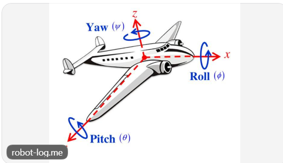
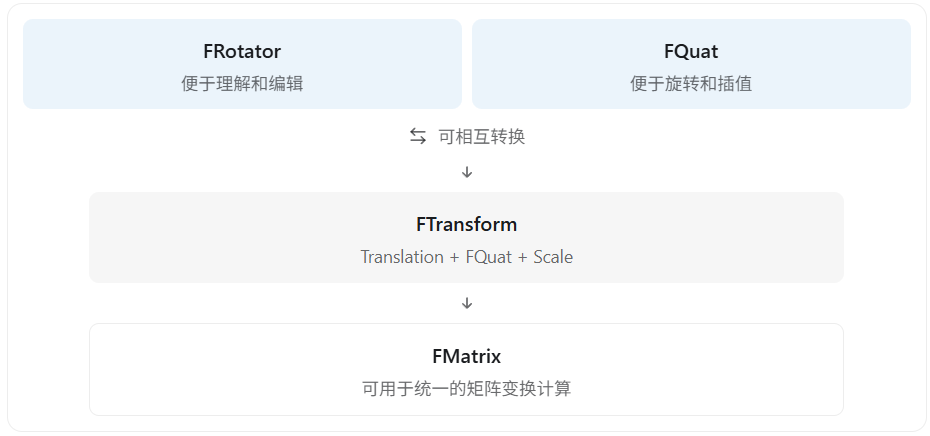

在计算机图形学和 UE5 中，**欧拉角（Euler Angles）、四元数（Quaternion）和齐次变换矩阵（Homogeneous Transformation Matrix）都是用于描述空间变换的数学工具，但它们并不是完全相同层次的概念。**

最重要的区别是：

- **欧拉角**：用三个角度描述物体的旋转，直观、方便编辑。
- **四元数**：用四个数描述物体的旋转，适合连续旋转、组合旋转和插值。
- **齐次变换矩阵**：通常用 4×4 矩阵统一表示旋转、平移、缩放等变换，适合直接变换顶点。

## 一、先看三者的核心区别

| 对比       | 欧拉角             | 四元数         | 4×4 齐次变换矩阵   |
| ---------- | ------------------ | -------------- | ------------------ |
| 数据数量   | 3 个角度           | 4 个数         | 16 个矩阵元素      |
| 表示旋转   | √                  | √              | √                  |
| 表示平移   | ×                  | ×              | √                  |
| 表示缩放   | ×                  | ×              | √                  |
| 万向节死锁 | 存在参数化奇异性   | 不存在         | 不存在             |
| 旋转插值   | 不太适合直接插值   | 非常适合       | 一般不直接插值矩阵 |
| 人类可读性 | 很好               | 较差           | 较差               |
| 常见用途   | 编辑器、摄像机控制 | 动画、角色旋转 | 顶点变换、渲染管线 |

这里讨论的是单位四元数表示旋转。普通四元数本身也可以用于其他数学计算。4×4 矩阵还可以表示剪切、投影等更一般的变换。

## 二、欧拉角：用三个角度描述旋转

欧拉角的思想非常简单：

**一个物体的朝向，可以通过依次绕三个指定的轴旋转来描述。**

例如游戏开发中经常使用：

- Yaw（偏航）：左右转头。
- Pitch（俯仰）：抬头、低头。
- Roll（横滚）：向左右倾斜。



在常见的数学约定中，可以把三个旋转记为：

​											\[ (\alpha,\beta,\gamma) \]

分别对应绕 X、Y、Z 轴的旋转角度。

假设使用右手坐标系、列向量，并约定先绕 X 轴、再绕 Y 轴、最后绕 Z 轴，那么总旋转矩阵为：

​									\[ R=R_z(\gamma)R_y(\beta)R_x(\alpha) \]

注意，**欧拉角的旋转顺序非常重要。**

比如先绕 X 轴转 90°，再绕 Y 轴转 90°，通常与先绕 Y 轴再绕 X 轴得到的结果不同。

因此，仅知道三个角度还不够，还需要知道旋转顺序以及旋转轴是局部轴还是世界轴。

### 欧拉角的最大问题：万向节死锁（Gimbal Lock）


想象物体安装在三个互相嵌套的旋转环中，每个环负责一个旋转轴。

当中间的旋转环转到特定角度时，最内层和最外层的旋转轴可能发生重合。

这意味着原本三个独立控制的角度中，有两个角度开始产生相同的旋转效果。

以 Z-Y-X 旋转顺序为例：

​							\[ R=R_z(\text{Yaw})R_y(\text{Pitch})R_x(\text{Roll}) \]

当：

​								\[ \text{Pitch}=90^\circ \]

总旋转就只依赖于 `Yaw - Roll`，而不能再独立区分这两个角度对最终朝向的贡献。

例如：

​							\[ ( Yaw=30^\circ,\ Pitch=90^\circ,\ Roll=10^\circ ) \]

和

​						\[ ( Yaw=20^\circ,\ Pitch=90^\circ,\ Roll=0^\circ ) \]

在上述旋转约定下，表示的是**完全相同的物体朝向**。

这就是欧拉角在该姿态下出现奇异性的体现。

需要注意：并不是物体真的失去了旋转能力，而是**欧拉角这种表示方式，在某些姿态下无法独立描述三个旋转方向的微小变化。**

## 三、四元数：用四个数描述三维旋转

四元数通常表示为：

​										\[ q=(x,y,z,w) \]

其中：

​									\[ q=xi+yj+zk+w \]

对于表示旋转的单位四元数，需要满足：

​									\[ x^2+y^2+z^2+w^2=1 \]

虽然它使用四个数，但是因为存在单位长度约束，实际上仍然只有三个独立自由度。

### 四元数怎么表示旋转？

可以通过一条旋转轴 \(\mathbf{n}\) 和一个旋转角度 \(\theta\) 构造单位四元数。

假设：

​									\[ \mathbf n=(n_x,n_y,n_z) \]

是单位向量，那么：

​						\[ \boxed{ q=\left( n_x\sin\frac{\theta}{2}, n_y\sin\frac{\theta}{2}, n_z\sin\frac{\theta}{2}, \cos\frac{\theta}{2} \right) } \]

例如，绕 Z 轴旋转 90°：

​								\[ \mathbf n=(0,0,1),\quad \theta=90^\circ \]

得到：

​							\[ q=(0,0,0.7071,0.7071) \]

它就描述了一个绕 Z 轴旋转 90° 的操作。

四元数不仅能表达绕一个固定轴的旋转，也可以通过四元数乘法组合任意三维旋转。

### 为什么四元数比欧拉角更适合游戏开发？

主要有三个原因：

1. **不存在欧拉角式的万向节死锁**

单位四元数能够连续表示三维旋转，不需要通过三个依次旋转的角度来描述姿态，因此没有欧拉角的那种参数化奇异性。

2. **适合旋转插值**

例如让一个角色从面向前方平滑地转向右后方。

欧拉角直接线性插值三个角度，得到的旋转路径不一定自然，甚至可能绕远路。

而单位四元数可以通过球面线性插值（SLERP）得到平滑的、沿最短旋转弧的结果（处理好四元数正负号时）。

​								\[ q(t)=\operatorname{Slerp}(q_0,q_1,t) \]

3. **适合组合旋转**

两个旋转可以通过四元数乘法组合：

​									\[ q=q_2q_1 \]

在常见的主动旋转约定下，这表示先应用 \(q_1\)，再应用 \(q_2\)。

相较于通过欧拉角反复组合旋转，四元数更方便维护和计算。

不过四元数也存在缺点：不够直观，而且使用时需要注意归一化和旋转乘法顺序。

## 四、齐次变换矩阵：统一描述空间变换

前面两种方法主要用于描述旋转，而齐次变换矩阵的功能更全面。

在三维图形学中，通常使用一个 4×4 矩阵描述物体的平移、旋转和缩放。

### 1. 为什么使用 4×4 矩阵？

普通的三维坐标是：

\[ P=\begin{bmatrix}x\\y\\z\end{bmatrix} \]

但是普通 3×3 线性变换矩阵无法直接表示平移。

因此，引入齐次坐标，为位置增加一个分量 \(w\)：

\[ P=\begin{bmatrix}x\\y\\z\\1\end{bmatrix} \]

此时，一个仿射变换矩阵可以写为：

\[ M= \begin{bmatrix} a_{11}&a_{12}&a_{13}&t_x\\ a_{21}&a_{22}&a_{23}&t_y\\ a_{31}&a_{32}&a_{33}&t_z\\ 0&0&0&1 \end{bmatrix} \]

其中：

- 左上角 3×3 部分可以包含旋转、缩放、剪切等线性变换。
- 最右侧的一列表示平移。
- 最后一行使这些变换能够统一使用齐次坐标计算。

因此：

\[ P'=MP \]

就可以得到变换后的位置。

### 2. 平移、旋转、缩放如何组合？

对于列向量约定，如果先缩放、再旋转、最后平移，可以写成：

\[ \boxed{M=T\cdot R\cdot S} \]

这里：

- \(T\)：平移矩阵
- \(R\)：旋转矩阵
- \(S\)：缩放矩阵

注意矩阵乘法的顺序不能随意交换。

例如一个点：

\[ P=(1,0,0) \]

先绕 Z 轴旋转 90°，再沿 X 轴平移 3：

\[ P\xrightarrow{\text{旋转}}(0,1,0) \]

\[ (0,1,0)\xrightarrow{\text{平移}}(3,1,0) \]

最终：

\[ P'=(3,1,0) \]

对应的齐次变换矩阵为：

\[ M= \begin{bmatrix} 0&-1&0&3\\ 1&0&0&0\\ 0&0&1&0\\ 0&0&0&1 \end{bmatrix} \]

计算：

\[ \begin{bmatrix} 0&-1&0&3\\ 1&0&0&0\\ 0&0&1&0\\ 0&0&0&1 \end{bmatrix} \begin{bmatrix}1\\0\\0\\1\end{bmatrix} = \begin{bmatrix}3\\1\\0\\1\end{bmatrix} \]

因此这种矩阵非常适合图形渲染中的坐标变换。

你之前学过的：

\[ P_{\text{clip}}=P_{\text{projection}}V M P_{\text{local}} \]

就是使用齐次矩阵，把模型空间坐标依次变换到世界空间、观察空间和裁剪空间。

而投影矩阵还可以采用更一般的 4×4 形式，不一定满足普通仿射矩阵最后一行为 \((0,0,0,1)\)。

## 六、为什么游戏引擎通常不会只选择其中一种？

因为它们各有优势，适合不同场景。

以 UE5 为例，最典型的三个类型是：

| UE5 类型   | 对应概念 | 主要用途                     |
| ---------- | -------- | ---------------------------- |
| `FRotator` | 欧拉角   | 编辑器调整旋转、输入角度     |
| `FQuat`    | 四元数   | 平滑旋转、动画插值、组合旋转 |
| `FMatrix`  | 矩阵     | 坐标变换、渲染计算           |

另外还有非常重要的 `FTransform`，它把平移、四元数旋转和缩放分别保存，而不是直接存储一个 4×4 矩阵。

例如：

```c++
// 1. 欧拉角：方便人为设置旋转
FRotator Rotator(0.f, 90.f, 0.f);

// 2. 转换为四元数
FQuat Quat = Rotator.Quaternion();

// 3. 创建空间变换
FTransform Transform;
Transform.SetRotation(Quat);
Transform.SetLocation(FVector(100, 0, 0));
Transform.SetScale3D(FVector(1, 1, 1));

// 4. 转换为矩阵
FMatrix Matrix = Transform.ToMatrixWithScale();

// 5. 四元数旋转插值
FQuat Result = FQuat::Slerp(
    FQuat::Identity,
    Quat,
    0.5f
);
```

可以理解为下面的关系：



这里还有三个容易被面试官追问的细节。

**第一，四元数会不会发生万向节死锁？**

四元数表示旋转时不会出现欧拉角式的万向节死锁。但是，如果把四元数转换为欧拉角再修改角度，就仍然可能遇到欧拉角的奇异性。

**第二，四元数的四个分量都是独立的吗？**

不是。单位四元数需要满足 \(x^2+y^2+z^2+w^2=1\)。而且 \(q\) 与 \(-q\) 表示完全相同的三维旋转。

**第三，四元数是不是完全可以替代变换矩阵？**

不能。普通单位四元数只表示旋转，不能单独表示平移、缩放或投影。完整的渲染管线仍然需要矩阵。

另外，UE5 的 `FRotator` 使用引擎自己的轴方向、角度正负和旋转顺序约定，与前面数学演示的右手坐标系约定不能直接混用。

## 七、游戏客户端面试回答

> 欧拉角、四元数和齐次变换矩阵都是用于描述空间变换的数学工具。
>
> 欧拉角用三个角度来描述旋转，比较直观，适合在编辑器里设置物体朝向，但是它依赖旋转顺序，并且存在万向节死锁问题。
>
> 四元数使用四个数来表示三维旋转，不存在欧拉角式的万向节死锁，而且适合组合旋转和旋转插值，因此游戏引擎经常使用四元数处理动画和角色旋转。
>
> 齐次变换矩阵通常使用 4×4 矩阵，不仅可以表示旋转，还可以统一处理平移、缩放等变换。矩阵乘法也方便把多个空间变换组合起来，因此非常适合图形渲染管线。
>
> 在 UE5 中，FRotator 对应欧拉角，FQuat 对应四元数，FMatrix 对应矩阵，而 FTransform 则把平移、四元数旋转和缩放组合在一起。
>
> 所以它们不是互相替代的关系，而是在不同场景下发挥各自的优势。

最后记住一个非常实用的选择原则：

需要人为设置角度，用欧拉角；需要连续旋转和插值，用四元数；需要对顶点进行完整的空间变换，用变换矩阵。

对于图形学面试，我建议下一步重点理解 “欧拉角为什么会发生万向节死锁，以及四元数为什么能避免这个问题”。这比单纯记住三者的优缺点更能体现对三维旋转的理解。