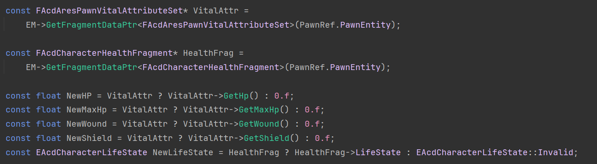
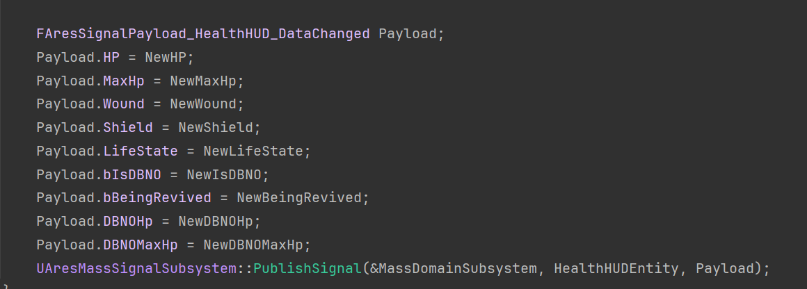
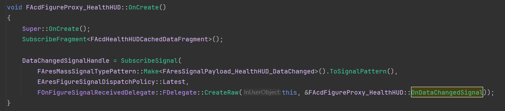
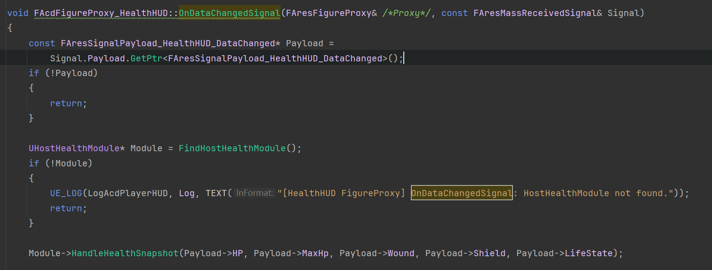
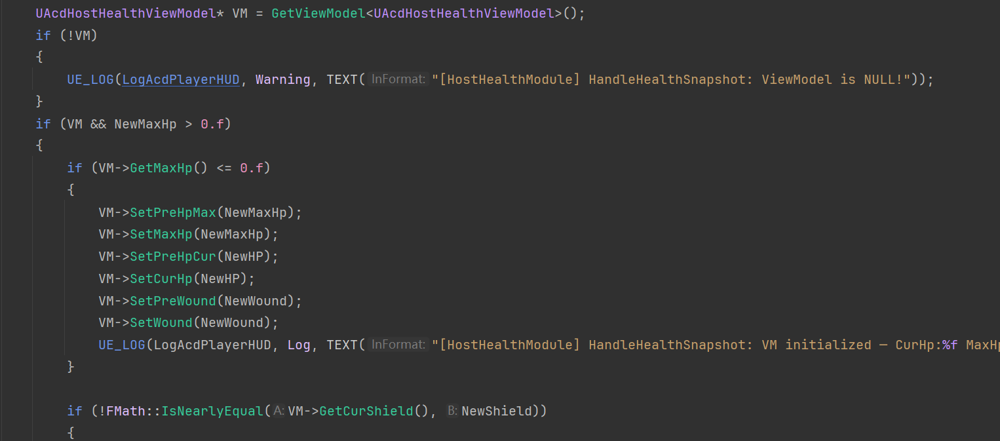
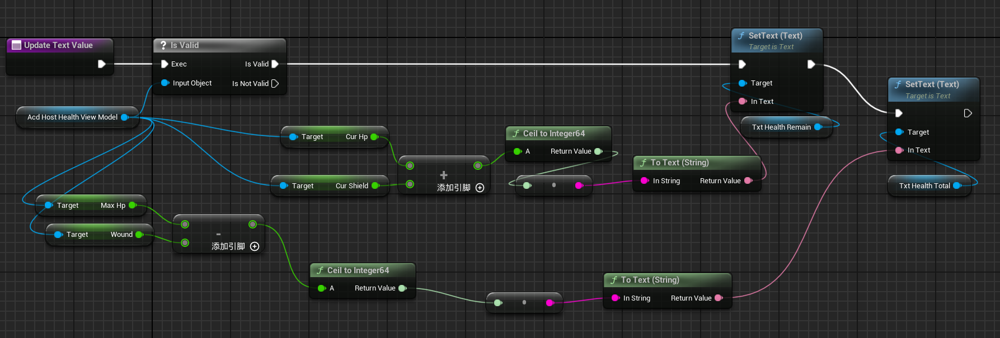

以**角色血条**的MaxHp绑定为例

1. ### `acdMassFeature_HealthHUD.cpp`每Tick获取Fragment中的数据并判断是否发生变化，如果变化则发送Signal

`FacdaresPawnVitalAttributeSet`是`acdaresAttributeSetFragment.h`中定义的，是Fragment

如果角色身上的Fragment数据发生了变化，就要发送Signal

`FaresSignalPayload_HealthHUD_DataChanged`是`acdHealthHUDFragments.h`中定义的，是FaresSignalPayload

1. ### `acdFigureTemplate_HealthHUD.cpp`，Proxy订阅Signal

`FacdFigureProxy_HealthHUD`在创建时会订阅Signal，并绑定回调函数`OnDataChangedSignal`

`OnDataChangedSignal`函数中获取Module并执行Module的`HandleHealthSnapshot`函数

Module获取ViewModule并且往ViewModule中写数据

ViewModule只存储数据，数据的写入只由Module管理，ViewModule的cpp文件都是空的

1. ### MVVM绑定调用蓝图函数

当`acdHostHealthViewModel`的MaxHp变量发生变化时，`OnMaxHpUpdate`就会被触发

从ViewModel中取出数据