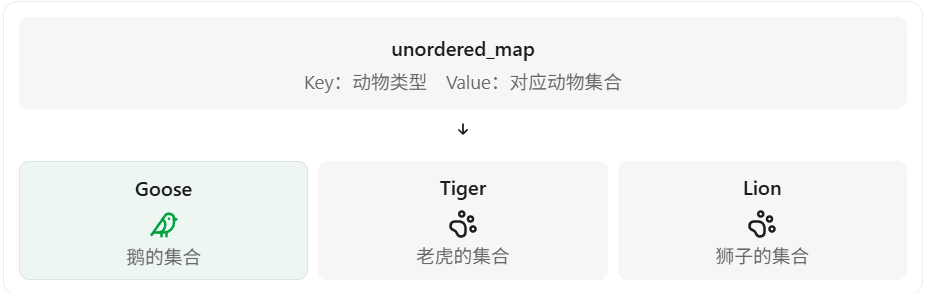
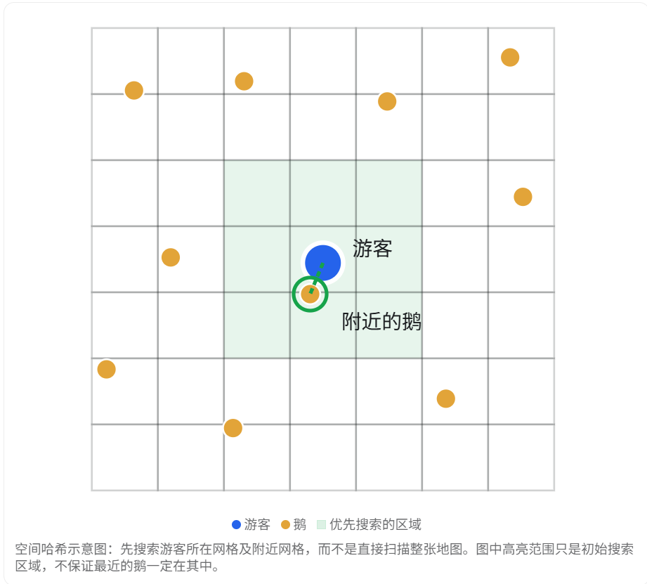

# 只需要找一只鹅

这道题如果出现在 C++ / UE5 游戏客户端技术面试中，我认为面试官主要想考察三个知识点：面向对象的多态、数据结构的选择，以及如何优化对象查找效率。

关键在于：动物园中的动物是怎么存储的？

## 一、最直接的方案：遍历 + 类型判断

假设所有动物都继承自 `Animal`，其中鹅对应 `Goose` 子类。

```c++
class Animal {
public:
    virtual ~Animal() = default;
};

class Goose : public Animal {};
class Tiger : public Animal {};
class Lion : public Animal {};
```

动物园使用一个数组保存所有动物：

```c++
vector<Animal*> animals;
```

那么可以遍历数组，通过 `dynamic_cast` 判断对象是否为鹅：

```c++
Goose* findGoose(const vector<Animal*>& animals) {
    for (Animal* animal : animals) {
        if (Goose* goose = dynamic_cast<Goose*>(animal)) {
            return goose;
        }
    }
    return nullptr;
}
```

这里利用了 C++ 的 RTTI（运行时类型识别）。

但是这个方案存在一个明显的问题：

时间复杂度是 O(n)。 如果动物园有几十万只动物，最坏情况下需要遍历整个数组。

而且 `dynamic_cast` 本身并不能优化查找复杂度，它只是用来判断对象类型。

## 二、更高效的方案：使用哈希表建立索引

如果动物园经常需要根据动物类型查找动物，可以提前按照类型分类存储。

例如：



C++ 实现：

```c++
enum class AnimalType {
    Goose,
    Tiger,
    Lion
};

unordered_map<AnimalType, vector<Animal*>> animalMap;
```

添加动物时：

```c++
animalMap[AnimalType::Goose].push_back(goose);
```

查找鹅：

```c++
Animal* findGoose() {
    auto it = animalMap.find(AnimalType::Goose);

    if (it == animalMap.end() || it->second.empty()) {
        return nullptr;
    }

    return it->second.front();
}
```

这样在哈希分布正常的情况下，**查找一只鹅的平均时间复杂度就是 O(1)。**

当然，代价是需要额外的内存维护索引，并在动物新增、移除时同步更新。

## 三、面试官可能真正想考察的是：你会不会根据需求选择数据结构

| 方案                      | 查找复杂度 | 适用场景             |
| ------------------------- | ---------- | -------------------- |
| 遍历数组 + `dynamic_cast` | O(n)       | 动物数量少、偶尔查找 |
| 按类型排序 + 二分查找     | O(log n)   | 数据基本不变         |
| `unordered_map` 类型索引  | 平均 O(1)  | 经常按动物类型查找   |
| 空间分区（四叉树、网格）  | 取决于分布 | 查找某个区域内的动物 |

注意最后一个方案。

如果面试官进一步要求：

> 现在不仅需要找到一只鹅，还需要找到距离玩家最近的一只鹅，该怎么办？

那么仅仅使用哈希表就不够了。

可以先通过哈希表找到所有鹅，再计算它们与玩家的距离。如果鹅数量非常多，就可以结合空间哈希、四叉树等空间数据结构加速最近邻查询。

## 四、结合 UE5，如何回答？

在 UE5 中，可以通过 `Cast<AGoose>(Actor)` 判断 Actor 是否为鹅类型，但它只是类型判断，不是快速检索算法。

如果需要频繁按类型查找，我会考虑在 `UWorldSubsystem` 中维护动物类型到 Actor 集合的映射，并在动物生成和销毁时维护索引。

如果项目使用 Mass 架构，则可以通过 Fragment 或 Tag 标记鹅，并利用 Mass 的实体查询机制筛选符合条件的实体。

------

# 需要找离游客最近的鹅

这道题相比上一道题，增加了一个关键条件：不仅要找到鹅，还要找到距离游客最近的那只鹅。

这是游戏客户端面试中很典型的**最近邻搜索（Nearest Neighbor Search）**问题，主要考察数组遍历、距离计算和空间数据结构。

## 一、最简单的方案：遍历所有鹅

如果我们已经使用 `unordered_map` 按动物类型分类，就可以先找到所有鹅，再遍历计算距离。

具体步骤：

1. 通过哈希表找到所有鹅。
2. 遍历这些鹅，计算它们与游客的距离平方。
3. 维护最小距离及其对应的鹅。
4. 遍历结束，返回最近的鹅。

在 UE5 中可以这样实现：

```c++
AGoose* FindNearestGoose(
    const FVector& VisitorPos,
    const TArray<AGoose*>& Geese)
{
    AGoose* Nearest = nullptr;
    double MinDistSq = TNumericLimits<double>::Max();

    for (AGoose* Goose : Geese)
    {
        if (!IsValid(Goose)) continue;

        double DistSq = FVector::DistSquared(
            VisitorPos,
            Goose->GetActorLocation()
        );

        if (DistSq < MinDistSq)
        {
            MinDistSq = DistSq;
            Nearest = Goose;
        }
    }

    return Nearest;
}
```

这里有一个面试加分点：

**为什么使用 `DistSquared`，而不是 `Dist`？**

因为计算欧氏距离需要开平方：

​					\[ d=\sqrt{(x_1-x_2)^2+(y_1-y_2)^2+(z_1-z_2)^2} \]

但我们只需要比较距离大小，不需要得到真实距离。

由于平方根函数是单调递增的，因此比较距离平方就足够了，可以省去开平方操作。

如果是俯视角二维地图，只考虑水平距离，还可以使用 `FVector::DistSquared2D()`。

**时间复杂度**： 假设动物总数为 \(n\)，其中鹅有 \(k\) 只。

- 不分类直接遍历：\(O(n)\)
- 通过哈希表找到鹅的集合，再遍历：平均 \(O(k)\)

## 二、如果动物园有十万只鹅，怎么优化？

这时候就可以引入空间数据结构，例如：

- 空间哈希（Spatial Hash）
- 四叉树（Quadtree）
- KD-Tree

对于游戏中大量移动的动物，我会优先考虑空间哈希网格。



> [!NOTE]
>
> 第一个九宫格里面只有一只鹅，不代表这只鹅就是最近的，因为九宫格不是一个圆，如果这个鹅在四个角落处，那距离游客的距离可能有根号二，而九宫格外面如果正好有一个鹅在游客的正上方，并且紧贴着九宫格的边界，那他的距离是要比根号二更短的，所以对于已经扫描到的最近的鹅，我们只能排除哪些最近距离也比这个更远的格子，而其他格子还是需要去搜索一次

> [!NOTE]
>
> 我怎么知道这些鹅在哪些格子里面？
>
> ​	空间哈希会提前把地图分块，并且提前存好所有鹅的位置

实现原理是：

首先将地图划分成固定大小的网格，并维护每个网格中的鹅。

游客要寻找最近的鹅时：

1. 根据游客坐标计算所在网格。
2. 优先搜索当前网格和附近网格中的鹅。
3. 维护当前找到的最小距离。
4. 如果还不能保证其他网格没有更近的鹅，就继续扩展搜索范围。

这里特别要注意：

**只搜索周围九宫格，并不能保证找到全局最近的鹅。**

要得到精确答案，必须继续检查尚未搜索区域到游客的最小可能距离。如果这些区域的最小可能距离都不小于已找到的距离，才能安全停止。

对于分布比较均匀的动物，这种方法通常能够显著减少实际遍历数量。但最坏情况下仍可能检查所有鹅。

## 三、面试时应该怎么选择方案？

| 场景                       | 推荐方案           |
| -------------------------- | ------------------ |
| 几十只鹅，偶尔查询         | 直接遍历           |
| 几万只鹅，很少查询         | 直接遍历也可能足够 |
| 几万只鹅，频繁查询         | 空间哈希、四叉树   |
| 鹅基本静止，频繁查询       | KD-Tree            |
| 鹅频繁移动，游客也频繁查询 | 动态更新的空间哈希 |

注意：空间索引本身存在维护成本。动物每次跨越网格，都可能需要更新所属网格，所以不是数量越多就一定越应该使用复杂的数据结构。

## 四、面试推荐口头回答

> 首先，我会通过动物类型索引获取所有鹅，然后遍历计算每只鹅与游客之间的距离，维护当前最小距离。
>
> 距离计算上可以使用距离平方，避免不必要的开平方运算。
>
> 如果鹅的数量为 k，那么查找的时间复杂度是 O(k)。
>
> 如果地图上有大量动物，而且每帧都需要进行最近邻查询，我会考虑使用空间哈希网格，把鹅按照位置划分到不同网格中。
>
> 查找时优先检查游客附近的网格，并根据当前最小距离判断是否需要继续扩大搜索范围，从而避免每次都遍历所有鹅。
>
> 对于 UE5 项目，如果这些动物频繁移动，我会优先考虑空间哈希，因为相较于需要维护空间层次结构的方案，它的动态位置更新通常更简单。