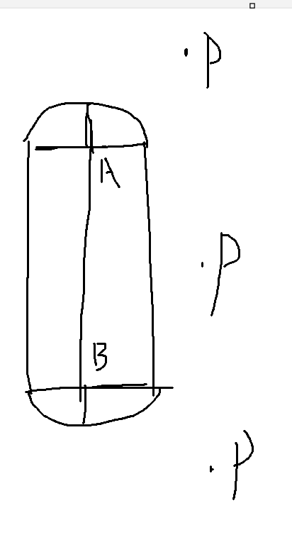
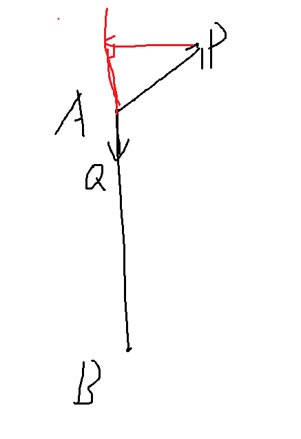
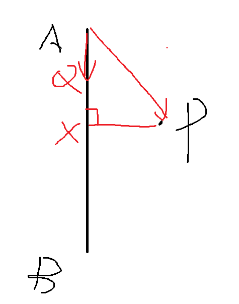
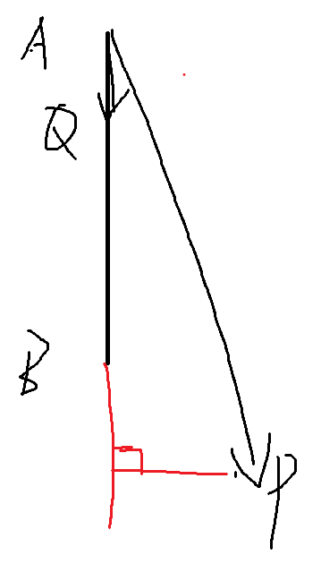

​	**首先，胶囊体是由一个半径为r的圆柱体和两个半径为r的半球组成**

我们取一个从A指向B的单位向量Q，然后求Q和AP的点乘

**第一种情况**

​	P不和圆柱体在同一平面内，也就是说P做AB的垂线，交点会在A的外面，此时P应该和上半球判断是否在里面，也就是求AP的距离，如果小于等于r，就是在上半球里面

**第二种情况**

​	P和圆柱体在同一平面内，此时P与AB的垂线，就是P距离圆柱体中心线的最短距离，只要这个距离小于等于r，就说明他在圆柱体内

**第三种情况**

​	P不和圆柱体在同一平面内，此时P与AB垂线的交点在B的外部，也就是说此时P应该判断和下半球的距离，如果PB的长度小于等于r，就说明他在下半球内

