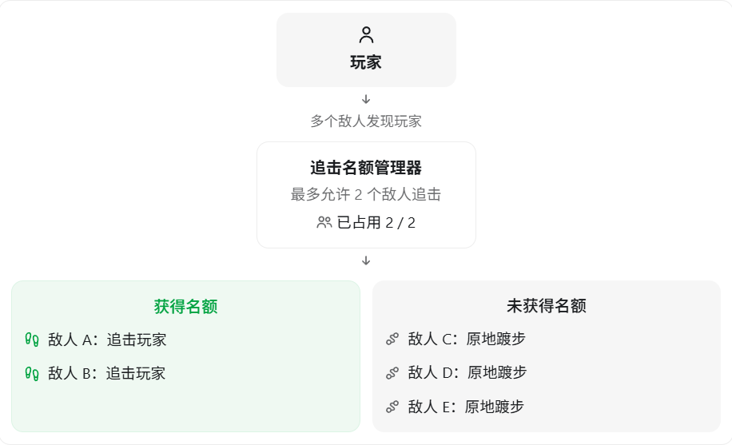

在 UE5 中，如果希望实现：

**场景中有多个敌人，但最多只有两个敌人可以同时追击玩家，其他敌人在原地附近踱步。当追击的敌人死亡或放弃追击后，其他敌人可以补上。**

我推荐采用 **行为树（Behavior Tree）+ 黑板（Blackboard）+ 全局追击管理器** 的方案。

核心思想是：**行为树决定每个敌人做什么，全局管理器决定哪些敌人有资格追击玩家。**

## 一、整体设计思路

假设场景中有 5 个敌人：



如果敌人 A 死亡：

1. 敌人 A 释放追击名额。
2. 全局管理器的已占用名额变成 1/2。
3. 等待中的敌人再次申请追击名额。
4. 例如敌人 C 申请成功，开始追击玩家。

这样就能保证同时追击玩家的敌人始终不超过两个。

## 二、行为树应该怎么设计？

建议使用以下行为树结构：

```
Root
 │
 └── Selector
      │   Service: UpdateChasePermission
      │
      ├── Sequence：追击玩家
      │    │
      │    ├── Decorator: HasChaseSlot == true
      │    ├── Decorator: TargetActor Is Set
      │    │
      │    └── Selector
      │         ├── 攻击玩家（在攻击范围内）
      │         └── Move To（TargetActor）
      │
      └── Sequence：原地踱步
           │
           ├── Task：获取出生点附近的随机位置
           ├── Move To（RandomLocation）
           └── Wait（随机等待一段时间）
```

这里使用了三个核心组件：

| 组件      | 作用                             |
| --------- | -------------------------------- |
| Service   | 定期检查是否能申请追击名额       |
| Decorator | 根据黑板状态决定是否进入追击分支 |
| Task      | 执行追击、攻击或者随机移动       |

Behavior Tree 中的 Service 可以在其所在分支运行期间周期性更新数据，Decorator 可以根据黑板值的变化中断正在执行的分支。

### 黑板需要保存什么？

创建一个 `BB_Enemy`，包含：

| Key            | 类型            | 作用             |
| -------------- | --------------- | ---------------- |
| TargetActor    | Object（Actor） | 当前追击目标     |
| HasChaseSlot   | Bool            | 是否获得追击名额 |
| HomeLocation   | Vector          | 敌人出生位置     |
| RandomLocation | Vector          | 踱步的目标位置   |

其中最重要的是 `HasChaseSlot`。

- `true`：允许进入追击分支。
- `false`：进入踱步分支。

**但一定要注意：黑板是每个 AI 自己的运行时数据，不是所有敌人共享一份黑板。**

因此，仅靠黑板不能控制全局最多两个敌人追击，必须另外实现一个共享管理器。

## 三、实现全局追击管理器

我推荐使用 `UWorldSubsystem` 来管理追击名额。

因为这个管理器只需要在当前游戏世界内共享，`UWorldSubsystem` 的生命周期也正好和 `UWorld` 对应。

### 1. 定义 ChaseSlotSubsystem

```c++
// ChaseSlotSubsystem.h

#pragma once

#include "CoreMinimal.h"
#include "AIController.h"
#include "Subsystems/WorldSubsystem.h"
#include "ChaseSlotSubsystem.generated.h"

UCLASS()
class UChaseSlotSubsystem : public UWorldSubsystem
{
    GENERATED_BODY()

public:
    bool TryAcquire(AAIController* Controller);
    void Release(AAIController* Controller);

private:
    void RemoveInvalidControllers();

    static constexpr int32 MaxChasers = 2;

    TSet<TWeakObjectPtr<AAIController>> Chasers;
};
```

这里使用 `TSet` 而不是简单的 `int32 ChaseCount`，是为了知道具体哪些 AI 占用了名额。

还使用了 `TWeakObjectPtr`，防止管理器仅仅因为保存 AI Controller 的引用而阻止其被 GC 回收。

### 2. 实现名额申请和释放

```c++
// ChaseSlotSubsystem.cpp

#include "ChaseSlotSubsystem.h"

void UChaseSlotSubsystem::RemoveInvalidControllers()
{
    for (auto It = Chasers.CreateIterator(); It; ++It)
    {
        if (!It->IsValid())
        {
            It.RemoveCurrent();
        }
    }
}

bool UChaseSlotSubsystem::TryAcquire(
    AAIController* Controller)
{
    if (!IsValid(Controller))
    {
        return false;
    }

    RemoveInvalidControllers();

    TWeakObjectPtr<AAIController> Key(Controller);

    // 已经有名额的敌人可以继续追击
    if (Chasers.Contains(Key))
    {
        return true;
    }

    // 名额已满
    if (Chasers.Num() >= MaxChasers)
    {
        return false;
    }

    Chasers.Add(Key);
    return true;
}

void UChaseSlotSubsystem::Release(
    AAIController* Controller)
{
    Chasers.Remove(
        TWeakObjectPtr<AAIController>(Controller)
    );
}
```

这里有一个重要的设计：`TryAcquire()` 是幂等的。

即同一个 AI 重复申请不会重复占用名额。这对于周期性执行的行为树 Service 很有用。

在常规 UE 游戏线程上执行申请和释放操作时，这种设计可以保证最多只分配两个名额。

## 四、行为树 Service 如何控制追击？

创建一个自定义 Service：

```
BTService_UpdateChasePermission
```

把它挂在前面行为树的顶层 Selector 上。

可以设置：

- Interval：0.3 秒。
- Random Deviation：0.1 秒。
- 开启 Call Tick on Search Start，让进入分支时可以及时执行检查。

Service 的逻辑可以写成：

```c++
// 以下是 Service 核心逻辑的示意代码

AAIController* AI = OwnerComp.GetAIOwner();

UBlackboardComponent* BB =
    OwnerComp.GetBlackboardComponent();

UChaseSlotSubsystem* Manager =
    AI->GetWorld()->GetSubsystem<UChaseSlotSubsystem>();

AActor* Target = Cast<AActor>(
    BB->GetValueAsObject(TEXT("TargetActor"))
);

bool bHasSlot = false;

if (IsValid(Target) && IsValid(AI->GetPawn()))
{
    bHasSlot = Manager->TryAcquire(AI);
}
else
{
    Manager->Release(AI);
}

BB->SetValueAsBool(
    TEXT("HasChaseSlot"),
    bHasSlot
);
```

这里假设 `TargetActor` 由 AI Perception 维护，并且在敌人放弃追击时会清空。如果希望敌人失去视野后仍短暂追击，还需要独立维护一个追击意图或视野状态。

### 配置 Decorator

在追击分支上添加 Blackboard Decorator：

```
Blackboard Key: HasChaseSlot
Key Query: Is Set
Observer Aborts: Both
```

`Observer Aborts = Both` 的作用是：

- 当 `HasChaseSlot` 从 `false` 变为 `true` 时，可以中断右侧低优先级的踱步分支，开始追击。
- 当 `HasChaseSlot` 从 `true` 变为 `false` 时，可以中断自己的追击分支，返回踱步行为。

这是 UE 行为树实现动态行为切换的重要机制。

## 五、原地踱步怎么实现？

创建一个 `BTTask_FindWanderLocation`。

具体步骤：

1. 敌人生成时，在黑板的 `HomeLocation` 中保存出生位置。
2. 调用 `UNavigationSystemV1::GetRandomReachablePointInRadius()`，在出生点附近寻找一个可到达的位置。
3. 将结果写入 `RandomLocation`。
4. 使用行为树内置 `Move To` 前往目标位置。
5. 等待 1～3 秒，然后重新选点。

例如将半径限制为 250～400 UE 单位，就能实现敌人在出生点附近小范围踱步的效果，而不会跑到很远的地方。

## 六、最容易出现的几个问题

### 1. 追击结束后没有释放名额

需要考虑以下情况：

- 敌人死亡。
- 敌人失去目标或停止追击。
- 敌人被销毁。
- AI Controller 停止控制 Pawn。
- 行为树停止运行。

尤其要注意：不能只在追击 Task 正常完成时释放名额。

因为追击任务可能被 Decorator 中断，也可能因为死亡而直接停止运行。

建议在管理追击状态的逻辑中主动释放名额，并在 AIController 的 `OnUnPossess()` 或适当的结束生命周期中兜底释放。

### 2. 不应该在 Move To 成功后立即释放名额

例如：

```
申请名额
   ↓
Move To Player
   ↓
释放名额
```

这其实有问题。

因为敌人靠近玩家以后，通常还会进入攻击状态。如果在 Move To 成功时释放名额，其他敌人就可能开始追击，导致玩家周围同时存在超过两个参与追击、攻击的敌人。

应该把名额绑定到整个追击/战斗状态，而不是某一次 Move To。

### 3. 如何保证其他敌人能补上？

目前的方案采用周期性申请机制。

假设 A、B、C、D 都发现了玩家：

| 时刻       | A    | B    | C        | D        |
| ---------- | ---- | ---- | -------- | -------- |
| 初始       | 追击 | 追击 | 踱步     | 踱步     |
| A 死亡     | 死亡 | 追击 | 等待申请 | 等待申请 |
| C 获得名额 | 死亡 | 追击 | 追击     | 踱步     |

这种方案实现简单，但是不能保证公平性。

如果还希望**距离玩家最近的敌人优先获得名额**，可以进一步修改管理器，维护一个等待队列，或者根据敌人到玩家的距离、仇恨值等计算优先级，再决定下一个追击者。

另外，如果是多人联机游戏，追击名额最好由服务端统一管理。假如每名玩家最多被两个敌人追击，则管理器需要按照玩家分别保存追击者集合。

## 七、面试时应该怎么回答？

> 我会通过行为树、黑板以及一个共享的追击管理器实现。
>
> 首先，在行为树中通过 Selector 分为追击分支和踱步分支，追击分支具有更高优先级。
>
> 然后通过一个 WorldSubsystem 统一管理追击名额，最多允许两个 AI Controller 占用名额。
>
> 每个敌人通过行为树的 Service 向管理器申请名额，并把申请结果写入自己的黑板。
>
> 追击分支通过 Blackboard Decorator 检查是否获得名额，同时设置 Observer Aborts 为 Both，从而在名额状态变化时动态切换行为。
>
> 没有获得名额的敌人就会执行低优先级的踱步分支，在出生位置附近随机寻点移动。
>
> 当追击的敌人死亡、失去目标或者退出战斗时，需要及时释放名额，使其他敌人可以加入追击。
>
> 另外，我会使用 TSet 保存追击者，而不是只记录追击人数，避免重复申请和重复释放导致计数错误。

**如果面试官继续追问，我认为最值得讨论的问题是：**

假设现在有 100 个敌人，但只能有 2 个追击玩家。你会选择让 100 个敌人每隔 0.3 秒调用一次 Service 申请名额，还是使用事件驱动的等待队列，在名额释放时主动通知下一个敌人？

这两个方案都能实现需求，但在性能、响应速度和可扩展性方面有不同的取舍。