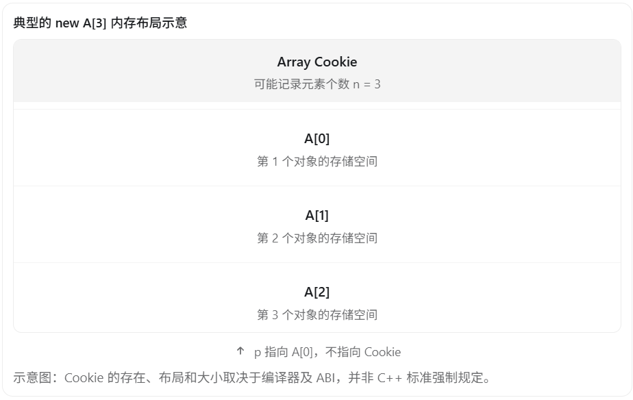

在 C++ 面试中，`delete` 和 `delete[]` 的区别是一个非常经典的高频考点，主要考察动态内存管理、析构函数调用、堆内存释放以及未定义行为。

核心区别：`delete` 用于释放 `new` 创建的单个对象，而 `delete[]` 用于释放 `new[]` 创建的对象数组。

## 一、delete 和 delete[] 的基本区别

| 对比项       | `delete`           | `delete[]`             |
| ------------ | ------------------ | ---------------------- |
| 配套使用     | `new`              | `new[]`                |
| 释放对象     | 单个对象           | 对象数组               |
| 析构函数调用 | 对单个对象调用一次 | 对每个数组元素调用一次 |
| 内存释放     | 调用对应的释放函数 | 调用对应的数组释放函数 |
| 错误混用     | 未定义行为         | 未定义行为             |

### 1. delete 释放单个对象

```c++
class A {
public:
    A() {
        cout << "构造函数" << endl;
    }

    ~A() {
        cout << "析构函数" << endl;
    }
};

int main() {
    A* p = new A;
    delete p;
}
```

输出：

```
构造函数
析构函数
```

`new A` 创建一个对象，`delete p` 会销毁该对象并释放对应内存。

### 2. delete[] 释放对象数组

```c++
int main() {
    A* p = new A[3];
    delete[] p;
}
```

输出：

```
构造函数
构造函数
构造函数
析构函数
析构函数
析构函数
```

其中，数组元素按照顺序构造，按照相反顺序析构。

## 二、为什么不能混用 delete 和 delete[]？

这是面试官经常追问的问题。

例如：

```c++
A* p = new A[3];

delete p;  // 错误！未定义行为
```

很多人会回答：

“因为 `delete` 只调用第一个对象的析构函数，而 `delete[]` 会调用所有对象的析构函数。”

这个说法不够准确。

按照 C++ 标准，`new[]` 分配的数组必须使用匹配的 `delete[]` 释放。使用 `delete` 会产生未定义行为（Undefined Behavior，UB）。

这意味着程序可能：

- 只执行部分析构操作。
- 发生内存泄漏。
- 触发堆内存管理错误。
- 直接崩溃。
- 表面上运行正常，但实际上存在隐患。

不能保证错误使用 `delete` 时一定只调用一次析构函数。

## 三、底层原理：delete[] 怎么知道数组有多少个元素？

这是这道题最有价值的深入考点。

考虑下面的代码：

```c++
A* p = new A[3];
delete[] p;
```

`delete[]` 必须正确销毁三个对象，那么它怎么知道数组长度是 3 呢？

在很多编译器实现中，对于需要析构的对象数组，运行时会在分配的内存中额外保存数组元素个数，这部分元信息通常称为 **Array Cookie（数组 Cookie）。**



执行 `delete[] p` 时，在采用这种实现方式的编译器上，通常会：

1. 获取数组元素数量。
2. 按照逆序调用每个元素的析构函数。
3. 调用匹配的数组内存释放函数，释放整个分配块。

而 `delete p` 走的是单对象销毁与释放流程，无法正确匹配数组的分配方式。

需要特别注意：**并不是所有 `new[]` 都一定需要 Array Cookie**。例如，对不需要非平凡析构的类型，编译器可能不保存元素个数。

## 四、面试陷阱：基本数据类型使用错了会怎么样？

```c++
int* p = new int[10];

delete p;  // 仍然是未定义行为
```

有些人认为：

“`int` 没有析构函数，因此使用 `delete` 也没关系。”

这是错误的。

虽然 `int` 没有用户定义的析构函数，但 `new[]` 与 `delete` 仍然不匹配。即使某个编译器上代码看起来能正常运行，也不代表这种写法合法。

正确写法：

```c++
int* p = new int[10];

delete[] p;
```

## 五、延伸面试题：delete nullptr 是否安全？

答案是：安全。

```
int* p = nullptr;

delete p;     // 合法
delete[] p;   // 合法
```

对空指针执行这两种删除表达式都是合法的，不会因为指针为空而触发未定义行为。

但要注意：

```c++
int* p = new int(10);

delete p;
delete p;  // 未定义行为：重复释放
```

`delete` 并不会自动将指针置为 `nullptr`。

因此手动管理裸指针时，释放后可以写：

```c++
delete p;
p = nullptr;
```

不过，这只能避免再次通过同一个指针变量误释放，无法解决其他悬空指针的问题。

## 六、实际开发中推荐怎么做？

现代 C++ 更推荐使用 RAII 和智能指针管理资源。

对于单个对象：

```c++
#include <memory>

auto p = std::make_unique<A>();
```

对于对象数组：

```c++
#include <memory>

auto p = std::make_unique<A[]>(3);
```

或者直接使用：

```c++
#include <vector>

std::vector<A> objects(3);
```

这样可以在对象生命周期结束时自动执行正确的销毁和释放操作，避免手动匹配 `new/delete`。

## 七、面试标准回答（建议背诵）

> `delete` 和 `delete[]` 的主要区别在于释放对象的数量和析构函数的调用方式。
>
> `delete` 用于释放 `new` 创建的单个对象，会调用该对象的析构函数，然后释放对应内存。
>
> `delete[]` 用于释放 `new[]` 创建的对象数组，会按照与构造顺序相反的顺序，逐个调用数组元素的析构函数，然后释放整个数组所占用的内存。
>
> 从底层实现来看，某些编译器会通过 Array Cookie 记录数组的元素数量，以便 `delete[]` 正确调用析构函数，但这种实现不是标准强制要求的。
>
> `new` 必须和 `delete` 配对，`new[]` 必须和 `delete[]` 配对，否则会产生未定义行为。即使数组元素是 `int` 这样的基本类型，也不能混用。
>
> 实际开发中，我会优先使用 `std::vector` 或 `std::unique_ptr` 等 RAII 工具来管理内存，减少手动释放引起的问题。

记住三个核心考点：

1. 配对原则：`new → delete`，`new[] → delete[]`。
2. 析构区别：单对象析构一次，数组元素逐个逆序析构。
3. 底层原理：`delete[]` 需要正确处理整个数组，某些实现会借助 Array Cookie，混用属于未定义行为。

面试官还可能沿着这个问题继续追问：`new/delete` 和 `malloc/free` 有什么区别？为什么 `malloc` 不会调用构造函数，而 `new` 会？ 这是 C++ 内存管理中另一道非常高频的面试题。