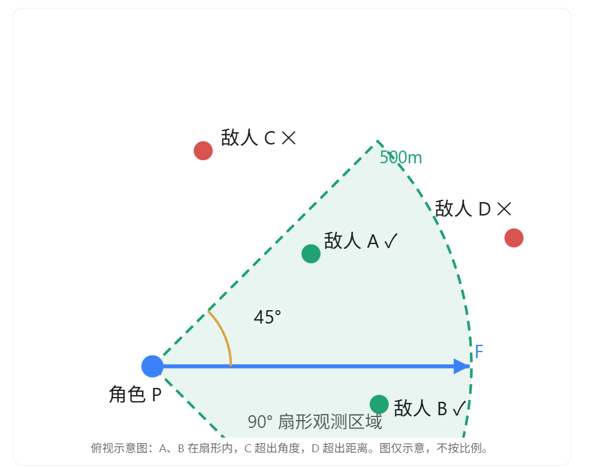

这是一道典型的游戏客户端开发中的空间几何判断题，主要考察向量、点积和距离计算。

核心思路是：**先判断敌人是否在半径 500m 内，再利用向量点积判断敌人是否处于角色前方 ±45° 的范围内。**

## 一、判断思路

假设：

- 角色位置为 \(P\)
- 角色正前方的单位方向向量为 \(F\)
- 敌人位置为 \(E\)
- 观测半径为 \(R=500m\)
- 扇形总角度为 90°，即左右各 45°



### 第一步：判断距离

计算角色指向敌人的向量：

\[ D=E-P \]

然后判断：

\[ |D|^2\leq R^2 \]

为了优化性能，**可以直接比较距离的平方**，避免调用 `sqrt` 开平方。

如果敌人距离超过 500m，就直接排除，不需要继续计算角度。

### 第二步：利用点积判断角度

向量点积公式：

\[ F\cdot D=|F||D|\cos\theta \]

由于 \(F\) 是单位向量，因此：

\[ \cos\theta=\frac{F\cdot D}{|D|} \]

扇形的总角度是 90°，所以敌人与角色正前方的夹角应该满足：

\[ \theta\leq45^\circ \]

等价于：

\[ \boxed{\frac{F\cdot D}{|D|}\geq\cos45^\circ} \]

而：

\[ \cos45^\circ\approx0.7071 \]

因此，当两个条件都成立时，就可以认定敌人在观测范围内：

1. 距离不超过 500m。
2. 方向夹角的余弦值大于等于 0.7071。

角色和敌人重合时，方向向量长度为 0，需要单独处理，一般可以直接认为在范围内。

## 二、UE5 中怎么实现？

如果是 UE5 项目，可以使用 `FVector` 进行计算。

假设观测范围是水平面上的扇形，即不考虑敌人的高度差。

```
bool IsEnemyInSector(
    const FVector& PlayerPos,
    const FVector& Forward,
    const FVector& EnemyPos)
{
    // UE 默认长度单位是厘米：500m = 50000cm
    const float Radius = 50000.f;
    const float CosHalfAngle = 0.70710678f;

    // 计算角色指向敌人的向量
    FVector Dir = EnemyPos - PlayerPos;
    Dir.Z = 0.f;

    // 第一步：距离判断
    float DistSq = Dir.SizeSquared2D();

    if (DistSq > Radius * Radius) {
        return false;
    }

    if (DistSq <= KINDA_SMALL_NUMBER) {
        return true;
    }

    // 第二步：角度判断
    FVector Forward2D = Forward.GetSafeNormal2D();
    FVector DirNormal = Dir.GetSafeNormal2D();

    float Dot = FVector::DotProduct(Forward2D, DirNormal);

    return Dot >= CosHalfAngle;
}
```

这里注意，点积判断只需要判断是否大于 0.7071，不需要真的通过 `acos` 反算角度，可以减少不必要的计算。

如果题目要求的是三维空间中的圆锥形范围，而不是水平面上的扇形，只需要改成使用完整的三维向量进行判断。

## 三、如果敌人数量非常多，怎么优化？

如果场景里存在数万甚至更多敌人，每次检测都遍历全部敌人，虽然单次判断是 O(1)，但总体仍然是 O(n)。

可以采用两级筛选：


例如在 UE5 中，可以先通过球形碰撞查询获得半径内的候选敌人，再逐个判断角度。

需要注意，球形查询是三维距离筛选。如果要求的是忽略高度的水平扇形，应保证粗筛不会错误排除目标，或者使用适当的二维空间索引。

另外，如果角色的观测还要求不能被墙壁遮挡，那么在上述筛选之后，可以进一步使用 `LineTrace` 进行可见性检测。

## 四、面试时的口头回答

> 我会使用向量点积配合距离判断来解决这个问题。
>
> 首先获取角色的位置和正前方方向向量，再遍历敌人，计算角色指向敌人的方向向量。
>
> 第一步判断敌人与角色之间的距离是否小于 500m。这里可以直接比较距离平方，避免开平方运算。
>
> 第二步判断角度，因为观测范围是前方 90°，所以敌人的方向与角色正前方的夹角不能超过 45°。
>
> 我会把两个方向向量归一化后计算点积。如果点积大于等于 cos45°，也就是约 0.7071，就说明敌人在扇形角度内。
>
> 两个条件都满足，就可以判定敌人在观测范围内。
>
> 如果敌人数量很多，我还会使用空间划分或者碰撞查询，先筛选附近的敌人，然后再进行点积判断，避免每次都遍历场景里的所有敌人。

面试加分点： 还可以继续优化第二步的计算。在已知正前方为单位向量的情况下，先保证 \(F\cdot D\geq0\)，再判断

\[ (F\cdot D)^2\geq |D|^2\cos^2 45^\circ \]

这样既不用归一化敌人方向向量，也不用开平方，能够进一步降低每个敌人的检测开销。