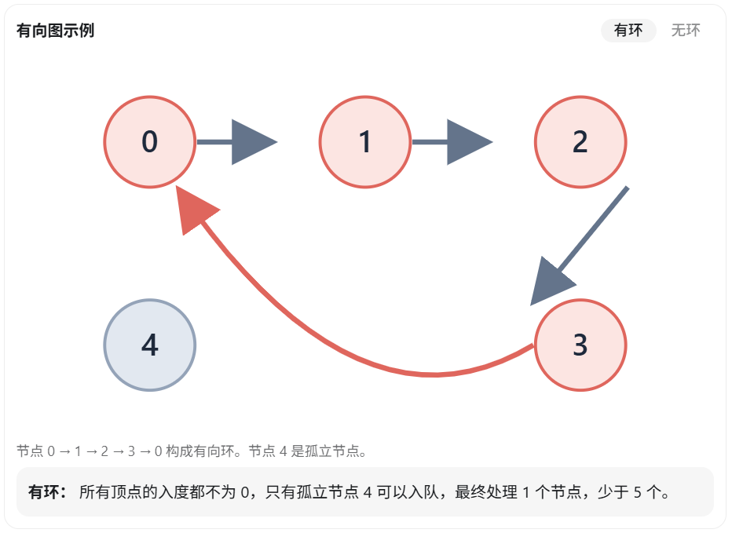

#### 拓扑排序

​	有向图有一个性质：**一个有向图不存在环，==当且仅当==它可以进行完整的拓扑排序。**

判断一个有向图是否存在环，是经典的图论算法题，也是 C++ 算法面试中的常见题目。

主要有两种解法：

1. 拓扑排序（BFS + 入度统计）：推荐，思路简单，不容易出错。
2. DFS + 三色标记法：通过搜索过程中是否遇到正在访问的节点来判断是否有环。

两种方法的时间复杂度都是 \(O(V+E)\)，其中 \(V\) 是顶点数，\(E\) 是边数。

## 一、方法一：拓扑排序（推荐）

### 1. 核心原理

**一个有向图不存在环，当且仅当它可以进行完整的拓扑排序。**

拓扑排序的过程：

- 统计每个顶点的入度（有多少条边指向它）。
- 将所有入度为 0 的顶点加入队列。
- 每次取出一个顶点，删除它发出的所有边（将相邻顶点的入度减 1）。
- 如果某个顶点的入度变成 0，就将它加入队列。

最后：

- 如果所有顶点都被处理，说明无环。
- 如果还有顶点没有被处理，说明有环。

### 2. 图解



### 3. C++ 核心模式代码

假设输入：

- `n`：顶点数量，编号为 `0 ~ n-1`
- `edges`：有向边数组，`edges[i] = {u, v}` 表示 `u → v`

```c++
class Solution {
public:
    bool hasCycle(int n, vector<vector<int>>& edges) {
        vector<vector<int>> graph(n);
        vector<int> indegree(n, 0);

        // 构造邻接表，统计入度
        for (auto& e : edges) {
            int u = e[0], v = e[1];
            graph[u].push_back(v);
            indegree[v]++;
        }

        queue<int> q;

        // 所有入度为0的节点入队
        for (int i = 0; i < n; i++) {
            if (indegree[i] == 0) {
                q.push(i);
            }
        }

        int count = 0;

        while (!q.empty()) {
            int u = q.front();
            q.pop();
            count++;

            for (int v : graph[u]) {
                indegree[v]--;

                if (indegree[v] == 0) {
                    q.push(v);
                }
            }
        }

        // 没能处理所有节点，说明存在环
        return count != n;
    }
};
```

复杂度分析：

- 时间复杂度：\(O(V+E)\)，每个顶点最多入队一次，每条边最多遍历一次。
- 空间复杂度：\(O(V+E)\)，邻接表、入度数组及队列占用空间。