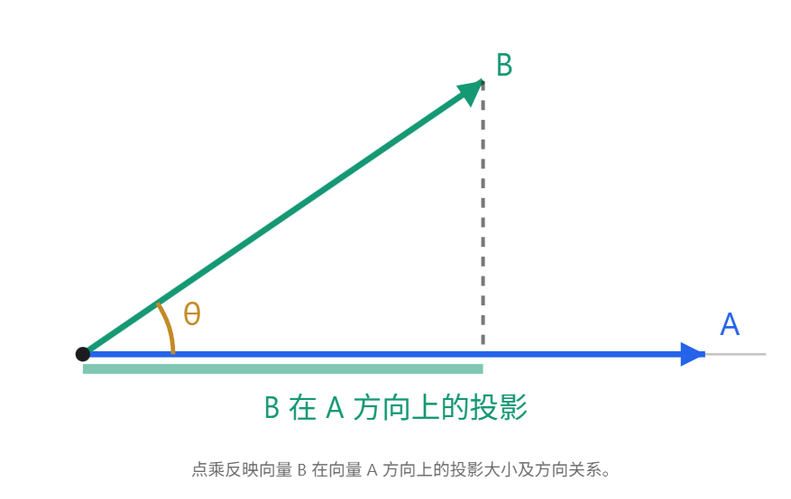
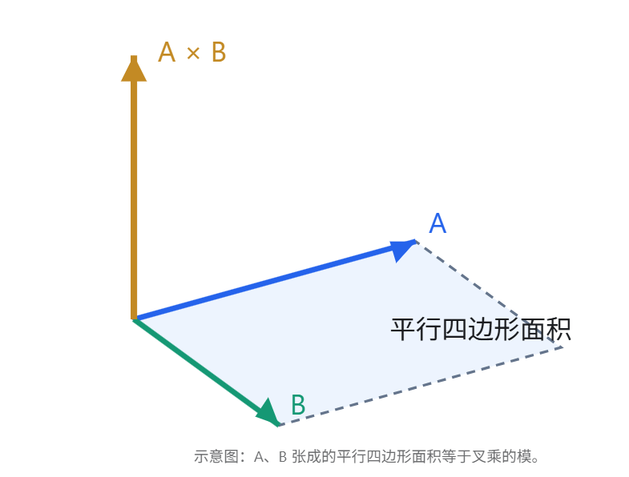

在游戏客户端开发面试中，向量点乘和叉乘是非常常见的数学知识点，尤其是在角色朝向判断、视野检测、攻击判定、旋转和碰撞计算中。

两者最核心的区别是：

- 点乘（Dot Product）：衡量两个向量在方向上有多一致，反映一个向量在另一个向量方向上的投影关系。
- 叉乘（Cross Product）：衡量两个向量的垂直程度，并得到一个垂直于两者所在平面的向量。

## 一、点乘的物理意义

### 1. 数学定义

对于两个向量 \(\vec A\) 和 \(\vec B\)：

\[ \boxed{\vec A\cdot\vec B=|\vec A||\vec B|\cos\theta} \]

其中 \(\theta\) 是两个向量之间的夹角。

**点乘的结果是一个标量，而不是向量。**

### 2. 几何意义：投影

假设 \(\vec A\) 是单位向量，那么：

\[ \vec A\cdot\vec B=|\vec B|\cos\theta \]

结果就是向量 B 在 A 方向上的**有符号投影长度。**

因此，点乘可以用来判断两个向量之间的方向关系：

| 夹角      | 点乘结果         | 几何意义     |
| --------- | ---------------- | ------------ |
| 0°        | 正数，最大       | 方向完全一致 |
| 0°～90°   | 正数             | 大致同向     |
| 90°       | 0                | 相互垂直     |
| 90°～180° | 负数             | 大致反向     |
| 180°      | 负数，绝对值最大 | 方向完全相反 |

### 3. 物理意义：力做功

物理学中的功：

\[ W=\vec F\cdot\vec s=Fs\cos\theta \]

其中：

- \(\vec F\)：作用力
- \(\vec s\)：物体的位移
- \(\theta\)：力与位移之间的夹角

只有力在位移方向上的分量会做功。

例如，向前推动箱子时，向前的力产生正功，垂直于位移方向的力不做功，反方向的力产生负功。

### 4. 游戏开发中的应用

比如之前的角色扇形视野题：

假设：

- \(F\)：角色正前方的单位方向向量
- \(D\)：角色指向敌人的单位方向向量

计算：

\[ F\cdot D=\cos\theta \]

如果结果大于等于 0.7071，说明敌人在角色正前方 ±45° 的范围内。

因此，点乘可以用来判断目标是否在前方、两向量是否垂直，以及方向夹角是否满足要求。

## 二、叉乘的物理意义

### 1. 数学定义

对于三维向量 \(\vec A\) 和 \(\vec B\)：

\[ \boxed{|\vec A\times\vec B|=|\vec A||\vec B|\sin\theta} \]

与点乘不同，**叉乘的结果是一个向量。**

其具有两个特点：

- 大小为 \(|A||B|\sin\theta\)
- 方向垂直于 A、B 所在的平面，按右手定则确定

### 2. 几何意义：面积和法线方向

两个向量构成的平行四边形面积为：

​									\[ S=|\vec A\times\vec B| \]

因此，当两个向量平行时，叉乘为零；当两个向量垂直时，叉乘的模最大。

叉乘的方向还可以用来计算一个平面的法线，例如：

​										\[ N=(B-A)\times(C-A) \]

这在图形学中的三角形法线、光照计算和背面剔除中非常重要。

### 3. 物理意义：力矩

物理学中，力矩的计算公式是：

\[ \vec\tau=\vec r\times\vec F \]

其中：

- \(\vec r\)：从转轴到受力点的位置向量
- \(\vec F\)：施加的力
- \(\vec\tau\)：力矩

力矩大小为：

\[ |\tau|=rF\sin\theta \]

这意味着，作用力越垂直于力臂，产生的旋转效果越明显。

例如推门时，沿垂直于门板的方向推动门把手，更容易让门绕铰链旋转；如果沿着门板方向推，力矩就可能很小甚至为零。

### 4. 游戏开发中的应用：判断敌人在角色左侧还是右侧

假设在 UE5 的水平面上，角色朝前方向为：

\[ F=(1,0,0) \]

敌人方向为：

\[ D=(0,1,0) \]

叉乘得到：

\[ F\times D=(0,0,1) \]

在 UE5 常用的 X 前、Y 右、Z 上坐标约定下，叉乘的 Z 分量为正，表示敌人在右侧；为负则表示敌人在左侧。

实际使用时，先计算：

\[ C=F\times D \]

判断 `C.Z` 的符号即可（针对水平面上的方向）。

注意：这个左右对应关系取决于坐标系及叉乘顺序。如果交换两个向量：

\[ A\times B=-(B\times A) \]

结果的方向就会反转。

## 三、点乘与叉乘的区别总结

| 对比     | 点乘               | 叉乘                   |
| -------- | ------------------ | ---------------------- |
| 运算公式 | \(AB\cos\theta\)   | 模为 \(AB\sin\theta\)  |
| 结果类型 | 标量               | 向量                   |
| 平行时   | 绝对值最大         | 0                      |
| 垂直时   | 0                  | 模最大                 |
| 物理意义 | 功、投影           | 力矩、旋转轴           |
| 游戏应用 | 判断夹角、前后方向 | 判断左右方向、计算法线 |

## 四、面试口头回答

> 点乘和叉乘都是向量之间的运算，但它们的几何意义不同。
>
> 点乘得到的是标量，公式是两个向量的模相乘再乘以夹角的余弦值。它主要反映两个向量在方向上的一致程度，也可以理解为投影关系。在物理学中，力做功就是典型的点乘应用。
>
> 在游戏开发中，我可以利用点乘判断敌人是否处于角色的前方，或者是否在某个视野角度内。
>
> 叉乘得到的是向量，它的模等于两个向量的模相乘再乘以夹角的正弦值，方向垂直于两个向量所在的平面。
>
> 叉乘在物理学中可以计算力矩，在游戏开发中可以用来求平面法线、判断目标在角色左侧还是右侧，以及计算旋转轴等。
>
> 所以我一般把点乘理解为判断两个方向有多一致，把叉乘理解为计算垂直方向和判断相对方位。

对于 UE5 面试，尤其建议记住：

点乘判断前后和夹角，叉乘判断左右和法线。

这两个知识点可以结合使用，比如判断敌人是否在角色前方 90° 范围内，再进一步判断敌人位于角色的左前方还是右前方。