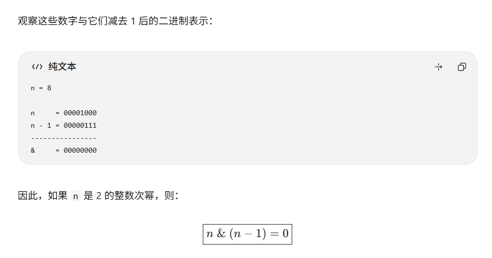

sort的底层原理,sort什么时候会选择快排

怎么快速判断一个数组是否是纯降序的

怎么快速判断一个数是不是2的x次方

有八扇门，push一个门会导致他和他相邻的两扇门的状态翻转（push8的时候是1，7，8），在某种起始状态下，想要让所有门都打开，最少需要操作多少次？


#### 八扇门

​	其实每扇门最多只会推一次，因为你如果推两次，不管你是按什么顺序来推，两次相同的操作都会被抵消。所以这道题其实是一个回溯题，step为8，每一步的选项是推或者不推。


#### 怎么快速判断一个数是不是2的x次方

​	如果一个数是2的x次方，那么他的二进制展开一定有且仅有一个1

```
1  = 00000001 = 2^0
2  = 00000010 = 2^1
4  = 00000100 = 2^2
8  = 00001000 = 2^3
16 = 00010000 = 2^4
```



比如说8是00001000，他-1等于00000111，两个与的结果一定是0，也就是说，如果一个数是2的x次方，那么这个数的二进制和他减一的二进制做与一定等于0