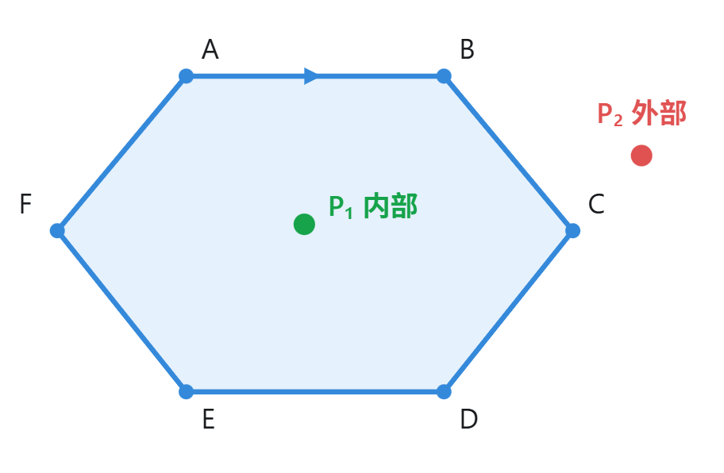

C++虚函数，类的内存分布，智能指针，左值右值

UE5的智能指针，commonui，mvvm，mass，服务器交互，大量格子的性能优化，gameplay框架，gas的关键类，从射击到命中的全流程（用gas）

前向渲染，延迟渲染

phong与blingphong的区别

怎么判断一个点是否在六边形内


有向图的判圈


为什么构造函数不能是虚函数，而析构函数最好是虚函数


lamda表达式的形式


函数的返回值一定会触发一次拷贝吗

A*寻路


------

### 移动语义带来了哪些便利？

​	减少不必要的深拷贝，提高程序运行效率。

​	在传统的拷贝语义中，如果一个对象管理着堆内存等资源，那么复制对象时通常需要重新申请内存，并复制原有数据，开销较大。而移动语义允许将一个对象持有的资源直接转移给另一个对象，而不必重新分配资源或复制数据。

**移动语义主要带来三个好处：**

1. 提高性能：避免不必要的深拷贝，降低内存分配和数据复制的开销。
2. 降低资源消耗：通过转移资源所有权，减少临时内存分配，尤其适合 `vector`、`string` 等管理动态内存的对象。
3. 支持独占资源的转移：使 `unique_ptr` 等不可复制但可以移动的类型能够在函数之间传递所有权。

移动语义主要通过右值引用、移动构造函数、移动赋值运算符实现，通常结合 `std::move` 使用。

> [!NOTE]
>
> **移动语义总是能提高性能吗？**
>
> ​	并不是，如果有两个对象，一个用ptr1控制堆内存，一个用ptr2控制堆内存，如果用深拷贝，ptr1会额外多开一块内存，而移动语义就是省下了这一块内存。
>
> ​	**但是**，如果是对象里面的**值成员**，一个int a，一个int b，你会发现，a本来就有自己的内存，就算用移动语义，这块内存也还是在，所以移动语义并没有节省任何内存

> [!NOTE]
>
> 移动语义使 `std::vector` 在扩容时能够移动元素，而不必总是拷贝元素

------

### 为什么UE5要搞一套自己的智能指针？

UE5 使用自己的智能指针，而不是完全采用 C++ 标准库智能指针，主要是为了适应游戏引擎的性能需求、内存管理机制以及自身的框架体系。

主要有以下四个原因：

1. 性能优化：UE5 对智能指针进行了针对性的设计，例如 `TSharedPtr` 可以选择线程安全或非线程安全的引用计数模式。在不需要多线程访问的场景下，可以减少原子操作的开销。
2. 适配 UObject 垃圾回收机制：UE5 的 `UObject` 使用自己的 GC 系统管理生命周期，而 C++ 的 `shared_ptr` 使用引用计数管理生命周期，两者机制不同。因此 UE5 提供了 `TObjectPtr`、`TWeakObjectPtr` 等专门管理 UObject 引用的指针类型。
3. 更丰富的指针类型：除了与标准库类似的共享指针、弱指针和独占指针，UE5 还提供了 `TSharedRef`，它保证非空，适合 Slate UI 等需要有效对象引用的场景。
4. 更好地与引擎框架集成：UE5 的智能指针能够更自然地与引擎自己的容器、Slate、对象系统等配合使用，同时保持引擎内部代码风格统一。

------

### 除了使用TObjectPtr外，还有哪些手段可以保活UObject？

UE5 主要有五种保活 UObject 的手段。

第一种是通过 `UPROPERTY` 配合 `TObjectPtr` 建立强引用，这是最常见的方式，只要持有者可达，GC 就能够追踪到被引用对象。

第二种是调用 `AddToRoot`，直接把对象加入 GC 根集合，阻止正常垃圾回收，需要手动调用 `RemoveFromRoot`。

第三种是 `TStrongObjectPtr`，它可以通过 RAII 机制自动管理 UObject 的强引用。

> [!NOTE]
>
> 即便类不是UObject类，成员UObject也可以通过TStrongObjectPtr保活

第四种是继承 `FGCObject`，主要用于普通 C++ 类，让它们也能够向 GC 报告 UObject 引用。

第五种是自定义 `AddReferencedObjects`，用于手动向 GC 收集器报告无法通过反射机制追踪的引用。

其中，实际开发中最常用的是 `UPROPERTY` 配合 `TObjectPtr`，其他方式则根据对象的持有关系和生命周期需求选择。

------

### 对于一个拥有很多格子的背包，怎么优化性能？

如果我在 UE5 中实现一个有大量物品格子的背包系统，我会主要从 UI、数据结构和资源加载三个方面优化。

首先是 UI 层面，我会优先考虑使用 TileView 的虚拟化机制，只创建当前可见区域的物品格子 Widget，并且在滚动时复用，避免一次性创建几百甚至几千个 Widget。

其次，我会采用事件驱动更新，而不是在 Tick 中不断检查物品数据。当物品数量或者状态改变时，只更新发生变化的格子，减少不必要的 UI 刷新。

然后在数据层面，我会把背包数据和 UI 分离，使用 TArray 和结构体管理物品格子，而不是为每个物品都创建一个 Actor。

资源方面，可以使用软引用和异步加载，避免打开背包时同步加载大量图标导致卡顿。

如果是多人联机游戏，还可以使用 FastArraySerializer 进行增量同步，避免每次修改物品都同步整个背包。

最后，我会通过 Unreal Insights 和 Widget Reflector 等工具实际分析瓶颈，验证优化效果。

------

### 怎么判断一个点是否在六边形内

判断一个点是否在六边形内部，需要先区分六边形是凸六边形还是凹六边形。

- 凸六边形：推荐使用叉乘法，简单高效。
- 凹六边形：推荐使用射线法，可以处理任意简单多边形。

**一、叉乘法（推荐用于凸六边形）**



六边形顶点依次为 A、B、C、D、E、F

1. **核心原理**

对于一个凸多边形，只要判断点 P 是否始终位于所有有向边的同一侧即可。

例如，按照顺时针顺序遍历六条边：

\[ AB,\ BC,\ CD,\ DE,\ EF,\ FA \]

对于每条边 AB，计算：

\[ \vec{AB}\times\vec{AP} \]

二维叉乘的公式为：

\[ cross=(B_x-A_x)(P_y-A_y)-(B_y-A_y)(P_x-A_x) \]

叉乘的符号代表：

- `cross > 0`：P 位于有向边 AB 的左侧。
- `cross < 0`：P 位于有向边 AB 的右侧。
- `cross = 0`：P 位于 AB 所在直线上。

判断条件：

如果六条边的叉乘结果全部非负，或者全部非正，那么 P 就在凸六边形内部或边界上。

如果既有正数又有负数，那么 P 在六边形外部。

**2. C++ 实现**

```c++
#include <iostream>
#include <vector>
#include <cmath>
using namespace std;

struct Point {
    double x, y;
};

double cross(Point A, Point B, Point P) {
    return (B.x - A.x) * (P.y - A.y)
         - (B.y - A.y) * (P.x - A.x);
}

// 判断点是否在凸六边形内（包含边界）
bool isInside(const vector<Point>& hex, Point P) {
    const double eps = 1e-9;

    bool positive = false;
    bool negative = false;

    for (int i = 0; i < 6; i++) {
        Point A = hex[i];
        Point B = hex[(i + 1) % 6];

        double c = cross(A, B, P);

        if (c > eps) positive = true;
        if (c < -eps) negative = true;

        if (positive && negative)
            return false;
    }

    return true;
}
```

需要注意：

1. 六个顶点必须按顺时针或逆时针顺序排列。
2. 六边形必须是凸的。
3. 上面的代码将边界上的点视为内部。

时间复杂度为 \(O(6)=O(1)\)，空间复杂度为 \(O(1)\)。

**二、射线法（适用于任意简单六边形）**

射线法的核心思路：

从待检测点 P 向右发射一条水平射线，统计这条射线与多边形边界的交点数量。

- 交点数为奇数：点在内部。
- 交点数为偶数：点在外部。
- 点恰好在边上：单独判断，通常视为内部。

该方法既适用于凸六边形，也适用于凹六边形。实现时需要特殊处理经过顶点的情况，避免重复计数。

**三、两种方法对比**

| 方法         | 适用范围       | 时间复杂度 | 特点                  |
| ------------ | -------------- | ---------- | --------------------- |
| 叉乘法       | 凸六边形       | O(6)       | 简单、高效            |
| 射线法       | 任意简单六边形 | O(6)       | 通用性强              |
| 三角形分割法 | 凸六边形       | O(6)       | 拆成4个三角形逐个判断 |

如果是在算法面试或者游戏开发中，我更推荐凸六边形使用叉乘法。

特别是在 UE5 游戏开发中，如果需要判断一个角色是否进入六边形技能范围，并且该范围是凸六边形，那么可以直接利用二维叉乘完成判断，不需要创建额外的碰撞组件。

------

### 